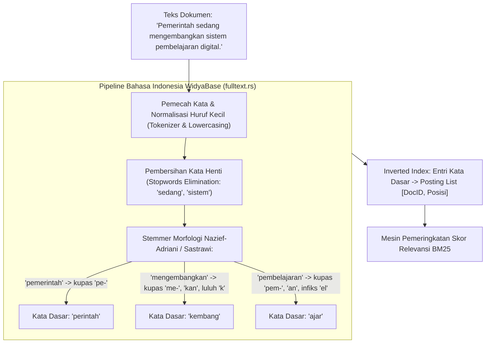

## Bab 19: Pencarian Teks Penuh & Stemmer Morfologi Bahasa Indonesia

### 19.1 Bahasa Berdaulat: Stemmer Nazief-Adriani & Algoritma Sastrawi

Pencarian teks dokumen berbahasa Indonesia memiliki tantangan linguistik yang sangat unik dan kompleks. Tidak seperti Bahasa Inggris yang memiliki infleksi sederhana (seperti akhiran `-s`, `-ed`, `-ing`), Bahasa Indonesia merupakan bahasa aglutinatif yang kaya dengan kombinasi awalan (*prefiks* seperti `me-`, `ber-`, `di-`, `pe-`, `ter-`, `ke-`), akhiran (*sufiks* seperti `-kan`, `-an`, `-i`), sisipan (*infiks* seperti `-el-`, `-em-`, `-er-`), dan konfiks gabungan (`per-an`, `ke-an`, `memper-kan`), serta fenomena peluruhan huruf konsonan dasar (*nasalisasi* k, p, t, s).

Jika mesin basis data hanya menggunakan pencarian substring sederhana (`LIKE '%ajar%'`), kueri tersebut akan menghasilkan *Full Table Scan* yang lambat dan gagal menangkap variasi bentuk kata seperti `pembelajaran`, `mengajari`, `terpelajar`, dan `diajarkan`.

WidyaBase menghadirkan **Mesin Pencarian Teks Penuh (Full-Text Search Engine)** berdaulat (`fulltext.rs`) yang dilengkapi:
1. **Stemmer Morfologi Bahasa Indonesia Native**: Mengimplementasikan algoritma linguistik formal **Nazief-Adriani & Sastrawi** dengan kamus kata dasar komprehensif, mampu mengupas lapisan imbuhan berlapis secara presisi.
2. **Indeks Terbalik (*Inverted Index*)**: Memetakan setiap kata dasar (*stemmed lexeme*) ke daftar lokasi dokumen (*posting list*) lengkap dengan frekuensi term dan posisi kata.
3. **Pemeringkatan Relevansi BM25 (*Best Matching 25*)**: Mengukur bobot relevansi dokumen berdasarkan algoritma standar industri BM25 dengan normalisasi panjang dokumen.
4. **Toleransi Salah Ketik (*Typo Tolerance*)**: Didukung algoritma metrik jarak sunting *Damerau-Levenshtein* untuk mendeteksi salah ketik satu atau dua karakter secara instan.



Aturan pengupasan imbuhan pada WidyaBase:
- Memeriksa kata dasar pada kamus terlebih dahulu sebelum mengupas imbuhan.
- Mengupas infleksional sufiks kepemilikan (`-ku`, `-mu`, `-nya`) dan partikel penegas (`-lah`, `-kah`, `-pun`).
- Mengupas derivasional sufiks (`-kan`, `-an`, `-i`).
- Mengupas derivasional prefiks dengan aturan peluruhan suara (misalnya: `menge-` + `cat` $\rightarrow$ `cat`, `meny-` + `p` / `s` $\rightarrow$ periksa bentuk kata asal).

### 19.2 Implementasi Kode Program Utuh

Berikut implementasi stemming Bahasa Indonesia, tokenisasi, dan kueri pencarian teks BM25 pada WidyaBase menggunakan Widya-Lang:

```widya
// Modul Pencarian Teks Penuh dan Stemmer Morfologi WidyaBase
modul pencarian_teks_penuh {
    impor ekosistem::widyabase::{
        WidyaBase, PengindeksTeksPenuh, StemmerIndonesia,
        PemeringkatBM25, HasilKueriTeks
    };

    fungsi demonstrasi_stemmer_dan_bm25(mesin: &mut WidyaBase) -> Hasil<Boolean, Teks> {
        cetak("==================================================================");
        cetak(">>> [FULLTEXT] Menguji Stemmer Morfologi Indonesia & Algoritma BM25...");

        // 1. Buat Tabel Arsip Regulasi Nasional
        biar sql_tabel = "
            BUAT TABEL arsip_hukum_nasional (
                id BULAT KUNCI_UTAMA_SERI,
                nomor_uu TEKS TIDAK_KOSONG,
                judul TEKS,
                isi_peraturan TEKS
            );
        ";
        mesin.eksekusi_sql(sql_tabel)?;

        // 2. Bangun Indeks Pencarian Teks Penuh Menggunakan Analisis Bahasa Indonesia
        biar sql_indeks = "
            BUAT INDEKS idx_fulltext_peraturan 
            PADA arsip_hukum_nasional 
            MENGGUNAKAN TEKS_PENUH (isi_peraturan) 
            DENGAN (
                bahasa = 'INDONESIA',
                stemmer = 'NAZIEF_ADRIANI',
                hapus_kata_henti = BENAR
            );
        ";
        mesin.eksekusi_sql(sql_indeks)?;
        cetak(">>> [FULLTEXT] Inverted Index berbahasa Indonesia berhasil dibangun.");

        // 3. Sisipkan Contoh Data Peraturan Perundang-undangan
        biar sql_sisip = "
            SISIP_KE arsip_hukum_nasional (nomor_uu, judul, isi_peraturan)
            NILAI 
            ('UU-01/2026', 'Kedaulatan Digital', 'Pemerintah menetapkan kewajiban penyelenggaraan dan pengelolaan pusat data di wilayah tanah air...'),
            ('UU-02/2026', 'Pendidikan Nasional', 'Pengembangan kurikulum komputasi dan pembelajaran kecerdasan buatan terapan di setiap jenjang sekolah...'),
            ('UU-03/2026', 'Ketahanan Pangan', 'Strategi swasembada pangan berkelanjutan melalui pemberdayaan petani dan modernisasi teknologi irigasi...');
        ";
        mesin.eksekusi_sql(sql_sisip)?;

        // 4. Uji Pencarian Berdasarkan Kata Dasar 'ajar' yang Menemukan Kata 'pembelajaran'
        biar kueri_cari = "mengajar";
        cetak(">>> [CARI] Mencari dokumen dengan kata kunci: '" + kueri_cari + "'");
        biar sql_cari = "
            PILIH nomor_uu, judul,
                  SKOR_BM25(isi_peraturan, '" + kueri_cari + "') SEBAGAI skor_relevansi
            DARI arsip_hukum_nasional
            DIMANA isi_peraturan @@ KATA_KUNCI('" + kueri_cari + "')
            URUTKAN_BERDASARKAN skor_relevansi MENURUN;
        ";

        biar hasil = mesin.kueri_sql(sql_cari)?;
        cetak(">>> [HASIL BM25] Ditemukan " + teks(hasil.jumlah_baris()) + " dokumen relevan:");
        untuk baris di hasil.baris_data() {
            cetak("  - [" + baris.ambil_teks("nomor_uu") + "] " + baris.ambil_teks("judul") + 
                  " | Skor BM25: " + teks(baris.ambil_desimal("skor_relevansi")));
        }

        cetak("==================================================================");
        kembalikan Ok(benar);
    }
}
```

### 19.3 Analisis Arsitektur, Metrik & Tabel Spesifikasi

Tabel formula dan parameter evaluasi pemeringkatan teks BM25 pada WidyaBase:

| Parameter / Formula BM25 | Nilai Baku WidyaBase | Penjelasan Makna Parameter Linguistik |
| :--- | :--- | :--- |
| **Formula Skor Dokumen $D$** | $\sum_{t \in Q} \text{IDF}(t) \cdot \frac{f(t, D) \cdot (k_1 + 1)}{f(t, D) + k_1 \cdot (1 - b + b \cdot \frac{\|D\|}{\text{avgdl}})}$ | Menghitung akumulasi bobot kata kunci kueri $Q$ |
| **Parameter Kejenuhan Frekuensi ($k_1$)**| `1.2` | Mengontrol titik batas jenuh frekuensi kemunculan term kata |
| **Parameter Normalisasi Panjang ($b$)** | `0.75` | Menghukum dokumen panjang yang hanya memuat repetisi kata |
| **Kompresi Inverted Index** | VByte / Elias-Fano | Mengompresi daftar posting selisih DocID (*Delta Encoding*) |
| **Ambang Jarak Salah Ketik** | Damerau-Levenshtein $\le 2$ | Menoleransi salah ketik penukaran huruf bertetangga |

### 19.4 Latihan Soal Esai

1. Mengapa algoritma stemming konvensional Bahasa Inggris (seperti Porter Stemmer) sama sekali tidak cocok dan tidak dapat digunakan untuk memproses korpus teks Bahasa Indonesia?
2. Terangkan alur tahapan pengupasan imbuhan pada algoritma Nazief-Adriani yang diimplementasikan pada modul `fulltext.rs` WidyaBase!
3. Bagaimana formula pemeringkatan BM25 mencegah dokumen berukuran sangat panjang mendominasi peringkat teratas secara tidak adil hanya karena frekuensi kemunculan kata yang tinggi?

### 19.5 Soal Pilihan Ganda

1. Algoritma komputasi linguistik terkemuka yang digunakan WidyaBase untuk mengupas imbuhan kata Bahasa Indonesia ke bentuk kata dasarnya adalah...
   A. Algoritma Nazief-Adriani & Sastrawi
   B. Porter Stemmer
   C. Snowball English
   D. Byte Pair Encoding

2. Struktur data utama yang digunakan dalam mesin pencarian teks penuh untuk memetakan setiap kata ke daftar dokumen yang memuatnya dinamakan...
   A. Inverted Index (Indeks Terbalik)
   B. B+Tree Indeks Primer
   C. Hash Ring
   D. Buffer Frame

3. Kata-kata umum yang memiliki frekuensi kemunculan sangat tinggi namun tidak memiliki makna pembeda spesifik (seperti 'dan', 'di', 'dari', 'yang') disebut...
   A. Stopwords (Kata Henti)
   B. Keywords
   C. Stem Words
   D. Foreign Keys

4. Parameter $b$ pada algoritma pemeringkatan BM25 berfungsi untuk...
   A. Mengontrol tingkat penalti normalisasi panjang dokumen terhadap dokumen yang terlalu panjang
   B. Mengatur jumlah thread CPU
   C. Menentukan ukuran font tulisan
   D. Menghapus dokumen kedaluwarsa

5. Kata dasar yang dihasilkan oleh Indonesian Stemmer WidyaBase untuk kata masukan 'pembelajaran' adalah...
   A. 'ajar'
   B. 'belajar'
   C. 'pelajar'
   D. 'pembelajar'

6. Operator SQL pada WidyaBase yang digunakan untuk mengevaluasi kueri pencarian teks penuh terhadap indeks terbalik adalah...
   A. `@@` (atau klausa `COCOK_TEKS`)
   B. `LIKE`
   C. `=`
   D. `<>`

7. Algoritma pengukuran jarak sunting karakter yang menoleransi kesalahan ketik penyisipan, penghapusan, penggantian, dan transposisi dua huruf bersebelahan dinamakan...
   A. Jarak Damerau-Levenshtein
   B. Jarak Euclidean
   C. Jarak Cosine
   D. Jarak Manhattan

8. Teknik kompresi yang menyimpan selisih nomor dokumen ($\Delta DocID$) alih-alih nomor dokumen absolut untuk menghemat memori pada posting list disebut...
   A. Delta Encoding
   B. Huffman Tree
   C. LZW Compression
   D. Gzip Chunking

9. Mengapa pencarian teks menggunakan klausa `LIKE '%kata%'` sangat tidak dianjurkan untuk tabel teks berskala jutaan baris?
   A. Karena memicu pemindaian tabel penuh (*Full Table Scan*) tanpa bisa memanfaatkan indeks B+Tree standar
   B. Karena klausa LIKE merusak memori RAM
   C. Karena LIKE hanya mendukung angka
   D. Karena LIKE membutuhkan izin root

10. Apa keuntungan integrasi kamus kata dasar (*root dictionary*) resmi di dalam modul `fulltext.rs` WidyaBase?
    A. Mencegah pemotongan imbuhan yang keliru pada kata yang sudah merupakan kata dasar asli (misalnya kata 'pasar' tidak dipotong menjadi 'sar')
    B. Menghapus kebutuhan koneksi internet
    C. Mengurangi konsumsi listrik monitor
    D. Mempercepat kompilasi kernel
