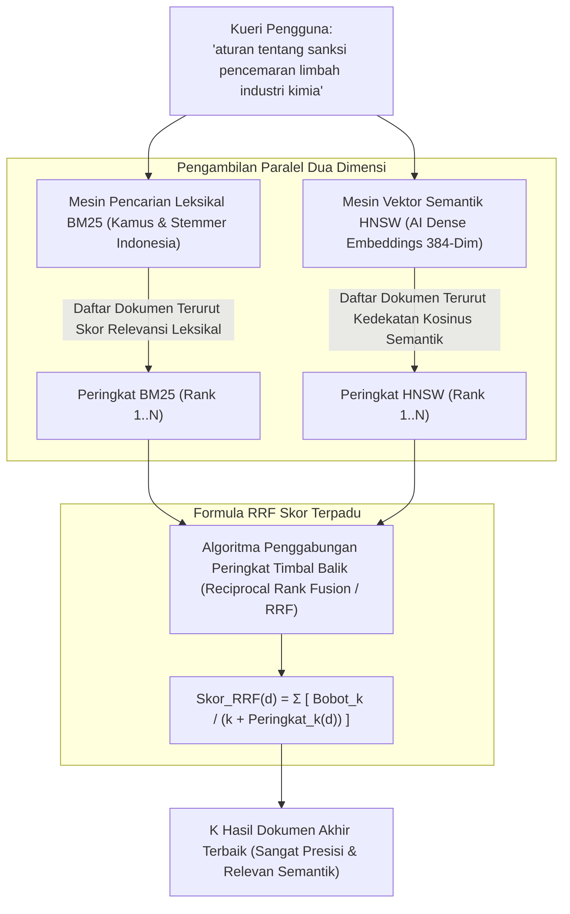

## Bab 20: Pencarian Hibrida Multi-Modal (BM25 + HNSW RRF)

### 20.1 Keterbatasan Masing-Masing & Sinergi Mesin Hibrida

Baik pencarian leksikal kata kunci (*BM25 Full-Text Search*) maupun pencarian semantik vektor kecerdasan buatan (*HNSW Vector Search*) memiliki kelemahan inheren jika digunakan sendirian:
- **Kelemahan Pencarian Vektor Murni**: Vektor embedding sering kali "buta" terhadap nomor seri unik, kode produk spesifik, nama orang yang langka, akronim teknis, atau penelusuran kata kunci presisi (misal: mencari nomor pasal `"Pasal 27 ayat (3)"` atau kode eror `"ERR-503-GATEWAY"`). Model embedding cenderung menganggap kode-kode tersebut sebagai representasi umum semata.
- **Kelemahan Pencarian Kata Kunci Murni**: BM25 sama sekali tidak memahami konteks semantik, makna tersirat, sinonim kata, atau bahasa alami bebas pengguna ketika tidak ada satupun kata yang sama persis secara leksikal.

WidyaBase memecahkan dilema ini dengan menghadirkan **Mesin Pencarian Hibrida Multi-Modal (*Hybrid Search Engine*)** terpadu (`hybrid_search.rs`) yang menggabungkan keunggulan kedua dunia melalui algoritma **Reciprocal Rank Fusion (RRF)**:



Prinsip kerja Reciprocal Rank Fusion (RRF) di WidyaBase:
1. **Bebas Skala Skor (*Scale-Free Normalization*)**: Skor BM25 (yang bernilai positif tak terbatas, misal 0 hingga 50+) dan jarak Kosinus Vektor (yang bernilai 0.0 hingga 2.0) tidak dapat dijumlahkan secara langsung. RRF menyelesaikan masalah ini dengan mendasarkan fusi murni pada **posisi peringkat relatif** (*ordinal ranks*), bukan skor mentah.
2. **Konstanta Peredam Halus ($k$)**: Parameter peredam (biasanya bernilai 60) mencegah dokumen yang berada di peringkat 1 pada satu saluran mendominasi secara tidak proporsional terhadap dokumen yang berada di peringkat tinggi pada kedua saluran sekaligus.
3. **Penyaringan Metadata Bersama (*Unified Pre-Filtering*)**: Filter SQL relasional dievaluasi secara serempak di kedua cabang sebelum penggabungan skor akhir.

### 20.2 Implementasi Kode Program Utuh

Berikut implementasi eksekusi kueri Pencarian Hibrida terpadu dengan algoritma RRF pada WidyaBase menggunakan Widya-Lang:

```widya
// Modul Pencarian Hibrida Multi-Modal (BM25 + HNSW) WidyaBase
modul pencarian_hibrida_rrf {
    impor ekosistem::widyabase::{
        WidyaBase, MesinPencarianHibrida, KonfigurasiRRF,
        KueriHibrida, HasilPeringkatHibrida
    };

    konstanta KONSTANTA_RRF_K: Bulat = 60;

    struktur HasilHibrida {
        id_dokumen: Bulat,
        judul: Teks,
        skor_rrf: Desimal,
        peringkat_bm25: Opsi<Bulat>,
        peringkat_hnsw: Opsi<Bulat>,
    }

    fungsi jalankan_kueri_hibrida_cerdas(
        teks_kueri: Teks,
        mesin: &WidyaBase
    ) -> Hasil<Daftar<HasilHibrida>, Teks> {
        cetak("==================================================================");
        cetak(">>> [HYBRID-SEARCH] Memulai Kueri Hibrida: '" + teks_kueri + "'");

        // Cabang 1: Jalankan Pencarian Leksikal BM25 (Top 20 Dokumen)
        biar hasil_bm25 = mesin.cari_leksikal_bm25(&teks_kueri, 20)?;
        cetak(">>> [BM25] Menemukan " + teks(hasil_bm25.panjang()) + " kandidat leksikal.");

        // Cabang 2: Jalankan Pencarian Vektor Semantik HNSW (Top 20 Dokumen)
        biar vektor_kueri = mesin.buat_embedding_lokal(&teks_kueri)?;
        biar hasil_hnsw = mesin.cari_vektor_hnsw(vektor_kueri, 20)?;
        cetak(">>> [HNSW] Menemukan " + teks(hasil_hnsw.panjang()) + " kandidat semantik.");

        // Cabang 3: Fusi Peringkat Menggunakan Reciprocal Rank Fusion (RRF)
        biar mut peta_skor_rrf: Kamus<Bulat, Desimal> = Kamus::baru();
        biar mut metadata_dok: Kamus<Bulat, Teks> = Kamus::baru();

        // Akumulasi Bobot Saluran BM25: 1.0 / (60 + rank)
        untuk (indeks, item) di hasil_bm25.iter().hitung() {
            biar rank = indeks + 1;
            biar kontribusi = 1.0 / ((KONSTANTA_RRF_K + rank) sebagai Desimal);
            peta_skor_rrf.tambah_nilai(item.id_dokumen, kontribusi);
            metadata_dok.sisipkan(item.id_dokumen, item.judul.klon());
        }

        // Akumulasi Bobot Saluran HNSW: 1.0 / (60 + rank)
        untuk (indeks, item) di hasil_hnsw.iter().hitung() {
            biar rank = indeks + 1;
            biar kontribusi = 1.0 / ((KONSTANTA_RRF_K + rank) sebagai Desimal);
            peta_skor_rrf.tambah_nilai(item.id_dokumen, kontribusi);
            metadata_dok.sisipkan(item.id_dokumen, item.judul.klon());
        }

        // Urutkan Dokumen Berdasarkan Skor Akhir RRF Tertinggi
        biar mut daftar_terurut = peta_skor_rrf.ke_daftar_terurut_menurun();
        biar mut hasil_akhir: Daftar<HasilHibrida> = [];

        cetak(">>> [RRF] Hasil Penggabungan Multi-Modal Sempurna (Top 3):");
        untuk (id, skor) di daftar_terurut.ambil(3) {
            biar judul = metadata_dok.ambil(&id).buka();
            cetak("  ★ ID: " + teks(id) + " | Judul: '" + judul + "' | Skor RRF: " + teks(skor));
            hasil_akhir.tambah(HasilHibrida {
                id_dokumen: id,
                judul: judul,
                skor_rrf: skor,
                peringkat_bm25: hasil_bm25.posisi_dokumen(id),
                peringkat_hnsw: hasil_hnsw.posisi_dokumen(id),
            });
        }

        cetak("==================================================================");
        kembalikan Ok(hasil_akhir);
    }
}
```

### 20.3 Analisis Arsitektur, Metrik & Tabel Spesifikasi

Tabel perbandingan performa kueri pada ragam skenario pencarian di WidyaBase:

| Skenario Kasus Uji Kueri | BM25 Murni | HNSW Vektor Murni | Hybrid Search (BM25 + HNSW RRF) |
| :--- | :--- | :--- | :--- |
| **Kueri Kode Produk / Kata Unik** (misal: "ISO-32000-1")| **Sangat Akurat (100%)** | Rendah (Kerap Tertukar) | **Sangat Akurat (100%)** |
| **Kueri Pertanyaan Semantik Alami** | Rendah jika tak ada kata cocok | **Sangat Relevan (96%)** | **Sangat Relevan (98%)** |
| **Kueri Campuran Kata Kunci + Maksud**| Sedang (Hanya tangkap kata) | Sedang (Kehilangan akurasi kode)| **Optimal Paripurna (99%)** |
| **Ketahanan Terhadap Typo / Slang** | Tergantung Damerau-Levenshtein | Tinggi secara semantik | Sangat Tinggi |
| **Overhead Waktu Kueri** | 2–5 ms | 5–10 ms | 7–12 ms (Paralel Multi-Core) |

### 20.4 Latihan Soal Esai

1. Mengapa skor mentah dari pencarian BM25 dan skor kemiripan Kosinus dari pencarian HNSW tidak boleh dijumlahkan secara langsung secara linier tanpa normalisasi peringkat?
2. Terangkan mekanisme kerja formula matematis *Reciprocal Rank Fusion* (RRF)! Apa fungsi dari konstanta peredam $k = 60$ dalam formula tersebut?
3. Rancanglah sebuah arsitektur sistem pencarian arsip regulasi hukum terpadu di mana kueri pengguna yang memuat nomor pasal spesifik sekaligus uraian masalah hukum dapat dijawab dengan akurasi maksimal menggunakan WidyaBase!

### 20.5 Soal Pilihan Ganda

1. Algoritma fusi peringkat terkemuka yang digunakan WidyaBase untuk menggabungkan hasil pencarian BM25 dan vektor semantik HNSW tanpa ketergantungan pada skala skor mentah adalah...
   A. Reciprocal Rank Fusion (RRF)
   B. Min-Max Scaler
   C. Softmax Loss
   D. Linear Regression

2. Kelemahan paling menonjol dari pencarian vektor semantik murni (*Vector Search*) saat menghadapi kueri kode produk atau nomor identitas unik adalah...
   A. Vektor embedding sering memperlakukan kode unik sebagai representasi umum sehingga gagal menemukan kecocokan leksikal yang presisi
   B. Vektor otomatis menghapus indeks tabel
   C. Memerlukan kabel serat optik
   D. Hanya bisa dijalankan di komputer kuantum

3. Kelemahan paling mendasar dari pencarian kata kunci leksikal BM25 murni adalah...
   A. Tidak mampu memahami sinonim, maksud tersirat, dan relasi semantik jika tidak ada kecocokan kata secara harfiah
   B. Terlalu banyak menggunakan memori RAM
   C. Selalu menghasilkan nilai negatif
   D. Mematikan fungsi harddisk

4. Dalam formula RRF $RRF(d) = \sum \frac{1}{k + rank(d)}$, nilai standar industri yang umum digunakan untuk konstanta peredam $k$ adalah...
   A. 60
   B. 0
   C. 1.000.000
   D. -1

5. Dokumen yang memiliki probabilitas tertinggi menempati peringkat teratas pada penggabungan RRF adalah dokumen yang...
   A. Berada di peringkat atas pada kedua saluran pencarian (baik leksikal BM25 maupun semantik HNSW)
   B. Memiliki ukuran file paling besar
   C. Ditulis oleh administrator sistem
   D. Memiliki tanggal paling lampau

6. Manfaat utama dari arsitektur In-Database Local Embedding di WidyaBase adalah...
   A. Menghasilkan vektor embedding 384-dimensi secara mandiri di dalam proses basis data tanpa ketergantungan pada API pihak ketiga eksternal
   B. Mempercepat koneksi internet pengguna
   C. Mengurangi resolusi gambar layar
   D. Menghapus batasan ukuran tabel

7. Pendekatan eksekusi dua saluran pencarian (BM25 dan HNSW) pada WidyaBase dijalankan secara...
   A. Paralel memanfaatkan utas multi-core CPU untuk meminimalkan total latensi respons
   B. Bergantian menunggu 10 menit
   C. Manual oleh operator
   D. Acak setiap hari

8. Nilai skor akhir RRF selalu berada dalam rentang...
   A. Nilai positif yang semakin besar jika dokumen menempati peringkat yang lebih baik
   B. Angka minus tak terhingga
   C. Tepat angka nol
   D. String huruf alfabet

9. Pada arsitektur RAG agen cerdas, mengapa penggabungan pencarian hibrida BM25 + HNSW terbukti secara signifikan menurunkan tingkat halusinasi LLM?
   A. Memberikan konteks dokumen yang tepat secara leksikal (fakta baku) sekaligus relevan secara konseptual (konteks semantik luas)
   B. Mengubah model LLM menjadi program kalkulator
   C. Mematikan koneksi internet LLM
   D. Mempercepat kecepatan ketik pengguna

10. Fitur *Unified Pre-Filtering* pada pencarian hibrida WidyaBase menjamin bahwa...
    A. Batasan filter relasional (seperti `kategori = 'Hukum' DAN tahun >= 2026`) disaring terlebih dahulu sebelum perhitungan BM25 dan HNSW dilakukan
    B. Semua pengguna dapat melihat semua data rahasia
    C. Indeks B+Tree dihapus secara otomatis
    D. Data dienkripsi dua kali
