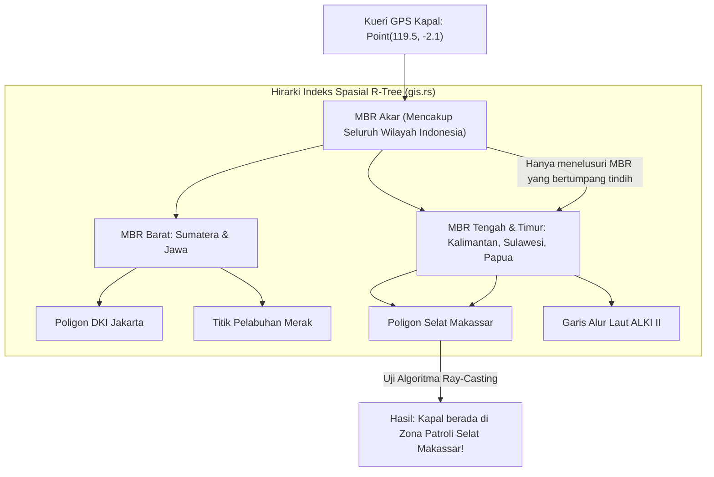

## Bab 22: Basis Data Spasial GIS & Indeks R-Tree Nusantara

### 22.1 Geometri Spasial & Komputasi Wilayah Kepulauan

Republik Indonesia merupakan negara kepulauan (*archipelagic state*) terbesar di dunia yang membentang lebih dari 5.000 kilometer melintasi garis khatulistiwa dengan belasan ribu pulau, perairan teritorial yang luas, serta zona ekonomi eksklusif (ZEE). Mengelola data geospasial—seperti koordinat kapal patroli maritim, batas konsesi lahan kehutanan, jalur pipa gas bumi bawah laut, dan zonasi tata ruang perkotaan—memerlukan kemampuan basis data spasial berkecepatan tinggi.

WidyaBase menyediakan **Mesin Geospasial Spasial (*Spatial GIS Engine*)** native (`gis.rs`):
- **Tipe Data Geometri Standar OGC**: Mendukung `TITIK` (*Point2D*), `GARIS` (*LineString2D*), dan `POLIGON` (*Polygon2D*) lengkap dengan dukungan format standar pertukaran GeoJSON dan WKT (*Well-Known Text*).
- **Indeks Spasial R-Tree $O(\log N)$**: Mengelompokkan objek-objek geometri spasial ke dalam kotak pembatas minimum (*Minimum Bounding Box* / MBR) secara hierarkis, memungkinkan pencarian wilayah (*Bounding Box Intersect*) dan kueri tetangga terdekat radius ($k$-NN) berjalan dalam fraksi milidetik.
- **Kalkulasi Geodesik Bumi Lengkung (WGS84 Ellipsoid)**: Menyediakan fungsi jarak geodesik presisi tinggi berbasis rumus **Haversine** dan Vincenty, memperhitungkan kelengkungan permukaan bumi secara akurat.
- **Uji Ketercakupan Wilayah (*Ray-Casting Point-in-Polygon*)**: Menentukan secara matematis apakah koordinat GPS sebuah kapal atau armada berada di dalam batas poligon wilayah teritorial laut tertentu.



Fungsi spasial dwibahasa di WidyaBase:
- `JARAK_HAVERSINE(p1, p2)` : Mengukur jarak lengkung bumi dua koordinat dalam satuan meter/kilometer.
- `TITIK_DALAM_POLIGON(titik, poligon)` : Evaluasi topologis apakah titik berada di dalam batas area poligon.
- `TUMPANG_TINDIH(geom1, geom2)` : Memeriksa persinggungan dua geometri spasial.
- `RADIUS_TERDEKAT(titik_pusat, radius_km)` : Mengambil seluruh entitas di dalam radius lingkar tertentu.

### 22.2 Implementasi Kode Program Utuh

Berikut implementasi penyimpanan koordinat armada kapal, pembangunan indeks spasial R-Tree, dan uji titik dalam poligon wilayah laut pada WidyaBase menggunakan Widya-Lang:

```widya
// Modul Basis Data Spasial GIS dan Indeks R-Tree WidyaBase
modul mesin_spasial_gis {
    impor ekosistem::widyabase::{
        WidyaBase, Titik2D, Poligon2D, IndeksRTree,
        HasilSpasial, GeodesikNusantara
    };

    fungsi jalankan_pemantauan_maritim(mesin: &mut WidyaBase) -> Hasil<Boolean, Teks> {
        cetak("==================================================================");
        cetak(">>> [GIS] Memulai Demonstrasi Sistem Pemantauan Wilayah Maritim...");

        // 1. Buat Tabel Pemantauan Kapal Laut Nasional
        biar sql_tabel = "
            BUAT TABEL armada_kapal_patroli (
                id BULAT KUNCI_UTAMA_SERI,
                nama_kapal TEKS TIDAK_KOSONG,
                jenis TEKS,
                posisi_gps TITIK_SPASIAL,
                kecepatan_knot DESIMAL
            );
        ";
        mesin.eksekusi_sql(sql_tabel)?;

        // 2. Bangun Indeks Spasial R-Tree pada Kolom Posisi GPS
        biar sql_indeks = "
            BUAT INDEKS idx_armada_rtree 
            PADA armada_kapal_patroli 
            MENGGUNAKAN RTREE (posisi_gps);
        ";
        mesin.eksekusi_sql(sql_indeks)?;
        cetak(">>> [RTREE] Indeks spasial R-Tree 2D berhasil diaktifkan.");

        // 3. Sisipkan Data Koordinat GPS Kapal Patroli (Bujur/X, Lintang/Y)
        biar sql_sisip = "
            SISIP_KE armada_kapal_patroli (nama_kapal, jenis, posisi_gps, kecepatan_knot)
            NILAI 
            ('KRI Golok 688', 'Kapal Cepat Rudal', TITIK(106.88, -5.98), 28.5), // Teluk Jakarta
            ('KRI I Gusti Ngurah Rai 332', 'Fregat', TITIK(119.45, -5.12), 18.0), // Selat Makassar
            ('KRI Alugoro 405', 'Kapal Selam', TITIK(131.25, -0.85), 12.0); // Perairan Papua Barat
        ";
        mesin.eksekusi_sql(sql_sisip)?;
        cetak(">>> [GIS] Koordinat posisi kapal berhasil disisipkan.");

        // 4. Hitung Jarak Geodesik Lengkung Bumi Menggunakan Formula Haversine
        biar jakarta = Titik2D::buat(106.88, -5.98);
        biar makassar = Titik2D::buat(119.45, -5.12);
        biar jarak_km = GeodesikNusantara::jarak_haversine_km(&jakarta, &makassar);
        cetak(">>> [HAVERSINE] Jarak geodesik Jakarta - Makassar: " + teks(jarak_km) + " KM");

        // 5. Uji Ray-Casting: Apakah Kapal Berada di Dalam Poligon Zona Konservasi Laut?
        biar sql_poligon = "
            PILIH nama_kapal, kecepatan_knot
            DARI armada_kapal_patroli
            DIMANA TITIK_DALAM_POLIGON(
                posisi_gps,
                POLIGON((
                    TITIK(106.0, -6.5), 
                    TITIK(108.0, -6.5), 
                    TITIK(108.0, -5.5), 
                    TITIK(106.0, -5.5), 
                    TITIK(106.0, -6.5)
                ))
            );
        ";

        cetak(">>> [RAY-CASTING] Memeriksa kapal di wilayah patroli Jawa Barat...");
        biar hasil = mesin.kueri_sql(sql_poligon)?;
        cetak(">>> [HASIL DETEKSI] Ditemukan " + teks(hasil.jumlah_baris()) + " kapal di zona:");
        untuk baris di hasil.baris_data() {
            cetak("  - " + baris.ambil_teks("nama_kapal") + " (Kecepatan: " + teks(baris.ambil_desimal("kecepatan_knot")) + " Knot)");
        }

        cetak("==================================================================");
        kembalikan Ok(benar);
    }
}
```

### 22.3 Analisis Arsitektur, Metrik & Tabel Spesifikasi

Tabel perbandingan struktur pengindeksan spasial dan metode kalkulasi geodesik pada WidyaBase:

| Komponen Spasial | Karakteristik Komputasi | Kompleksitas | Keunggulan & Keterbatasan |
| :--- | :--- | :--- | :--- |
| **Indeks R-Tree** | Hierarki Minimum Bounding Box (MBR) | $O(\log N)$ | Sangat cepat untuk kueri jendela (*Window Query*) & $k$-NN |
| **Indeks QuadTree** | Pembagian kuadran 4 arah sama besar | $O(\log_4 N)$ | Sederhana namun rawan timpang jika data terkonsentrasi |
| **Formula Haversine** | Trigonometri lengkung bola bumi rata-rata | $O(1)$ | Sangat cepat dengan akurasi 99.5% untuk navigasi |
| **Formula Vincenty** | Model elipsoid bumi WGS84 presisi milimeter | $O(1)$ Iteratif | Sangat akurat untuk batas patok tanah kadaster |
| **Ray-Casting Algorithm** | Melontarkan sinar horizontal dari titik | $O(P)$ simpul | Menentukan titik di dalam poligon bentuk sembarang |

### 22.4 Latihan Soal Esai

1. Mengapa indeks B+Tree satu dimensi standar tidak dapat digunakan secara efisien untuk mengindeks data koordinat spasial 2 dimensi (Lintang dan Bujur)?
2. Terangkan prinsip kerja struktur data *R-Tree* dalam mengelompokkan objek spasial menggunakan kotak pembatas minimum (*Minimum Bounding Box* / MBR)!
3. Jelaskan cara kerja algoritma *Ray-Casting* dalam menentukan apakah sebuah titik koordinat berada di dalam atau di luar suatu poligon batas wilayah!

### 22.5 Soal Pilihan Ganda

1. Struktur data indeks spasial hierarkis yang digunakan WidyaBase untuk mengindeks data koordinat geometri 2D adalah...
   A. R-Tree
   B. Red-Black Tree
   C. Binary Heap
   D. B+Tree 1D

2. Konsep pembungkus geometri terkecil sejajar sumbu yang memuat suatu objek spasial pada indeks R-Tree dinamakan...
   A. Minimum Bounding Box (MBR)
   B. Circle Radius
   C. Convex Hull
   D. Voronoi Cell

3. Rumus trigonometri bola yang digunakan untuk menghitung jarak lingkaran besar antara dua titik koordinat pada permukaan bumi lengkung adalah...
   A. Formula Haversine
   B. Teorema Pythagoras Datar
   C. Transformasi Fourier
   D. Hukum Ohm

4. Standar internasional format data teks terbuka yang digunakan untuk merepresentasikan objek geometri seperti `POINT(x y)` atau `POLYGON(...)` adalah...
   A. Well-Known Text (WKT)
   B. ASCII Art
   C. HTML5
   D. Base64 Image

5. Algoritma komputasi geometri yang digunakan untuk menguji apakah suatu koordinat titik berada di dalam area poligon tertutup dinamakan...
   A. Algoritma Ray-Casting (Crossing Number)
   B. Algoritma Bellman-Ford
   C. Algoritma Prim
   D. Algoritma K-Means

6. Model elipsoid acuan geodesik global standar yang digunakan pada sistem koordinat GPS modern adalah...
   A. WGS84 (World Geodetic System 1984)
   B. UTM Zone 1
   C. Flat Earth Plane
   D. Mercator 1569

7. Tipe data spasial standar yang merepresentasikan rangkaian garis terhubung (seperti jalan raya atau alur pelayaran sungai) adalah...
   A. LineString
   B. Point
   C. Circle
   D. Blob

8. Operasi kueri spasial yang mencari sejumlah $k$ fasilitas terdekat dari suatu lokasi pengguna dinamakan kueri...
   A. $k$-Nearest Neighbors ($k$-NN Spatial)
   B. Range Sum
   C. Inverse Matrix
   D. Full Scan

9. Format representasi spasial berbasis JSON yang sangat populer dalam aplikasi web pemetaan modern dan didukung penuh oleh WidyaBase adalah...
   A. GeoJSON
   B. XML Spasial
   C. YAML Geometri
   D. SVG Polygon

10. Mengapa pemanfaatan indeks spasial R-Tree sangat penting bagi sistem pertahanan maritim dalam memantau ribuan kapal di perairan Indonesia secara real-time?
    A. Memungkinkan penyaringan instan terhadap kapal yang memasuki zona terlarang dalam hitungan milidetik tanpa memindai seluruh data kapal
    B. Menjadikan kapal bergerak lebih cepat
    C. Mengisi bahan bakar kapal otomatis
    D. Mengubah sinyal radio menjadi teks
