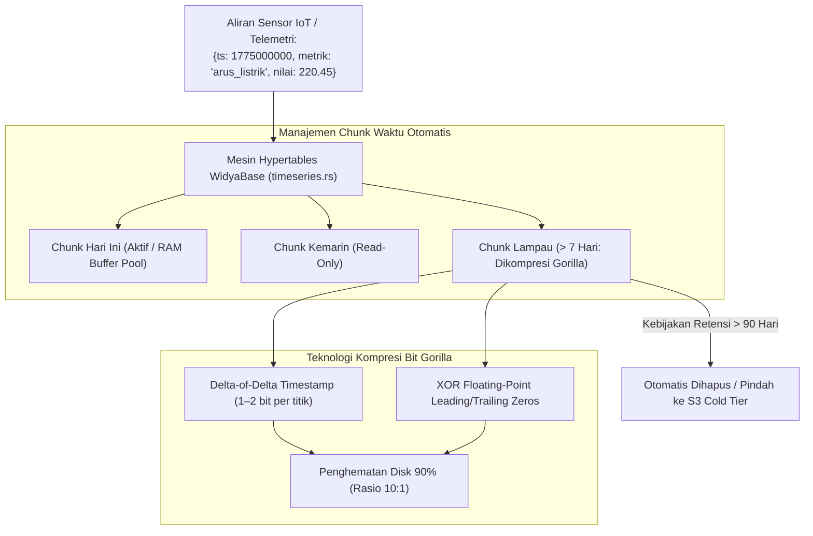

## Bab 23: Mesin Deret Waktu & Kompresi Gorilla

### 23.1 Ledakan Data Telemetri: Tantangan Volume & Retensi

Perangkat Internet of Things (IoT), stasiun pemantau cuaca maritim BMKG, telemetri turbin pembangkit listrik tenaga air/surya, server log pemantauan jaringan telekomunikasi, dan tick pasar modal bursa saham menghasilkan miliaran titik data deret waktu (*time-series data*) setiap harinya. Ciri khas data time-series:
- **Aliran Data Append-Only Monoton**: Data disisipkan terus-menerus mengikuti stempel waktu (*timestamp*) yang selalu maju ke depan, hampir tanpa adanya modifikasi data lampau (*no random updates*).
- **Pola Akses Berbasis Waktu**: Kueri hampir selalu menyaring rentang waktu tertentu (misalnya: data 1 jam terakhir, agregasi mingguan, atau tren bulanan).
- **Kebutuhan Kompresi Ekstrem**: Menyimpan data telemetri mentah tanpa kompresi akan menghabiskan ruang penyimpanan piringan disk puluhan terabyte dalam hitungan minggu.

Untuk menjawab kebutuhan ini, WidyaBase menghadirkan **Mesin Deret Waktu Terpadu (*Time-Series Hypertable Engine*)** native (`timeseries.rs`):
- **Tabel Hiper Terpartisi Otomatis (*Hypertables*)**: Secara transparan membagi data besar menjadi potongan-potongan partisi waktu berkala (*time chunks*, misal 1 hari atau 1 minggu per chunk) di balik satu nama tabel tunggal.
- **Kompresi Gorilla Bit-Level**: Menerapkan algoritma kompresi mutakhir pelopor industri (dikembangkan oleh tim engineering Facebook Gorilla):
  - *Delta-of-Delta Encoding*: Untuk stempel waktu stempel 64-bit yang berinterval reguler, menghasilkan kompresi hampir sempurna (1 bit per timestamp).
  - *XOR Floating-Point Encoding*: Untuk nilai metrik numerik desimal (*IEEE 754 float*), memanfaatkan redundansi pola bit signifikan untuk memangkas ukuran hingga 90%+.
- **Agregasi Kontinu & Penurunan Frekuensi (*Continuous Aggregates & Downsampling*)**: Menghitung secara otomatis ringkasan OHLCV (*Open, High, Low, Close, Volume*), nilai rata-rata, dan kuantil ke dalam tabel agregat material.
- **Kebijakan Retensi Usia (*Data Retention Lifecycle*)**: Secara otomatis menghapus atau memindahkan chunk data yang berusia lebih dari $N$ hari ke penyimpanan dingin hemat biaya.



### 23.2 Implementasi Kode Program Utuh

Berikut implementasi pembuatan Hypertable deret waktu, penyisipan telemetri sensor pembangkit listrik, dan kueri agregasi ember waktu (*time bucket*) pada WidyaBase menggunakan Widya-Lang:

```widya
// Modul Mesin Deret Waktu (Time-Series) dan Kompresi Gorilla WidyaBase
modul mesin_deret_waktu {
    impor ekosistem::widyabase::{
        WidyaBase, Hypertable, RekamanDeretWaktu,
        KompresiGorilla, HasilEmberWaktu, BarisOHLCV
    };

    fungsi jalankan_telemetri_pembangkit(mesin: &mut WidyaBase) -> Hasil<Boolean, Teks> {
        cetak("==================================================================");
        cetak(">>> [TIMESERIES] Mengonfigurasi Hypertable Telemetri PLTA Nasional...");

        // 1. Buat Tabel Data Deret Waktu Standar
        biar sql_tabel = "
            BUAT TABEL telemetri_sensor_plta (
                waktu CAP_WAKTU TIDAK_KOSONG,
                id_sensor TEKS TIDAK_KOSONG,
                tegangan_volt DESIMAL,
                arus_ampere DESIMAL,
                suhu_celsius DESIMAL
            );
        ";
        mesin.eksekusi_sql(sql_tabel)?;

        // 2. Transformasikan Tabel Biasa Menjadi Hypertable dengan Interval 1 Hari
        biar sql_hypertable = "
            BUAT HYPERTABLE telemetri_sensor_plta 
            BERDASARKAN (waktu) 
            DENGAN (interval_chunk = '1 HARI');
        ";
        mesin.eksekusi_sql(sql_hypertable)?;
        cetak(">>> [HYPERTABLE] Tabel berhasil dikonversi menjadi Hypertable terpartisi otomatis.");

        // 3. Konfigurasikan Kebijakan Kompresi Gorilla untuk Chunk yang Berusia Lebih dari 3 Hari
        biar sql_kompresi = "
            ATUR KEBIJAKAN_KOMPRESI PADA telemetri_sensor_plta
            SETELAH '3 HARI'
            MENGGUNAKAN (METODE = 'GORILLA_XOR');
        ";
        mesin.eksekusi_sql(sql_kompresi)?;
        cetak(">>> [GORILLA] Kebijakan kompresi bit Gorilla aktif.");

        // 4. Sisipkan Aliran Titik Data Telemetri Terjadwal
        biar sql_sisip = "
            SISIP_KE telemetri_sensor_plta (waktu, id_sensor, tegangan_volt, arus_ampere, suhu_celsius)
            NILAI 
            (SEKARANG(), 'TURBIN-01', 220.5, 45.2, 58.4),
            (SEKARANG() + INTERVAL '1 DETIK', 'TURBIN-01', 220.4, 45.6, 58.5),
            (SEKARANG() + INTERVAL '2 DETIK', 'TURBIN-01', 220.8, 45.1, 58.3);
        ";
        mesin.eksekusi_sql(sql_sisip)?;
        cetak(">>> [TIMESERIES] Berhasil menyisipkan titik telemetri berkecepatan tinggi.");

        // 5. Kueri Agregasi Ember Waktu (Time Bucket Downsampling 1 Menit)
        biar sql_ember = "
            PILIH EMBER_WAKTU('1 MENIT', waktu) SEBAGAI interval_menit,
                  id_sensor,
                  RATA_RATA(tegangan_volt) SEBAGAI rata_tegangan,
                  MAKSIMAL(suhu_celsius) SEBAGAI puncak_suhu
            DARI telemetri_sensor_plta
            KELOMPOKKAN_BERDASARKAN interval_menit, id_sensor
            URUTKAN_BERDASARKAN interval_menit MENURUN;
        ";

        cetak(">>> [SQL] Menjalankan kueri ember waktu (time bucket downsampling)...");
        biar hasil = mesin.kueri_sql(sql_ember)?;
        untuk baris di hasil.baris_data() {
            cetak("  [WAKTU] " + teks(baris.ambil_cap_waktu("interval_menit")) + 
                  " | Sensor: " + baris.ambil_teks("id_sensor") +
                  " | Tegangan Rata-rata: " + teks(baris.ambil_desimal("rata_tegangan")) + " V" +
                  " | Suhu Puncak: " + teks(baris.ambil_desimal("puncak_suhu")) + " °C");
        }

        cetak("==================================================================");
        kembalikan Ok(benar);
    }
}
```

### 23.3 Analisis Arsitektur, Metrik & Tabel Spesifikasi

Tabel rasio kompresi dan efisiensi algoritma Gorilla pada WidyaBase:

| Komponen Data Deret Waktu | Format Mentah | Metode Kompresi Bit Gorilla | Rasio Kompresi Tipikal |
| :--- | :--- | :--- | :--- |
| **Stempel Waktu Reguler** (misal 1 detik) | 64-bit BigEndian integer | Delta-of-Delta ($\Delta(\Delta t) = 0 \rightarrow 1\text{ bit}$) | **98.4% (Hampir 1 bit/titik)** |
| **Stempel Waktu Fluktuatif** | 64-bit BigEndian integer | Delta-of-Delta Variabel Bit | 80–88% |
| **Nilai Sensor Numerik Stabil** | 64-bit IEEE 754 Float | XOR Leading & Trailing Zeros | **90–95% Penghematan** |
| **Nilai Numerik Sangat Berubah Acak** | 64-bit IEEE 754 Float | XOR Bit-Packing Dinamis | 55–65% |
| **Pembersihan Chunk Kedaluwarsa** | Operasi `DELETE FROM` Lambat | `DROP CHUNK` Instan Metadata | **100% Bebas Overhead VACUUM** |

### 23.4 Latihan Soal Esai

1. Mengapa operasi penghapusan data kedaluwarsa berbasis baris biasa (`DELETE FROM ... WHERE waktu < ...`) menimbulkan beban I/O masif dan fragmentasi ruang disk, sedangkan mekanisme *Drop Chunk* pada Hypertable berjalan dalam hitungan milidetik?
2. Jelaskan prinsip matematis di balik algoritma kompresi *Delta-of-Delta* untuk stempel waktu dan kompresi *XOR* untuk angka pecahan (*floating-point*) pada algoritma Gorilla!
3. Uraikan bagaimana fungsi *Time Bucket Downsampling* (misal merangkum 1 detik menjadi interval 5 menit) mampu mempercepat dasbor visualisasi pemantauan analitis hingga ratusan kali lipat!

### 23.5 Soal Pilihan Ganda

1. Abstraksi tabel pada WidyaBase yang secara otomatis mempartisi data deret waktu ke dalam beberapa potongan berkala (*chunks*) dinamakan...
   A. Hypertable
   B. View Dinamis
   C. Slotted Table
   D. Master Page

2. Algoritma kompresi bit-level terkemuka yang digunakan untuk mengompresi stempel waktu dan metrik numerik desimal deret waktu adalah...
   A. Algoritma Gorilla
   B. Algoritma ZIP Standar
   C. Algoritma JPEG
   D. Algoritma MP3

3. Prinsip kompresi stempel waktu reguler pada Gorilla memanfaatkan nilai selisih dari selisih waktu yang dinamakan...
   A. Delta-of-Delta Encoding
   B. Run Length Encoding
   C. Byte Pair Encoding
   D. Lempel-Ziv

4. Nilai bit yang dihasilkan kompresi Gorilla untuk stempel waktu yang intervalnya konsisten sempurna ($\Delta(\Delta t) = 0$) adalah...
   A. Tepat 1 bit (yaitu bit `0`)
   B. 64 bit
   C. 128 bit
   D. 0 bit

5. Prinsip kompresi angka desimal (*float*) pada Gorilla memanfaatkan operasi logika bitwise...
   A. XOR antara nilai bit saat ini dengan nilai bit sebelumnya
   B. AND dengan angka nol
   C. OR dengan angka satu
   D. Shift Right 32 bit

6. Keuntungan menghapus data kedaluwarsa dengan metode *Drop Chunk* dibandingkan perintah SQL `DELETE` adalah...
   A. Menghapus berkas chunk secara instan pada tingkat sistem berkas tanpa menghasilkan baris mati (*dead tuples*) dan tanpa memerlukan VACUUM
   B. Mematikan peladen basis data
   C. Menghapus akun pengguna root
   D. Menjadikan kabel jaringan lebih panjang

7. Fungsi SQL pada Dialek Nusantara yang digunakan untuk mengelompokkan data waktu ke dalam ember interval tetap (misal per 5 menit) adalah...
   A. `EMBER_WAKTU` (atau `time_bucket`)
   B. `POTONG_JAM`
   C. `BAGI_HARI`
   D. `IRIS_MENIT`

8. Baris rangkuman yang terdiri atas nilai Pembuka (*Open*), Tertinggi (*High*), Terendah (*Low*), Penutup (*Close*), dan Volume transaksi dinamakan...
   A. OHLCV Bar
   B. JSONB Array
   C. Free Space Map
   D. B+Tree Node

9. Apa yang terjadi pada chunk Hypertable ketika statusnya diubah menjadi terkompresi Gorilla?
   A. Data menjadi berstatus *Read-Only* yang sangat padat dan memakan ruang disk 90% lebih sedikit
   B. Data tidak bisa dibaca selamanya
   C. Data otomatis diunggah ke media sosial
   D. Memori RAM server harus dimatikan

10. Mengapa data telemetri IoT pembangkit listrik atau stasiun maritim sangat cocok disimpan dalam bentuk Hypertable deret waktu?
    A. Karena pola aksesnya hampir 100% berupa aliran penulisan sekuensial (*append-only*) dan kueri rentang filter waktu
    B. Supaya tegangan listrik otomatis stabil
    C. Agar turbin tidak berkarat
    D. Menghapus kebutuhan sensor fisik
