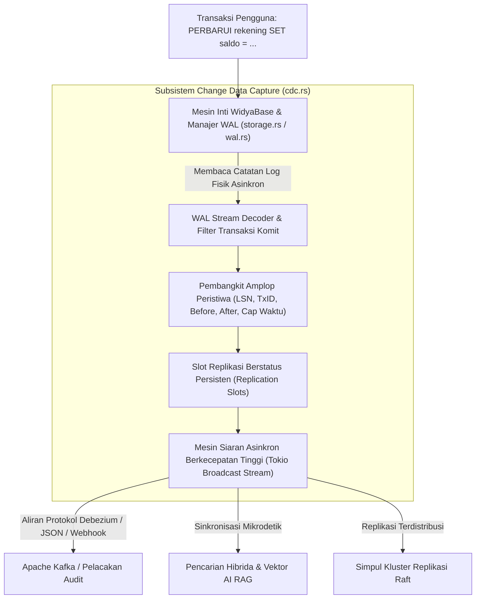

## Bab 28: Mesin Aliran Perubahan Data (Change Data Capture / CDC)

### 28.1 Aliran Perubahan Real-Time: Dari Polling ke Event-Driven

Dalam ekosistem aplikasi enterprise modern berskala nasional—seperti integrasi antar kementerian, sinkronisasi dompet digital perbankan dengan gerbang pembayaran nasional (GPN), dan orkestrasi arsitektur layanan mikro (*microservices*)—metode integrasi kuno berbasis penarikan berkala (*polling* kueri `PILIH * DARI tabel DIMANA diubah_pada > ...`) tidak lagi dapat ditoleransi. *Polling* menimbulkan beban berat pada basis data, menghasilkan latensi deteksi data yang lambat, dan gagal menangkap operasi penghapusan data (*DELETE operations*).

WidyaBase menghadirkan **Mesin Aliran Perubahan Data Waktu-Nyata (*Real-Time Change Data Capture / CDC Streamer*)** native skala industri (`cdc.rs`):
- **Penangkapan Berbasis Log Transaksi WAL (*WAL-Based CDC*)**: Menangkap setiap mutasi data (`SISIP_KE`, `PERBARUI`, `HAPUS_DARI`, `KOSONGKAN`) langsung dari aliran Write-Ahead Log tanpa menambahkan beban kueri (*zero query overhead*) pada tabel produksi.
- **Kepatuhan Batas Transaksi Penuh**: Mencatat penanda `MULAI` (*Begin*), `KOMIT` (*Commit*), dan `BATAL` (*Rollback*), menjamin aliran peristiwa yang dikirimkan ke konsumen hanya berisi data dari transaksi yang benar-benar berhasil dikomit.
- **Potret Lengkap Nilai Sebelum & Sesudah (*Before & After Images*)**: Menyajikan kondisi data lama (*before*) dan data baru (*after*) secara komprehensif untuk memudahkan pemrosesan audit log dan resolusi konflik.
- **Format Amplop Standar Industri**: Menghasilkan struktur muatan data (*payload envelope*) yang kompatibel 100% dengan standar industri Debezium dan Apache Kafka Connect.
- **Pemutaran Ulang Historis (*Catch-Up Replay via LSN Slots*)**: Memungkinkan konsumen baru atau konsumen yang sempat terputus koneksinya untuk memutar ulang aliran peristiwa dari nilai stempel `LSN` tertentu di masa lampau tanpa kehilangan satu pun mutasi data.



### 28.2 Implementasi Kode Program Utuh

Berikut implementasi pendaftaran konsumen CDC, penangkapan peristiwa mutasi data, dan pemutaran ulang dari LSN pada WidyaBase menggunakan Widya-Lang:

```widya
// Modul Mesin Aliran Perubahan Data (Change Data Capture / CDC) WidyaBase
modul mesin_cdc_streamer {
    impor ekosistem::widyabase::{
        WidyaBase, MesinCDC, OperasiCDC, RekamanCDC,
        SlotReplikasi, FormatAmplopCDC
    };

    fungsi demonstrasi_aliran_cdc(mesin: &mut WidyaBase) -> Hasil<Boolean, Teks> {
        cetak("==================================================================");
        cetak(">>> [CDC] Mengonfigurasi Slot Aliran Perubahan Data Real-Time...");

        // 1. Buat Slot Replikasi CDC Persisten untuk Layanan Mikro Notifikasi
        biar mut streamer = mesin.ambil_mesin_cdc();
        biar slot_notifikasi = streamer.buat_slot_replikasi("slot_notifikasi_bank")?;
        cetak(">>> [CDC] Slot replikasi 'slot_notifikasi_bank' siap pada LSN: " + teks(slot_notifikasi.lsn_terakhir));

        // 2. Berlangganan Saluran Aliran Siaran Asinkron
        biar mut langganan_peristiwa = streamer.langganan_siaran();

        // 3. Eksekusi Mutasi Transaksi Relasional di Mesin Utama
        cetak(">>> [TX] Melakukan transaksi transfer antar rekening...");
        mesin.eksekusi_sql("
            MULAI;
            PERBARUI rekening SET saldo = saldo - 750000.0 WHERE no_rek = 'REK-001';
            PERBARUI rekening SET saldo = saldo + 750000.0 WHERE no_rek = 'REK-002';
            KOMIT;
        ")?;

        // 4. Konsumsi Aliran Peristiwa CDC yang Tertangkap dari Log WAL
        cetak(">>> [KONSUMEN-CDC] Menangkap rekaman perubahan dari aliran:");
        biar mut jumlah_peristiwa = 0;

        selama jumlah_peristiwa < 2 {
            biar rekaman: RekamanCDC = langganan_peristiwa.terima_berikutnya()?;
            
            cetak("  ★ Peristiwa Tertangkap:");
            cetak("    - Operasi DML : " + rekaman.operasi.nama_teks());
            cetak("    - Nama Tabel  : " + rekaman.nama_tabel);
            cetak("    - LSN WAL     : " + teks(rekaman.lsn.nilai()));
            cetak("    - ID Transaksi: T" + teks(rekaman.id_transaksi));
            cetak("    - Saldo Lama  : Rp " + teks(rekaman.data_lama.ambil_desimal("saldo")));
            cetak("    - Saldo Baru  : Rp " + teks(rekaman.data_baru.ambil_desimal("saldo")));

            // Konfirmasi Pengakuan Pembacaan (Acknowledge LSN)
            streamer.konfirmasi_lsn("slot_notifikasi_bank", rekaman.lsn)?;
            jumlah_peristiwa = jumlah_peristiwa + 1;
        }

        // 5. Uji Pemutaran Ulang Historis (Catch-Up Replay) Pasca Gangguan Konsumen
        cetak(">>> [REPLAY] Menguji pemutaran ulang historis dari LSN awal...");
        biar rekaman_lampau = streamer.baca_riwayat_dari_lsn(slot_notifikasi.lsn_terakhir, 10)?;
        cetak(">>> [REPLAY] Berhasil mengambil " + teks(rekaman_lampau.panjang()) + " peristiwa dari penyimpanan WAL!");

        cetak("==================================================================");
        kembalikan Ok(benar);
    }
}
```

### 28.3 Analisis Arsitektur, Metrik & Tabel Spesifikasi

Tabel perbandingan antara metode integrasi Polling Kueri Tradisional vs WAL-Based CDC WidyaBase:

| Karakteristik Evaluasi | Polling Kueri Tradisional (`SELECT ... WHERE`) | WAL-Based CDC WidyaBase (`cdc.rs`) |
| :--- | :--- | :--- |
| **Beban Terhadap Mesin Produksi** | Sangat Berat (Memicu scan berkala berkali-kali) | **Nol Overhead Kueri (Membaca berkas WAL)** |
| **Latensi Deteksi Perubahan** | Tertunda sesuai jadwal interval (detik/menit) | **Real-Time Instan (< 2 milidetik)** |
| **Penangkapan Peristiwa DELETE** | **Gagal Menangkap** (Baris sudah terhapus) | **Sempurna (Tercatat di log WAL)** |
| **Ketepatan Rekaman Transaksi** | Rentan melewatkan mutasi berulang (*missed update*)| **100% Monoton Konsisten Sesuai LSN** |
| **Kemampuan Pemutaran Ulang** | Sangat Sulit tanpa tabel audit sekunder | **Mudah via LSN Replication Slot Replay** |

### 28.4 Latihan Soal Esai

1. Mengapa teknik integrasi sistem berbasis *Polling* kueri SQL dianggap sebagai anti-pola (*anti-pattern*) pada arsitektur transaksi tinggi? Mengapa pendekatan *WAL-Based CDC* jauh lebih aman dan efisien?
2. Terangkan struktur muatan (*payload envelope*) peristiwa CDC standar industri yang mencakup informasi *Before-Image*, *After-Image*, dan metadata transaksi!
3. Jelaskan peranan *Replication Slot* dan mekanisme konfirmasi LSN (*LSN Acknowledgment*) dalam mencegah penghapusan berkas WAL prematur serta menjamin pengiriman pesan minimal satu kali (*At-Least-Once Delivery*)!

### 28.5 Soal Pilihan Ganda

1. Kepanjangan dari singkatan CDC dalam dunia rekayasa integrasi data adalah...
   A. Change Data Capture
   B. Central Data Center
   C. Core Database Controller
   D. Continuous Delivery Cloud

2. Sumber data utama yang dibaca oleh mesin CDC WidyaBase untuk mendeteksi mutasi data tanpa membebani tabel produksi adalah...
   A. Write-Ahead Log (WAL)
   B. Layar Monitor Admin
   C. File CSV Pengguna
   D. Browser Cache

3. Keuntungan paling mendasar dari CDC berbasis WAL terhadap peristiwa penghapusan data (`DELETE`) adalah...
   A. Operasi DELETE tercatat secara utuh di dalam WAL sehingga dapat dipropagasikan ke konsumen meskipun baris fisik telah tiada
   B. Operasi DELETE otomatis dibatalkan
   C. Seluruh tabel otomatis terkunci
   D. Menghapus akun pengguna

4. Format amplop peristiwa (*event envelope*) standar industri global yang didukung penuh oleh CDC WidyaBase adalah...
   A. Format Amplop Debezium / Apache Kafka Connect
   B. Format Spreadsheet Excel
   C. Gambar JPEG
   D. File Audio MP3

5. Struktur data persisten pada mesin CDC yang mencatat posisi LSN terakhir yang telah berhasil dikonfirmasi oleh konsumen tertentu dinamakan...
   A. Replication Slot (Slot Replikasi)
   B. Frame Buffer
   C. Memory Leak
   D. B+Tree Leaf

6. Manfaat utama dari adanya informasi *Before-Image* pada peristiwa CDC pembaruan (`UPDATE`) adalah...
   A. Konsumen dapat mengetahui secara pasti nilai lama sebelum dimodifikasi untuk keperluan audit dan kalkulasi selisih
   B. Mengubah bahasa kueri menjadi bahasa daerah
   C. Memperkecil resolusi grafik
   D. Mengabaikan transaksi baru

7. Nilai identifikasi unik 64-bit yang memastikan seluruh peristiwa CDC terurut secara kronologis mutlak adalah...
   A. Log Sequence Number (LSN)
   B. IP Address
   C. Port Number
   D. Thread ID

8. Sifat jaminan pengiriman pesan yang diberikan oleh integrasi CDC dengan konfirmasi LSN pada WidyaBase adalah...
   A. At-Least-Once Delivery (Minimal satu kali kirim tanpa data hilang)
   B. Zero Delivery (Data dibuang)
   C. Random Delivery
   D. Best Effort Tanpa Jaminan

9. Kapan peristiwa mutasi CDC dialirkan ke antrean siaran publikasi konsumen?
   A. Hanya setelah transaksi yang bersangkutan berhasil dikomit (*Committed Transactions Only*)
   B. Saat transaksi baru dimulai
   C. Saat transaksi dibatalkan
   D. Setiap 24 jam sekali

10. Mengapa pemanfaatan CDC sangat krusial dalam arsitektur AI RAG modern?
    A. Memungkinkan pembaruan vektor embedding dan indeks pengetahuan AI secara otomatis dalam hitungan milidetik saat data operasional berubah
    B. Supaya model AI tidak membutuhkan listrik
    C. Menghapus kebutuhan data teks
    D. Menjadikan komputer peladen bisa berbicara
