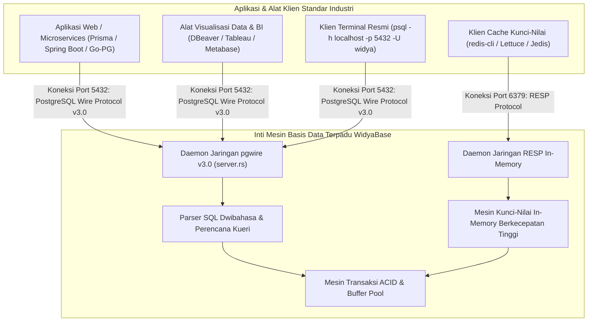

## Bab 32: Protokol Jaringan Terbuka (pgwire v3.0 & RESP)

### 32.1 Jembatan Ekosistem: Kompatibilitas Wire-Protocol Standar Industri

Sebuah inovasi perangkat lunak basis data berdaulat sehebat apa pun akan sulit diadopsi oleh industri jika mengharuskan para pengembang menulis ulang ribuan baris kode program klien mereka, atau mewajibkan perusahaan membuang pustaka driver (*drivers*), framework ORM, dan alat visualisasi Business Intelligence (BI) yang telah terpasang matang.

WidyaBase memecahkan tantangan adopsi industri ini dengan mengimplementasikan dua lapisan protokol komunikasi jaringan terbuka (*Network Wire Protocols*) standar dunia secara 100% native murni (`server.rs`):
1. **PostgreSQL Wire Protocol v3.0 (`pgwire`, Port Default 5432)**: Memungkinkan seluruh perkakas standar dunia—seperti klien terminal resmi `psql`, aplikasi GUI DBeaver, pgAdmin, Prisma ORM, Hibernate, hingga driver JDBC/ODBC/Node.js/Python—terhubung langsung ke WidyaBase seolah-olah sedang berbicara dengan peladen PostgreSQL asli!
2. **Redis Serialization Protocol (`RESP`, Port Default 6379)**: Menyediakan antarmuka penyimpanan kunci-nilai in-memory berlatensi mikrodetik untuk kueri cepat seperti `PING`, `SET`, `GET`, `MGET`, dan `DEL`.



Alur siklus pertukaran paket pada PostgreSQL Wire Protocol v3.0 (`server.rs`):
1. **Fase Jabat Tangan (*Startup Handshake*)**:
   - Klien membuka koneksi TCP dan mengirimkan paket `StartupMessage` yang memuat nomor versi protokol (`3.0`), nama pengguna (`user`), dan nama basis data (`database`).
   - Server merespons dengan paket `AuthenticationOk` (kode 'R'), serangkaian parameter status peladen (`ParameterStatus` 'S'), serta penanda kesiapan kueri `ReadyForQuery` (kode 'Z').
2. **Fase Kueri Sederhana (*Simple Query Protocol*)**:
   - Klien mengirim paket `Query` (kode 'Q') yang memuat barisan teks kueri SQL.
   - Server mengeksekusi kueri, lalu mengembalikan:
     - `RowDescription` (kode 'T'): Metadata nama dan tipe data kolom luaran.
     - Satu atau banyak paket `DataRow` (kode 'D'): Baris data dalam format biner atau string UTF-8.
     - `CommandComplete` (kode 'C'): Penanda sukses eksekusi (misal: `SELECT 10` atau `INSERT 0 1`).
     - `ReadyForQuery` (kode 'Z'): Menandakan server siap menerima kueri berikutnya dalam transaksi aktif.

### 32.2 Implementasi Kode Program Utuh

Berikut implementasi server daemon jaringan pgwire v3.0 dan penanganan aliran pesan TCP pada WidyaBase menggunakan Widya-Lang:

```widya
// Modul Daemon Jaringan PostgreSQL Wire Protocol v3.0 WidyaBase
modul daemon_jaringan_pgwire {
    impor ekosistem::widyabase::{
        WidyaBase, PeladenTCP, SoketTCP, AliranPaketPG,
        PesanPG, DeskripsiBaris, NilaiKolom
    };

    konstanta PORT_PGWIRE_BAKU: Bulat = 5432;

    fungsi jalankan_peladen_pgwire(mesin: &WidyaBase) -> Hasil<(), Teks> {
        biar pendengar = PeladenTCP::ikat("0.0.0.0", PORT_PGWIRE_BAKU)?;
        cetak("==================================================================");
        cetak(">>> [PGWIRE] Peladen WidyaBase aktif mendengarkan di port 5432...");
        cetak(">>> [KOMPATIBILITAS] Siap menerima koneksi dari psql, DBeaver, & ORM.");

        selama biar Ada(soket) = pendengar.terima_koneksi() {
            cetak(">>> [KONEKSI] Klien baru terhubung dari: " + soket.alamat_klien());

            // 1. Baca Paket StartupMessage dari Klien
            biar startup = AliranPaketPG::baca_startup_message(&soket)?;
            cetak(">>> [HANDSHAKE] Pengguna: '" + startup.pengguna + "' | Database: '" + startup.database + "'");

            // 2. Kirim Respon Autentikasi Sukses & Kesiapan Kueri
            AliranPaketPG::kirim_auth_ok(&soket)?;
            AliranPaketPG::kirim_parameter_status(&soket, "server_version", "16.0-WidyaBase-Berdaulat")?;
            AliranPaketPG::kirim_ready_for_query(&soket, 'I')?; // 'I' = Idle (di luar transaksi)

            // 3. Loop Penanganan Kueri Klien
            selama biar Ada(pesan) = AliranPaketPG::baca_pesan_berikutnya(&soket) {
                cocokkan pesan {
                    PesanPG::KueriSederhana(teks_sql) => {
                        cetak(">>> [SQL-INCOMING] Kueri diterima: " + teks_sql);
                        
                        // Eksekusi Kueri di Inti Mesin WidyaBase
                        biar hasil_kueri = mesin.kueri_sql(&teks_sql);
                        cocokkan hasil_kueri {
                            Ok(hasil) => {
                                // Kirim Header Deskripsi Baris (RowDescription 'T')
                                AliranPaketPG::kirim_row_description(&soket, hasil.skema_kolom())?;
                                
                                // Kirim Baris-Baris Data (DataRow 'D')
                                untuk baris di hasil.baris_data() {
                                    AliranPaketPG::kirim_data_row(&soket, baris)?;
                                }
                                
                                // Kirim CommandComplete 'C' & ReadyForQuery 'Z'
                                AliranPaketPG::kirim_command_complete(&soket, "PILIH " + teks(hasil.jumlah_baris()))?;
                                AliranPaketPG::kirim_ready_for_query(&soket, 'I')?;
                            },
                            Salah(pesan_galat) => {
                                AliranPaketPG::kirim_error_response(&soket, pesan_galat)?;
                                AliranPaketPG::kirim_ready_for_query(&soket, 'I')?;
                            }
                        }
                    },
                    PesanPG::Terminasi => {
                        cetak(">>> [PUTUS] Klien mengakhiri sesi koneksi.");
                        keluar;
                    }
                }
            }
        }
        kembalikan Ok(());
    }
}
```

### 32.3 Analisis Arsitektur, Metrik & Tabel Spesifikasi

Tabel paket pesan biner utama pada PostgreSQL Wire Protocol v3.0 di WidyaBase:

| Kode Karakter Pesan | Nama Tipe Paket | Arah Aliran | Deskripsi Muatan Data Paket |
| :--- | :--- | :--- | :--- |
| `None` (Panjang Byte) | `StartupMessage` | Klien $\rightarrow$ Peladen | Versi protokol (3.0), user, database, parameter sesi |
| `'R'` | `AuthenticationOk` | Peladen $\rightarrow$ Klien | Konfirmasi bahwa autentikasi kredensial pengguna sukses |
| `'S'` | `ParameterStatus` | Peladen $\rightarrow$ Klien | Nilai variabel sesi (server_version, client_encoding) |
| `'Z'` | `ReadyForQuery` | Peladen $\rightarrow$ Klien | Status peladen siap: 'I' (Idle), 'T' (In-Tx), 'E' (Failed-Tx) |
| `'Q'` | `Query` | Klien $\rightarrow$ Peladen | Teks string kueri SQL sederhana yang ingin dieksekusi |
| `'T'` | `RowDescription` | Peladen $\rightarrow$ Klien | Jumlah kolom, nama kolom, tipe OID, lebar tipe data |
| `'D'` | `DataRow` | Peladen $\rightarrow$ Klien | Rangkaian nilai kolom untuk satu baris catatan data |
| `'C'` | `CommandComplete` | Peladen $\rightarrow$ Klien | Tag penyelesaian perintah (misal: "SELECT 5") |
| `'E'` | `ErrorResponse` | Peladen $\rightarrow$ Klien | Pesan kesalahan SQLSTATE, rincian galat, petunjuk perbaikan |

### 32.4 Latihan Soal Esai

1. Mengapa implementasi protokol jaringan standar industri terbuka seperti PostgreSQL Wire Protocol v3.0 menjadi strategi adopsi yang sangat menentukan keberhasilan sebuah mesin basis data baru di dunia enterprise?
2. Terangkan urutan pertukaran pesan biner (*handshake flow*) antara klien dan peladen sejak koneksi TCP pertama kali dibuka hingga peladen mengirimkan paket `ReadyForQuery`!
3. Jelaskan perbedaan operasional antara *Simple Query Protocol* (paket 'Q') dan *Extended Query Protocol* (rangkaian paket Parse, Bind, Execute) pada pgwire!

### 32.5 Soal Pilihan Ganda

1. Nomor port TCP baku (*default*) yang digunakan oleh peladen WidyaBase untuk mendengarkan koneksi PostgreSQL Wire Protocol v3.0 adalah...
   A. 5432
   B. 80
   C. 3306
   D. 21

2. Nomor port TCP baku yang digunakan oleh antarmuka Redis Serialization Protocol (RESP) adalah...
   A. 6379
   B. 443
   C. 8080
   D. 1433

3. Paket pertama yang dikirimkan oleh klien ke peladen saat membuka koneksi PostgreSQL v3.0 adalah...
   A. `StartupMessage`
   B. `ReadyForQuery`
   C. `CommandComplete`
   D. `PasswordPacket`

4. Kode karakter satu byte yang menandai pesan `ReadyForQuery` pada protokol pgwire adalah...
   A. Karakter `'Z'`
   B. Karakter `'A'`
   C. Karakter `'Q'`
   D. Karakter `'X'`

5. Kode karakter satu byte yang menandai deskripsi metadata skema kolom (*RowDescription*) adalah...
   A. Karakter `'T'`
   B. Karakter `'D'`
   C. Karakter `'C'`
   D. Karakter `'E'`

6. Status indikator `'I'` pada paket `ReadyForQuery` menandakan bahwa peladen saat ini berada dalam kondisi...
   A. Idle (Menganggur di luar transaksi aktif)
   B. In-Transaction (Di dalam blok transaksi aktif)
   C. Error State
   D. Internet Disconnected

7. Keuntungan kompatibilitas pgwire pada WidyaBase terhadap aplikasi klien yang sudah ada adalah...
   A. Aplikasi klien dapat langsung terhubung tanpa mengganti driver atau menulis ulang kode program
   B. Mengubah seluruh kode Java menjadi kode Rust otomatis
   C. Menghapus kebutuhan login kata sandi
   D. Menjadikan server kebal terhadap mati lampu

8. Format transmisi nilai data pada paket `DataRow` (`'D'`) dapat dikirimkan dalam bentuk...
   A. Format Teks String UTF-8 atau Format Biner
   B. Format Gambar PNG
   C. Format Audio WAV
   D. Format File PDF

9. Klien perkakas basis data visual grafis terkemuka yang dapat langsung digunakan untuk mengelola WidyaBase via pgwire adalah...
   A. DBeaver, pgAdmin, dan TablePlus
   B. Microsoft Paint
   C. Adobe Photoshop
   D. VLC Media Player

10. Mengapa dukungan protokol ganda (pgwire v3.0 untuk SQL dan RESP untuk cache kunci-nilai) dalam satu mesin basis data terpadu sangat menguntungkan arsitektur aplikasi?
    A. Menggabungkan kebutuhan kueri relasional dan caching berkecepatan tinggi dalam satu infrastruktur terpadu tanpa memelihara server Redis terpisah
    B. Supaya tidak perlu membayar teknisi jaringan
    C. Mengurangi kebutuhan memori pada monitor
    D. Menghilangkan kebutuhan bahasa pemrograman
