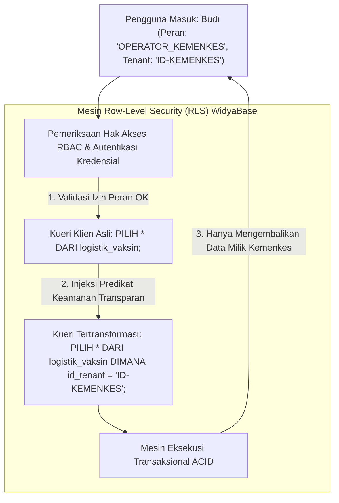

## Bab 34: Kontrol Akses Berbasis Peran (RBAC) & Isolasi Multi-Tenant

### 34.1 Tata Kelola Izin Granular & Pemisahan Tenant Berdaulat

Dalam ekosistem aplikasi pemerintahan terpadu (*Sistem Pemerintahan Berbasis Elektronik* / SPBE) dan platform perbankan multinasional, satu kluster basis data sering kali harus melayani berbagai kementerian, pemerintah daerah, atau anak perusahaan yang berbeda (**Multi-Tenancy**). Setiap penyewa (*tenant*) harus terisolasi secara mutlak sehingga tidak ada kemungkinan satu instansi melihat atau memodifikasi data instansi lain (*Tenant Cross-Talk Prevention*).

WidyaBase menyediakan **Mesin Kontrol Akses Berbasis Peran (*Role-Based Access Control* / RBAC)** dan **Pemisahan Multi-Tenant Berbutir Halus**:
- **Hierarki Peran Fleksibel (*Hierarchical RBAC*)**: Mendukung pewarisan hak akses (*role inheritance*) mulai dari tingkat kluster, basis data, skema, tabel, kolom, hingga tingkat baris individual (*Row-Level Security* / RLS).
- **Keamanan Tingkat Baris Otomatis (*Row-Level Security* / RLS)**: Secara transparan menyuntikkan filter predikat keamanan (misal: `DIMANA kode_instansi = SESI_TENANT()`) ke dalam setiap kueri `PILIH`, `PERBARUI`, atau `HAPUS_DARI` pengguna tanpa disadari oleh pengembang aplikasi.
- **Isolasi Skema Bersama vs Basis Data Terpisah (*Hybrid Multi-Tenant Model*)**:
  - *Database-per-Tenant*: Isolasi fisik mutlak untuk instansi intelijen/perbankan bernilai kritis tinggi.
  - *Schema-per-Tenant*: Isolasi logis efisien untuk instansi dinas daerah.
  - *Row-Level-Tenant (RLS)*: Konsolidasi kepadatan tinggi (*High-Density Multi-Tenancy*) untuk ribuan aplikasi UMKM.



Prinsip hak istimewa terkecil (*Principle of Least Privilege*):
1. **Pemisahan Tugas (*Separation of Duties*)**: Administrator Keamanan (*Security Officer*), Administrator Audit (*Audit Officer*), dan Pengelola Operasional Harian (*DBA*) dipisahkan ke dalam peran mandiri yang tidak dapat saling mengambil alih kekuasaan.
2. **Koneksi Terotentikasi Kuat**: Mendukung enkripsi kata sandi menggunakan fungsi hash mutakhir **Argon2id** dan **SCRAM-SHA-256**, kebal terhadap serangan kamus (*dictionary attacks*) dan serangan kartu grafis (*GPU brute-force*).
3. **Pembatasan Kolom Spesifik (*Column-Level Privileges*)**: Staf operasional dapat diizinkan melihat kolom `nama` dan `alamat`, namun diblokir total dari melihat kolom `saldo` dan `nomor_kartu_kredit`.

### 34.2 Implementasi Kode Program Utuh

Berikut implementasi konfigurasi peran RBAC, kebijakan Row-Level Security (RLS), dan pembuktian isolasi data multi-tenant pada WidyaBase menggunakan Widya-Lang:

```widya
// Modul Kontrol Akses RBAC dan Row-Level Security WidyaBase
modul keamanan_rbac {
    impor ekosistem::widyabase::{
        WidyaBase, PeranPengguna, KebijakanRLS,
        IzinAkses, KonteksSesi
    };

    fungsi demonstrasi_rbac_dan_rls(mesin: &mut WidyaBase) -> Hasil<Boolean, Teks> {
        cetak("==================================================================");
        cetak(">>> [RBAC-RLS] Mengonfigurasi Tata Kelola Keamanan Multi-Tenant...");

        // 1. Buat Peran dan Pengguna Berbeda Kementerian
        mesin.eksekusi_sql("BUAT PERAN staf_operasional;")?;
        mesin.eksekusi_sql("BUAT PENGGUNA budi DENGAN KATA_SANDI 'BudiKemenkes2026!' MILIK_PERAN staf_operasional;")?;
        mesin.eksekusi_sql("BUAT PENGGUNA siti DENGAN KATA_SANDI 'SitiKemendag2026!' MILIK_PERAN staf_operasional;")?;

        // 2. Buat Tabel Bersama dengan Kolom Penanda Tenant
        biar sql_tabel = "
            BUAT TABEL arsip_proyek_strategis (
                id BULAT KUNCI_UTAMA_SERI,
                id_kementerian TEKS TIDAK_KOSONG,
                nama_proyek TEKS TIDAK_KOSONG,
                anggaran_miliar DESIMAL
            );
        ";
        mesin.eksekusi_sql(sql_tabel)?;

        // 3. Sisipkan Data Milik Kementerian Kesehatan dan Kementerian Perdagangan
        mesin.eksekusi_sql("
            SISIP_KE arsip_proyek_strategis (id_kementerian, nama_proyek, anggaran_miliar)
            NILAI ('KEMENKES', 'Sistem SatuSehat Nasional', 150.0),
                  ('KEMENDAG', 'Sistem Ekspor Komoditas Terpadu', 85.0);
        ")?;

        // 4. Aktifkan Row-Level Security (RLS) pada Tabel Tersebut
        mesin.eksekusi_sql("AKTIFKAN KEAMANAN_TINGKAT_BARIS PADA arsip_proyek_strategis;")?;

        // 5. Buat Kebijakan RLS Dinamis Berdasarkan Atribut Sesi Pengguna
        biar sql_kebijakan_rls = "
            BUAT KEBIJAKAN isolasi_proyek_kementerian
            PADA arsip_proyek_strategis
            UNTUK SELURUH PERINTAH
            MENGGUNAKAN (id_kementerian = AMBIL_VARIABEL_SESI('kementerian_aktif'));
        ";
        mesin.eksekusi_sql(sql_kebijakan_rls)?;
        cetak(">>> [RLS] Kebijakan isolasi multi-tenant berhasil diaktifkan.");

        // 6. Uji Sesi Pengguna Budi (Kementerian Kesehatan)
        cetak(">>> [SESI] Membuka sesi untuk pengguna: 'budi' (Tenant: KEMENKES)...");
        biar mut sesi_budi = mesin.buka_sesi_pengguna("budi", "BudiKemenkes2026!")?;
        sesi_budi.atur_variabel("kementerian_aktif", "KEMENKES");

        biar hasil_budi = sesi_budi.kueri_sql("PILIH * DARI arsip_proyek_strategis;")?;
        cetak(">>> [HASIL BUDI] Jumlah proyek yang tampak: " + teks(hasil_budi.jumlah_baris()));
        untuk baris di hasil_budi.baris_data() {
            cetak("  ★ Proyek Kemenkes: " + baris.ambil_teks("nama_proyek") + 
                  " (Anggaran: Rp " + teks(baris.ambil_desimal("anggaran_miliar")) + " Miliar)");
        }

        // 7. Uji Sesi Pengguna Siti (Kementerian Perdagangan)
        cetak(">>> [SESI] Membuka sesi untuk pengguna: 'siti' (Tenant: KEMENDAG)...");
        biar mut sesi_siti = mesin.buka_sesi_pengguna("siti", "SitiKemendag2026!")?;
        sesi_siti.atur_variabel("kementerian_aktif", "KEMENDAG");

        biar hasil_siti = sesi_siti.kueri_sql("PILIH * DARI arsip_proyek_strategis;")?;
        cetak(">>> [HASIL SITI] Jumlah proyek yang tampak: " + teks(hasil_siti.jumlah_baris()));
        untuk baris di hasil_siti.baris_data() {
            cetak("  ★ Proyek Kemendag: " + baris.ambil_teks("nama_proyek") + 
                  " (Anggaran: Rp " + teks(baris.ambil_desimal("anggaran_miliar")) + " Miliar)");
        }

        cetak(">>> [SUKSES RLS] Tidak ada kebocoran data antar kementerian!");
        cetak("==================================================================");
        kembalikan Ok(benar);
    }
}
```

### 34.3 Analisis Arsitektur, Metrik & Tabel Spesifikasi

Tabel perbandingan model isolasi multi-tenant pada WidyaBase:

| Model Isolasi Tenancy | Tingkat Isolasi Data | Overhead Memori & Sumber Daya | Skalabilitas Tenant | Biaya Operasional Infrastruktur |
| :--- | :--- | :--- | :--- | :--- |
| **Database-per-Tenant** | **Mutlak Fisik Terpisah** | Tinggi (Buffer pool ganda per DB) | Rendah (Puluhan Tenant) | Sangat Tinggi |
| **Schema-per-Tenant** | Kuat (Namespace Terpisah) | Sedang (Tabel metadata terpisah) | Sedang (Ratusan Tenant) | Sedang |
| **Row-Level Security (RLS)**| **Kuat Berbasis Aturan Logis**| **Sangat Ringan ($O(1)$ Buffer Pool)**| **Ekstrem (Jutaan Tenant)** | **Sangat Hemat & Terpadu** |

### 34.4 Latihan Soal Esai

1. Terangkan prinsip kerja *Row-Level Security* (RLS) dalam mentransformasikan kueri SQL pengguna secara transparan di dalam perencana logis sebelum dieksekusi!
2. Mengapa algoritma hash kata sandi modern seperti Argon2id atau SCRAM-SHA-256 mutlak diperlukan pada basis data kedaulatan nasional dibandingkan fungsi hash kuno seperti MD5 atau SHA-1?
3. Rancanglah sebuah skema pembagian peran RBAC untuk instansi rumah sakit umum daerah yang memisahkan wewenang antara Dokter Spesialis, Perawat, Kasir Pembayaran, dan Administrator IT!

### 34.5 Soal Pilihan Ganda

1. Kepanjangan dari singkatan RBAC dalam keamanan sistem adalah...
   A. Role-Based Access Control
   B. Read-Buffer Allocation Cache
   C. Remote Binary Access Channel
   D. Round-Robin Array Controller

2. Fitur keamanan basis data yang membatasi baris data mana yang boleh dilihat atau dimodifikasi oleh pengguna tertentu dinamakan...
   A. Row-Level Security (RLS)
   B. Column Encryption
   C. Table Truncation
   D. Vacuuming

3. Algoritma penentu fungsi hash kata sandi pengguna berstandar militer mutakhir yang tahan terhadap serangan GPU brute-force pada WidyaBase adalah...
   A. Argon2id / SCRAM-SHA-256
   B. MD5 polos
   C. Base64
   D. Plain Text

4. Prinsip keamanan siber yang menetapkan bahwa setiap pengguna hanya boleh diberikan hak akses seminimal mungkin yang diperlukan untuk tugasnya disebut...
   A. Principle of Least Privilege
   B. Principle of Unlimited Access
   C. Principle of Zero Trust Network
   D. Fast Execution

5. Perintah SQL Dialek Nusantara yang digunakan untuk mengaktifkan keamanan tingkat baris pada suatu tabel adalah...
   A. `AKTIFKAN KEAMANAN_TINGKAT_BARIS PADA nama_tabel;`
   B. `KUNCI SELURUH TABEL;`
   C. `HAPUS PENGGUNA;`
   D. `RESET PERAN;`

6. Model multi-tenant yang paling hemat sumber daya memori RAM dan mampu menampung ribuan penyewa dalam satu tabel bersama adalah...
   A. Shared Table dengan Row-Level Security (RLS)
   B. Database-per-Tenant
   C. Laptop-per-Tenant
   D. Server Fisik Mandiri

7. Perintah SQL untuk memberikan izin kueri SELECT pada tabel tertentu kepada peran staf adalah...
   A. `BERIKAN PILIH PADA nama_tabel KEPADA peran_staf;` (atau `GRANT SELECT ...`)
   B. `BUANG TABEL`
   C. `UBAH NAMA`
   D. `FORMAT DATA`

8. Karakteristik pewarisan peran (*Role Inheritance*) pada RBAC memungkinkan...
   A. Peran tingkat tinggi secara otomatis mewarisi seluruh hak akses yang dimiliki oleh peran anak di bawahnya
   B. Data otomatis disalin ke komputer admin
   C. Pengguna tidak perlu mengingat password
   D. Transaksi tidak perlu komit

9. Apa yang terjadi jika pengguna mencoba mengeksekusi perintah SQL terhadap kolom yang hak aksesnya tidak diberikan kepadanya?
   A. Sistem menolak kueri dan membangkitkan galat pelanggaran izin hak akses (*Permission Denied*)
   B. Nilai kolom diubah menjadi nol
   C. Komputer pengguna mati
   D. Server basis data crash

10. Mengapa pemisahan tugas (*Separation of Duties*) antara DBA dan Security Administrator sangat penting pada lembaga keuangan negara?
    A. Mencegah seorang DBA menyalahgunakan wewenang teknisnya untuk mengubah saldo rekening atau menghapus jejak audit tanpa pengawasan
    B. Supaya ada banyak lowongan pekerjaan
    C. Mengurangi penggunaan kertas di kantor
    D. Menghapus kebutuhan rapat mingguan
