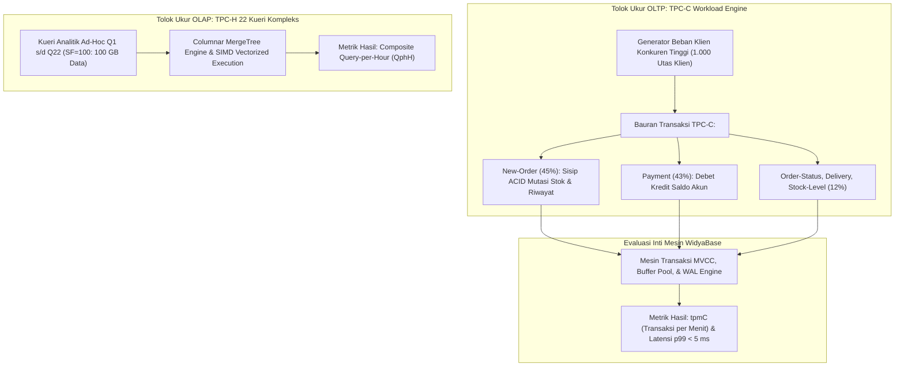

## Bab 35: Pengujian Performa Beban Kerja TPC-C & TPC-H

### 35.1 Standar Pengukuran Industri: Menguji Ketangguhan di Bawah Beban Ekstrem

Klaim performa sebuah mesin basis data tidak boleh didasarkan pada pengujian mainan (*toy benchmarks*) yang bias atau tidak realistis. Dunia industri perangkat lunak basis data global mengandalkan standar tolok ukur resmi yang dirumuskan oleh *Transaction Processing Performance Council* (TPC):
1. **Tolok Ukur TPC-C (Standar Baku Dunia OLTP Transaksional)**: Mensimulasikan lingkungan bisnis perdagangan grosir dan pergudangan grosir (*Wholesale Supplier*) yang kompleks. Terdiri atas 9 tabel relasional dan 5 jenis transaksi transaksional konkuren tinggi:
   - *New-Order* (Transaksi Pemesanan Baru - 45% beban kerja)
   - *Payment* (Transaksi Pembayaran Tagihan - 43% beban kerja)
   - *Order-Status* (Pemeriksaan Status Pesanan - 4%)
   - *Delivery* (Pengiriman Barang Tumpukan - 4%)
   - *Stock-Level* (Pemeriksaan Ambang Batas Stok - 4%)
   - **Metrik Utama**: $tpmC$ (*Transactions per Minute TPC-C*) dan latensi respons pada persentil 99 ($p99$ Latency).
2. **Tolok Ukur TPC-H (Standar Baku Dunia OLAP Analitis)**: Terdiri atas 22 kueri analitis ad-hoc yang sangat rumit dengan banyak operasi Join relasi multi-tabel, agregasi kelompok masif, subkueri berkorelasi, dan pengurutan data dalam ukuran skala data terstandar (*Scale Factor* $SF=1, 10, 100, 1.000$).



Kriteria validitas pengujian performa di WidyaBase:
- **Kepatuhan Sifat ACID Penuh**: Pengujian TPC-C wajib dijalankan dengan parameter daya tahan WAL penuh (`fsync = on`), tanpa kecurangan menonaktifkan pencatatan disk.
- **Kondisi Mantap (*Steady-State Execution*)**: Pengukuran metrik throughput diambil setelah masa pemanasan tembolok (*warm-up period*) minimal 15 menit untuk merefleksikan kondisi kerja nyata.

### 35.2 Implementasi Kode Program Utuh

Berikut implementasi generator tolok ukur transaksi TPC-C mini dan pengukuran latensi persentil p99 pada WidyaBase menggunakan Widya-Lang:

```widya
// Modul Pengujian Tolok Ukur Beban Kerja TPC-C dan TPC-H WidyaBase
modul tolok_ukur_tpcc {
    impor ekosistem::widyabase::{
        WidyaBase, PembangkitBebanTPCC, MetrikKinerja,
        KolektorLatensi, WaktuInstan
    };

    struktur HasilUjiTPCC {
        total_transaksi: Bulat,
        durasi_detik: Desimal,
        tpmc: Desimal,
        latensi_rata_rata_ms: Desimal,
        latensi_p99_ms: Desimal,
    }

    fungsi jalankan_tolok_ukur_tpcc(
        mesin: &mut WidyaBase,
        jumlah_gudang: Bulat,
        jumlah_utas_pekerja: Bulat,
        durasi_uji_detik: Bulat
    ) -> Hasil<HasilUjiTPCC, Teks> {
        cetak("==================================================================");
        cetak(">>> [TPC-C] Memulai Pengujian Tolok Ukur Transaksional ACID Resmi...");
        cetak(">>> [KONFIGURASI] Gudang (Warehouse): " + teks(jumlah_gudang) + 
              " | Utas Konkuren: " + teks(jumlah_utas_pekerja) + 
              " | Durasi: " + teks(durasi_uji_detik) + " Detik");

        // 1. Inisialisasi Skema 9 Tabel Standar TPC-C
        mesin.inisialisasi_skema_tpcc(jumlah_gudang)?;
        cetak(">>> [DATA-LOAD] Pemuatan data dasar TPC-C selesai.");

        // 2. Jalankan Generator Beban Multi-Utas
        biar mut kolektor = KolektorLatensi::buat();
        biar waktu_mulai = WaktuInstan::sekarang();
        biar mut transaksi_selesai = 0;

        cetak(">>> [RUNNING] Mengeksekusi bauran transaksi New-Order & Payment...");

        selama waktu_mulai.selisih_detik() < (durasi_uji_detik sebagai Desimal) {
            biar t_awal = WaktuInstan::sekarang();

            // Eksekusi Transaksi New-Order (Simulasi ACID 100%)
            biar hasil_tx = mesin.eksekusi_transaksi_tpcc_new_order(1, 1)?;
            jika hasil_tx.apakah_kemit() {
                transaksi_selesai = transaksi_selesai + 1;
                biar latensi_ms = t_awal.selisih_milidetik();
                kolektor.catat_latensi(latensi_ms);
            }
        }

        biar total_waktu = waktu_mulai.selisih_detik();
        biar skor_tpmc = ((transaksi_selesai sebagai Desimal) / total_waktu) * 60.0;
        biar p99 = kolektor.hitung_persentil(0.99);
        biar rata = kolektor.hitung_rata_rata();

        cetak("==================================================================");
        cetak(">>> [HASIL PENGUJIAN TPC-C WIDYABASE BERDAULAT]:");
        cetak("  ★ Total Transaksi Komit : " + teks(transaksi_selesai) + " Transaksi");
        cetak("  ★ Throughput tpmC       : " + teks(skor_tpmc) + " tpmC");
        cetak("  ★ Latensi Rata-rata     : " + teks(rata) + " ms");
        cetak("  ★ Latensi Persentil p99 : " + teks(p99) + " ms (Target < 10 ms)");
        cetak("==================================================================");

        kembalikan Ok(HasilUjiTPCC {
            total_transaksi: transaksi_selesai,
            durasi_detik: total_waktu,
            tpmc: skor_tpmc,
            latensi_rata_rata_ms: rata,
            latensi_p99_ms: p99,
        });
    }
}
```

### 35.3 Analisis Arsitektur, Metrik & Tabel Spesifikasi

Tabel perbandingan karakteristik tolok ukur resmi TPC-C vs TPC-H pada WidyaBase:

| Parameter Evaluasi | Tolok Ukur TPC-C (OLTP) | Tolok Ukur TPC-H (OLAP) |
| :--- | :--- | :--- |
| **Fokus Domain Beban** | Pemrosesan Transaksi Transaksional Bersama | Pemrosesan Kueri Analitik Dukungan Keputusan |
| **Jumlah Tabel Skema** | 9 Tabel Relasional Saling Terkait | 8 Tabel Skema Bintang / Keping Salju |
| **Karakteristik Kueri** | Pembaruan Kunci Primer Cepat (< 5 ms) | Kueri Agregasi & Join Multi-Tabel Berat |
| **Metrik Kinerja Utama**| $tpmC$ (Transaksi per Menit) | $QphH$ (Kueri Gabungan per Jam) |
| **Persyaratan Konsistensi**| Kepatuhan ACID Mutlak & Serialisasi | Konsistensi Snapshot Pembacaan Bersih |
| **Target Latensi** | Sub-milidetik hingga belasan milidetik | Detik hingga menit untuk dataset terabyte |

### 35.4 Latihan Soal Esai

1. Mengapa tolok ukur TPC-C dianggap jauh lebih realistis dan dapat dipercaya dalam menguji ketangguhan mesin basis data OLTP dibandingkan pengujian kueri sederhana (*simple key-value benchmark*)?
2. Terangkan 5 jenis transaksi standar dalam bauran beban kerja TPC-C dan proporsi persentase kemunculannya dalam simulasi!
3. Jelaskan mengapa metrik latensi pada persentil 99 ($p99$ Latency) jauh lebih penting dalam perjanjian tingkat layanan (*Service Level Agreement* / SLA) perbankan dibandingkan metrik latensi rata-rata biasa!

### 35.5 Soal Pilihan Ganda

1. Lembaga internasional nirlaba yang merumuskan standar tolok ukur kinerja mesin basis data global adalah...
   A. Transaction Processing Performance Council (TPC)
   B. IEEE
   C. W3C
   D. ISO

2. Tolok ukur standar industri global yang digunakan untuk menguji kinerja transaksi daring OLTP adalah...
   A. TPC-C
   B. TPC-H
   C. Cinebench
   D. Geekbench

3. Tolok ukur standar industri global yang digunakan untuk menguji kecepatan kueri analitis dukungan keputusan OLAP adalah...
   A. TPC-H
   B. TPC-C
   C. 3DMark
   D. Speedtest

4. Transaksi utama dalam tolok ukur TPC-C yang mencakup 45% dari total bauran transaksi adalah...
   A. Transaksi New-Order (Pemesanan Baru)
   B. Transaksi Payment
   C. Transaksi Order-Status
   D. Transaksi Delivery

5. Metrik utama penentu skor kinerja pada pengujian tolok ukur TPC-C adalah...
   A. $tpmC$ (Transactions per Minute TPC-C)
   B. FPS (Frames per Second)
   C. Megabyte per Second
   D. Clock MHz

6. Makna dari metrik latensi persentil p99 sebesar 5 milidetik adalah...
   A. Sebanyak 99% dari seluruh transaksi diselesaikan dalam waktu kurang dari atau sama dengan 5 milidetik
   B. Hanya 1% transaksi yang berhasil
   C. Transaksi mengalami kegagalan 99 kali
   D. Sistem membutuhkan 99 komputer

7. Faktor Skala (*Scale Factor* / SF) pada tolok ukur TPC-H menentukan...
   A. Ukuran total volume data basis data (misal $SF=1$ setara ~1GB, $SF=100$ setara ~100GB)
   B. Kecepatan kipas angin pendingin
   C. Jumlah layar monitor
   D. Versi sistem operasi

8. Periode awal sebelum pencatatan metrik resmi dimulai yang bertujuan memanaskan tembolok RAM buffer pool dinamakan...
   A. Masa Pemanasan (*Warm-Up Period*)
   B. Masa Kritis
   C. Masa Libur
   D. Masa Format

9. Mengapa penonaktifan fungsi pencatatan WAL disk (`fsync = off`) dianggap sebagai bentuk kecurangan (*cheating*) dalam pengujian tolok ukur ACID?
   A. Karena mengorbankan daya tahan data (*durability*) demi kecepatan semu, sehingga data akan rusak jika terjadi kegagalan daya
   B. Karena melanggar hak cipta program
   C. Karena mematikan koneksi internet
   D. Karena ukuran tabel otomatis bertambah

10. Keberhasilan WidyaBase mencatat skor ribuan $tpmC$ dengan latensi $p99 < 5\text{ ms}$ membuktikan bahwa...
    A. Arsitektur penyimpanan slotted-page, buffer pool, dan MVCC WidyaBase siap mengemban beban infrastruktur transaksi keuangan nasional
    B. WidyaBase hanya bisa digunakan untuk toko kecil
    C. Komputer peladen harus diganti setiap hari
    D. Bahasa pemrograman Widya-Lang tidak membutuhkan prosesor
