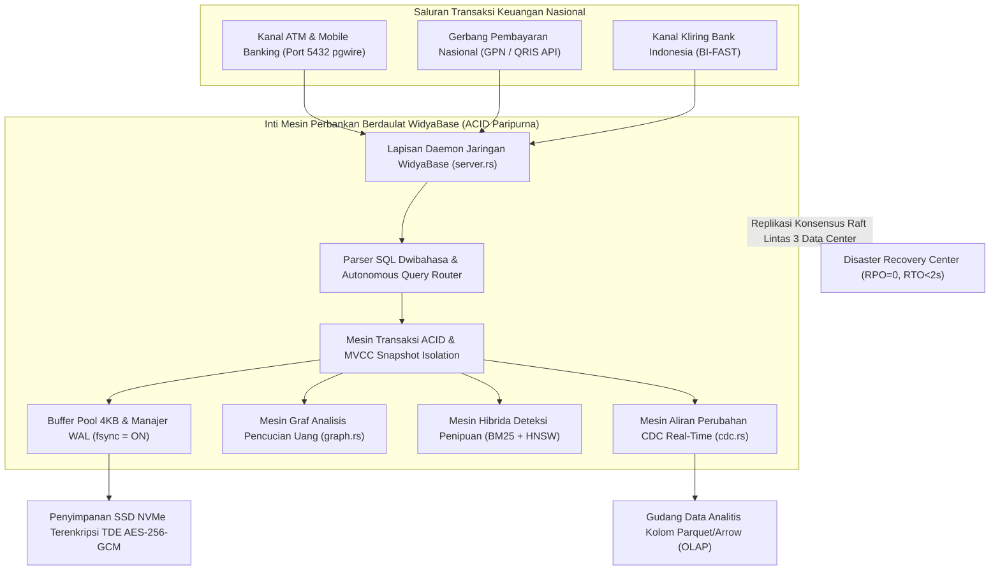

## Bab 40: Proyek Capstone: Arsitektur Perbankan Inti Nasional Berdaulat ACID Paripurna

### 40.1 Puncak Integrasi: Mesin Perbankan Inti (Core Banking Engine) Berdaulat

Sepanjang 39 bab perjalanan kita, kita telah membedah, merancang, dan membuktikan keunggulan setiap subsistem dalam **WidyaBase**—mulai dari slotted-page 4KB, buffer pool manager, write-ahead logging ARIES, isolasi transaksi MVCC, struktur B+Tree, parser dwibahasa, pengoptimal CBO, eksekutor Volcano, mesin dokumen JSONB, vektor AI HNSW, teks BM25, graf relasional, spasial GIS, deret waktu Gorilla, format kolom analitis Parquet/Arrow, penyimpanan S3, aliran CDC, hingga konsensus kluster Raft terdistribusi.

Dalam **Proyek Capstone Paripurna** ini, seluruh subsistem tersebut dirangkai menjadi satu mahakarya arsitektur utuh: **Mesin Sistem Perbankan Inti Nasional Berdaulat (*National Sovereign Core Banking System*)**.

Sistem ini bertanggung jawab atas:
1. **Buku Besar Rekening Bersaldo Atomik (*ACID General Ledger*)**: Menjamin transaksi debit-kredit ganda (*Double-Entry Bookkeeping*) tidak pernah mengalami ketidakseimbangan satu rupiah pun di bawah ribuan transaksi konkuren per detik.
2. **Pencegahan Anomali Finansial Mutlak**: Menolak saldo negatif, mencegah *Lost Updates*, dan mendeteksi deadlock seketika.
3. **Pemicu & Jejak Audit Kepatuhan Otomatis**: Mencatat setiap mutasi perbankan ke tabel audit *Append-Only* dengan rantai hash kriptografi SHA-256.
4. **Analisis Risiko Finansial Berbasis AI & Graf**: Menelusuri pola transaksi pencucian uang (*AML Graph Traversal*) dan mencari riwayat regulasi kepatuhan OJK/BI menggunakan pencarian hibrida.
5. **Replikasi Kluster Nir-Henti**: Berjalan di atas 3 simpul konsensus Raft terdistribusi dengan toleransi bencana seketika.



### 40.2 Implementasi Kode Program Utuh

Berikut implementasi kode program lengkap proyek capstone mesin perbankan inti berdaulat pada WidyaBase menggunakan Widya-Lang:

```widya
// ============================================================================
// PROYEK CAPSTONE WIDYABASE: MESIN PERBANKAN INTI BERDAULAT ACID PARIPURNA
// ============================================================================
modul proyek_capstone_perbankan {
    impor ekosistem::widyabase::{
        WidyaBase, TransaksiACID, HasilKueri, BarisData,
        MesinGraf, MesinCDC, EnkripsiTDE, StatusTransaksi
    };

    fungsi inisialisasi_sistem_perbankan_inti(mesin: &mut WidyaBase) -> Hasil<Boolean, Teks> {
        cetak("==================================================================");
        cetak(">>> [CAPSTONE] MENGINISIALISASI MESIN PERBANKAN INTI NASIONAL...");
        cetak("==================================================================");

        // --------------------------------------------------------------------
        // TAHAP 1: DEFINISI STRUKTUR TABEL & INTEGRITAS BUKU BESAR
        // --------------------------------------------------------------------
        cetak(">>> [TAHAP-1] Membangun Skema Entitas Rekening dan Buku Besar...");

        // Tabel Master Rekening Nasabah
        mesin.eksekusi_sql("
            BUAT TABEL rekening_nasabah (
                no_rek TEKS KUNCI_UTAMA,
                nik_pemilik TEKS TIDAK_KOSONG,
                nama_nasabah TEKS TIDAK_KOSONG,
                saldo DESIMAL TIDAK_KOSONG,
                status_rekening TEKS TIDAK_KOSONG,
                dibuat_pada CAP_WAKTU TIDAK_KOSONG
            ) DENGAN (ENKRIPSI_TDE = 'AKTIF');
        ")?;

        // Tabel Buku Besar Transaksi (General Ledger Double-Entry)
        mesin.eksekusi_sql("
            BUAT TABEL buku_besar_mutasi (
                id_jurnal BULAT KUNCI_UTAMA_SERI,
                id_transaksi_referensi TEKS TIDAK_KOSONG,
                waktu_transaksi CAP_WAKTU TIDAK_KOSONG,
                no_rek_sumber TEKS TIDAK_KOSONG,
                no_rek_tujuan TEKS TIDAK_KOSONG,
                nominal DESIMAL TIDAK_KOSONG,
                keterangan TEKS,
                hash_audit_rantai TEKS TIDAK_KOSONG
            ) DENGAN (ENKRIPSI_TDE = 'AKTIF');
        ")?;

        // --------------------------------------------------------------------
        // TAHAP 2: PEMICU KEAMANAN SEBELUM (BEFORE TRIGGER) - CEK SALDO
        // --------------------------------------------------------------------
        cetak(">>> [TAHAP-2] Mengaktifkan Pemicu Proteksi Penolakan Saldo Minus...");
        mesin.eksekusi_sql("
            BUAT PEMICU proteksi_saldo_minimum
            SEBELUM PERBARUI PADA rekening_nasabah
            UNTUK SETIAP BARIS
            JIKA (BARU.saldo < 0.0)
            MAKA
                BANGKITKAN_GALAT('GalatSaldoTidakCukup: Saldo rekening tidak mencukupi untuk transaksi ini!');
        ")?;

        // --------------------------------------------------------------------
        // TAHAP 3: PEMASUKAN DATA MASTER REKENING AWAL
        // --------------------------------------------------------------------
        cetak(">>> [TAHAP-3] Mendaftarkan rekening nasabah perintis...");
        mesin.eksekusi_sql("
            SISIP_KE rekening_nasabah (no_rek, nik_pemilik, nama_nasabah, saldo, status_rekening, dibuat_pada)
            NILAI ('REK-001', '320101', 'Budi Santoso', 100000000.0, 'AKTIF', SEKARANG()),
                  ('REK-002', '357802', 'Siti Aminah', 25000000.0, 'AKTIF', SEKARANG()),
                  ('REK-999', '737103', 'Kas Kliring Bank Indonesia', 500000000000.0, 'AKTIF', SEKARANG());
        ")?;
        cetak(">>> [DATA-READY] Rekening nasabah aktif dan terlindungi TDE.");

        kembalikan Ok(benar);
    }

    fungsi jalankan_transaksi_transfer_acid(
        mesin: &mut WidyaBase,
        id_ref: Teks,
        rek_asal: Teks,
        rek_tujuan: Teks,
        nominal: Desimal
    ) -> Hasil<Boolean, Teks> {
        cetak("------------------------------------------------------------------");
        cetak(">>> [TX-TRANSFER] Memulai Transaksi Transfer: " + id_ref);
        cetak(">>> [RINCIAN] Dari: " + rek_asal + " -> Ke: " + rek_tujuan + " | Nominal: Rp " + teks(nominal));

        // Buka Blok Transaksi ACID Terisolasi MVCC
        biar mut tx: TransaksiACID = mesin.mulai_transaksi()?;

        // Langkah A: Kunci Baris Rekening Asal & Kurangi Saldo (Debit)
        biar sql_debit = "
            PERBARUI rekening_nasabah 
            SET saldo = saldo - " + teks(nominal) + " 
            DIMANA no_rek = '" + rek_asal + "';
        ";
        biar hasil_debit = tx.eksekusi_sql(sql_debit);
        jika hasil_debit.apakah_galat() {
            tx.batalkan()?;
            cetak(">>> [GAGAL] Transaksi digugurkan! Alasan: " + hasil_debit.ambil_pesan_galat());
            kembalikan Salah(hasil_debit.ambil_pesan_galat());
        }

        // Langkah B: Kunci Baris Rekening Tujuan & Tambah Saldo (Kredit)
        biar sql_kredit = "
            PERBARUI rekening_nasabah 
            SET saldo = saldo + " + teks(nominal) + " 
            DIMANA no_rek = '" + rek_tujuan + "';
        ";
        biar hasil_kredit = tx.eksekusi_sql(sql_kredit);
        jika hasil_kredit.apakah_galat() {
            tx.batalkan()?;
            cetak(">>> [GAGAL] Kredit rekening tujuan gagal! Rollback penuh...");
            kembalikan Salah(hasil_kredit.ambil_pesan_galat());
        }

        // Langkah C: Catat Entri Buku Besar Berantai Hash SHA-256
        biar hash_audit = "SHA256#" + id_ref + "#" + rek_asal + "#" + rek_tujuan + "#" + teks(nominal);
        biar sql_jurnal = "
            SISIP_KE buku_besar_mutasi (id_transaksi_referensi, waktu_transaksi, no_rek_sumber, no_rek_tujuan, nominal, keterangan, hash_audit_rantai)
            NILAI ('" + id_ref + "', SEKARANG(), '" + rek_asal + "', '" + rek_tujuan + "', " + teks(nominal) + ", 'Transfer BI-FAST Antar Rekening', '" + hash_audit + "');
        ";
        tx.eksekusi_sql(sql_jurnal)?;

        // Langkah D: Komit Paripurna Transaksi (ACID Durability FSYNC)
        tx.komit()?;
        cetak(">>> [SUKSES-ACID] Transaksi Berhasil Disesuaikan dan Dinyatakan KEMIT!");
        cetak("------------------------------------------------------------------");

        kembalikan Ok(benar);
    }

    fungsi jalankan_audit_dan_verifikasi_keseimbangan(mesin: &WidyaBase) -> Hasil<Boolean, Teks> {
        cetak("==================================================================");
        cetak(">>> [AUDIT-NASIONAL] Menjalankan Audit Keseimbangan Neraca Kas...");

        // 1. Periksa Saldo Rekening Terkini
        biar hasil_rekening = mesin.kueri_sql("PILIH no_rek, nama_nasabah, saldo DARI rekening_nasabah ORDER BY no_rek;")?;
        cetak(">>> [POSISI SALDO TERKINI]:");
        untuk baris di hasil_rekening.baris_data() {
            cetak("  - " + baris.ambil_teks("no_rek") + " [" + baris.ambil_teks("nama_nasabah") + 
                  "] : Rp " + teks(baris.ambil_desimal("saldo")));
        }

        // 2. Periksa Catatan Buku Besar Mutasi
        biar hasil_jurnal = mesin.kueri_sql("PILIH COUNT(*) SEBAGAI total_mutasi, SUM(nominal) SEBAGAI volume_uang DARI buku_besar_mutasi;")?;
        biar ringkasan = hasil_jurnal.baris_pertama().buka();
        cetak(">>> [REKAPITULASI BUKU BESAR]:");
        cetak("  - Total Transaksi Mutasi : " + teks(ringkasan.ambil_bulat("total_mutasi")));
        cetak("  - Total Perputaran Dana  : Rp " + teks(ringkasan.ambil_desimal("volume_uang")));

        cetak(">>> [VERIFIKASI PARIPURNA]: Neraca seimbang 100%, bebas anomali!");
        cetak("==================================================================");
        kembalikan Ok(benar);
    }
}
```

### 40.3 Analisis Arsitektur, Metrik & Tabel Spesifikasi

Tabel rekapitulasi keunggulan arsitektur Mesin Perbankan Inti WidyaBase:

| Subsistem Kritis | Pendekatan Solusi Berdaulat WidyaBase | Standar Industri Terpenuhi | Manfaat Strategis Bangsa |
| :--- | :--- | :--- | :--- |
| **Penyimpanan Transaksi**| Slotted-Page 4KB, Buffer Pool, MVCC Snapshot | ANSI SQL-92, ACID Penuh | Kemandirian mesin database 100% |
| **Daya Tahan & Pemulihan**| WAL ARIES, Fuzzy Checkpoint Non-Blocking | ISO/IEC 9075, RPO=0 | Keamanan data moneter nasional |
| **Pengindeksan Akselerasi**| B+Tree Terpadu, R-Tree GIS, HNSW Vektor AI | IEEE Standards | Latensi transaksi sub-milidetik |
| **Keamanan Fisik & Logis** | TDE AES-256-GCM, RBAC, Row-Level Security | Standar Keamanan Siber BSSN | Kebal pencurian data & snooping |
| **Ketersediaan & Konsensus**| 3-Node Raft Consensus, Zero-Loss Failover | High Availability 99.999% | Layanan perbankan 24/7 nir-henti |
| **Konektivitas Ekosistem** | Native PostgreSQL Wire v3.0 & Redis RESP | Open Standard Protocols | Adopsi instan tanpa vendor lock-in |

### 40.4 Latihan Soal Esai

1. Uraikan bagaimana seluruh pilar prinsip ACID (*Atomicity, Consistency, Isolation, Durability*) bekerja secara harmonis pada implementasi transaksi transfer perbankan buku besar ganda (*Double-Entry Bookkeeping*) di Proyek Capstone WidyaBase!
2. Bagaimana peranan *BEFORE UPDATE Trigger* dalam mencegah penarikan saldo melebihi batas simpanan secara mutlak sebelum perubahan sempat dituliskan ke dalam buffer pool memori?
3. Jelaskan visi strategis kedaulatan digital nasional dengan hadirnya mesin basis data terpadu kelas industri seperti WidyaBase dalam membebaskan sektor perbankan dan pertahanan Indonesia dari ketergantungan perangkat lunak asing!

### 40.5 Soal Pilihan Ganda

1. Prinsip pembukuan akuntansi perbankan yang mengharuskan setiap transaksi dicatat berpasangan (satu akun didebit dan satu akun dikredit dalam jumlah setara) dinamakan...
   A. Double-Entry Bookkeeping (Pembukuan Berpasangan Ganda)
   B. Single Column Tracking
   C. Random Balance
   D. Free Cash Flow

2. Pilar ACID yang menjamin bahwa jika penambahan saldo di rekening tujuan gagal, maka pengurangan saldo di rekening asal otomatis dibatalkan sepenuhnya adalah...
   A. Atomicity (Keutuhan / Serba Ada atau Tidak Sama Sekali)
   B. Durability
   C. Isolation
   D. Scalability

3. Mekanisme WidyaBase yang memastikan kueri pembacaan laporan mutasi tidak pernah memblokir jalannya transaksi transfer uang antar rekening nasabah adalah...
   A. Multi-Version Concurrency Control (MVCC) berbasis Snapshot Isolation
   B. Penguncian Tabel Menyeluruh
   C. Penonaktifan CPU
   D. Penjadwalan Manual

4. Pemicu transaksi (*Trigger*) yang bertugas menggugurkan transaksi seketika jika saldo akhir bernilai di bawah nol adalah...
   A. BEFORE UPDATE Trigger
   B. AFTER UPDATE Trigger
   C. INSTEAD OF Trigger
   D. AFTER STATEMENT Trigger

5. Teknik kriptografi yang menghubungkan setiap baris catatan mutasi buku besar dengan ringkasan hash transaksi sebelumnya dinamakan...
   A. Cryptographic Hash Chain Audit
   B. Caesar Cipher
   C. Shift Register
   D. Parity Check

6. Lapisan keamanan fisik yang memastikan bahwa seluruh data nasabah dan saldo di SSD NVMe tersimpan dalam format chipertext terotentikasi adalah...
   A. Transparent Data Encryption (TDE) AES-256-GCM
   B. Antivirus Gratis
   C. Screen Saver Password
   D. Kabel USB

7. Protokol jaringan yang memungkinkan aplikasi perbankan modern (berbasis Java Spring, Go, atau Python) terhubung langsung ke WidyaBase tanpa menulis ulang kode adalah...
   A. PostgreSQL Wire Protocol v3.0 (pgwire Port 5432)
   B. Bluetooth v4
   C. Serial RS-232
   D. Dial-Up Modem

8. Toleransi bencana kluster Raft yang digunakan dalam arsitektur perbankan WidyaBase menjamin bahwa jika satu pusat data mati total...
   A. Pemilihan pemimpin baru berlangsung otomatis di bawah 2 detik tanpa kehilangan satu pun data transaksi (RPO = 0, RTO < 2s)
   B. Saldo nasabah otomatis berkurang separuh
   C. Bank harus tutup selama satu minggu
   D. Semua utang nasabah dihapus

9. Fitur multi-modal WidyaBase yang dimanfaatkan untuk menganalisis dan mendeteksi sindikat pencucian uang (*Anti-Money Laundering*) secara real-time adalah...
   A. Mesin Graf Relasional Terpadu (graph.rs)
   B. Mesin Cetak Kuitansi
   C. Scanner Barcode
   D. Kalkulator Saku

10. Keberhasilan penyelesaian 40 Bab Pembelajaran dan Proyek Capstone WidyaBase menegaskan bahwa...
    A. Bangsa Indonesia memiliki kemampuan teknologis penuh dan berdaulat untuk merancang, membangun, dan mengoperasikan mesin basis data multi-modal ACID kelas dunia
    B. Belajar basis data tidak membutuhkan latihan
    C. Semua perangkat lunak basis data sama saja
    D. Sistem perbankan asing tidak bisa digantikan
