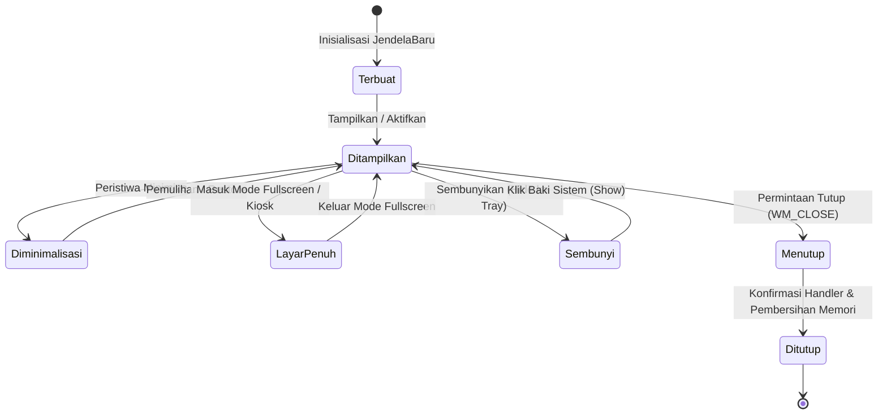

## Bab 2: Anatomi Windowing Native & Pengelolaan Siklus Hidup Jendela

### 2.1 Event Loop Sistem Operasi & Status Jendela Murni

Sistem jendela (*windowing system*) pada platform komputer personal adalah abstraksi tingkat tinggi yang dikelola oleh subsistem grafik kernel sistem operasi: *Desktop Window Manager* (DWM) dan `user32.dll` pada Microsoft Windows, server tampilan *X11* atau *Wayland* pada Linux, serta subsistem *Quartz/Cocoa* pada Apple macOS.

Pada arsitektur WidyaDesktop, antarmuka jendela dikendalikan secara langsung oleh modul `pure_window.rs` tanpa perantara toolkit berat seperti GTK atau Qt. Setiap jendela direpresentasikan oleh struktur `JendelaMurni` yang terdaftar dalam `PengelolaJendelaMurni`. Mesin ini mengelola **Event Loop** asinkron yang menangkap peristiwa perangkat masukan (*mouse click*, *key press*, *resize*, *minimize*, *focus change*) dan menyalurkannya dengan latensi sub-milidetik.



Siklus hidup jendela pada WidyaDesktop mencakup fase-fase kritis:
1. **Fase Alokasi & Inisialisasi**: Struktur memori jendela disiapkan dengan batasan geometri default, atribut dekorasi bingkai, dan token IPC unik.
2. **Fase Presentasi (*Show & Focus*)**: Buffer bingkai jendela dipetakan ke layar fisik monitor, dan jendela memperoleh fokus masukan utama (*active input focus*).
3. **Fase Mutasi Keadaan (*State Mutation*)**: Penanganan perubahan dinamis seperti minimisasi, maksimisasi, peralihan ke mode layar penuh (*exclusive kiosk fullscreen*), atau penyesuaian dimensi.
4. **Fase Terminasi Anggun (*Graceful Termination*)**: Menangkap sinyal penutupan (`WM_CLOSE` atau `window.close()`), mengeksekusi kait (*hook*) penyimpanan data transaksi, dan membebaskan pegangan grafis (*graphics context handle*) secara aman.

### 2.2 Implementasi Kode Widya-Lang & WidyaDesktop Utuh

Berikut implementasi pengelolaan siklus hidup jendela, pencegahan penutupan tidak disengaja, dan manipulasi status pada Widya-Lang:

```widya
// Modul Pengendalian Siklus Hidup Jendela Kasir
modul pengelola_siklus_jendela {
    impor "./modul/desktop.wya";

    fungsi kelola_siklus_jendela_kasir() {
        // 1. Buat Jendela Utama Aplikasi Kasir
        misal jendela = BuatAplikasiDesktop("Sistem Penjualan Toko Berdaulat", 1024, 768);
        jendela.pusatkan();

        // 2. State untuk Melacak Apakah Ada Transaksi Tertunda
        misal mut transaksi_aktif = benar;

        // 3. Registrasi RPC untuk Mengubah Status Layar Penuh
        jendela.daftarkan_rpc("alih_layar_penuh", fungsi(payload) {
            misal aktif = payload.layar_penuh;
            jendela.set_layar_penuh(aktif);
            kembalikan { "sukses": benar, "status_fullscreen": aktif };
        });

        // 4. Registrasi RPC Permintaan Tutup Jendela dengan Validasi Transaksi
        jendela.daftarkan_rpc("minta_tutup_jendela", fungsi(_payload) {
            jika (transaksi_aktif) {
                // Tampilkan Kotak Dialog Konfirmasi
                misal konfirmasi = TampilkanKotakPesan(
                    "Peringatan",
                    "Transaksi Belum Selesai",
                    "Ada transaksi kasir yang sedang aktif. Yakin ingin membatalkan dan keluar?"
                );
                jika (konfirmasi != "ya") {
                    kembalikan { "sukses": salah, "alasan": "Dibatalkan oleh kasir" };
                }
            }

            // Bersihkan data dan tutup jendela secara anggun
            cetak(">>> [WINDOW] Menutup jendela dan melepaskan sumber daya...");
            jendela.tutup();
            kembalikan { "sukses": benar };
        });

        kembalikan jendela;
    }
}
```

### 2.3 Analisis Kinerja, Keamanan & Tabel Metrik Arsitektur

Tabel transisi status jendela dan alokasi sumber daya proses:

| Status Jendela (`StatusJendela`) | Konsumsi CPU Thread Render | Status Konsumsi Buffer VRAM | Penghematan Daya (EcoQoS) |
| :--- | :--- | :--- | :--- |
| **Ditampilkan (Aktif/Focused)** | Standar (1.0 – 2.5%) | Alokasi Penuh (Front + Back Buffer) | Normal Mode |
| **Ditampilkan (Unfocused)** | Rendah (< 0.5%) | Alokasi Penuh (Refresh Pasif) | Throttle Ringan |
| **Diminimalisasi (Minimized)** | Mendekati Nol (< 0.1%) | Swap Buffer Dibekukan Sementara | Active App Nap / EcoQoS |
| **Sembunyi di Tray (Hidden)** | Nol Murni (0.0% CPU) | Buffer Layar Dikosongkan (RAM Only) | Sleep Subsystem |
| **Mode Kiosk Eksklusif** | Dioptimalkan V-Sync 60 FPS | Buffer Eksklusif Layar Penuh | Mode Performa Tinggi |

### 2.4 Latihan Praktik & Studi Kasus

1. Mengapa penanganan sinyal penutupan jendela (*close event handler*) pada aplikasi kasir ritel wajib dirancang secara sinkron untuk memvalidasi transaksi yang belum tersimpan ke basis data?
2. Jelaskan bagaimana mekanisme pembekuan buffer rendering saat jendela diminimalisasi mampu menghemat konsumsi energi baterai pada komputer jinjing stasiun kerja lapangan!
3. Uraikan perbedaan mendasar antara mode jendela layar penuh biasa (*windowed fullscreen*) dengan mode Kiosk eksklusif (*borderless top-level kiosk*) dalam konteks keamanan stasiun kerja kasir!

### 2.5 Evaluasi Mandiri Pilihan Ganda

1. Struktur internal Rust yang bertindak sebagai representasi inti jendela native pada WidyaDesktop adalah...
   A. `JendelaMurni`
   B. `VirtualDomWindow`
   C. `HtmlIframeElement`
   D. `BrowserWindowProxy`

2. Status jendela ketika diminimalisasi ke bilah tugas (taskbar) dan buffernya dibekukan untuk menghemat daya adalah...
   A. `StatusJendela::Diminimalisasi`
   B. `StatusJendela::RusakTotal`
   C. `StatusJendela::DihapusPermanen`
   D. `StatusJendela::Panik`

3. Apa keuntungan utama arsitektur Event Loop asinkron pada modul `pure_window.rs`?
   A. Menangkap dan menyalurkan masukan pengguna dengan latensi sub-milidetik tanpa memblokir thread eksekusi bisnis
   B. Mematikan seluruh fungsi mouse
   C. Mengubah warna tombol secara acak
   D. Memperlambat reaksi kompilator

4. Metode yang digunakan untuk memosisikan jendela tepat di tengah layar monitor utama secara otomatis adalah...
   A. `jendela.pusatkan()`
   B. `jendela.geser_ke_pinggir()`
   C. `jendela.sembunyikan_selamanya()`
   D. `jendela.putar_90_derajat()`

5. Manakah pernyataan yang benar mengenai penanganan peristiwa penutupan jendela (*close handler*) pada WidyaDesktop?
   A. Pengembang dapat mencegat permintaan penutupan untuk menampilkan konfirmasi penyimpanan data sebelum jendela dihancurkan
   B. Jendela selalu tertutup paksa tanpa peringatan apapun
   C. Komputer langsung mati seketika
   D. File sistem operasi otomatis terhapus

6. Pada kondisi jendela disembunyikan ke baki sistem (*hidden to tray*), pemakaian sumber daya pemrosesan CPU adalah...
   A. Mendekati atau tepat 0% CPU
   B. Konstan 100% CPU
   C. 50% CPU per inti
   D. Memerlukan pendingin nitrogen cair

7. Jenis mode tampilan di mana jendela menutupi seluruh ruang monitor tanpa dekorasi bingkai dan mencegah pengguna beralih aplikasi disebut...
   A. Mode Kiosk (Kiosk Mode)
   B. Mode Screensaver
   C. Mode Safe Graphics
   D. Mode Notepad

8. Komponen yang bertugas melacak seluruh daftar jendela aktif dan mengoordinasikan interaksi antar-jendela adalah...
   A. `PengelolaJendelaMurni`
   B. `DiskCleanupWizard`
   C. `FontRegistry`
   D. `AudioMixer`

9. Apa yang terjadi pada buffer grafis jendela ketika jendela diminimalkan pada sistem operasi modern?
   A. Buffer perenderan dibekukan dan frekuensi pembaruan frame diturunkan drastis untuk menghemat energi
   B. Kartu grafis dilepaskan dari motherboard
   C. Resolusi layar komputer diturunkan ke 320x240
   D. Tampilan jendela dicetak ke printer kertas

10. Fungsi pustaka standar `dialog_pesan(tipe, judul, isi)` pada Widya-Lang berguna untuk...
    A. Menampilkan kotak dialog modal pesan sistem native sistem operasi
    B. Mengirim email ke seluruh kontak kasir
    C. Memainkan file audio MP3
    D. Menulis data mentah ke flashdisk
