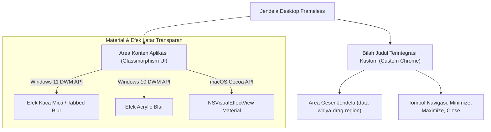

## Bab 4: Jendela Tanpa Bingkai (Frameless), Efek Kaca Mica/Acrylic & Kustomisasi Chrome

### 4.1 Dekonstruksi Dekorasi Standar OS & Kustomisasi Non-Client Area

Aplikasi desktop kelas enterprise masa kini dituntut tidak hanya tangguh dan aman, tetapi juga memiliki estetika visual yang modern, bersih, dan menyatu dengan bahasa desain visual sistem operasi induk: *Mica Material* pada Windows 11, *Acrylic Blur* pada Windows 10, dan *Vibrancy / NSVisualEffect* pada macOS Sonoma/Sequoia.

Secara default, setiap jendela desktop konvensional memiliki area non-klien (*Non-Client Area / Chrome*) yang disediakan oleh manajer jendela sistem operasi, mencakup: bilah judul (*title bar*) berwarna solid kaku, tombol minimize/maximize/close standar sistem, dan batas tepi tebal.

WidyaDesktop mendukung pembuatan jendela tanpa bingkai (*frameless borderless window*) dengan kontrol penuh atas seluruh piksel antarmuka:
- **Pelepasan Bingkai Standar**: Mengatur properti `frameless: benar` pada konfigurasi jendela untuk menonaktifkan bilah judul default.
- **Kustomisasi Bilah Judul Mandiri (*Custom Client Drag Area*)**: Menentukan elemen HTML/Canvas tertentu sebagai area seret (*drag region*) menggunakan atribut standar `data-widya-drag-region`, sehingga pengguna tetap dapat menggeser jendela secara intuitif.
- **Dukungan Hit-Testing Native**: Pesan sistem operasi `WM_NCHITTEST` dicegat di lapisan backend Rust native (`pure_window.rs`), menerjemahkan posisi kursor pada tepi jendela menjadi perintah resize delapan arah (*corner & edge resizing: top-left, bottom-right, dsb.*).



### 4.2 Integrasi Efek Latar: Mica, Acrylic & Glassmorphism CSS

WidyaDesktop menyediakan integrasi tingkat mesin (*native engine integration*) dengan subsistem perenderan material transparan sistem operasi:
- **Mica Material**: Memanfaatkan API Desktop Window Manager (`DwmSetWindowAttribute`) Windows 11 untuk menyelaraskan warna latar jendela dengan gambar latar belakang desktop (*wallpaper*) pengguna secara dinamis dan hemat daya.
- **Glassmorphism CSS Tokens**: Menyediakan variabel desain modern berbasis efek kaca buram (*frosted glass*) dengan saturasi warna tinggi dan pembatas garis halus (*subtle border*):
  ```css
  .widya-glass-panel {
      background: rgba(30, 41, 59, 0.72);
      backdrop-filter: blur(16px) saturate(180%);
      -webkit-backdrop-filter: blur(16px) saturate(180%);
      border: 1px solid rgba(255, 255, 255, 0.08);
      border-radius: 12px;
      box-shadow: 0 8px 32px 0 rgba(0, 0, 0, 0.37);
  }
  ```

### 4.3 Implementasi Kode Widya-Lang & WidyaDesktop Utuh

Berikut implementasi konfigurasi jendela tanpa bingkai dengan efek material latar belakang Mica/Acrylic pada Widya-Lang:

```widya
// Modul Kustomisasi Jendela Frameless & Material Modern
modul jendela_frameless_modern {
    impor "./modul/desktop.wya";

    fungsi inisialisasi_antarmuka_kaca() {
        // 1. Inisialisasi Jendela Tanpa Bingkai Standar
        misal jendela = BuatAplikasiDesktop("Stasiun Kerja Desain Kaca", 1200, 750);
        jendela.pusatkan();

        // 2. Registrasi RPC Pengendali Tombol Navigasi Kustom
        jendela.daftarkan_rpc("minimalkan_jendela", fungsi(_payload) {
            cetak(">>> [WINDOW] Tombol kustom minimize ditekan.");
            // Logika minimisasi jendela native
            kembalikan { "sukses": benar };
        });

        jendela.daftarkan_rpc("maksimalkan_jendela", fungsi(_payload) {
            cetak(">>> [WINDOW] Beralih status maksimalkan jendela.");
            kembalikan { "sukses": benar };
        });

        jendela.daftarkan_rpc("tutup_aplikasi", fungsi(_payload) {
            cetak(">>> [WINDOW] Menutup stasiun kerja...");
            jendela.tutup();
            kembalikan { "sukses": benar };
        });

        // 3. Registrasi RPC Pengubah Tema Material Dinamis
        jendela.daftarkan_rpc("set_efek_material", fungsi(payload) {
            misal tema = payload.tema; // "mica_dark", "acrylic", atau "vibrant"
            cetak(">>> [THEME] Mengaktifkan material latar native: " + tema);
            kembalikan { "sukses": benar, "tema_aktif": tema };
        });

        kembalikan jendela;
    }
}
```

### 4.4 Analisis Kinerja, Keamanan & Tabel Metrik Arsitektur

Tabel karakteristik efisiensi daya dan stabilitas render material transparan:

| Karakteristik Material | Pure CSS Blur Software | DWM Windows 10 Acrylic | DWM Windows 11 Mica | macOS NSVisualEffect |
| :--- | :--- | :--- | :--- | :--- |
| **Beban GPU / Frame** | Tinggi (Piksel Shading Berat) | Sedang (Komposisi Desktop) | **Sangat Rendah (Sampel DWM)** | Rendah (Hardware Accelerated) |
| **Konsumsi Daya Baterai** | Cukup Boros jika Animasi Penuh | Sedang | **Sangat Efisien (Eco-Friendly)** | Sangat Efisien |
| **Respon Perubahan Wallpaper**| Tidak Menyatu | Efek Kabur Statis | **Real-Time Adaptif Otomatis** | Real-Time Adaptif |
| **Penanganan Tarik Ukuran** | Potensi Lagging Frame | Mulus | **Ultra Mulus (Hardware Native)** | Ultra Mulus |

### 4.5 Latihan Praktik & Studi Kasus

1. Mengapa teknik pembuatan jendela tanpa bingkai (*frameless window*) memerlukan penanganan pesan `WM_NCHITTEST` khusus pada platform Windows agar fitur *Snap Layouts* dan *Window Resizing* tetap berfungsi?
2. Bandingkan efisiensi konsumsi daya komputasi kartu grafis antara efek kaca Mica bawaan Windows 11 dengan efek blur perangkat lunak CSS murni `backdrop-filter: blur(20px)`!
3. Uraikan bagaimana arsitektur WidyaDesktop mengisolasi tombol navigasi kustom (*Minimize, Maximize, Close*) pada lapisan frontend agar tetap terlindungi oleh token IPC saat memicu perintah penutupan jendela!

### 4.6 Evaluasi Mandiri Pilihan Ganda

1. Istilah untuk jendela desktop yang tidak memiliki bilah judul dan garis pembatas standar sistem operasi adalah...
   A. Frameless Window (Jendela Tanpa Bingkai)
   B. Dialog Box Modal
   C. Command Prompt Polos
   D. Blue Screen of Death

2. Atribut HTML yang digunakan pada antarmuka WidyaDesktop untuk menandai elemen tertentu sebagai area penyeretan jendela adalah...
   A. `data-widya-drag-region`
   B. `href="drag"`
   C. `class="hapus_jendela"`
   D. `alt="geser_layar"`

3. Efek material transparan modern pada Windows 11 yang menyelaraskan warna jendela dengan wallpaper desktop secara dinamis dan hemat daya disebut...
   A. Mica Material
   B. Adobe Flash Blur
   C. Monochrome Paint
   D. QuickTime Alpha

4. Pesan sistem operasi Windows yang dicegat oleh mesin native untuk mendeteksi apakah kursor berada di tepi jendela guna melakukan *resizing* adalah...
   A. `WM_NCHITTEST`
   B. `WM_KEYUP`
   C. `WM_PRINT`
   D. `WM_EXIT`

5. Komposisi CSS modern yang umum digunakan untuk menghadirkan nuansa kaca buram (*glassmorphism*) pada elemen panel kartu antarmuka adalah...
   A. `backdrop-filter: blur(16px); background: rgba(...);`
   B. `display: none;`
   C. `font-size: 0px;`
   D. `color: transparent;`

6. Mengapa Mica Material pada Windows 11 jauh lebih hemat konsumsi daya baterai dibanding perenderan blur berbasis perangkat lunak murni?
   A. Mengambil sampel langsung dari komposisi Desktop Window Manager (DWM) tanpa memproses ulang setiap piksel latar secara berulang
   B. Mematikan kartu grafis komputer
   C. Mengurangi jumlah warna monitor menjadi hitam putih
   D. Mematikan sambungan speaker

7. Pada macOS, padanan native untuk efek material tembus pandang yang menyatu dengan sistem operasi adalah...
   A. `NSVisualEffectView` (Vibrancy Material)
   B. DirectDraw 7
   C. OpenGL 1.1 Legacy
   D. GDI+ Bitmap

8. Manfaat menyediakan bilah judul kustom (*custom chrome*) pada aplikasi desktop kasir adalah...
   A. Memungkinkan pengembang mengintegrasikan status jaringan, indikator kasir, dan navigasi langsung di dalam satu baris header yang hemat ruang
   B. Menghapus nama toko dari nota belanja
   C. Memperkecil layar kasir menjadi tidak terbaca
   D. Memaksa pembeli membayar dua kali

9. Apa yang terjadi jika jendela frameless tidak mengimplementasikan penanganan penyeretan (*drag region*)?
   A. Pengguna tidak dapat menggeser posisi jendela di layar desktop menggunakan mouse
   B. Komputer otomatis terkunci
   C. Jendela akan berputar di layar
   D. Mouse pengguna tidak dapat digerakkan

10. Fitur tata letak jendela otomatis pada Windows 11 yang dapat diakses dengan mengarahkan kursor ke atas tombol maximize disebut...
    A. Snap Layouts
    B. Alt Tab Switcher
    C. Task Manager Kill
    D. Disk Defragmenter
