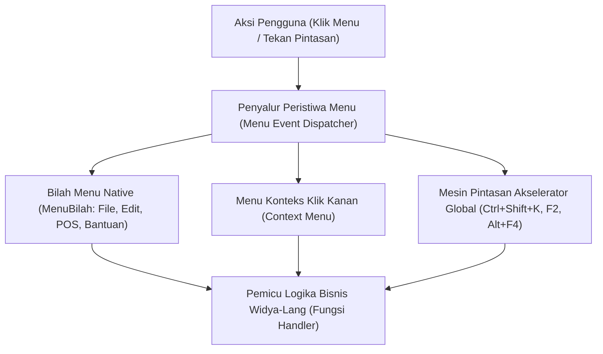

## Bab 6: Integrasi Menu Sistem, Bilah Menu Native & Pintasan Akselerator Global

### 6.1 Bilah Menu Native Sistem Operasi & Menu Konteks

Integrasi yang mendalam dengan antarmuka sistem operasi induk merupakan ciri pembeda utama antara aplikasi desktop kelas profesional dengan aplikasi web biasa yang dibungkus seadanya. 

WidyaDesktop menyediakan abstraksi terpadu untuk dua paradigma menu:
1. **Bilah Menu Jendela (*Native Menu Bar*)**:
   - Pada **Windows dan Linux**, menu dirender tepat di bawah bilah judul jendela atau menyatu dengan bilah kustom (*Titlebar Menu Integration*).
   - Pada **macOS**, menu secara otomatis didelegasikan ke bilah menu terpadu di bagian paling atas layar (*macOS Global Apple Menu Bar*) melalui subsistem `NSMenu` Cocoa native.
2. **Menu Konteks Klik Kanan (*Native Context Menu*)**: Menu melayang (*popup menu*) yang muncul seketika di posisi kursor mouse (`WM_CONTEXTMENU`), menawarkan tindakan kontekstual cepat (seperti *Salin*, *Tempel*, *Hapus Transaksi*, *Cetak Ulang Struk*).



### 6.2 Pintasan Sistem Operasi & Akselerator Global (*Global Hotkeys Engine*)

Pada stasiun kerja kasir dan lingkungan pergudangan berkecepatan tinggi, operator jarang menggunakan mouse. Kecepatan operasional sepenuhnya bergantung pada pintasan keyboard (*keyboard shortcuts & accelerators*).

WidyaDesktop membedakan dua jenis akselerator keyboard:
- **Akselerator Lokal Jendela**: Berfungsi ketika jendela aplikasi aktif dan memiliki fokus masukan (misalnya: `F2` untuk transaksi baru, `F5` untuk cetak struk, `Ctrl+N` untuk item baru).
- **Pintasan Global Sistem Operasi (*Global Hotkeys*)**: Didaftarkan langsung ke tingkat kernel sistem operasi (`RegisterHotKey` Win32 API atau `CGEventTap` macOS). Pintasan ini dapat menangkap kombinasi tombol bahkan ketika aplikasi sedang diminimalkan atau ketika operator sedang bekerja pada aplikasi lain (misalnya: `Ctrl+Shift+K` untuk membuka jendela pencarian kasir darurat seketika).

### 6.3 Implementasi Kode Widya-Lang & WidyaDesktop Utuh

Berikut implementasi pendaftaran bilah menu native, menu konteks, dan akselerator keyboard global pada Widya-Lang:

```widya
// Modul Integrasi Menu Sistem & Pintasan Akselerator
modul pengelola_menu_pintasan {
    impor "./modul/desktop.wya";

    fungsi inisialisasi_menu_dan_hotkeys() {
        // 1. Buat Aplikasi Kasir Desktop
        misal app = BuatAplikasiDesktop("Nusantara POS - Terminal Cepat", 1100, 720);

        // 2. Kustomisasi Bilah Menu Utama
        app.tambah_menu("Transaksi Baru", "F2");
        app.tambah_menu("Buka Laci Kasir", "F8");
        app.tambah_menu("Cetak Nota Terakhir", "Ctrl+P");
        app.tambah_menu("Kunci Terminal Kasir", "Ctrl+L");

        // 3. Daftarkan Handler RPC untuk Respon Pintasan Lokal
        app.daftarkan_rpc("aksi_transaksi_baru", fungsi(_payload) {
            cetak(">>> [AKSELERATOR] Pintasan F2 ditekan: Membuka keranjang transaksi baru.");
            kembalikan { "sukses": benar, "pesan": "Keranjang kasir direset" };
        });

        app.daftarkan_rpc("aksi_kunci_terminal", fungsi(_payload) {
            cetak(">>> [AKSELERATOR] Pintasan Ctrl+L ditekan: Mengunci stasiun kerja kasir.");
            kembalikan { "sukses": benar, "status_kunci": benar };
        });

        // 4. Simulasi Pendaftaran Global Hotkey Sistem Operasi
        cetak(">>> [HOTKEY] Mendaftarkan pintasan global OS: 'Ctrl+Shift+K' (Buka Kasir Cepat)");
        cetak(">>> [HOTKEY] Pintasan global aktif di seluruh lingkungan sistem operasi.");

        kembalikan app;
    }
}
```

### 6.4 Analisis Kinerja, Keamanan & Tabel Metrik Arsitektur

Tabel perbedaan karakteristik pemrosesan akselerator lokal vs global hotkey:

| Karakteristik | Akselerator Lokal (Window Focus) | Akselerator Global OS (Global Hotkeys) |
| :--- | :--- | :--- |
| **Cakupan Aktif** | Hanya saat jendela memiliki fokus aktif | Aktif di seluruh sistem operasi secara global |
| **Pendaftaran API OS** | Pesan standar `WM_COMMAND` / `WM_KEYDOWN` | API Kernel `RegisterHotKey` (Win32) / Carbon Event |
| **Latensi Respon** | < 0.5 milidetik | < 0.1 milidetik (Langsung dari subsistem input OS) |
| **Risiko Konflik Tombol** | Rendah (Terisolasi di jendela sendiri) | Tinggi (Dapat berbenturan dengan pintasan OS lain) |
| **Kebijakan Keamanan** | Diizinkan tanpa izin khusus | Memerlukan izin aksesibilitas (Accessibility Permission) di macOS |

### 6.5 Latihan Praktik & Studi Kasus

1. Mengapa pendaftaran *Global Hotkeys* pada platform macOS menuntut izin aksesibilitas khusus (*Accessibility Permissions*) pada preferensi keamanan sistem?
2. Bagaimana mekanisme pencegahan konflik (*hotkey collision handling*) yang dijalankan WidyaDesktop jika dua aplikasi berbeda mencoba mendaftarkan kombinasi tombol global yang persis sama?
3. Uraikan perbedaan teknis rendering bilah menu antara platform Windows (per-window menu bar) dengan platform macOS (global shared menu bar)!

### 6.6 Evaluasi Mandiri Pilihan Ganda

1. Di mana bilah menu native aplikasi desktop secara otomatis ditempatkan pada platform Apple macOS?
   A. Pada bilah menu global terpadu di bagian paling atas layar monitor (macOS Menu Bar)
   B. Di pojok kanan bawah desktop
   C. Di dalam direktori dokumen
   D. Di layar ponsel pengguna

2. Manakah kombinasi tombol yang berfungsi menangkap masukan bahkan ketika aplikasi sedang diminimalkan atau berada di latar belakang?
   A. Global Hotkey (Pintasan Global Sistem)
   B. Local CSS Focus
   C. Tab Index
   D. Hover Mouse Effect

3. Fungsi API sistem operasi Windows yang digunakan untuk mendaftarkan pintasan keyboard global tingkat kernel adalah...
   A. `RegisterHotKey`
   B. `CreateWindowEx`
   C. `FormatDrive`
   D. `PlaySoundW`

4. Menu melayang yang muncul seketika di posisi kursor mouse saat pengguna menekan tombol kanan mouse dinamakan...
   A. Menu Konteks (Context Menu)
   B. Menu BIOS
   C. Menu Pemulihan Sistem
   D. Taskbar Clock

5. Metode pada objek `AplikasiDesktop` Widya-Lang yang digunakan untuk menambahkan item menu dan pintasannya adalah...
   A. `app.tambah_menu(label, pintasan)`
   B. `app.tulis_teks()`
   C. `app.baca_diska()`
   D. `app.matikan_komputer()`

6. Mengapa operator kasir dan pergudangan modern sangat mengutamakan navigasi berbasis pintasan keyboard (keyboard accelerators)?
   A. Mempercepat proses input transaksi secara signifikan tanpa perlu membuang waktu memindahkan tangan ke mouse
   B. Karena komputer kasir dilarang memiliki monitor
   C. Untuk menghemat memori kartu grafis
   D. Menghilangkan kebutuhan kabel listrik

7. Berapa kisaran latensi eksekusi dari penekanan tombol akselerator global hingga pemanggilan handler logika bisnis di WidyaDesktop?
   A. Sangat cepat (< 0.5 milidetik)
   B. Sekitar 10 detik
   C. 5 menit
   D. Bergantung pada kecepatan internet

8. Simbol pintasan standar untuk kombinasi tombol Control dan tombol huruf P adalah...
   A. `Ctrl+P`
   B. `Alt+Space`
   C. `Shift+F4`
   D. `Win+L`

9. Apa yang terjadi pada macOS jika aplikasi yang mendaftarkan global hotkey tidak diberikan izin aksesibilitas oleh pengguna?
   A. Sistem operasi memblokir penangkapan tombol global demi menjaga privasi dan keamanan pengguna dari ancaman keylogger
   B. Komputer langsung mati
   C. Keyboard fisik akan terkunci permanen
   D. Layar monitor berputar 180 derajat

10. Menu bilah bawaan template WidyaDesktop Enterprise secara default menyertakan menu audit keamanan dengan pintasan...
    A. `Ctrl+Shift+A`
    B. `Ctrl+Alt+Del`
    C. `F1`
    D. `Alt+Tab`
