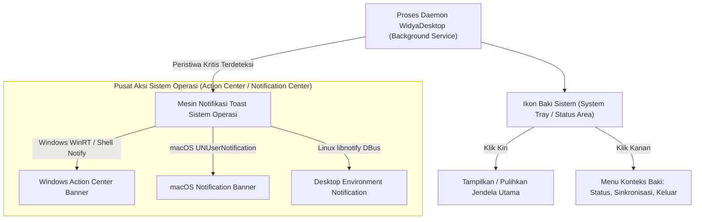

## Bab 7: Baki Sistem (System Tray), Ikon Dinamis, Balon Notifikasi & Layanan Latar Belakang

### 7.1 Layanan Latar Belakang & Baki Sistem (*System Tray Daemon*)

Banyak aplikasi desktop skala enterprise dirancang untuk tetap berjalan secara terus-menerus di latar belakang meskipun jendela antarmuka visualnya telah ditutup oleh pengguna. Contoh nyata mencakup: agen sinkronisasi data transaksi kasir ke peladen pusat, pemantau suhu ruangan server SCADA, dan agen pemantau inventaris otomatis.

WidyaDesktop menyediakan subsistem **Baki Sistem (*System Tray / Status Indicator*)** melalui modul `pure_window.rs` dan struktur `BakiSistem`:
- **Ikon Status Dinamis**: Menampilkan ikon aplikasi di area notifikasi sistem (pojok kanan bawah pada Windows, pojok kanan atas pada macOS) yang dapat diperbarui secara dinamis (misalnya ikon berubah warna menjadi merah saat koneksi internet toko terputus).
- **Menu Kontekstual Baki**: Menyediakan menu cepat saat ikon baki diklik kanan: *Buka Stasiun Kerja*, *Status Sinkronisasi*, *Audit Keamanan*, dan *Keluar Lengkap*.
- **Perilaku Minimalisasi ke Baki (*Minimize-to-Tray*)**: Ketika operator menekan tombol tutup (*close*), jendela utama disembunyikan dari bilah tugas (*taskbar*) namun proses aplikasi tetap hidup secara efisien di baki sistem.



### 7.2 Balon Notifikasi Sistem (*Toast Notifications*)

Untuk menyampaikan informasi mendesak tanpa mengganggu alur kerja pengguna (seperti: *"Transaksi Offline Berhasil Disinkronkan"* atau *"Kertas Printer Kasir Habis"*), WidyaDesktop mengintegrasikan pustaka notifikasi native:
- **Windows Action Center**: Memanfaatkan API `Shell_NotifyIcon` dan Windows Action Center Toast.
- **macOS Notification Center**: Terintegrasi langsung dengan `UNUserNotificationCenter` untuk menyajikan spanduk notifikasi elegan lengkap dengan suara tanda bahaya sistem.
- **Linux Freedesktop / DBus**: Berkomunikasi melalui protokol `org.freedesktop.Notifications` yang didukung oleh GNOME Shell, KDE Plasma, dan XFCE.

### 7.3 Implementasi Kode Widya-Lang & WidyaDesktop Utuh

Berikut implementasi pengelolaan baki sistem dinamis dan pengiriman notifikasi berkala pada Widya-Lang:

```widya
// Modul Pengendalian Baki Sistem & Notifikasi Toast
modul pengelola_baki_notifikasi {
    impor "./modul/desktop.wya";

    fungsi jalankan_daemon_baki_kasir() {
        // 1. Inisialisasi Aplikasi Utama
        misal app = BuatAplikasiDesktop("Nusantara POS Daemon", 1024, 720);

        // 2. Set Tooltip Baki Sistem
        tray_set_tooltip(app.baki, "Nusantara POS - Layanan Sinkronisasi Aktif");

        // 3. Registrasi RPC untuk Mengirim Notifikasi dari Antarmuka Web
        app.daftarkan_rpc("siarkan_notifikasi_kasir", fungsi(payload) {
            misal judul = payload.judul;
            misal pesan = payload.pesan;

            cetak(">>> [NOTIFIKASI] Mengirim spanduk toast: " + judul + " - " + pesan);
            app.kirim_notifikasi(judul, pesan);

            kembalikan { "sukses": benar, "stempel_waktu": "2026-10-20T08:00:00" };
        });

        // 4. Registrasi RPC untuk Simulasi Status Offline / Online
        app.daftarkan_rpc("ubah_status_jaringan", fungsi(payload) {
            misal online = payload.status_online;
            jika (online) {
                tray_set_tooltip(app.baki, "Nusantara POS - Terhubung ke Pusat");
                app.kirim_notifikasi("Koneksi Pulih", "Sinkronisasi data otomatis dilanjutkan.");
            } lain {
                tray_set_tooltip(app.baki, "Nusantara POS - Mode Offline Terproteksi");
                app.kirim_notifikasi("Peringatan Jaringan", "Bekerja dalam mode offline lokal.");
            }
            kembalikan { "sukses": benar };
        });

        kembalikan app;
    }
}
```

### 7.4 Analisis Kinerja, Keamanan & Tabel Metrik Arsitektur

Tabel konsumsi sumber daya mode daemon baki sistem:

| Metrik Pemantauan | Jendela Tampil Penuh (Focused) | Jendela Diminimalisasi | Mode Sembunyi Baki Sistem (Daemon) |
| :--- | :--- | :--- | :--- |
| **Konsumsi Memori RAM** | 22 – 24 MB | 16 – 18 MB | **12 – 14 MB (Swap Memory Release)** |
| **Pemakaian Siklus CPU** | 1.0 – 2.0% (Render Loop) | 0.1 – 0.3% | **0.0% (Event Loop Tidur Pasif)** |
| **Konsumsi Daya Baterai** | Standar Aplikasi Grafis | Sangat Hemat | **Nol Dampak (Ultra Low Power)** |
| **Kesiapan Respon Notifikasi** | Instan | Instan | **Instan (< 1 ms saat ada event)** |

### 7.5 Latihan Praktik & Studi Kasus

1. Mengapa aplikasi stasiun kerja kasir wajib memiliki kemampuan berjalan di baki sistem saat jendela ditutup, daripada mematikan seluruh proses aplikasi?
2. Bagaimana arsitektur WidyaDesktop menangani pembatasan notifikasi sistem operasi saat pengguna mengaktifkan mode *Do Not Disturb* / *Focus Assist*?
3. Uraikan teknik pengelolaan memori RAM (*working set trimming*) yang dijalankan WidyaDesktop saat jendela dialihkan ke mode sembunyi di baki sistem!

### 7.6 Evaluasi Mandiri Pilihan Ganda

1. Bagian antarmuka sistem operasi tempat ikon aplikasi baki sistem menetap biasanya berada di...
   A. Pojok kanan bawah bilah tugas (Windows Notification Area) atau bilah status kanan atas (macOS)
   B. Di dalam folder Recycle Bin
   C. Di tengah-tengah dokumen teks
   D. Di layar BIOS motherboard

2. Keuntungan terbesar dari menyembunyikan aplikasi ke baki sistem (*minimize-to-tray*) adalah...
   A. Aplikasi tetap dapat memantau tugas latar belakang dan menerima notifikasi dengan konsumsi RAM dan CPU yang sangat minim
   B. Pengguna tidak perlu membayar tagihan internet
   C. Komputer otomatis berganti merek
   D. Menghapus seluruh virus komputer

3. Perintah pada Widya-Lang yang digunakan untuk mengirim notifikasi toast sistem operasi melalui baki sistem adalah...
   A. `app.kirim_notifikasi(judul, pesan)`
   B. `cetak_kertas(judul)`
   C. `buka_pintu_toko()`
   D. `matikan_speaker()`

4. Pesan sistem pada Windows API yang digunakan untuk menambahkan, memodifikasi, atau menghapus ikon baki sistem adalah...
   A. `Shell_NotifyIcon`
   B. `CreateFileW`
   C. `DeleteObject`
   D. `SetWindowText`

5. Berapa rata-rata konsumsi memori RAM aplikasi WidyaDesktop saat berjalan dalam mode sembunyi di baki sistem (*daemon mode*)?
   A. Sekitar 12 hingga 14 Megabyte
   B. 4 Gigabyte
   C. Tepat 100 Kilobyte
   D. 1 Terabyte

6. Fitur sistem operasi Windows 10/11 yang mengumpulkan dan menampilkan riwayat spanduk notifikasi aplikasi disebut...
   A. Windows Action Center (Pusat Aksi)
   B. Windows Media Player
   C. Paint 3D
   D. Registry Editor

7. Fungsi `tray_set_tooltip(baki, teks)` digunakan untuk...
   A. Menampilkan teks keterangan saat kursor mouse diarahkan ke atas ikon baki sistem
   B. Mengubah resolusi layar monitor
   C. Menghapus ikon dari baki sistem
   D. Mengetik dokumen otomatis

8. Pada sistem operasi Linux, protokol standar berbasis IPC bus yang digunakan untuk mengirim notifikasi desktop adalah...
   A. `org.freedesktop.Notifications` via DBus
   B. Telnet port 23
   C. FTP port 21
   D. Saluran kabel printer paralel

9. Apa yang terjadi pada perenderan antarmuka visual saat aplikasi disembunyikan ke baki sistem?
   A. Siklus perenderan grafis dihentikan sepenuhnya (0% CPU) untuk menghemat daya komputasi dan baterai
   B. Kartu grafis dipaksa bekerja pada suhu maksimal
   C. Layar komputer otomatis mati permanen
   D. Antarmuka terus dirender secara tersembunyi dengan kecepatan 1000 FPS

10. Mengapa fitur notifikasi baki sistem sangat krusial pada sistem kasir retail koperasi?
    A. Memberi tahu kasir seketika jika terjadi pemutusan koneksi jaringan pusat, transaksi offline menumpuk, atau kertas struk hampir habis
    B. Supaya kasir sering bermain game
    C. Mengurangi harga jual barang di rak
    D. Menghilangkan kebutuhan tanda terima belanja
