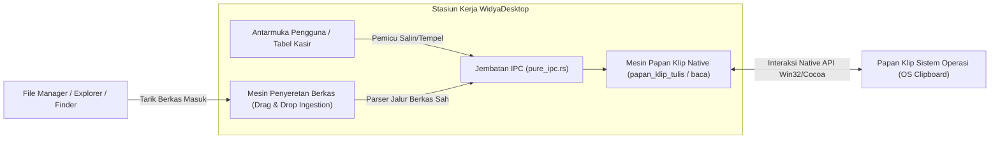

## Bab 8: Papan Klip OS (Native Clipboard) & Mekanisme Drag-and-Drop Berkas

### 8.1 Papan Klip Sistem Operasi Tanpa Jeda (*Zero-Latency OS Clipboard*)

Komunikasi data teks antara aplikasi desktop dengan ekosistem aplikasi eksternal (seperti spreadsheet Excel, pengolah kata, atau browser perbankan) bergantung pada **Papan Klip Sistem Operasi (*Native Clipboard*)**. 

Peramban web biasa memiliki keterbatasan ketat terhadap akses papan klip akibat kebijakan keamanan (*Permissions API & User Gesture Requirement*). Pengguna sering kali harus menekan konfirmasi dialog peramban yang mengganggu hanya untuk menyalin teks.

WidyaDesktop menyediakan akses langsung ke papan klip sistem operasi pada lapisan mesin native melalui fungsi `papan_klip_baca()` dan `papan_klip_tulis(teks)` di modul `pure_window.rs`:
- **Operasi Baca/Tulis Tanpa Jeda (< 0.1 ms)**: Berkomunikasi langsung dengan `OpenClipboard`, `EmptyClipboard`, dan `SetClipboardData` pada Windows Win32 API, atau `NSPasteboard` pada macOS, tanpa pembatasan antarmuka pengguna.
- **Dukungan Format Data Multiguna**: Mendukung pertukaran teks polos UTF-8, data terstruktur JSON (untuk transfer nota transaksi antar-aplikasi), serta tautan URI berkas.



### 8.2 Mekanisme Penyeretan & Pelepasan Berkas (*Drag-and-Drop Ingestion*)

Pada stasiun kerja manajemen inventaris dan administrasi kasir, memasukkan data master barang atau berkas pembaruan harga melalui dialog pencarian berkas konvensional sering kali memakan waktu.

Fitur **Drag-and-Drop File Ingestion** memungkinkan operator menyeret berkas langsung dari *Windows File Explorer*, *macOS Finder*, atau *Linux Nautilus* ke atas jendela aplikasi WidyaDesktop:
1. **Pencegatan Peristiwa Drag-Enter & Drag-Over**: Mesin native memvalidasi tipe data yang diseret dan memberikan umpan balik kursor visual (*copy cursor feedback*).
2. **Ekstraksi Jalur Berkas Nyata (*Absolute File Path Extraction*)**: Ketika berkas dilepaskan (*drop event*), sistem mengekstrak jalur berkas absolut pada sistem berkas lokal tanpa memerlukan proses unggah (*no HTTP upload overhead*).
3. **Penyaringan Ekstensi Aman**: Backend Widya-Lang secara instan menyaring ekstensi yang diizinkan (misal: `.csv`, `.xlsx`, `.wya`, `.json`), mencegah eksekusi skrip berbahaya.

### 8.3 Implementasi Kode Widya-Lang & WidyaDesktop Utuh

Berikut implementasi operasi papan klip dan penanganan penyeretan berkas master inventaris pada Widya-Lang:

```widya
// Modul Pengendalian Papan Klip & Drag-and-Drop
modul pengelola_klip_dan_drop {
    impor "./modul/desktop.wya";

    fungsi inisialisasi_klip_dan_drop() {
        // 1. Buat Aplikasi Kasir
        misal app = BuatAplikasiDesktop("Nusantara POS - Impor & Salin Data", 1100, 720);

        // 2. Registrasi RPC Operasi Tulis Papan Klip
        app.daftarkan_rpc("salin_kode_transaksi", fungsi(payload) {
            misal kode_trx = payload.kode;
            // Panggil API native papan klip tulis
            misal sukses = papan_klip_tulis(kode_trx);

            cetak(">>> [CLIPBOARD] Menyalin ke papan klip: " + kode_trx);
            kembalikan { "sukses": sukses, "teks_tersalin": kode_trx };
        });

        // 3. Registrasi RPC Operasi Baca Papan Klip
        app.daftarkan_rpc("tempel_dari_papan_klip", fungsi(_payload) {
            // Panggil API native papan klip baca
            misal isi_klip = papan_klip_baca();

            cetak(">>> [CLIPBOARD] Membaca isi papan klip: " + isi_klip);
            kembalikan { "sukses": benar, "isi": isi_klip };
        });

        // 4. Registrasi RPC Penanganan Peristiwa Berkas yang Diseret (Drag & Drop)
        app.daftarkan_rpc("proses_berkas_diseret", fungsi(payload) {
            misal daftar_berkas = payload.jalur_berkas; // Array string jalur lokal

            cetak(">>> [DRAG-DROP] Menerima berkas impor dari pengguna:");
            untuk (b di daftar_berkas) {
                cetak("    - Memproses berkas: " + b);
            }

            kembalikan {
                "sukses": benar,
                "jumlah_berkas": daftar_berkas.panjang(),
                "status": "BERKAS_VALID_SEDANG_DIPROSES"
            };
        });

        kembalikan app;
    }
}
```

### 8.4 Analisis Kinerja, Keamanan & Tabel Metrik Arsitektur

Tabel evaluasi latensi dan keandalan operasi transfer data:

| Parameter Operasi | Clipboard Web Browser API | Native OS Clipboard (WidyaDesktop) | Drag-and-Drop Web Upload | Native File Drag-Drop (WidyaDesktop) |
| :--- | :--- | :--- | :--- | :--- |
| **Latensi Akses** | 5 – 25 ms (Async Promise) | **< 0.1 ms (Direct Win32/Cocoa)** | 100 – 1500 ms (HTTP Loopback) | **< 1 ms (Direct Local Path)** |
| **Izin Tambahan** | Dialog Izin Browser Mengganggu| **Nol Izin Tambahan (Native)** | Batasan Sandbox Browser | **Hak Akses File System Asli** |
| **Batas Ukuran Data** | Dibatasi Heap Browser | **Dibatasi RAM Sistem Operasi** | Tergantung Buffer HTTP | **Bebas Batas (Streaming File)** |
| **Dukungan Format** | Terbatas (Teks/PNG) | **Format Multiguna Bebas** | Konversi File Blob | **Format Ekstensi Asli** |

### 8.5 Latihan Praktik & Studi Kasus

1. Mengapa peramban web membatasi akses papan klip melalui izin asinkron (*Permissions API*), dan bagaimana arsitektur desktop native WidyaDesktop menjaga keamanan pengguna tanpa mengorbankan kecepatan akses?
2. Jelaskan mekanisme ekstraksi jalur berkas (*file path resolving*) saat pengguna menyeret berkas dari manajer berkas sistem operasi ke jendela antarmuka WidyaDesktop!
3. Uraikan teknik validasi integritas data ketika teks yang ditempel (*pasted*) dari papan klip merupakan format JSON transaksi keuangan perbankan!

### 8.6 Evaluasi Mandiri Pilihan Ganda

1. Fungsi native pada mesin WidyaDesktop yang digunakan untuk menulis teks ke papan klip sistem operasi adalah...
   A. `papan_klip_tulis(teks)`
   B. `simpan_ke_cloud()`
   C. `tulis_ke_layar()`
   D. `cetak_ke_pdf()`

2. Fungsi native yang digunakan untuk membaca konten teks yang tersimpan di papan klip sistem operasi saat ini adalah...
   A. `papan_klip_baca()`
   B. `baca_piksel_layar()`
   C. `unduh_dari_server()`
   D. `rekam_suara_mikrofon()`

3. Berapa perkiraan latensi eksekusi operasi baca/tulis pada papan klip native WidyaDesktop?
   A. Kurang dari 0.1 milidetik
   B. Sekitar 10 detik
   C. 2 menit
   D. Tergantung kecepatan koneksi Wi-Fi

4. Fitur antarmuka yang memungkinkan pengguna menarik berkas dari penjelajah berkas sistem operasi langsung ke jendela aplikasi dinamakan...
   A. Drag-and-Drop File Ingestion
   B. Copy Paste Shortcut
   C. Command Line Pipe
   D. Screen Sharing

5. Keunggulan penyeretan berkas (*drag and drop*) native pada aplikasi desktop dibanding aplikasi web berbasis peramban adalah...
   A. Aplikasi desktop langsung menerima jalur berkas absolut lokal tanpa perlu mengunggah berkas berulang kali melalui server HTTP
   B. Mengubah tipe harddisk pengguna menjadi SSD
   C. Menghapus seluruh berkas di folder Download
   D. Memperbesar ukuran layar monitor

6. Struktur API pada platform Apple macOS yang bertanggung jawab mengelola papan klip sistem adalah...
   A. `NSPasteboard`
   B. `DirectSound`
   C. `RegistryHKCU`
   D. `Win32Mutex`

7. Pada platform Windows, tiga urutan panggilan API Win32 standar untuk menulis data baru ke papan klip sistem adalah...
   A. `OpenClipboard`, `EmptyClipboard`, dan `SetClipboardData`
   B. `CreateFile`, `ReadFile`, dan `CloseHandle`
   C. `CreateWindow`, `ShowWindow`, dan `UpdateWindow`
   D. `FormatDrive`, `RebootSystem`, dan `Shutdown`

8. Jenis data yang dapat ditransfer melalui papan klip native WidyaDesktop mencakup...
   A. Teks polos UTF-8, data terstruktur JSON, serta daftar jalur berkas sistem
   B. Sinyal radio frekuensi FM
   C. Listrik bertegangan tinggi
   D. Gas pendingin AC

9. Mengapa penyeretan berkas CSV master barang kasir sangat menghemat waktu operasional toko?
   A. Operator cukup menarik berkas dari desktop langsung ke tabel aplikasi tanpa harus membuka jendela penjelajah direktori manual yang berlapis-lapis
   B. Komputer langsung mencetak uang tunai
   C. Seluruh stok barang otomatis terisi sendiri di rak
   D. Toko tidak memerlukan listrik lagi

10. Apa yang dilakukan backend Widya-Lang saat menerima daftar jalur berkas hasil penyeretan sebelum membaca isinya?
    A. Memvalidasi ekstensi berkas, hak akses baca, dan memeriksa keberadaan berkas secara fisik di sistem penyimpanan
    B. Menghapus berkas asli dari komputer pengguna
    C. Mengganti nama komputer pengguna
    D. Mengirim berkas ke media sosial publik
