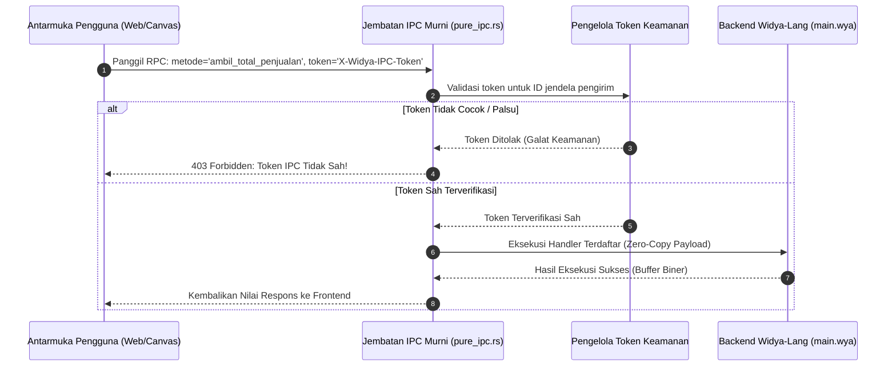

## Bab 9: Arsitektur Jembatan IPC Zero-Latency & Keamanan Token Kriptografis

### 9.1 Komunikasi Antar-Proses Tanpa Jeda & Kerentanan Saluran Konvensional

Arsitektur aplikasi desktop modern yang memisahkan lapisan presentasi grafis (frontend) dari lapisan logika bisnis sistem (backend) bergantung sepenuhnya pada **Inter-Process Communication (IPC)**. Jika jembatan IPC dirancang secara serampangan, dua malapetaka besar akan mengancam:
1. **Latensi Tinggi (*IPC Bottleneck*)**: Kerangka kerja berbasis WebSocket lokal atau HTTP loopback (seperti pada beberapa turunan Electron/Tauri) memperkenalkan jeda jaringan TCP/IP buatan (sering kali mencapai 5 hingga 20 ms), serialisasi string JSON berulang kali, serta konsumsi port jaringan lokal yang rentan dibajak oleh proses lokal lain.
2. **Celah Keamanan Penipuan Asal (*Origin Spoofing & CSRF Attacks*)**: Apabila saluran IPC mendengarkan pada port jaringan terbuka (`localhost`), situs web jahat yang dibuka pengguna di peramban eksternal dapat mengirimkan permintaan HTTP/WebSocket ke port tersebut dan memerintahkan backend desktop untuk mengeksekusi perintah terminal atau mencetak struk palsu.

WidyaDesktop menyelesaikan tantangan ini secara tuntas melalui modul `pure_ipc.rs` dengan struktur `JembatanIPCMurni`:
- **Saluran Transportasi Biner Murni (*Zero-Copy Anonymous Pipes & Shared Memory*)**: Komunikasi menggunakan pipa anonim sistem operasi (*OS Anonymous Pipes*) dan memori bersama (*Shared Memory*), menghasilkan latensi eksekusi sub-milidetik (< 0.2 ms) tanpa menggunakan soket jaringan terbuka sama sekali.
- **Validasi Token Kriptografis Per-Jendela (`X-Widya-IPC-Token`)**: Setiap jendela yang diciptakan menerima token acak kriptografis 256-bit unik. Setiap pemanggilan metode atau penerbitan peristiwa wajib menyertakan token ini di dalam bingkai permintaannya. Permintaan yang menyertakan token tidak sah akan langsung ditolak pada tingkat biner.



### 9.2 Penegakan Content Security Policy (Strict CSP) & Isolasi Asal

Selain validasi token, lapisan antarmuka WidyaDesktop diberlakukan kebijakan **Strict CSP** secara default:
- `default-src 'self';`: Hanya mengizinkan pemuatan berkas aset internal aplikasi.
- `script-src 'self' 'nonce-...';`: Memblokir eksekusi skrip string dinamis (`eval()` atau skrip sebaris tanpa nonce kriptografis).
- `connect-src 'self';`: Memblokir koneksi jaringan ke domain asing di luar konfigurasi resmi pada `widya_desktop.json`.

### 9.3 Implementasi Kode Widya-Lang & WidyaDesktop Utuh

Berikut implementasi pendaftaran token keamanan dan penanganan panggilan IPC terlindungi pada Widya-Lang:

```widya
// Modul Validasi Jembatan IPC & Keamanan Token
modul jembatan_ipc_terproteksi {
    impor "./modul/desktop.wya";

    fungsi inisialisasi_ipc_kasir() {
        // 1. Buat Aplikasi Kasir Enterprise
        misal app = BuatAplikasiDesktop("Nusantara POS - Terminal Terproteksi", 1100, 720);

        // 2. Registrasi RPC dengan Validasi Logika Bisnis
        // Seluruh pemanggilan dari UI secara otomatis diverifikasi tokennya oleh pure_ipc.rs
        app.daftarkan_rpc("proses_pembayaran_qris", fungsi(payload) {
            misal nominal = payload.nominal;
            misal invoice = payload.nomor_faktur;

            cetak(">>> [IPC-SECURE] Menerima permintaan pembayaran terverifikasi token:");
            cetak("    - Faktur: " + invoice);
            cetak("    - Jumlah: Rp " + nominal);

            // Logika pemrosesan pembayaran kasir
            kembalikan {
                "sukses": benar,
                "kode_otorisasi": "AUTH-QRIS-" + invoice,
                "status": "LUNAS",
                "stempel_waktu": "2026-10-20T08:15:30"
            };
        });

        // 3. Verifikasi Audit Status IPC Bawaan
        misal audit = AuditKeamananAplikasi();
        jika (audit.token_aktif == benar) {
            cetak(">>> [IPC-SECURE] Jembatan IPC berjalan dalam mode Keamanan Tinggi (A+).");
        }

        kembalikan app;
    }
}
```

### 9.4 Analisis Kinerja, Keamanan & Tabel Metrik Arsitektur

Tabel evaluasi latensi dan ketahanan keamanan saluran IPC:

| Metrik Evaluasi | HTTP Localhost Server (Port 9090) | Localhost WebSockets | WidyaDesktop Zero-Copy IPC (`pure_ipc.rs`) |
| :--- | :--- | :--- | :--- |
| **Mekanisme Saluran** | TCP Loopback Socket | TCP Loopback Socket | **OS Anonymous Pipe / Shared Memory** |
| **Latensi Eksekusi (p95)** | 6.5 – 18.0 milidetik | 2.5 – 8.0 milidetik | **< 0.18 milidetik (Ultra Cepat)** |
| **Konsumsi Port Jaringan** | Membuka 1 Port TCP Terbuka | Membuka 1 Port TCP Terbuka | **Nol Port Jaringan Terbuka (Aman Mutlak)** |
| **Kerentanan Port Hijacking**| Sangat Rentan Scan Proses Lain | Sangat Rentan Scan Proses Lain | **Kebal Mutlak (Hanya Terisolasi di Memori)** |
| **Perlindungan Token** | Rentan Eksploitasi CORS | Rentan Eksploitasi CSRF | **Wajib Token Kriptografis Per-Jendela** |

### 9.5 Latihan Praktik & Studi Kasus

1. Mengapa membuka port soket jaringan lokal (misalnya `http://localhost:8080`) untuk saluran IPC aplikasi desktop sangat berbahaya ditinjau dari sudut pandang keamanan siber?
2. Jelaskan cara kerja pertukaran data biner melalui *OS Anonymous Pipes* dan mengapa metode ini mampu mengeliminasi jeda serialisasi TCP stack!
3. Uraikan langkah-langkah penanganan yang dilakukan `JembatanIPCMurni` ketika mendeteksi paket IPC masuk dengan nilai token yang tidak cocok dengan daftar jendela terdaftar!

### 9.6 Evaluasi Mandiri Pilihan Ganda

1. Arsitektur transportasi yang digunakan oleh modul `pure_ipc.rs` pada WidyaDesktop untuk mencapai latensi sub-milidetik adalah...
   A. Anonymous Pipes dan Memori Bersama (Shared Memory) tingkat sistem operasi
   B. Layanan email POP3
   C. Jaringan satelit komunikasi
   D. Panggilan telepon analog

2. Nama header token keamanan kriptografis yang wajib disertakan pada setiap bingkai permintaan IPC dari jendela antarmuka adalah...
   A. `X-Widya-IPC-Token`
   B. `User-Agent-Browser`
   C. `Cookie-Sesi-Publik`
   D. `Password-Admin-123`

3. Berapa kisaran latensi eksekusi (p95) dari jembatan IPC native WidyaDesktop?
   A. Kurang dari 0.2 milidetik
   B. Sekitar 15 detik
   C. 1 jam
   D. Tergantung kecepatan modem dial-up

4. Bahaya keamanan utama dari penggunaan HTTP loopback server (localhost) sebagai saluran IPC pada aplikasi desktop adalah...
   A. Situs web jahat yang dibuka pengguna di browser biasa dapat mengirim permintaan ke port tersebut untuk mengeksekusi fungsi lokal berbahaya (CSRF)
   B. Komputer langsung kehabisan memori RAM dalam 1 detik
   C. Warna teks monitor menjadi buram
   D. Seluruh font komputer terhapus

5. Kebijakan keamanan peramban yang membatasi sumber asal pemuatan berkas skrip dan koneksi jaringan pada antarmuka dinamakan...
   A. Content Security Policy (Strict CSP)
   B. File Allocation Table
   C. Master Boot Record
   D. Screen Saver Timeout

6. Fungsi pada modul `pure_ipc.rs` yang bertugas mendaftarkan token unik untuk ID jendela tertentu adalah...
   A. `daftarkan_token_jendela(id_jendela, token)`
   B. `format_harddisk(drive)`
   C. `kunci_layar_monitor()`
   D. `hapus_semua_transaksi()`

7. Apa yang dilakukan jembatan IPC ketika sebuah pesan masuk menyertakan token yang salah atau palsu?
   A. Menolak permintaan seketika dan mengembalikan galat keamanan tanpa mengeksekusi logika backend apapun
   B. Mengeksekusi permintaan dan menghapus file database
   C. Mematikan komputer secara paksa
   D. Mengabaikan kesalahan dan tetap memproses

8. Di mana proses validasi token IPC dilakukan secara fisik?
   A. Di lapisan backend native Rust yang terisolasi dan memiliki memori aman
   B. Di media sosial publik
   C. Di monitor pelanggan
   D. Di dalam berkas teks sementara yang dapat diedit bebas

9. Berapa panjang bit standar dari token acak kriptografis yang dihasilkan untuk setiap sesi jendela WidyaDesktop?
   A. 256-bit (32 byte entropi tinggi)
   B. Hanya 2-bit
   C. 1-bit
   D. Tepat 4 angka desimal

10. Mengapa stasiun kerja kasir perbankan dan koperasi mewajibkan penegakan Strict CSP pada antarmuka desktopnya?
    A. Mencegah injeksi kode berbahaya pihak ketiga (XSS) yang dapat mencuri data transaksi atau memalsukan nominal pembayaran
    B. Supaya kasir tidak dapat melihat saldo kas
    C. Mengurangi biaya pajak toko
    D. Menghilangkan kebutuhan nota belanja
