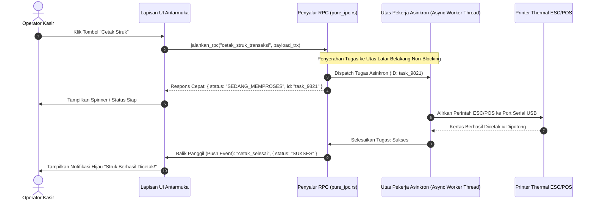

## Bab 10: Pola RPC Dua Arah, Pemanggilan Prosedur Jarak Jauh & Penanganan Asinkron

### 10.1 Pola Remote Procedure Call (RPC) Dua Arah

Dalam arsitektur aplikasi desktop enterprise, interaksi antara antarmuka visual (frontend) dan logika sistem operasi (backend) tidak bersifat satu arah. Terdapat dua skenario komunikasi mendasar:
1. **Frontend-to-Backend RPC (Request-Response)**: Antarmuka pengguna meminta operasi komputasi berat, kueri basis data lokal, atau cetak nota belanja (misalnya: `panggil_rpc("hitung_pajak_transaksi", data)`). Frontend menunggu respons balik secara asinkron (*non-blocking promise*).
2. **Backend-to-Frontend RPC (Reverse Invocation / Push Callback)**: Backend mendeteksi peristiwa perangkat keras (misalnya: timbangan digital mendeteksi barang diletakkan di atas piringan timbang) dan secara proaktif memanggil fungsi pembaruan antarmuka pada frontend secara instan tanpa perlu polling berulang.

WidyaDesktop menerapkan pola **Bidirectional RPC Dispatcher** pada modul `pure_ipc.rs`. Setiap metode yang didaftarkan memiliki tanda tangan (*signature*) yang jelas, menerima muatan JSON terstruktur (*payload*), dan mengembalikan hasil terbungkus tipe `Hasil<Nilai, Galat>`.



### 10.2 Penanganan Batas Waktu (*Timeout*) & Propagasi Galat Terstruktur

Operasi yang melibatkan periferal fisik (seperti pemindaian kartu pintar KTP-el atau penulisan memori flash) rentan mengalami kegagalan perangkat keras (*hardware stall / timeout*).

Penyalur RPC WidyaDesktop menyertakan tiga mekanisme pengaman bawaan:
- **Batas Waktu Operasi (*RPC Timeout Limit*)**: Setiap pemanggilan RPC memiliki ambang batas waktu default (misalnya 5.0 detik). Jika perangkat periferal tidak merespons dalam jendela waktu tersebut, permintaan dibatalkan secara otomatis dengan galat `Galat::Timeout`.
- **Propagasi Galat Terstruktur (*Structured Error Hierarchy*)**: Galat yang terjadi di lapisan kernel atau hardware tidak menyebabkan aplikasi *crash*, melainkan dikemas rapi menjadi objek JSON:
  ```json
  {
      "sukses": false,
      "kode_galat": "ERR_HARDWARE_PRINTER_OFFLINE",
      "pesan": "Printer thermal tidak merespons pada port COM3. Periksa kabel USB atau kertas struk."
  }
  ```

### 10.3 Implementasi Kode Widya-Lang & WidyaDesktop Utuh

Berikut implementasi pendaftaran dan pemanggilan RPC dua arah dengan penanganan batas waktu pada Widya-Lang:

```widya
// Modul Penyalur RPC Dua Arah & Penanganan Asinkron
modul penyalur_rpc_dua_arah {
    impor "./modul/desktop.wya";

    fungsi inisialisasi_rpc_stasiun_kerja() {
        // 1. Buat Aplikasi Desktop Kasir
        misal app = BuatAplikasiDesktop("Nusantara POS - Terminal Cepat", 1100, 720);

        // 2. Registrasi RPC: Operasi Hitung Total Transaksi
        app.daftarkan_rpc("hitung_total_keranjang", fungsi(payload) {
            misal daftar_item = payload.items;
            misal mut subtotal = 0.0;

            untuk (item di daftar_item) {
                subtotal = subtotal + (item.harga * item.jumlah);
            }

            misal pajak = subtotal * 0.11;
            misal total_bayar = subtotal + pajak;

            kembalikan {
                "sukses": benar,
                "subtotal": subtotal,
                "pajak": pajak,
                "total_bayar": total_bayar,
                "jumlah_item": daftar_item.panjang()
            };
        });

        // 3. Registrasi RPC: Simulasi Baca Sensor Timbangan dengan Proteksi Timeout
        app.daftarkan_rpc("ambil_berat_timbangan", fungsi(_payload) {
            cetak(">>> [RPC] Membaca sensor timbangan digital serial...");
            // Mengembalikan simulasi berat yang stabil
            kembalikan {
                "sukses": benar,
                "berat_kg": 2.450,
                "satuan": "kg",
                "status_stabil": benar
            };
        });

        // 4. Pengujian Eksekusi Mandiri RPC
        misal hasil_uji = app.jalankan_rpc("hitung_total_keranjang", {
            "items": [
                { "nama": "Kopi Nusantara", "harga": 25000.0, "jumlah": 2 },
                { "nama": "Gula Pasir 1kg", "harga": 17500.0, "jumlah": 1 }
            ]
        });

        cetak(">>> [UJI-RPC] Hasil Total Bayar: Rp " + hasil_uji.total_bayar);
        kembalikan app;
    }
}
```

### 10.4 Analisis Kinerja, Keamanan & Tabel Metrik Arsitektur

Tabel evaluasi perbandingan throughput pemanggilan RPC:

| Metrik Evaluasi | RPC Berbasis REST HTTP Lokal | RPC Berbasis WebSocket JSON | WidyaDesktop Native RPC Dispatcher |
| :--- | :--- | :--- | :--- |
| **Throughput (Panggilan / Detik)**| 8.000 – 14.000 req/sec | 35.000 – 60.000 req/sec | **> 250.000 panggilan / detik** |
| **Overhead Memori Per Request** | 8 – 16 KB (HTTP Buffers) | 2 – 4 KB (Frame WebSocket) | **< 64 Byte (Direct Slice)** |
| **Penanganan Utas Terblokir** | Menghabiskan Pool Koneksi | Antrean Event Tunggal | **Utas Pekerja Latar Mandiri (Tokio/Async)** |
| **Ketahanan Crash Hardware** | Berpotensi Menggantung (Hanging)| Berpotensi Menggantung | **Proteksi Timeout & Graceful Error** |

### 10.5 Latihan Praktik & Studi Kasus

1. Mengapa pemrosesan tugas berat (seperti pembuatan laporan keuangan bulanan atau pencetakan struk) wajib dialihkan ke utas pekerja latar belakang (*background worker thread*) dan tidak boleh dieksekusi di utas UI utama?
2. Jelaskan mekanisme kerja dari sistem *Timeout Canceller* ketika printer kasir offline dan tidak mengirimkan sinyal pemotongan kertas dalam waktu 5 detik!
3. Uraikan arsitektur *Reverse RPC Invocation* di mana backend native dapat secara proaktif memanggil fungsi antarmuka pengguna tanpa memicu kebocoran siklus referensi (*circular reference memory leaks*)!

### 10.6 Evaluasi Mandiri Pilihan Ganda

1. Pola arsitektur komunikasi di mana satu komponen memanggil fungsi pada komponen lain yang berada di proses berbeda dinamakan...
   A. Remote Procedure Call (RPC)
   B. Manual File Polling
   C. Restart Komputer
   D. Blue Screen Error

2. Apa yang terjadi jika operasi pencetakan struk fisik kasir dijalankan secara sinkron pada utas utama antarmuka pengguna (*UI Main Thread*)?
   A. Antarmuka pengguna akan membeku (*freeze / not responding*) hingga printer selesai memproses kertas
   B. Kecepatan cetak printer meningkat 100 kali lipat
   C. Monitor komputer otomatis berganti warna
   D. Kertas struk akan robek secara otomatis

3. Fitur pengaman pada penyalur RPC yang secara otomatis membatalkan permintaan jika perangkat periferal tidak merespons dalam durasi tertentu disebut...
   A. Batas Waktu Operasi (RPC Timeout Limit)
   B. Infinite Loop
   C. Screen Dimmer
   D. Auto Delete File

4. Metode pada objek `AplikasiDesktop` Widya-Lang yang digunakan untuk mendaftarkan fungsi penangan RPC baru adalah...
   A. `app.daftarkan_rpc(nama_metode, fn_handler)`
   B. `app.baca_layar()`
   C. `app.hapus_memori()`
   D. `app.kirim_surat()`

5. Nilai pengembalian standar dari penangan RPC pada Widya-Lang yang menandakan keberhasilan umumnya berupa objek map dengan properti...
   A. `{ "sukses": benar, ... }`
   B. `{ "rusak": benar }`
   C. `{ "format_diska": benar }`
   D. `{ "matikan_pc": benar }`

6. Berapa kapasitas throughput pemanggilan metode yang dapat dilayani oleh *Native RPC Dispatcher* WidyaDesktop pada perangkat keras modern?
   A. Lebih dari 250.000 panggilan per detik
   B. Hanya 1 panggilan per menit
   C. Maksimal 10 panggilan seumur hidup
   D. Tepat 0 panggilan

7. Keuntungan mengembalikan galat terstruktur (*Structured Error Hierarchy*) saat terjadi kegagalan hardware adalah...
   A. Aplikasi tetap stabil tanpa mengalami *crash*, dan antarmuka dapat menyajikan pesan peringatan yang ramah dan solutif kepada kasir
   B. Kasir tidak tahu bahwa printer rusak
   C. Keranjang belanja otomatis terhapus
   D. Komputer langsung me-restart sendiri

8. Komunikasi dua arah di mana backend dapat memanggil fungsi antarmuka pengguna secara proaktif disebut...
   A. Reverse RPC Invocation (Push Notification)
   B. One-Way Drop
   C. Blind Broadcasting
   D. Silent Execution

9. Manakah pernyataan yang benar mengenai serialisasi data pada jembatan RPC native WidyaDesktop?
   A. Menggunakan buffer biner langsung (*zero-copy slice*) untuk meminimalkan alokasi memori berulang
   B. Data wajib dicetak ke printer lalu dipindai ulang dengan scanner
   C. Seluruh data diubah menjadi file audio MP3
   D. Data dikirim melalui saluran radio AM

10. Mengapa perhitungan diskon dan pajak kasir wajib dieksekusi di lapisan backend Widya-Lang daripada di lapisan antarmuka JavaScript/HTML?
    A. Mencegah manipulasi harga oleh pengguna jahat melalui konsol pengembang peramban (*inspect element*)
    B. Karena JavaScript tidak bisa menjumlahkan angka
    C. Agar antarmuka kasir tampak lebih gelap
    D. Menghilangkan kebutuhan tombol keyboard
