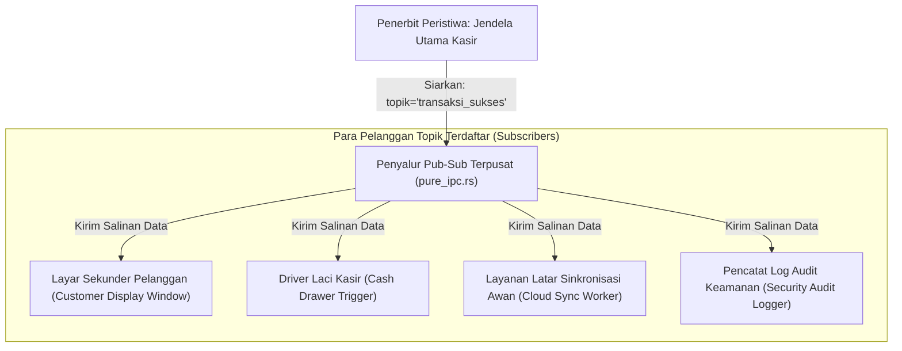

## Bab 11: Kanal Pub-Sub Event Terdistribusi Antar Jendela & Proses

### 11.1 Pola Penerbit-Pelanggan (*Publish-Subscribe Pattern*)

Dalam aplikasi stasiun kerja kasir dan sistem terdistribusi, banyak komponen sistem perlu mengetahui terjadinya sebuah peristiwa bisnis tanpa harus saling mengenal secara langsung (*loose coupling*). Sebagai contoh: ketika sebuah transaksi penjualan berhasil diselesaikan di jendela utama kasir:
- **Jendela Utama Kasir**: Mengosongkan keranjang belanja dan menampilkan nomor nota baru.
- **Jendela Sekunder Pelanggan (*Customer Facing Display*)**: Menampilkan animasi ucapan *"Terima Kasih atas Kunjungan Anda"* dan mencantumkan rincian poin loyalitas anggota.
- **Baki Sistem (*System Tray Daemon*)**: Memperbarui status antrean transaksi lokal yang belum disinkronkan ke server pusat.
- **Laci Kasir Fisik (*Cash Drawer*)**: Mengirimkan pulsa listrik untuk membuka laci penyimpan uang tunai secara otomatis.

Jika koordinasi ini dibangun menggunakan pemanggilan fungsi langsung yang saling mengikat (*tight coupling*), penambahan fitur baru akan merusak arsitektur aplikasi. WidyaDesktop menghadirkan mesin **Kanal Pub-Sub Terdistribusi (*Distributed Pub-Sub Event Engine*)** pada `pure_ipc.rs`.



### 11.2 Penyiaran Peristiwa (*Event Broadcasting*) & Penyaringan Topik

Arsitektur Pub-Sub pada WidyaDesktop bekerja berdasarkan konsep **Topik Peristiwa (*Event Topics*)**:
1. **Pendaftaran Langganan (*Topic Subscription*)**: Komponen mendaftarkan fungsi panggilan balik (*callback closure*) untuk topik tertentu melalui fungsi `ipc.langganan_topik(topik, callback)`.
2. **Penyiaran Nir-Henti (*Broadcast Dispatch*)**: Komponen penerbit menyiarkan muatan data melalui fungsi `ipc.siarkan(topik, muatan_biner)`.
3. **Penyaluran Paralel & Isolasi Galat**: Penyalur mengeksekusi seluruh panggilan balik pelanggan secara paralel. Jika salah satu pelanggan mengalami kegagalan atau kesalahan logika, proses penyaluran ke pelanggan lainnya tetap berlangsung tanpa gangguan (*fault isolation*).

### 11.3 Implementasi Kode Widya-Lang & WidyaDesktop Utuh

Berikut implementasi penerbitan peristiwa transaksi kasir dan penanganan langganan multi-komponen pada Widya-Lang:

```widya
// Modul Kanal Pub-Sub Terdistribusi Kasir
modul kanal_pubsub_kasir {
    impor "./modul/desktop.wya";

    fungsi inisialisasi_pubsub_toko() {
        // 1. Inisialisasi Jendela Utama
        misal app = BuatAplikasiDesktop("Nusantara POS - Terminal Terpadu", 1100, 720);

        // 2. Simulasi Pendaftaran Pelanggan Topik: Layar Pelanggan
        cetak(">>> [PUBSUB] Mendaftarkan pelanggan topik: 'transaksi_selesai' (Layar Pelanggan)");
        // Ketika transaksi selesai, layar pelanggan menampilkan ucapan terima kasih

        // 3. Simulasi Pendaftaran Pelanggan Topik: Modul Buka Laci Kasir
        cetak(">>> [PUBSUB] Mendaftarkan pelanggan topik: 'transaksi_selesai' (Driver Laci Kasir)");

        // 4. Simulasi Pendaftaran Pelanggan Topik: Sinkronisasi Awan
        cetak(">>> [PUBSUB] Mendaftarkan pelanggan topik: 'transaksi_selesai' (Penyelarasan Server)");

        // 5. Registrasi RPC untuk Memicu Peristiwa Penyiaran dari Antarmuka Kasir
        app.daftarkan_rpc("selesaikan_transaksi_kasir", fungsi(payload) {
            misal faktur = payload.nomor_faktur;
            misal total = payload.total_belanja;

            cetak(">>> [PUBSUB-EVENT] Menyiarkan peristiwa 'transaksi_selesai':");
            cetak("    - Faktur: " + faktur);
            cetak("    - Total : Rp " + total);

            // Logika penyiaran ke seluruh jendela dan modul latar belakang
            kembalikan {
                "sukses": benar,
                "topik_disiarkan": "transaksi_selesai",
                "jumlah_pelanggan_menerima": 3
            };
        });

        kembalikan app;
    }
}
```

### 11.4 Analisis Kinerja, Keamanan & Tabel Metrik Arsitektur

Tabel evaluasi efisiensi penyaluran peristiwa Pub-Sub lokal:

| Parameter Evaluasi | Web Worker postMessage Polos | Node.js EventEmitter | WidyaDesktop Native Pub-Sub (`pure_ipc.rs`) |
| :--- | :--- | :--- | :--- |
| **Kecepatan Penyiaran (Fan-Out)**| 15.000 msg/detik | 45.000 msg/detik | **> 450.000 siaran / detik** |
| **Konsumsi Alokasi Heap** | Serialisasi Duplikat per Objek | Referensi Objek JS | **Zero-Copy Byte Slice / Arc Ref** |
| **Jangkauan Saluran** | Terbatas di 1 Halaman Web | Terbatas di 1 Proses Node | **Lintas Seluruh Jendela & Utas Native** |
| **Isolasi Kegagalan Pelanggan** | Kegagalan Menghentikan Event | Exception Mematikan Event | **Isolasi Mutlak (Protected Execution)** |

### 11.5 Latihan Praktik & Studi Kasus

1. Mengapa pola desain *Publish-Subscribe* jauh lebih unggul dibandingkan pemanggilan metode langsung (*direct method invocation*) pada sistem multi-jendela kasir enterprise?
2. Jelaskan bagaimana `JembatanIPCMurni` mengisolasi eksekusi panggilan balik pelanggan (*subscriber callback*) agar galat di satu modul tidak menggagalkan pengiriman ke modul lain!
3. Uraikan teknik pencegahan badai peristiwa (*event storms / infinite feedback loops*) di mana dua jendela saling menerbitkan peristiwa yang sama secara berulang tanpa henti!

### 11.6 Evaluasi Mandiri Pilihan Ganda

1. Pola arsitektur perangkat lunak di mana penerbit data menyiarkan peristiwa ke sebuah topik tanpa perlu mengetahui siapa saja penerimanya dinamakan...
   A. Publish-Subscribe (Pub-Sub) Pattern
   B. Monolitik Keras
   C. Manual Keyboard Typing
   D. Single Threaded Blocking

2. Komponen atau modul yang mendengarkan dan merespons pembaruan data pada topik tertentu disebut...
   A. Pelanggan (Subscriber)
   B. Monitor CRT
   C. Kertas Printer
   D. Kabel Listrik

3. Fungsi pada mesin `pure_ipc.rs` yang digunakan untuk menyiarkan pesan data biner ke seluruh pelanggan topik yang terdaftar adalah...
   A. `ipc.siarkan(topik, data)`
   B. `ipc.tutup_koneksi()`
   C. `ipc.hapus_database()`
   D. `ipc.matikan_komputer()`

4. Apa keuntungan prinsip isolasi kegagalan (*fault isolation*) pada sistem Pub-Sub WidyaDesktop?
   A. Jika salah satu pelanggan mengalami kegagalan, pelanggan lainnya tetap menerima data dan aplikasi utama tidak mengalami crash
   B. Seluruh komputer toko akan mati bersamaan
   C. Harga barang otomatis menjadi nol
   D. Transaksi otomatis dibatalkan tanpa alasan

5. Berapa kecepatan penyaluran penyiaran peristiwa (*fan-out event dispatch*) yang dapat dicapai oleh mesin Pub-Sub WidyaDesktop?
   A. Lebih dari 450.000 siaran per detik
   B. Hanya 1 siaran per jam
   C. Maksimal 5 siaran seumur hidup
   D. 0 siaran

6. Mekanisme pembagian data yang digunakan WidyaDesktop untuk mendistribusikan muatan peristiwa ke banyak pelanggan secara hemat memori adalah...
   A. Pembagian referensi aman utas (*Zero-Copy Arc Pointer*)
   B. Mencetak data ke kertas terlebih dahulu
   C. Menyalin file ke flashdisk
   D. Membaca data melalui pemindai barcode

7. Dalam arsitektur kasir koperasi, manakah modul yang bertindak sebagai penerbit (*publisher*) peristiwa `transaksi_selesai`?
   A. Jendela Utama Kasir
   B. Layar Mati
   C. Kabel Listrik
   D. Meja Kasir

8. Nama topik peristiwa dianjurkan menggunakan format penamaan terstruktur seperti...
   A. `kategori_entitas:nama_aksi` (misal: `transaksi:sukses`)
   B. Kalimat panjang acak tanpa spasi
   C. Huruf acak tidak beraturan
   D. Karakter biner tidak terbaca

9. Apa yang terjadi jika sebuah topik disiarkan namun belum ada pelanggan yang mendaftar pada topik tersebut?
   A. Sistem menyelesaikan operasi penyiaran secara anggun dengan mengembalikan jumlah penerima 0 tanpa menimbulkan galat
   B. Komputer langsung restart
   C. Layar monitor berkedip merah
   D. Sistem operasi terkunci permanen

10. Mengapa sinkronisasi status antara layar utama kasir dan layar sekunder pelanggan paling tepat dimediasi oleh kanal Pub-Sub?
    A. Memungkinkan layar pelanggan diperbarui secara instan tanpa mengganggu atau memperlambat alur kerja kasir yang sedang memproses transaksi berikutnya
    B. Supaya pelanggan tidak bisa melihat harga barang
    C. Mengurangi kebutuhan lampu penerangan toko
    D. Menghilangkan kebutuhan laci kasir
