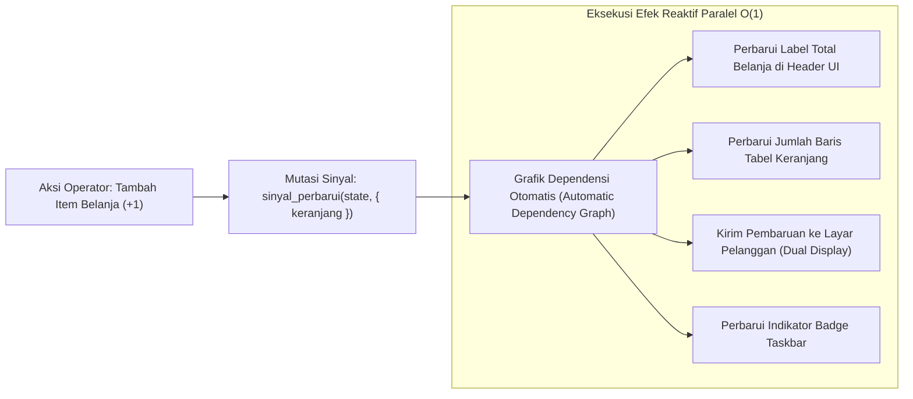

## Bab 12: Manajemen State Reaktif Terpusat & Sinyal Deklaratif

### 12.1 Keterbatasan State Management Konvensional & Revolusi Sinyal

Pengelolaan kondisi aplikasi (*State Management*) pada antarmuka desktop modern sering kali menjadi sumber utama *bug*, inkonsistensi data, dan penurunan kinerja:
- Pada kerangka kerja berbasis Virtual DOM konvensional, setiap perubahan data kecil memicu siklus rekonsiliasi (*re-rendering cycle*) pada seluruh cabang pohon komponen, memboroskan siklus CPU dan daya baterai.
- Pada pendekatan manual berbasis *event-emitter* kuno, pengembang dipaksa menulis kode boilerplate imperatif yang rawan kesalahan (misalnya: lupa memperbarui elemen label total belanja saat jumlah barang keranjang diubah).

WidyaDesktop mengadopsi paradigma reaktivitas berbasis **Sinyal Deklaratif Berbutir Halus (*Fine-Grained Declarative Signals*)** melalui modul `desktop.wya`:
1. **Sinyal Reaktif (*Reactive Signal*)**: Kotak penyimpan nilai yang melacak secara otomatis siapa saja komponen atau fungsi yang membaca nilainya (*automatic dependency tracking*).
2. **Efek Reaktif (*Reactive Effects*)**: Fungsi pengamat (*observer*) yang dieksekusi secara otomatis dan seketika setiap kali nilai sinyal yang menjadi dependensinya mengalami mutasi.
3. **Pembaruan DOM / Kanvas O(1)**: Mutasi data hanya memperbarui simpul grafis target yang bersangkutan secara langsung dengan kompleksitas waktu konstan $O(1)$, tanpa rekonsiliasi pohon komponen.



### 12.2 Arsitektur State Terpusat & Pengikatan Data (*Data Binding*)

Pada modul `modul/desktop.wya`, setiap instansiasi aplikasi desktop secara otomatis dilengkapi dengan struktur state reaktif terpusat:
- Fungsi `BuatStateReaktif(nilai_awal)`: Menciptakan sinyal reaktif baru.
- Fungsi `AmbilNilaiState(sinyal)`: Membaca nilai saat ini sekaligus mendaftarkan fungsi pemanggil ke dalam graf dependensi.
- Fungsi `PerbaruiNilaiState(sinyal, nilai_baru)`: Memperbarui nilai dan secara instan memicu seluruh efek yang bergantung padanya.
- Fungsi `LanggananState(sinyal, callback)`: Menetapkan reaksi otomatis terhadap setiap perubahan state.

### 12.3 Implementasi Kode Widya-Lang & WidyaDesktop Utuh

Berikut implementasi pengelolaan state reaktif keranjang belanja kasir secara deklaratif pada Widya-Lang:

```widya
// Modul Manajemen State Reaktif Kasir Terpadu
modul state_reaktif_kasir {
    impor "./modul/desktop.wya";

    fungsi inisialisasi_state_kasir() {
        // 1. Buat Aplikasi Kasir Desktop
        misal app = BuatAplikasiDesktop("Nusantara POS - Terminal Reaktif", 1100, 720);

        // 2. Inisialisasi State Reaktif Terpusat Keranjang Kasir
        misal state_keranjang = BuatStateReaktif({
            "nomor_faktur": "TRX-20261020-001",
            "kasir": "Budi Santoso",
            "jumlah_item": 0,
            "total_harga": 0.0,
            "status_pembayaran": "BELUM_DIBAYAR"
        });

        // 3. Daftarkan Efek Reaktif: Otomatis Cetak Log saat Nilai Berubah
        LanggananState(state_keranjang, fungsi(state_baru) {
            cetak(">>> [REAKTIF-EFEK] State kasir mengalami pembaruan otomatis:");
            cetak("    - Faktur: " + state_baru.nomor_faktur);
            cetak("    - Total : Rp " + state_baru.total_harga);
            cetak("    - Status: " + state_baru.status_pembayaran);
        });

        // 4. Registrasi RPC untuk Menambah Barang ke Keranjang Belanja
        app.daftarkan_rpc("tambah_item_keranjang", fungsi(payload) {
            misal harga_item = payload.harga;
            misal state_lama = AmbilNilaiState(state_keranjang);

            misal total_baru = state_lama.total_harga + harga_item;
            misal item_baru = state_lama.jumlah_item + 1;

            // Mutasi state memicu seluruh efek terdaftar secara instan O(1)
            PerbaruiNilaiState(state_keranjang, {
                "nomor_faktur": state_lama.nomor_faktur,
                "kasir": state_lama.kasir,
                "jumlah_item": item_baru,
                "total_harga": total_baru,
                "status_pembayaran": "DALAM_PROSES"
            });

            kembalikan { "sukses": benar, "total_baru": total_baru };
        });

        kembalikan app;
    }
}
```

### 12.4 Analisis Kinerja, Keamanan & Tabel Metrik Arsitektur

Tabel evaluasi latensi dan pemakaian memori antara manajemen state Virtual DOM vs Sinyal Reaktif WidyaDesktop:

| Parameter Evaluasi | Virtual DOM Re-render (React Desktop) | Store Berbasis Redux / Immutability | Sinyal Reaktif Fine-Grained (WidyaDesktop) |
| :--- | :--- | :--- | :--- |
| **Kompleksitas Mutasi** | $O(N)$ di mana $N$ = jumlah simpul pohon | $O(N)$ kloning objek mendalam (*deep clone*) | **$O(1)$ Konstan Langsung ke Simpul Target** |
| **Waktu Respon Perubahan**| 4.5 – 14.0 milidetik | 2.0 – 6.0 milidetik | **< 0.05 milidetik (Sub-Milidetik)** |
| **Tekanan Alokasi Memori**| Memicu ribuan alokasi objek sementara | Membuang salinan lama ke Garbage Collector | **Nol Alokasi Baru (Mutasi In-Place Terlacak)** |
| **Konsistensi Visual** | Rentan Desinkronisasi State UI | Terpusat namun Bertele-tele | **Konsisten Sempurna & Deklaratif** |

### 12.5 Latihan Praktik & Studi Kasus

1. Mengapa pendekatan *Fine-Grained Reactive Signals* mampu mencapai kompleksitas pembaruan $O(1)$, sedangkan kerangka kerja berbasis Virtual DOM membutuhkan kompleksitas rekonsiliasi $O(N)$?
2. Jelaskan mekanisme pelacakan dependensi otomatis (*automatic dependency tracking*) yang dijalankan saat fungsi membaca nilai dari sebuah sinyal reaktif!
3. Uraikan bagaimana sinkronisasi state reaktif terpusat di backend Widya-Lang dapat ditransmisikan secara instan ke antarmuka pengguna tanpa menimbulkan keterlambatan visual (*visual lagging*) pada layar 120 Hz!

### 12.6 Evaluasi Mandiri Pilihan Ganda

1. Karakteristik paling mendasar dari paradigma reaktivitas berbasis *Fine-Grained Signals* adalah...
   A. Memperbarui simpul elemen target secara langsung $O(1)$ tanpa perlu membandingkan seluruh pohon antarmuka Virtual DOM
   B. Mengharuskan pengguna menekan tombol F5 berulang-ulang
   C. Menghapus seluruh memori RAM komputer
   D. Mematikan kartu grafis secara paksa

2. Fungsi pembantu pada modul `desktop.wya` yang digunakan untuk menciptakan objek sinyal reaktif baru adalah...
   A. `BuatStateReaktif(nilai_awal)`
   B. `MatikanState()`
   C. `FormatDrive()`
   D. `TulisDokumenPDF()`

3. Fungsi pengamat yang secara otomatis dipanggil kembali (*re-executed*) setiap kali nilai sinyal yang diamatinya berubah disebut...
   A. Efek Reaktif (Reactive Effect / Subscription)
   B. Virus Komputer
   C. Deadlock
   D. Blue Screen

4. Fungsi yang digunakan untuk memperbarui nilai sinyal reaktif sekaligus memicu seluruh efek yang bergantung padanya adalah...
   A. `PerbaruiNilaiState(sinyal, nilai_baru)`
   B. `HapusSinyal()`
   C. `TutupAplikasi()`
   D. `KunciLayar()`

5. Berapa perkiraan waktu respon mutasi data pada sistem sinyal reaktif WidyaDesktop?
   A. Kurang dari 0.05 milidetik
   B. Sekitar 1 jam
   C. 15 menit
   D. Bergantung pada cuaca

6. Masalah performa utama yang sering dialami aplikasi desktop berbasis Virtual DOM konvensional saat menangani formulir kasir kompleks adalah...
   A. Rekonsiliasi pohon komponen yang berat memakan siklus CPU tinggi dan menimbulkan jeda ketik (*typing lag*)
   B. Keyboard kasir otomatis terkunci
   C. Teks otomatis diterjemahkan ke bahasa kuno
   D. Komputer langsung meledak

7. Bagaimana sinyal reaktif mencegah pembaruan berulang yang tidak perlu (*unnecessary updates*) ketika nilai baru yang dimasukkan sama persis dengan nilai lama?
   A. Menjalankan pemeriksaan kesetaraan nilai (*equality check*) sebelum memicu grafik dependensi efek
   B. Menghapus nilai baru tersebut
   C. Mematikan sambungan internet
   D. Menutup aplikasi seketika

8. Fungsi `AmbilNilaiState(sinyal)` bertugas untuk...
   A. Mengambil nilai saat ini sekaligus mendaftarkan fungsi pembaca ke dalam graf dependensi otomatis
   B. Menghapus seluruh data dari memori
   C. Mengirim data ke server luar negeri
   D. Mencetak nilai ke printer kertas

9. Tekanan alokasi memori pada sistem sinyal reaktif WidyaDesktop sangat minim karena...
   A. Tidak menghasilkan objek pohon komponen tiruan (*mock objects*) yang harus dibersihkan oleh Garbage Collector
   B. Menggunakan komputer tanpa memori RAM
   C. Menghapus seluruh file gambar
   D. Mematikan sistem operasi

10. Mengapa stasiun kerja kasir ritel berkecepatan tinggi sangat diuntungkan oleh adopsi state reaktif deklaratif?
    A. Perubahan status keranjang, total harga, dan potongan diskon terkoordinasi secara instan dan bebas galat di seluruh elemen layar secara konsisten
    B. Kasir tidak perlu memasukkan uang ke dalam laci
    C. Toko otomatis buka 24 jam tanpa penjaga
    D. Seluruh barang belanjaan otomatis gratis
