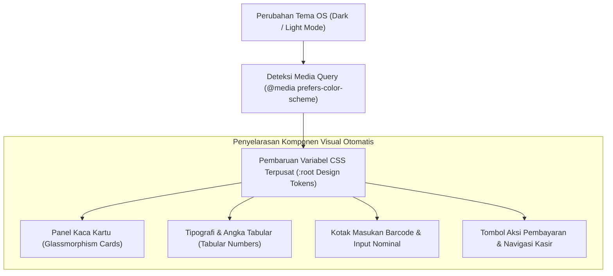

## Bab 13: Desain Sistem Antarmuka Modern: Token Desain Vanilla CSS & Dark Mode Native

### 13.1 Filosofi Desain Antarmuka Berdaulat & Kerapian Tipografi

Antarmuka stasiun kerja desktop kelas industri dituntut memiliki standar estetika visual yang tinggi: nyaman dipandang selama 8 jam kerja operator secara kontinu, memiliki kontras rasio warna yang memenuhi standar aksesibilitas WCAG 2.1 AA/AAA, serta responsif terhadap perubahan tema sistem operasi (*Windows Dark Mode / macOS Light-Dark Appearance*).

WidyaDesktop menerapkan prinsip **Pure Vanilla CSS Design System** tanpa membebani aplikasi dengan dependensi runtime CSS-in-JS berat seperti Tailwind atau Styled Components:
- **Token Desain Terpusat (*CSS Design Tokens*)**: Didefinisikan pada tingkat akar dokumen `:root` menggunakan CSS Custom Properties, mencakup palet warna semantik (*slate, emerald, crimson, amber*), skala spasi modular (*modular scale: 4px, 8px, 16px, 24px*), elevasi bayangan (*depth elevation shadows*), serta radius sudut kurva (*Bézier border radii*).
- **Tipografi Modern & Keterbacaan Data Kasir**: Memanfaatkan fonta sistem berkualitas tinggi dengan *kerning* presisi dan *tabular lining figures* (`font-variant-numeric: tabular-nums;`), memastikan digit angka mata uang (Rupiah) berderet lurus sempurna secara vertikal pada tabel transaksi.



### 13.2 Mode Gelap Native (*Dark Mode*) & Palet Warna Glassmorphism

Pada lingkungan stasiun kerja kasir atau ruang kendali industri yang temaram, mode gelap (*Dark Mode*) terbukti mengurangi kelelahan mata operator dan menghemat konsumsi daya layar OLED/LCD:
```css
:root {
    --widya-bg-primary: #0f172a;
    --widya-bg-surface: rgba(30, 41, 59, 0.75);
    --widya-border-subtle: rgba(255, 255, 255, 0.08);
    --widya-text-primary: #f8fafc;
    --widya-text-muted: #94a3b8;
    --widya-accent-emerald: #10b981;
    --widya-accent-blue: #38bdf8;
    --widya-accent-crimson: #f43f5e;
    --widya-font-sans: 'Inter', -apple-system, BlinkMacSystemFont, 'Segoe UI', Roboto, sans-serif;
    --widya-radius-card: 12px;
    --widya-shadow-depth: 0 10px 30px -10px rgba(0, 0, 0, 0.5);
}
```

### 13.3 Implementasi Kode Widya-Lang & WidyaDesktop Utuh

Berikut implementasi integrasi tema desain sistem dan penanganan alih tema gelap pada Widya-Lang:

```widya
// Modul Pengendalian Tema Desain Sistem UI
modul tema_desain_antarmuka {
    impor "./modul/desktop.wya";

    fungsi inisialisasi_antarmuka_bertema() {
        // 1. Buat Aplikasi Kasir dengan Dark Mode Default
        misal app = BuatAplikasiDesktop("Nusantara POS - Desain Elegan", 1100, 720);

        // 2. Registrasi RPC untuk Pengalihan Tema Antarmuka
        app.daftarkan_rpc("ganti_tema_antarmuka", fungsi(payload) {
            misal mode_gelap = payload.mode_gelap;
            misal tema = jika (mode_gelap) { "dark_emerald" } lain { "light_clean" };

            cetak(">>> [THEME-UI] Mengalihkan tema antarmuka pengguna ke: " + tema);
            kembalikan {
                "sukses": benar,
                "tema_aktif": tema,
                "warna_aksen": "#10b981",
                "font_angka": "tabular-nums"
            };
        });

        // 3. Registrasi RPC untuk Validasi Format Angka Tabular Kasir
        app.daftarkan_rpc("format_mata_uang_rupiah", fungsi(payload) {
            misal nominal = payload.nilai;
            // Menghasilkan teks Rupiah terformat rapi untuk UI
            misal teks_idr = "Rp " + nominal;
            kembalikan { "sukses": benar, "hasil_format": teks_idr };
        });

        kembalikan app;
    }
}
```

### 13.4 Analisis Kinerja, Keamanan & Tabel Metrik Arsitektur

Tabel evaluasi perbandingan sistem desain Vanilla CSS vs Framework CSS Kompleks:

| Karakteristik Evaluasi | Tailwind / CSS-in-JS Runtime | Pustaka UI Webview Monolitik | WidyaDesktop Pure Vanilla CSS System |
| :--- | :--- | :--- | :--- |
| **Ukuran Berkas Bundel CSS** | 120 – 350 KB | 400 – 900 KB | **< 18 KB (Sangat Ringkas)** |
| **Waktu Parsing Awal Mesin** | 15 – 35 milidetik | 40 – 90 milidetik | **< 2 milidetik (Instan Native)** |
| **Ketergantungan Paket Luar**| Memerlukan Node & PostCSS Build| Puluhan Paket Tambahan | **Nol Dependensi (Murni Standar CSS3)** |
| **Keamanan Rantai Pasok** | Rentan Kerentanan Build Tools | Cukup Rentan | **Aman Berdaulat (In-Tree Vanilla)** |

### 13.5 Latihan Praktik & Studi Kasus

1. Mengapa penggunaan atribut CSS `font-variant-numeric: tabular-nums` sangat krusial pada tabel keranjang belanja dan nota transaksi kasir?
2. Jelaskan bagaimana penerapan variabel token desain CSS (`:root Custom Properties`) mempermudah peralihan tema mode gelap dan terang tanpa memuat ulang dokumen antarmuka!
3. Uraikan teknik perancangan antarmuka kasir yang memenuhi kepatuhan kontras warna standar WCAG 2.1 AAA agar tidak memicu kelelahan mata operator kasir!

### 13.6 Evaluasi Mandiri Pilihan Ganda

1. Pendekatan perancangan antarmuka yang digunakan oleh WidyaDesktop untuk mencapai keringanan memori dan kecepatan pemuatan adalah...
   A. Pure Vanilla CSS Design System dengan CSS Custom Properties terpusat
   B. Mengunduh pustaka JavaScript berukuran ratusan Megabyte
   C. Menggunakan gambar statis JPEG untuk seluruh tombol
   D. Mematikan seluruh fungsi warna

2. Properti CSS yang memastikan setiap digit angka memiliki lebar horizontal yang sama persis sehingga angka mata uang berderet lurus sempurna adalah...
   A. `font-variant-numeric: tabular-nums;`
   B. `text-align: random;`
   C. `font-weight: invisible;`
   D. `letter-spacing: -100px;`

3. Manfaat ergonomis utama dari penerapan Mode Gelap (*Dark Mode*) pada stasiun kerja kasir toko adalah...
   A. Mengurangi kelelahan mata operator saat bekerja di pencahayaan temaram dan menghemat energi monitor
   B. Membuat barang toko menjadi tidak terlihat
   C. Mempercepat koneksi satelit internet
   D. Menghapus data pelanggan secara otomatis

4. Variabel CSS terpusat (*Design Tokens*) pada berkas gaya WidyaDesktop umumnya didefinisikan pada pemilih global...
   A. `:root`
   B. `body:hover`
   C. `#unknown`
   D. `footer:active`

5. Berapa rata-rata ukuran berkas berkas CSS sistem desain modern berbasis Vanilla pada WidyaDesktop?
   A. Kurang dari 18 Kilobyte
   B. Lebih dari 500 Megabyte
   C. Tepat 2 Terabyte
   D. 0 byte

6. Standar internasional yang mengatur aksesibilitas kontras rasio warna pada antarmuka perangkat lunak komputer dinamakan...
   A. WCAG (Web Content Accessibility Guidelines) 2.1
   B. ISO 9001 Manajemen Kantor
   C. Regulasi Ekspor Kayu
   D. Aturan Lalu Lintas Darat

7. Efek visual modern yang memadukan panel latar transparan, pembatas garis tipis, dan efek kabur dinamakan...
   A. Glassmorphism
   B. Brutalism 1990
   C. Skeuomorphism Kayu
   D. Plain ASCII Text

8. Nilai heksadesimal standar warna latar belakang mode gelap pekat (*Slate 900*) yang digunakan pada WidyaDesktop adalah...
   A. `#0f172a`
   B. `#ffffff`
   C. `#ff0000`
   D. `#ffff00`

9. Mengapa arsitektur antarmuka WidyaDesktop menghindari dependensi rantai alat (*build-tools*) CSS pihak ketiga yang rapuh?
   A. Menghilangkan risiko serangan rantai pasok (*supply-chain attack*) dan menjamin biner aplikasi dapat dikompilasi secara mandiri selamanya
   B. Karena kompilator menolak huruf C
   C. Agar teks tombol tidak bisa diklik
   D. Mengurangi resolusi layar monitor

10. Media query CSS standar yang mendeteksi preferensi tema gelap pengguna dari sistem operasi adalah...
    A. `@media (prefers-color-scheme: dark)`
    B. `@media (screen: black)`
    C. `@media (monitor: off)`
    D. `@media (night: true)`
