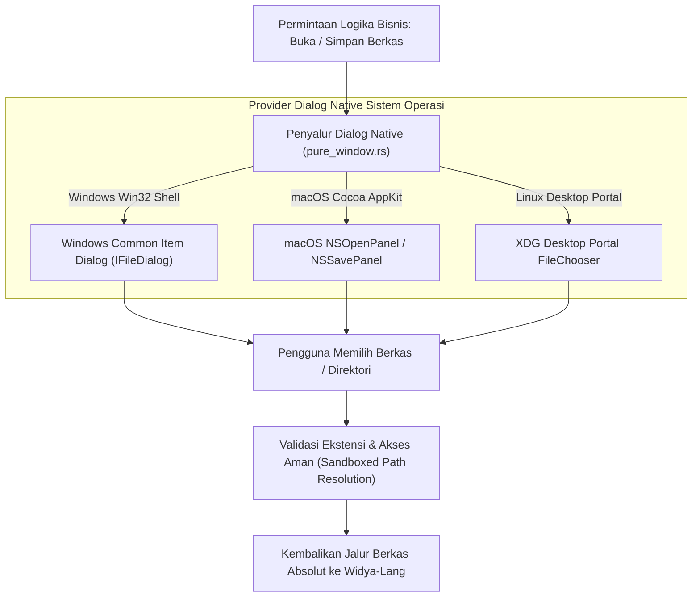

## Bab 14: Dialog Berkas Native & Pemilih Direktori Sistem Operasi

### 14.1 Kotak Dialog Berkas Native vs Dialog Web Tiruan

Ketika pengguna ingin membuka berkas basis data cadangan, mengekspor laporan transaksi kasir ke format dokumen, atau memilih direktori penyimpanan struk digital, menyajikan kotak dialog penjelajah berkas (*File Explorer Dialog*) adalah sebuah keharusan mutlak.

Aplikasi berbasis web murni sering kali terbatas pada elemen `<input type="file">` HTML yang kikuk, tidak mendukung pemilihan folder secara fleksibel, dan tidak dapat menentukan nama berkas default saat menyimpan dokumen.

WidyaDesktop menghadirkan dialog berkas native sistem operasi tingkat mesin melalui modul `pure_window.rs` dan helper `modul/desktop.wya`:
- **Windows Common Item Dialog (`IFileDialog` / `GetOpenFileNameW`)**: Menyajikan dialog standar Windows lengkap dengan akses ke folder cepat (*Quick Access*), panel pratinjau dokumen, dan jaringan lokal.
- **macOS `NSOpenPanel` & `NSSavePanel`**: Menyajikan dialog elegan Apple Cocoa dengan integrasi iCloud Drive, tag warna dokumen, dan bilah pencarian Spotlight native.
- **Linux Portal & GTK FileChooser**: Mendukung *XDG Desktop Portal* untuk sandboxing modern Wayland dan GNOME/KDE.



### 14.2 Penyaringan Ekstensi (*File Filters*) & Resolusi Jalur Aman

Operasi dialog berkas pada WidyaDesktop mencakup dua fungsi utama:
1. `BukaDialogPilihBerkas(filter)`: Membuka dialog pemilihan berkas dengan penyaring ekstensi spesifik (misalnya: `"*.csv;*.xlsx"` untuk impor inventaris, atau `"*.wya"` untuk modul kode).
2. `BukaDialogSimpanBerkas(nama_default)`: Membuka dialog penentuan lokasi penyimpanan berkas baru dengan nama awal yang telah terisi (misalnya: `"Laporan_Kasir_2026-10-20.pdf"`).

Kedua fungsi ini mengembalikan jalur absolut berkas pada sistem penyimpanan lokal secara aman, memungkinkan backend Widya-Lang membaca atau menulis berkas secara langsung dengan kecepatan I/O native tanpa perantara buffer HTTP.

### 14.3 Implementasi Kode Widya-Lang & WidyaDesktop Utuh

Berikut implementasi alur ekspor laporan keuangan kasir dan impor data master barang melalui dialog native pada Widya-Lang:

```widya
// Modul Pengendalian Dialog Berkas & Pemilih Direktori
modul pengelola_dialog_berkas {
    impor "./modul/desktop.wya";

    fungsi inisialisasi_layanan_ekspor_impor() {
        // 1. Buat Aplikasi Kasir
        misal app = BuatAplikasiDesktop("Nusantara POS - Administrasi Berkas", 1100, 720);

        // 2. Registrasi RPC: Impor Data Barang via Dialog Buka Berkas
        app.daftarkan_rpc("impor_data_barang", fungsi(_payload) {
            cetak(">>> [DIALOG] Membuka dialog pemilihan berkas inventaris...");
            // Buka dialog native sistem operasi dengan filter berkas spreadsheet
            misal jalur_berkas = BukaDialogPilihBerkas("*.csv;*.xlsx");

            jika (jalur_berkas == "" atau jalur_berkas == nil) {
                cetak(">>> [DIALOG] Pengguna membatalkan pemilihan berkas.");
                kembalikan { "sukses": salah, "alasan": "Pemilihan berkas dibatalkan" };
            }

            cetak(">>> [DIALOG] Berkas berhasil dipilih: " + jalur_berkas);
            kembalikan {
                "sukses": benar,
                "jalur_terpilih": jalur_berkas,
                "status": "SIAP_DIBACA"
            };
        });

        // 3. Registrasi RPC: Ekspor Laporan Transaksi via Dialog Simpan Berkas
        app.daftarkan_rpc("ekspor_laporan_kasir", fungsi(payload) {
            misal tgl = payload.tanggal;
            misal nama_bawaan = "Laporan_POS_" + tgl + ".pdf";

            cetak(">>> [DIALOG] Membuka dialog simpan berkas dengan saran: " + nama_bawaan);
            misal lokasi_simpan = BukaDialogSimpanBerkas(nama_bawaan);

            jika (lokasi_simpan == "" atau lokasi_simpan == nil) {
                kembalikan { "sukses": salah, "alasan": "Ekspor dibatalkan oleh kasir" };
            }

            cetak(">>> [DIALOG] Lokasi berkas target disetujui: " + lokasi_simpan);
            kembalikan {
                "sukses": benar,
                "lokasi_tujuan": lokasi_simpan,
                "pesan": "Laporan siap ditulis ke diska penyimpanan."
            };
        });

        kembalikan app;
    }
}
```

### 14.4 Analisis Kinerja, Keamanan & Tabel Metrik Arsitektur

Tabel evaluasi perbandingan dialog berkas web vs dialog native WidyaDesktop:

| Parameter Evaluasi | Input File HTML Biasa (`<input type="file">`) | Dialog Berkas Native WidyaDesktop |
| :--- | :--- | :--- |
| **Dukungan Dialog Simpan Berkas** | Tidak Ada (Hanya Otomatis Unduh ke Folder Download) | **Dukungan Penuh `BukaDialogSimpanBerkas` Native** |
| **Pilihan Direktori / Folder** | Terbatas & Bergantung Peramban | **Dukungan Penuh Pemilih Direktori Sistem** |
| **Akses Jalur Berkas Nyata** | Disamarkan / Dipalsukan (`C:\fakepath\...`) | **Jalur Absolut Nyata Sistem Berkas Lokal** |
| **Kecepatan Pembacaan Berkas** | Melewati Serialisasi Blob Browser (Lambat) | **Direct OS File Handle I/O (Sangat Cepat)** |
| **Estetika & Kenyamanan OS** | Dialog Asing / Kaku | **Dialog Asli Sistem Operasi Lengkap Quick Access** |

### 14.5 Latihan Praktik & Studi Kasus

1. Mengapa peramban web modern menyamarkan jalur berkas yang dipilih pengguna menjadi `C:\fakepath\...`, dan bagaimana WidyaDesktop mempertahankan keamanan sistem tanpa harus menyamarkan jalur berkas riil?
2. Jelaskan perbedaan mendasar arsitektur pemanggilan dialog berkas antara Windows (`IFileDialog` COM API) dengan macOS (`NSOpenPanel` AppKit)!
3. Uraikan teknik penanganan pembatalan pemilihan berkas (*dialog cancellation*) pada kode backend agar tidak memicu galat eksekusi pada antarmuka pengguna!

### 14.6 Evaluasi Mandiri Pilihan Ganda

1. Fungsi pembantu pada modul `desktop.wya` yang digunakan untuk memunculkan kotak dialog pemilihan berkas native adalah...
   A. `BukaDialogPilihBerkas(filter)`
   B. `UnduhFileDariInternet()`
   C. `TulisHarddiskLangsung()`
   D. `NyalakanKamera()`

2. Fungsi pembantu yang digunakan untuk memunculkan kotak dialog penentuan lokasi penyimpanan berkas dengan saran nama awal adalah...
   A. `BukaDialogSimpanBerkas(nama_default)`
   B. `HapusSeluruhFile()`
   C. `KunciSemuaDirektori()`
   D. `CetakKertasKasir()`

3. Komponen API standar pada Microsoft Windows yang bertindak sebagai mesin dialog berkas native modern adalah...
   A. Windows Common Item Dialog (`IFileDialog`)
   B. DOS Command Shell
   C. Windows Movie Maker
   D. Internet Explorer 6

4. Objek kelas native pada Apple macOS AppKit yang bertanggung jawab menyajikan jendela pemilih berkas adalah...
   A. `NSOpenPanel`
   B. `Direct3DDevice`
   C. `RegistryKey`
   D. `X11Pixmap`

5. Kelemahan fatal dari elemen unggah berkas HTML biasa `<input type="file">` dibanding dialog native WidyaDesktop adalah...
   A. Menyamarkan jalur berkas asli menjadi `C:\fakepath\` dan tidak memiliki dialog native simpan berkas dengan nama kustom
   B. Membuat komputer pengguna terbakar
   C. Menghapus seluruh foto di galeri
   D. Mematikan fungsi mouse

6. Nilai yang dikembalikan oleh fungsi `BukaDialogPilihBerkas` jika pengguna menekan tombol "Batal" (*Cancel*) adalah...
   A. String kosong `""` atau `nil`
   B. Galat Fatal Memory Overflow
   C. Kata sandi administrator komputer
   D. Nomor rekening kasir

7. String filter ekstensi `"*.csv;*.xlsx"` saat diteruskan ke dialog berkas memiliki fungsi untuk...
   A. Membatasi tampilan penjelajah berkas hanya pada dokumen berekstensi CSV dan lembar kerja Excel
   B. Menghapus seluruh berkas bertipe lain
   C. Mengubah seluruh berkas menjadi format MP3
   D. Mematikan keyboard

8. Mengapa akses terhadap jalur berkas absolut nyata (*absolute file path*) sangat penting bagi aplikasi stasiun kerja kasir dan gudang?
   A. Memungkinkan backend native membaca atau menulis data berukuran ratusan megabyte secara instan melalui sistem berkas lokal tanpa overhead unggah peramban
   B. Supaya kasir bisa melihat rahasia komputer lain
   C. Mengurangi konsumsi memori kartu grafis
   D. Menghilangkan kebutuhan kabel monitor

9. Standar portal modern pada Linux yang memungkinkan aplikasi di dalam container memilih berkas secara aman di lingkungan Wayland dan GNOME adalah...
   A. XDG Desktop Portal FileChooser
   B. Floppy Disk Mounter
   C. Serial Cable Terminal
   D. Dial-up Network Script

10. Apa keuntungan integrasi panel *Quick Access* pada kotak dialog native Windows bagi operator kasir?
    A. Operator dapat melompat seketika ke folder laporan harian atau flashdisk tanpa harus menavigasi struktur direktori bertingkat secara manual
    B. Kasir tidak perlu menghitung uang tunai
    C. Transaksi otomatis dinyatakan lunas
    D. Toko tidak memerlukan nota belanja
