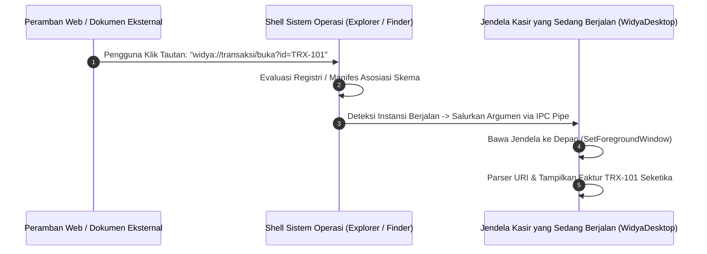

## Bab 15: Integrasi Shell OS Tingkat Mendalam: Custom URL Scheme & Asosiasi Berkas

### 15.1 Skema Tautan Dalam (*Custom URI Deep Linking Schemes*)

Aplikasi desktop berdaulat tidak boleh terisolasi dari ekosistem sistem operasi. Stasiun kerja kasir, perbankan, dan logistik sering kali harus dapat dipicu secara langsung dari tautan di peramban web eksternal, dokumen PDF faktur, atau pesan kode QR (misalnya saat pengguna mengklik tautan `widya://buka-kasir?faktur=TRX-9982` pada email konfirmasi).

WidyaDesktop menyediakan subsistem **Custom URI Deep Linking** melalui modul `desktop_native.rs`:
- **Pendaftaran Skema Kustom (*Custom Scheme Registration*)**:
  - Pada **Windows**, mendaftarkan kunci skema ke registri sistem operasi (`HKEY_CLASSES_ROOT\widya`).
  - Pada **macOS**, menambahkan definisi skema protokol ke dalam berkas manifes bundel aplikasi `Info.plist` pada kamus `CFBundleURLTypes`.
  - Pada **Linux**, mendaftarkan berkas desktop asosiasi MIME (`x-scheme-handler/widya`) melalui perkakas `xdg-mime`.
- **Penanganan Instansi Tunggal (*Single-Instance IPC Forwarding*)**: Jika aplikasi desktop sudah dalam kondisi aktif terbuka, penekanan tautan deep link tidak akan membuka proses aplikasi baru yang berulang. Sistem secara otomatis menyalurkan argumen URI tersebut ke jendela yang sudah aktif dan membawa jendela ke lapisan terdepan layar (*bring to front*).



### 15.2 Asosiasi Berkas Ekstensi Mandiri (*File Association*)

Selain skema URL, WidyaDesktop mendukung asosiasi ekstensi berkas dokumen berdaulat (seperti ekstensi `.wya`, `.wpos`, atau `.wdoc`). Ketika pengguna mengklik dua kali (*double click*) berkas `.wpos` pada File Explorer atau Finder:
1. Shell sistem operasi secara otomatis mengeksekusi biner WidyaDesktop dengan parameter argumen jalur berkas tersebut.
2. Ikon dokumen pada File Explorer menampilkan ikon visual resmi aplikasi secara presisi.
3. Menu konteks klik kanan berkas menampilkan opsi pintasan khusus (seperti: *"Buka dengan Stasiun Kerja Widya"*).

### 15.3 Implementasi Kode Widya-Lang & WidyaDesktop Utuh

Berikut implementasi pendaftaran skema deep link dan penanganan parameter tautan masuk pada Widya-Lang:

```widya
// Modul Integrasi Deep Link & Asosiasi Berkas Dokumen
modul integrasi_shell_os {
    impor "./modul/desktop.wya";

    fungsi inisialisasi_deep_link_kasir() {
        // 1. Buat Aplikasi Kasir
        misal app = BuatAplikasiDesktop("Nusantara POS - Terminal Shell", 1100, 720);

        // 2. Registrasi RPC untuk Menangani Parameter URI Deep Link yang Masuk
        app.daftarkan_rpc("proses_tautan_deep_link", fungsi(payload) {
            misal uri_masuk = payload.uri; // Contoh: "widya://kasir/faktur?nomor=INV-8891"

            cetak(">>> [DEEP-LINK] Menerima parameter navigasi dari OS Shell:");
            cetak("    - URI: " + uri_masuk);

            // Parser skema URL dan arahkan layar kasir ke faktur terkait
            kembalikan {
                "sukses": benar,
                "skema": "widya://",
                "tindakan": "BUKA_FAKTUR_LANGSUNG",
                "nomor_faktur": "INV-8891"
            };
        });

        // 3. Registrasi RPC untuk Penanganan Berkas Asosiasi yang Diklik Dua Kali
        app.daftarkan_rpc("proses_berkas_dibuka_os", fungsi(payload) {
            misal jalur = payload.jalur_berkas;

            cetak(">>> [ASOSIASI-BERKAS] Aplikasi dibuka melalui klik ganda berkas:");
            cetak("    - Berkas: " + jalur);

            kembalikan {
                "sukses": benar,
                "berkas_terbuka": jalur,
                "tipe": "DOKUMEN_TRANSAKSI_WPOS"
            };
        });

        cetak(">>> [SHELL] Integrasi skema 'widya://' dan asosiasi '.wya' aktif.");
        kembalikan app;
    }
}
```

### 15.4 Analisis Kinerja, Keamanan & Tabel Metrik Arsitektur

Tabel spesifikasi pendaftaran skema shell lintas platform:

| Sistem Operasi | Lokasi Pendaftaran Skema URL | Lokasi Pendaftaran Asosiasi Berkas | Mekanisme Single-Instance Forwarding |
| :--- | :--- | :--- | :--- |
| **Microsoft Windows** | `HKEY_CLASSES_ROOT\<skema>` | `HKCR\.ekstensi` & `ProgID` | Windows Named Pipe / `WM_COPYDATA` |
| **Apple macOS** | `Info.plist` (`CFBundleURLTypes`)| `Info.plist` (`CFBundleDocumentTypes`) | Apple Event Handler (`kAEGetURL`) |
| **Linux Desktop** | `~/.local/share/applications/*.desktop` | `/usr/share/mime/packages/*.xml` | DBus Service Activation |

### 15.5 Latihan Praktik & Studi Kasus

1. Mengapa penanganan instansi tunggal (*single-instance application*) sangat krusial saat aplikasi desktop dipicu melalui tautan deep link atau klik ganda berkas?
2. Bagaimana teknik sanitasi dan validasi parameter URI yang masuk dari skema `widya://` guna menangkal ancaman eksploitasi injeksi argumen (*argument injection attacks*)?
3. Uraikan perbedaan mekanisme pendaftaran skema URL antara sistem berbasis Registry pada Windows dengan sistem berbasis berkas `.desktop` pada Linux!

### 15.6 Evaluasi Mandiri Pilihan Ganda

1. Fitur yang memungkinkan aplikasi desktop terbuka secara otomatis ketika tautan protokol khusus (seperti `widya://`) diklik di peramban atau dokumen disebut...
   A. Custom URI Deep Linking
   B. Anonymous FTP Download
   C. Web Cookie Injector
   D. Teletext Broadcast

2. Kunci pada Registry sistem operasi Windows tempat pendaftaran skema URL kustom disimpan adalah...
   A. `HKEY_CLASSES_ROOT\<nama_skema>`
   B. `HKEY_CURRENT_CONFIG\Fonts`
   C. `HKEY_LOCAL_MACHINE\SAM`
   D. `C:\Windows\System32\drivers`

3. Berkas manifes bundel aplikasi pada Apple macOS tempat definisi `CFBundleURLTypes` didaftarkan adalah...
   A. `Info.plist`
   B. `config.sys`
   C. `autoexec.bat`
   D. `macOS.ini`

4. Apa yang dilakukan fitur *Single-Instance Forwarding* ketika tautan deep link diklik saat aplikasi sudah dalam kondisi terbuka?
   A. Menyalurkan argumen tautan ke jendela aplikasi yang sudah aktif dan membawanya ke depan layar tanpa membuat proses baru
   B. Menutup paksa aplikasi dan mematikan komputer
   C. Membuka 100 jendela baru secara bersamaan hingga memori penuh
   D. Menolak tautan dan memformat diska penyimpanan

5. Perintah baris perintah standar pada lingkungan Linux untuk mengaitkan skema protokol dengan berkas aplikasi desktop adalah...
   A. `xdg-mime default aplikasi.desktop x-scheme-handler/widya`
   B. `rm -rf /`
   C. `killall systemd`
   D. `format /dev/sda`

6. Fitur sistem operasi yang membuat berkas berekstensi khusus (seperti `.wya` atau `.wpos`) otomatis dibuka menggunakan aplikasi WidyaDesktop saat diklik ganda dinamakan...
   A. Asosiasi Berkas (File Association)
   B. File Hiding
   C. Disk Partitioning
   D. Memory Overclocking

7. Bahaya keamanan yang harus diantisipasi saat mengurai string parameter deep link adalah...
   A. Serangan injeksi argumen berbahaya (*Argument Injection Attack*) melalui manipulasi karakter khusus pada URL
   B. Komputer kehabisan daya listrik dalam 1 detik
   C. Keyboard otomatis mengetik sendiri
   D. Speaker mengeluarkan suara keras

8. Pesan sistem operasi Windows legendaris yang sering digunakan untuk mentransfer data string antar proses instansi tunggal adalah...
   A. `WM_COPYDATA`
   B. `WM_PAINT`
   C. `WM_DESTROY`
   D. `WM_SETCURSOR`

9. Manakah contoh tautan skema kustom berdaulat yang sah untuk membuka rincian transaksi tertentu pada WidyaDesktop?
   A. `widya://transaksi/faktur?nomor=TRX-2026-991`
   B. `http://www.google.com/search`
   C. `ftp://192.168.1.1/file.zip`
   D. `file:///C:/boot.ini`

10. Mengapa fitur deep linking sangat bermanfaat pada sistem integrasi perbankan dan kasir toko?
    A. Memungkinkan surat tagihan digital atau portal web manajemen memicu stasiun kerja kasir untuk membuka dokumen pembayaran secara otomatis dengan satu kali klik
    B. Supaya kasir tidak perlu menghitung kembalian
    C. Menghilangkan kebutuhan nota belanja fisik
    D. Mengganti kebutuhan petugas keamanan toko
