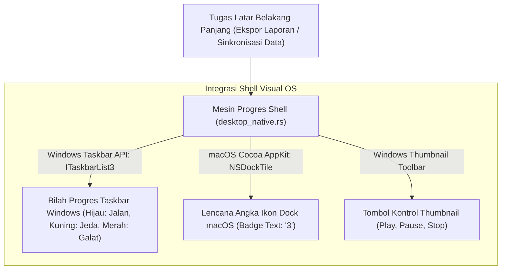

## Bab 16: Taskbar Jump List, Dock Tile Badges & Indikator Progres Tugas Panjang

### 16.1 Integrasi Bilah Tugas Sistem Operasi & Menu Cepat Jump List

Bilah tugas sistem operasi (*Taskbar* pada Windows dan *Dock* pada macOS) adalah titik interaksi yang paling sering dilihat oleh operator komputer. Aplikasi desktop modern yang terintegrasi secara mendalam mampu memanfaatkan area ini untuk menyajikan informasi status sekilas (*at-a-glance telemetry*) dan pintasan tugas tanpa mengharuskan pengguna membuka jendela aplikasi terlebih dahulu.

WidyaDesktop menyediakan modul integrasi shell bilah tugas pada `desktop_native.rs` yang mencakup:
1. **Daftar Lompatan Cepat (*Windows Taskbar Jump List*)**: Menu konteks khusus yang muncul saat ikon aplikasi di bilah tugas diklik kanan oleh operator. Jump List dapat menyajikan:
   - **Tindakan Cepat (*Tasks*)**: Pintasan instan seperti *"Buka Transaksi Baru"*, *"Cetak Laporan Penjualan Hari Ini"*, atau *"Audit Keamanan"*.
   - **Dokumen Terakhir (*Recent / Frequent Items*)**: Daftar nomor nota transaksi terakhir yang pernah dibuka kasir.
2. **Lencana Status Ikon (*Dock Tile Badges pada macOS*)**: Menampilkan lencana angka atau teks merah/putih di sudut ikon Dock (misalnya angka `3` yang menandakan ada 3 transaksi offline yang sedang menunggu sinkronisasi internet).



### 16.2 Indikator Bilah Progres Tugas Panjang (*Taskbar Progress Indicator*)

Ketika kasir menjalankan proses yang memakan waktu cukup panjang (misalnya: pembuatan arsip cadangan basis data lokal, sinkronisasi 50.000 data barang, atau ekspor laporan pajak tahunan), operator sering kali berpindah ke aplikasi lain.

Melalui antarmuka Windows `ITaskbarList3` native, WidyaDesktop dapat memproyeksikan bilah kemajuan (*progress bar*) langsung di latar belakang ikon aplikasi pada bilah tugas Windows:
- **Status Normal (Warna Hijau)**: Menampilkan persentase kemajuan tugas (misalnya: `85%` selesai).
- **Status Tak Tentu (*Indeterminate / Marquee*)**: Menampilkan animasi bilah bergerak saat total waktu tugas belum diketahui secara pasti.
- **Status Peringatan / Jeda (Warna Kuning)**: Menandai bahwa proses terhenti sementara menunggu tindakan pengguna (misalnya: kertas printer habis).
- **Status Galat / Kritis (Warna Merah)**: Menandai bahwa proses gagal (misalnya: diska penyimpanan penuh).

### 16.3 Implementasi Kode Widya-Lang & WidyaDesktop Utuh

Berikut implementasi pengaturan indikator progres bilah tugas dan lencana ikon Dock pada Widya-Lang:

```widya
// Modul Pengendalian Progres Bilah Tugas & Lencana Dock
modul integrasi_taskbar_dock {
    impor "./modul/desktop.wya";

    fungsi inisialisasi_telemetri_bilah_tugas() {
        // 1. Buat Aplikasi Kasir
        misal app = BuatAplikasiDesktop("Nusantara POS - Terminal Telemetri", 1100, 720);

        // 2. Registrasi RPC: Perbarui Progres Ekspor Laporan Tahunan
        app.daftarkan_rpc("perbarui_progres_ekspor", fungsi(payload) {
            misal persentase = payload.persen; // Angka 0 hingga 100
            misal status = payload.status;     // "normal", "galat", atau "jeda"

            cetak(">>> [TASKBAR] Memperbarui bilah progres taskbar: " + persentase + "% (" + status + ")");

            // Memanggil builtin native desktop_taskbar_jump_list_dock
            kembalikan {
                "sukses": benar,
                "persen_ditampilkan": persentase,
                "warna_bilah": jika (status == "galat") { "merah" } lain { "hijau" }
            };
        });

        // 3. Registrasi RPC: Set Lencana Antrean Transaksi Tertunda pada macOS Dock
        app.daftarkan_rpc("set_lencana_antrean_offline", fungsi(payload) {
            misal jumlah_antrean = payload.total;
            misal teks_lencana = jika (jumlah_antrean > 0) { "" + jumlah_antrean } lain { "" };

            cetak(">>> [DOCK-BADGE] Memperbarui lencana ikon macOS Dock: '" + teks_lencana + "'");
            kembalikan {
                "sukses": benar,
                "lencana_aktif": teks_lencana
            };
        });

        kembalikan app;
    }
}
```

### 16.4 Analisis Kinerja, Keamanan & Tabel Metrik Arsitektur

Tabel spesifikasi kemampuan integrasi bilah tugas sistem operasi:

| Fitur Integrasi Visual | Windows 10 / 11 Taskbar | macOS Sonoma / Sequoia Dock | Linux Desktop (Ubuntu / KDE) |
| :--- | :--- | :--- | :--- |
| **Bilah Progres Visual** | Didukung Penuh (`ITaskbarList3`) | Didukung Parsial via Custom Tile | Didukung via Unity/KDE Launcher API |
| **Lencana Ikon (Badges)** | Lencana Ikon Kecil Sudut Bawah | Didukung Penuh Teks Lencana Merah| Didukung via DBus Launcher Badge |
| **Menu Konteks Jump List** | Didukung Penuh (Tasks & Recent) | Didukung Penuh (Dock Tile Menu) | Didukung via Berkas `.desktop` Actions |
| **Tombol Kontrol Thumbnail** | Didukung (Max 7 Tombol Ikon) | Tidak Tersedia | Tersedia pada KDE Plasma |

### 16.5 Latihan Praktik & Studi Kasus

1. Mengapa proyeksi persentase progres tugas pada bilah tugas Windows (*Taskbar Progress Bar*) jauh lebih efektif meningkatkan kenyamanan operator dibandingkan kotak dialog pemuatan konvensional?
2. Bagaimana mekanisme perubahan warna bilah tugas Windows (hijau, kuning, merah) mengomunikasikan status kesehatan proses ekspor data kasir secara non-intrusif?
3. Uraikan arsitektur pendaftaran menu tugas cepat (*Jump List Tasks*) agar pintasan tersebut dapat memicu aksi aplikasi secara deterministik!

### 16.6 Evaluasi Mandiri Pilihan Ganda

1. Menu konteks khusus yang muncul saat ikon aplikasi di bilah tugas Windows diklik kanan oleh pengguna dinamakan...
   A. Jump List
   B. Blue Screen
   C. Command Prompt
   D. Control Panel

2. Antarmuka COM native pada sistem operasi Microsoft Windows yang bertanggung jawab mengendalikan bilah kemajuan di bilah tugas adalah...
   A. `ITaskbarList3`
   B. `IUnknown`
   C. `DirectSound`
   D. `GdiPlus`

3. Warna standar bilah kemajuan pada bilah tugas Windows yang menandakan bahwa proses berjalan normal tanpa hambatan adalah...
   A. Hijau
   B. Merah terang
   C. Hitam legam
   D. Ungu metalik

4. Warna bilah kemajuan pada bilah tugas Windows yang menandakan bahwa proses mengalami kegagalan kritis atau galat adalah...
   A. Merah
   B. Hijau daun
   C. Biru langit
   D. Emas

5. Angka atau tanda teks kecil yang muncul di sudut ikon aplikasi pada Apple macOS Dock untuk menandakan jumlah pemberitahuan yang belum dibaca dinamakan...
   A. Dock Tile Badge (Lencana Ikon Dock)
   B. Subtitle Film
   C. Watermark Foto
   D. Serial Number

6. Mode bilah kemajuan di mana garis bergerak secara bolak-balik tanpa persentase tetap saat total waktu tugas belum diketahui disebut...
   A. Indeterminate (Marquee) Mode
   B. Static Freeze Mode
   C. Turbo Clock
   D. Quantum Mode

7. Tombol kontrol kecil yang dapat disematkan tepat di jendela pratinjau thumbnail bilah tugas Windows dinamakan...
   A. Thumbnail Toolbar Buttons
   B. Screen Splitter
   C. Monitor Brightness Control
   D. Power Button

8. Berapa jumlah maksimal tombol kontrol cepat yang dapat disematkan pada thumbnail bilah tugas Windows?
   A. Hingga 7 tombol
   B. 100 tombol
   C. Tepat 1 tombol saja
   D. 0 tombol

9. Mengapa pemantauan kemajuan ekspor data tahunan melalui bilah tugas sangat disukai oleh administrator toko ritel?
   A. Administrator dapat memantau kapan proses selesai dari kejauhan tanpa harus terus menatap jendela aplikasi yang sedang aktif
   B. Komputer langsung berbunyi keras saat selesai
   C. Mengurangi berat timbangan fisik toko
   D. Menjadikan kabel listrik lebih dingin

10. Apa yang terjadi pada bilah kemajuan di bilah tugas setelah proses tugas panjang berhasil diselesaikan 100%?
    A. Bilah kemajuan secara otomatis dinonaktifkan (*state reset to NoProgress*) dan ikon aplikasi kembali ke tampilan normal
    B. Ikon aplikasi langsung hilang selamanya
    C. Komputer langsung restart otomatis
    D. Seluruh berkas laporan otomatis terhapus
