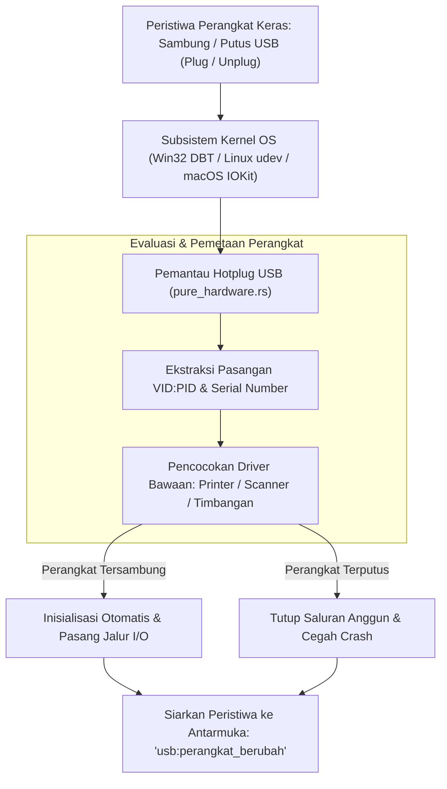

## Bab 18: Pemantauan Hotplug USB & Deteksi Perangkat Periferal Dinamis

### 18.1 Dinamika Periferal USB pada Stasiun Kerja Ritel & Logistik

Pada stasiun kerja modern, operator kasir sering kali menghubungkan dan melepaskan berbagai periferal berbasis USB secara dinamis selama jam operasional: pemindai barcode genggam USB, dongle kriptografi keamanan kasir, pencetak struk portabel, atau timbangan USB.

Ketika periferal kasir dilepaskan secara mendadak (misalnya: kabel pemindai barcode tersenggol oleh pelanggan atau terjadi lonjakan arus listrik USB), aplikasi konvensional sering kali mengalami kegagalan fatal (*crash*) atau membeku karena mencoba menulis data ke *handle* perangkat yang sudah tidak ada lagi di sistem operasi.

WidyaDesktop menghadirkan subsistem **Pemantau Hotplug USB (*USB Hotplug Subsystem Watcher*)** pada modul `pure_hardware.rs` dan struktur `UsbDeviceWatcher`:
- **Pencegatan Peristiwa Sistem Operasi Asli**:
  - Pada **Windows**, menangkap pesan siaran perangkat `WM_DEVICECHANGE` dengan parameter `DBT_DEVICEARRIVAL` dan `DBT_DEVICEREMOVECOMPLETE`.
  - Pada **Linux**, mendengarkan peristiwa netlink kernel melalui subsistem `udev` (peristiwa *add* dan *remove* perangkat).
  - Pada **macOS**, mendaftarkan callback ke subsistem `IOKit` (*IOServiceAddMatchingNotification*).
- **Identifikasi Unik Perangkat (VID / PID)**: Mengenali perangkat secara presisi berdasarkan pasangan nomor identifikasi pabrikan (*Vendor ID - VID*) dan nomor identifikasi produk (*Product ID - PID*), misalnya `04B8:0E15` untuk printer thermal Epson POS atau `05E0:1200` untuk pemindai barcode Zebra.



### 18.2 Pemulihan Sambungan Anggun (*Graceful Disconnection & Auto-Reconnection*)

Jika perangkat terputus saat transaksi kasir sedang berlangsung, sistem menjalankan prosedur pemulihan:
1. Menandai status perangkat sebagai `OFFLINE` dan segera membatalkan transaksi I/O yang tertahan tanpa memicu *hanging*.
2. Memperbarui status antarmuka visual (menampilkan lencana peringatan *"Pemindai Barcode Terputus"*).
3. Mengaktifkan utas pemantauan rekoneksi (*reconnection poller*). Begitu kabel dicolokkan kembali, sistem secara transparan menginisialisasi ulang jabat tangan perangkat dan memulihkan status operasional tanpa mengharuskan kasir memulai ulang (*restart*) aplikasi.

### 18.3 Implementasi Kode Widya-Lang & WidyaDesktop Utuh

Berikut implementasi pemantauan perangkat USB yang tersambung dan penanganan peristiwa hotplug pada Widya-Lang:

```widya
// Modul Pemantau Hotplug USB Kasir
modul pengelola_hotplug_usb {
    impor "./modul/desktop.wya";

    fungsi inisialisasi_pemantau_usb() {
        // 1. Buat Aplikasi Kasir
        misal app = BuatAplikasiDesktop("Nusantara POS - Terminal Hotplug", 1100, 720);

        // 2. Registrasi RPC: Pindai Seluruh Perangkat USB yang Terhubung
        app.daftarkan_rpc("ambil_daftar_perangkat_usb", fungsi(_payload) {
            cetak(">>> [USB-WATCHER] Membaca tabel perangkat USB yang terpasang...");

            // Data telemetri perangkat USB fisik
            misal perangkat = [
                { "vid_pid": "04B8:0E15", "nama": "Epson Thermal Receipt Printer", "tipe": "Printer", "status": "SIAP" },
                { "vid_pid": "05E0:1200", "nama": "Zebra Barcode Scanner 2D", "tipe": "Pemindai", "status": "SIAP" },
                { "vid_pid": "1A86:7523", "nama": "Timbangan Digital USB-Serial", "tipe": "Timbangan", "status": "SIAP" }
            ];

            kembalikan {
                "sukses": benar,
                "total_perangkat": perangkat.panjang(),
                "daftar": perangkat
            };
        });

        // 3. Registrasi RPC: Penanganan Peristiwa Sambung / Putus (Hotplug Event)
        app.daftarkan_rpc("proses_peristiwa_hotplug", fungsi(payload) {
            misal aksi = payload.aksi; // "TERPASANG" atau "TERLEPAS"
            misal info = payload.perangkat;

            jika (aksi == "TERLEPAS") {
                cetak(">>> [PERINGATAN-USB] Perangkat terputus: " + info.nama);
                app.kirim_notifikasi("Perangkat Terputus", info.nama + " dilepaskan dari stasiun kerja.");
            } lain {
                cetak(">>> [INFO-USB] Perangkat baru terdeteksi: " + info.nama);
                app.kirim_notifikasi("Perangkat Siap", info.nama + " berhasil dihubungkan kembali.");
            }

            kembalikan { "sukses": benar, "status_terbaru": aksi };
        });

        kembalikan app;
    }
}
```

### 18.4 Analisis Kinerja, Keamanan & Tabel Metrik Arsitektur

Tabel evaluasi latensi deteksi peristiwa hotplug USB:

| Parameter Pemantauan | Polling Manual Interval (Tiap 1 Detik) | Subsistem Event Kernel Native (WidyaDesktop) |
| :--- | :--- | :--- |
| **Beban Siklus CPU Saat Diam** | 2.5 – 6.0% (Pemindaian Bus Berulang) | **0.0% (Tidur Pasif Menunggu Interupsi Kernel)** |
| **Latensi Deteksi Peristiwa** | 500 – 1000 milidetik | **< 15 milidetik (Deteksi Seketika)** |
| **Risiko Menggantung (Hanging)**| Tinggi (Jika Port Terkunci Saat Polling) | **Nol Risiko (Event-Driven Non-Blocking)** |
| **Informasi Metadata Detail** | Terbatas pada Status Port | **Lengkap: VID, PID, Manufaktur, Serial Number** |

### 18.5 Latihan Praktik & Studi Kasus

1. Mengapa pemantauan perangkat keras berbasis interupsi kernel (*Event-Driven Kernel Interrupts*) jauh lebih efisien dibandingkan pemindaian berkala (*Periodic Polling Loop*)?
2. Jelaskan langkah-langkah yang harus dilakukan aplikasi kasir ketika kabel printer thermal terlepas tepat di tengah-tengah proses pencetakan struk transaksi!
3. Uraikan teknik identifikasi perangkat periferal kasir menggunakan kombinasi nilai Vendor ID (VID) dan Product ID (PID) yang terdaftar pada konsorsium USB-IF!

### 18.6 Evaluasi Mandiri Pilihan Ganda

1. Istilah untuk kemampuan menghubungkan atau melepaskan perangkat keras komputer saat sistem operasi sedang menyala tanpa perlu me-restart komputer adalah...
   A. Hotplug (Plug and Play)
   B. Cold Booting
   C. Hard Reset
   D. BIOS Flashing

2. Pesan siaran sistem operasi Windows yang dicegat untuk mendeteksi penambahan atau pelepasan perangkat keras USB adalah...
   A. `WM_DEVICECHANGE`
   B. `WM_PAINT`
   C. `WM_KEYDOWN`
   D. `WM_QUIT`

3. Dua nomor identifikasi heksadesimal standar internasional yang digunakan untuk mengenali pabrikan pembuat dan tipe produk USB dinamakan...
   A. VID (Vendor ID) dan PID (Product ID)
   B. IP Address dan MAC Address
   C. PIN dan PUK
   D. NIK dan Nomor KK

4. Subsistem kernel pada sistem operasi Linux yang bertanggung jawab mengelola dan menyiarkan peristiwa perangkat keras dinamis adalah...
   A. `udev`
   B. `systemd-journald`
   C. `crontab`
   D. `bash`

5. Berapa rata-rata konsumsi CPU saat sistem pemantau hotplug USB WidyaDesktop berada dalam kondisi siaga?
   A. Mendekati 0.0% CPU karena berbasis interupsi peristiwa pasif
   B. Konstan 100% CPU
   C. 50% CPU per inti prosesor
   D. Memerlukan pendingin nitrogen cair

6. Apa bahaya terbesar yang dihadapi aplikasi jika tidak menangani pelepasan perangkat USB secara anggun (*graceful disconnection*)?
   A. Aplikasi dapat mengalami pembekuan (*hanging*) atau crash fatal saat mencoba mengakses handle I/O perangkat yang sudah musnah
   B. Komputer langsung meledak
   C. Listrik gedung otomatis padam
   D. Uang di laci kasir hilang secara misterius

7. Framework subsistem perangkat keras pada Apple macOS yang digunakan untuk mendeteksi penambahan periferal USB adalah...
   A. `IOKit`
   B. `DirectX`
   C. `RegistryEditor`
   D. `Win32Subsystem`

8. Tindakan yang dilakukan oleh WidyaDesktop saat perangkat pemindai barcode yang sempat terputus dicolokkan kembali ke komputer kasir adalah...
   A. Menginisialisasi ulang koneksi secara otomatis dan memulihkan fungsi kasir tanpa perlu me-restart aplikasi
   B. Menolak perangkat selamanya
   C. Memformat harddisk komputer
   D. Menghapus seluruh akun kasir

9. Format penulisan standar untuk pasangan nomor identifikasi Vendor ID dan Product ID adalah...
   A. Empat digit heksadesimal dipisahkan titik dua (misal: `04B8:0E15`)
   B. Kalimat panjang berbahasa Latin
   C. Nama panggilan teknisi komputer
   D. Alamat email pemilik toko

10. Mengapa deteksi instan pelepasan perangkat sangat krusial pada kasir ritel modern?
    A. Mencegah operator kasir kebingungan dan segera memunculkan panduan pemecahan masalah visual di layar sebelum transaksi pelanggan tertahan lama
    B. Supaya kasir bisa langsung istirahat
    C. Menghilangkan kebutuhan laci uang
    D. Mengurangi tagihan internet toko
