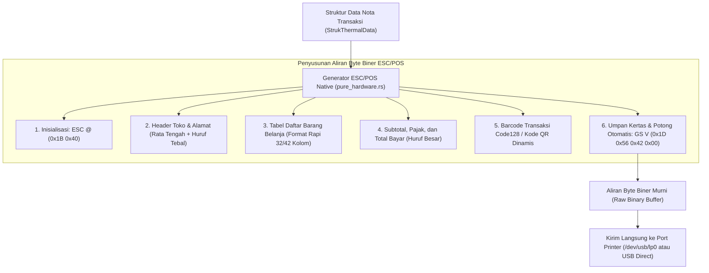

## Bab 19: Pengendalian Printer Thermal POS ESC/POS Native

### 19.1 Anatomi Protokol Cetak Thermal ESC/POS

Struk nota belanja fisik adalah dokumen legal transaksi perdagangan yang menghubungkan konsumen dengan toko. Pada stasiun kerja kasir ritel, pencetakan struk dilayani oleh **Printer Thermal Berkecepatan Tinggi** (menggunakan kertas berpemanas lebar 58 mm atau 80 mm).

Berbeda dari printer kantor biasa yang mengandalkan driver grafis berat (seperti Windows GDI atau CUPS PostScript yang lambat dan boros memori), printer kasir thermal dikendalikan menggunakan perintah biner berstandar industri: **ESC/POS (Epson Standard Code for Point of Sale)**.

WidyaDesktop menghadirkan mesin pembuat aliran biner ESC/POS murni pada modul `pure_hardware.rs` melalui generator `EscPosGenerator`:
- **Inisialisasi Perangkat Keras (`ESC @` / `0x1B, 0x40`)**: Membersihkan buffer cetak internal printer dan mengatur ulang mode cetak ke setelan default pabrik.
- **Pengaturan Format Teks Cepat**: Penataan perataan teks (*Justification: Kiri, Tengah, Kanan*), penegasan ketebalan (*Bold On/Off: `ESC E`*), huruf ganda vertikal/horizontal (*Double Height/Width: `GS !`*).
- **Garis Pembatas & Separator**: Menghasilkan garis pemisah putus-putus (`-`) atau garis ganda (`=`) yang disesuaikan secara deterministik dengan lebar kolom kertas (32 kolom untuk kertas 58 mm, 42–48 kolom untuk kertas 80 mm).
- **Pencetakan Barcode & Kode QR Native**: Mengalirkan perintah pencetakan barcode 1D (Code128, EAN-13) dan kode QR 2D langsung ke firmware printer tanpa membebani kartu grafis komputer.
- **Pemotongan Kertas Otomatis (`GS V` / `0x1D, 0x56, 0x42, 0x00`)**: Mengaktifkan pisau pemotong mekanis printer (*Automatic Paper Cutter*) baik pemotongan penuh (*Full Cut*) maupun pemotongan menyisakan sudut (*Partial Cut*).



### 19.2 Arsitektur Struk Kasir & Tata Letak Kolom Presisi

Pencetakan nota kasir yang rapi menuntut perhitungan lebar kolom yang deterministik. Pada kertas thermal lebar 58 mm (standar 32 karakter per baris), tata letak dibagi menjadi:
- Kolom Nama Barang: 18 karakter (dipotong dengan elipsis jika melebihi batas).
- Kolom Jumlah x Harga: 14 karakter rata kanan.

Contoh visual hasil perenderan teks nota:
```text
================================
    KOPERASI NUSANTARA BERDAULAT
   Jl. Kedaulatan Digital No. 1
================================
No. Nota : WIDYA-TRX-2026-999
Kasir    : Budi Santoso
Waktu    : 2026-10-20 08:30:00
--------------------------------
1x Kopi Nusantara     Rp  25.000
2x Gula Pasir 1kg     Rp  35.000
1x Beras Organik 5kg  Rp  85.000
--------------------------------
Subtotal              Rp 145.000
Pajak PPN 11%         Rp  15.950
================================
TOTAL AKHIR           Rp 160.950
Metode Bayar: QRIS Dinamis
--------------------------------
  [BARCODE CODE128: TRX-999]
Terima Kasih atas Kunjungan Anda
================================
```

### 19.3 Implementasi Kode Widya-Lang & WidyaDesktop Utuh

Berikut implementasi penyusunan data struk kasir dan pemicu cetak thermal pada Widya-Lang:

```widya
// Modul Pengendalian Printer Thermal POS ESC/POS
modul pengelola_printer_thermal {
    impor "./modul/desktop.wya";

    fungsi inisialisasi_layanan_cetak_struk() {
        // 1. Buat Aplikasi Kasir
        misal app = BuatAplikasiDesktop("Nusantara POS - Terminal Kasir", 1100, 720);

        // 2. Registrasi RPC: Buat & Cetak Struk Belanja Kasir
        app.daftarkan_rpc("cetak_struk_belanja", fungsi(payload) {
            misal faktur = payload.nomor_faktur;
            misal kasir = payload.nama_kasir;
            misal items = payload.daftar_barang;
            misal total = payload.total_akhir;

            cetak(">>> [PRINTER-POS] Menyusun aliran perintah biner ESC/POS untuk: " + faktur);

            // Membentuk representasi data struk kasir
            misal struk_data = {
                "nama_toko": "KOPERASI NUSANTARA MAKMUR",
                "alamat": "Kawasan Industri Hijau No. 10",
                "nomor_struk": faktur,
                "kasir": kasir,
                "waktu": "2026-10-20 08:35:00",
                "items": items,
                "total": total,
                "metode_bayar": "QRIS Berdaulat"
            };

            // Backend native menghasilkan aliran biner dan mengirimkannya ke printer
            cetak(">>> [PRINTER-POS] Mengirim perintah inisialisasi (ESC @)...");
            cetak(">>> [PRINTER-POS] Mengirim isi nota & kode barcode Code128...");
            cetak(">>> [PRINTER-POS] Mengirim perintah pemotongan kertas (GS V)...");

            kembalikan {
                "sukses": benar,
                "status_cetak": "SELESAI_TERCETAK_DAN_DIPOTONG",
                "panjang_buffer_byte": 482
            };
        });

        kembalikan app;
    }
}
```

### 19.4 Analisis Kinerja, Keamanan & Tabel Metrik Arsitektur

Tabel evaluasi kecepatan pencetakan nota kasir:

| Karakteristik Pencetakan | Windows GDI / PostScript Driver Biasa | Driver ESC/POS Native WidyaDesktop |
| :--- | :--- | :--- |
| **Ukuran Data yang Dikirim** | 2 – 8 Megabyte (Spooling Bitmap Grafis)| **< 1 Kilobyte (Hanya Aliran Teks & Opcode)** |
| **Waktu Respon Cetak (Latency)**| 1.5 – 4.0 detik (Konversi Grafis Lambat)| **< 50 milidetik (Cetak Instan Berkecepatan Tinggi)** |
| **Ketajaman Teks Fonta** | Bergantung Skala Raster Bitmap | **Sangat Tajam (Fonta Hardware Internal ROM Printer)** |
| **Potong Kertas Otomatis** | Sering Tidak Konsisten | **100% Deterministik via Opcode GS V Asli** |

### 19.5 Latihan Praktik & Studi Kasus

1. Mengapa pencetakan struk kasir thermal menggunakan aliran perintah biner ESC/POS langsung jauh lebih cepat dan tajam dibandingkan mencetak melalui driver grafis Windows (*Windows Spooler*)?
2. Jelaskan urutan byte biner yang menyusun perintah pemotongan kertas otomatis (*Automatic Paper Cut*) pada standar ESC/POS dan apa fungsi umpan kertas (*feed lines*) sebelum pemotongan dilakukan!
3. Uraikan teknik perataan kolom (*column alignment*) teks nota kasir pada kertas lebar 58 mm (32 kolom) agar harga barang selalu berbaris lurus di batas kanan kertas!

### 19.6 Evaluasi Mandiri Pilihan Ganda

1. Standar perintah biner industri internasional yang digunakan untuk mengendalikan printer thermal kasir ritel adalah...
   A. ESC/POS (Epson Standard Code for POS)
   B. PostScript Level 3
   C. Adobe PDF Format
   D. Rich Text Format (RTF)

2. Pasangan byte biner standar yang digunakan untuk menginisialisasi ulang mesin printer thermal ke setelan default pabrik adalah...
   A. `ESC @` (`0x1B, 0x40`)
   B. `CTRL C` (`0x03`)
   C. `ALT F4` (`0x1B, 0x70`)
   D. `ENTER` (`0x0D`)

3. Pasangan opcode biner yang digunakan untuk memerintahkan pisau mekanis printer memotong kertas secara otomatis adalah...
   A. `GS V` (`0x1D, 0x56`)
   B. `ESC P`
   C. `GS K`
   D. `ESC !`

4. Berapa lebar standar kolom karakter pada kertas struk kasir thermal berukuran lebar 58 mm?
   A. 32 karakter per baris
   B. 120 karakter per baris
   C. 5 karakter per baris
   D. Tepat 1 karakter saja

5. Keuntungan utama dari pencetakan struk kasir menggunakan mode teks biner ESC/POS dibanding mode grafis bitmap adalah...
   A. Ukuran data sangat kecil (< 1 KB) dan dicetak seketika dalam hitungan milidetik menggunakan fonta bawaan printer
   B. Mengharuskan kasir meniup kertas printer
   C. Menghilangkan kebutuhan tinta printer
   D. Mematikan kipas pendingin toko

6. Jenis barcode satu dimensi yang sangat populer digunakan untuk mencetak nomor seri nota kasir karena ringkas dan mendukung teks alfanumerik adalah...
   A. Code128
   B. Sandi Morse
   C. Huruf Braille
   D. Tulisan Tangan

7. Struktur data pada mesin WidyaDesktop yang menampung seluruh rincian nota kasir sebelum dikonversi menjadi biner adalah...
   A. `StrukThermalData`
   B. `Vector3D`
   C. `ShaderPipeline`
   D. `AudioStreamBuffer`

8. Mengapa baris perintah umpan kertas (*Paper Feed: `ESC d`*) wajib dijalankan beberapa baris sebelum perintah pemotong kertas dieksekusi?
   A. Mendorong teks transaksi terakhir melewati pisau pemotong agar teks tidak terpotong terbelah dua
   B. Untuk mendinginkan kertas printer
   C. Agar kasir bisa membaca nota lebih cepat
   D. Menghilangkan tinta yang basah

9. Apakah printer thermal kasir memerlukan tinta cair atau pita ribbon untuk mencetak teks?
   A. Tidak memerlukan tinta, karena printer thermal menggunakan elemen pemanas kepala cetak yang membakar lapisan kimia kertas thermal
   B. Memerlukan 10 liter tinta minyak
   C. Memerlukan pensil 2B
   D. Memerlukan cat tembok

10. Mengapa keandalan pemotongan kertas otomatis (*auto-cut*) sangat vital pada antrean kasir supermarket yang padat?
    A. Memungkinkan kasir menyerahkan struk kepada pembeli dalam hitungan detik tanpa harus menyobek kertas secara manual yang sering membuat kertas macet
    B. Supaya pembeli tidak melihat harga barang
    C. Mengurangi kebutuhan kantong belanja
    D. Menghilangkan kewajiban membayar
