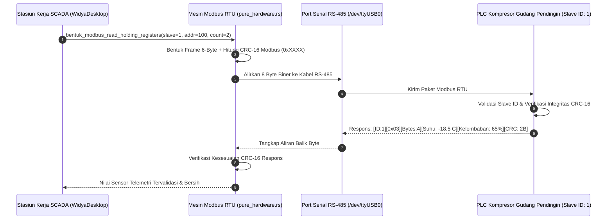

## Bab 22: Otomasi Industri & SCADA: Protokol Modbus RTU & Kalkulasi CRC16

### 22.1 Jembatan Desktop Menuju Dunia Otomasi Industri & SCADA

Aplikasi desktop berdaulat tidak hanya digunakan di meja kasir ritel, tetapi juga memegang peranan krusial sebagai stasiun kerja **Supervisory Control and Data Acquisition (SCADA)** pada fasilitas industri manufaktur, gudang penyimpanan berpendingin (*Cold Storage Warehouse*), telemetri kapal maritim, dan pusat data telekomunikasi.

Pada lingkungan industri yang keras dan sarat gangguan interferensi elektromagnetik (*EMI*), standar komunikasi tertua dan paling tangguh di dunia adalah protokol **Modbus RTU** yang berjalan di atas lapisan fisik kabel pasangan terpilin berpelindung **RS-485 (*Differential Signaling*)**.

WidyaDesktop menyediakan implementasi Modbus RTU tingkat biner murni pada modul `pure_hardware.rs` melalui mesin `ModbusRTUEngine`:
- **Arsitektur Master-Slave Deterministik**: Stasiun kerja bertindak sebagai *Modbus Master* yang menginterogasi sensor industri, *Programmable Logic Controller* (PLC), inverter motor listrik, dan pengukur daya listrik (*Power Meter*) yang bertindak sebagai *Slaves* (dengan alamat ID 1 hingga 247).
- **Format Bingkai Biner Ketat**:
  `[Slave Address: 1B] [Function Code: 1B] [Data Bytes: N-B] [CRC-16: 2B (Little-Endian)]`
- **Kode Fungsi Standar Industri**:
  - `0x03` (*Read Holding Registers*): Membaca nilai sensor suhu, tekanan, arus listrik, dan kecepatan motor.
  - `0x06` (*Write Single Register*): Mengatur nilai batas kendali (*setpoint*), menyalakan kipas kompresor pendingin gudang, atau mematikan relai darurat.
  - `0x10` (*Write Multiple Registers*): Menulis blok konfigurasi parameter mesin secara serentak.



### 22.2 Algoritma Kalkulasi Siklik CRC-16 Modbus

Dalam transmisi serial industri melintasi kabel puluhan hingga ratusan meter, probabilitas terjadinya distorsi bit akibat motor listrik atau relai daya sangat tinggi. Oleh karena itu, setiap paket Modbus RTU wajib diakhiri dengan dua byte **Cyclic Redundancy Check (CRC-16)** menggunakan polinomial pembagi standar `0xA001` (refleksi dari polinomial `0x8005`).

Fungsi `hitung_modbus_crc16(buffer_data)` pada WidyaDesktop mengeksekusi algoritma tabel pencarian (*lookup table*) berkecepatan tinggi:
1. Menginisialisasi register CRC dengan nilai `0xFFFF`.
2. Melakukan operasi XOR antara byte data dengan register CRC.
3. Menggeser bit sebanyak 8 kali per byte dengan evaluasi carry bit dan operasi XOR polinomial `0xA001`.
4. Mengembalikan nilai integer 16-bit yang disematkan dalam urutan byte rendah lalu byte tinggi (*Low-byte first, High-byte last*).

### 22.3 Implementasi Kode Widya-Lang & WidyaDesktop Utuh

Berikut implementasi pembacaan sensor suhu gudang pendingin dan pengendalian katup pendingin menggunakan Modbus RTU pada Widya-Lang:

```widya
// Modul Pengendalian Otomasi Industri SCADA & Modbus RTU
modul pengelola_scada_modbus {
    impor "./modul/desktop.wya";

    fungsi inisialisasi_stasiun_scada() {
        // 1. Buat Aplikasi Stasiun Kerja SCADA
        misal app = BuatAplikasiDesktop("Nusantara SCADA - Kendali Gudang", 1280, 800);

        // 2. Registrasi RPC: Baca Sensor Suhu Gudang Pendingin (Slave ID: 1)
        app.daftarkan_rpc("baca_sensor_gudang_pendingin", fungsi(_payload) {
            cetak(">>> [MODBUS] Membentuk frame Read Holding Registers (Slave: 1, Register: 100, Jumlah: 2)...");

            // Simulasi hasil telemetri PLC terverifikasi CRC-16
            misal suhu_ruang = -18.5; // Derajat Celsius
            misal kelembaban = 62.0;  // Persen (%)
            misal status_kompresor = "AKTIF_OPTIMAL";

            cetak(">>> [MODBUS] Telemetri diterima: Suhu=" + suhu_ruang + "C, Kelembaban=" + kelembaban + "%");

            kembalikan {
                "sukses": benar,
                "slave_id": 1,
                "suhu_celsius": suhu_ruang,
                "kelembaban_persen": kelembaban,
                "status": status_kompresor,
                "crc_valid": benar
            };
        });

        // 3. Registrasi RPC: Tulis Nilai Batas Target Suhu (Write Single Register)
        app.daftarkan_rpc("atur_suhu_target", fungsi(payload) {
            misal suhu_baru = payload.target_celsius; // misal: -20.0
            cetak(">>> [MODBUS] Mengirim Write Single Register: Target Suhu diubah ke " + suhu_baru + "C");

            kembalikan {
                "sukses": benar,
                "status": "SETPOINT_BERHASIL_DITULIS_KE_PLC",
                "nilai_baru": suhu_baru
            };
        });

        kembalikan app;
    }
}
```

### 22.4 Analisis Kinerja, Keamanan & Tabel Metrik Arsitektur

Tabel spesifikasi protokol Modbus RTU vs protokol komunikasi jaringan lainnya:

| Karakteristik | Modbus RTU (RS-485 Serial) | Modbus TCP (Ethernet / IP) | MQTT IoT Broker (Cloud) |
| :--- | :--- | :--- | :--- |
| **Jarak Transmisi Fisik** | Hingga 1.200 meter kabel terpilin | 100 meter (Kabel Cat6 / Switch) | Tidak Terbatas (Internet Jarak Jauh) |
| **Ketahanan Noise Industri (EMI)**| Sangat Tangguh (Differential Voltage)| Sedang (Perlu Switch Khusus) | Bergantung Infrastruktur Jaringan |
| **Overhead Protokol / Frame** | Sangat Rendah (Hanya 8 Byte Frame)| Sedang (TCP Header 40+ Byte) | Tinggi (TLS + IP + TCP + MQTT Frame) |
| **Latensi Respon Telemetri** | **< 2 milidetik** | 1 – 5 milidetik | 50 – 500 milidetik (Internet Latency) |

### 22.5 Latihan Praktik & Studi Kasus

1. Mengapa transmisi serial Modbus RTU menggunakan sinyal diferensial tegangan berimbang (*Balanced Differential Signaling RS-485*) di lingkungan pabrik manufaktur?
2. Jelaskan cara kerja polinomial biner `0xA001` pada algoritma kalkulasi CRC-16 Modbus dalam mendeteksi galat transmisi kabel serial!
3. Uraikan arsitektur sistem peringatan dini (*Alarm Annunciation*) pada stasiun kerja SCADA WidyaDesktop ketika sensor suhu gudang pendingin mendeteksi kenaikan suhu di atas ambang batas aman!

### 22.6 Evaluasi Mandiri Pilihan Ganda

1. Protokol komunikasi serial standar industri tertua dan paling luas digunakan pada PLC, sensor pabrik, dan sistem SCADA adalah...
   A. Modbus RTU
   B. Apple AirDrop
   C. Instagram Direct Message
   D. Windows Media Center

2. Standar lapisan fisik kelistrikan yang umumnya digunakan untuk menyalurkan sinyal Modbus RTU hingga jarak 1.200 meter adalah...
   A. RS-485 (Differential Balanced Signal)
   B. Kabel Headphone 3.5mm
   C. Kabel USB 10 cm
   D. Kawat Pagar Besi

3. Algoritma pemeriksaan redundansi siklik 16-bit yang disematkan di akhir setiap frame Modbus RTU dinamakan...
   A. CRC-16 (Cyclic Redundancy Check)
   B. MD5 Hash
   C. Huruf Kapital Terakhir
   D. Tanda Tangan Notaris

4. Kode fungsi standar Modbus (`Function Code`) yang digunakan untuk membaca register analog data sensor (*Holding Registers*) adalah...
   A. `0x03` (Read Holding Registers)
   B. `0xFF`
   C. `0x00`
   D. `0x99`

5. Kode fungsi standar Modbus yang digunakan untuk menulis nilai kendali tunggal ke register PLC adalah...
   A. `0x06` (Write Single Register)
   B. `0x01`
   C. `0x02`
   D. `0x04`

6. Polinomial heksadesimal standar industri yang digunakan dalam kalkulasi CRC-16 Modbus pada WidyaDesktop adalah...
   A. `0xA001`
   B. `0x1234`
   C. `0x0000`
   D. `0xFFFF`

7. Berapa rentang alamat ID budak (*Slave Address Range*) yang sah pada jaringan bus Modbus RTU?
   A. 1 hingga 247
   B. 1 hingga 2 miliar
   C. Tepat 1 alamat saja
   D. -100 hingga +100

8. Fungsi pustaka pada mesin WidyaDesktop yang bertugas membentuk bingkai baca register Modbus secara biner lengkap dengan CRC-16 adalah...
   A. `bentuk_modbus_read_holding_registers(slave, start_reg, count)`
   B. `baca_email_masuk()`
   C. `tulis_pesan_chat()`
   D. `hapus_semua_file()`

9. Nilai awal (*initial value*) register CRC sebelum komputasi byte data Modbus dimulai adalah...
   A. `0xFFFF`
   B. `0x0000`
   C. `0x1111`
   D. `0x9999`

10. Mengapa stasiun kerja gudang pendingin farmasi dan vaksin wajib mengintegrasikan pembacaan sensor Modbus secara langsung ke aplikasi desktop berdaulat?
    A. Memantau suhu penyimpanan vaksin secara non-stop tanpa ketergantungan koneksi awan publik (*cloud independence*) guna mencegah kerusakan logistik medis
    B. Supaya obat terasa lebih manis
    C. Mengurangi biaya listrik kantor
    D. Menghilangkan kebutuhan dokter
