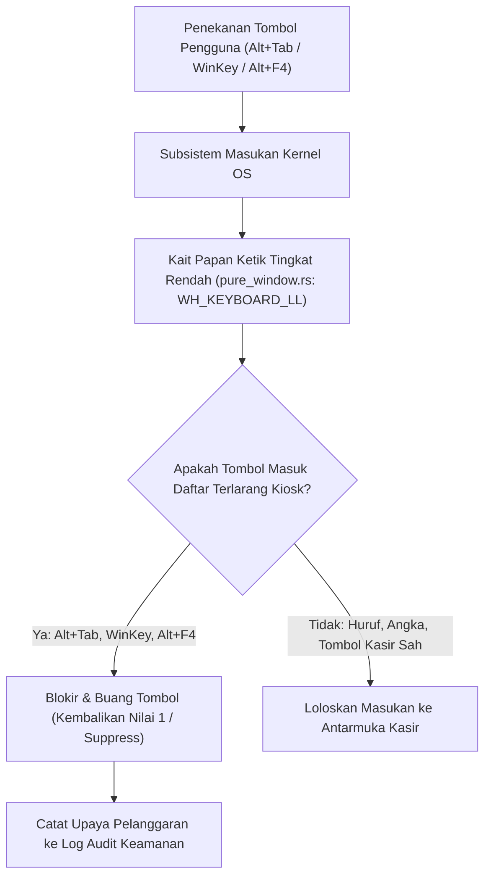

## Bab 24: Mode Kiosk & Penguncian Stasiun Kerja (Lockdown Workstation)

### 24.1 Kebutuhan Penguncian Total Stasiun Kerja Publik & Kasir

Pada terminal pelayanan publik mandiri (*Self-Checkout Kiosk*, ATM perbankan, mesin pencetak tiket stasiun kereta api, dan stasiun kasir toko modern), komputer berada dalam jangkauan fisik pengguna umum atau staf pihak ketiga. 

Jika sistem operasi tidak dikunci secara ketat (*System Lockdown*), pengguna usil atau operator nakal dapat:
- Menekan kombinasi tombol sistem seperti `Alt+Tab` atau tombol `Windows Key` untuk beralih ke desktop Windows dan membuka peramban pribadi atau bermain game.
- Menekan `Ctrl+Shift+Esc` atau `Ctrl+Alt+Del` untuk membuka *Task Manager* dan mematikan proses pengawasan keamanan kasir.
- Menyalin berkas data basis data lokal ke flashdisk pribadi melalui penjelajah berkas.

WidyaDesktop menghadirkan arsitektur **Mode Kiosk & Stasiun Kerja Terkunci (*Kiosk Mode & Workstation Lockdown Engine*)** pada modul `pure_window.rs`:
- **Mode Layar Penuh Eksklusif (*Borderless Exclusive Fullscreen*)**: Jendela menutupi seluruh ruang monitor fisik tanpa bilah judul, tanpa bilah tugas (*Taskbar hidden*), dan tanpa batas tepi.
- **Pencegatan Kait Keyboard Tingkat Rendah (*Low-Level Keyboard Hook*)**: Memasang kait kernel Windows (`WH_KEYBOARD_LL`) atau penangkap input global Linux/macOS untuk memblokir penekanan kombinasi tombol sistem terlarang: `Alt+Tab`, `Alt+Esc`, `Ctrl+Esc`, `Windows Key (LWin/RWin)`, `F11`, dan `Alt+F4`.
- **Penguncian Akses Sistem Berkas**: Mencegah jendela dialog eksternal membuka direktori sistem yang dilindungi.



### 24.2 Mode Penguncian Terminal (*Terminal Lock Screen*)

Selain mode Kiosk fisik, WidyaDesktop menyediakan fitur penguncian sementara stasiun kerja (*Cashier Terminal Lock*). Ketika operator kasir meninggalkan meja kasir untuk istirahat makan atau ke toilet:
- Operator menekan pintasan `Ctrl+L`.
- Layar seketika menampilkan tirai penguncian modal (*Lock Screen Overlay*) yang meminta PIN kasir atau pemindaian sidik jari biometrik.
- Seluruh fungsi transaksi dan periferal dinonaktifkan sementara hingga otentikasi berhasil diverifikasi.

### 24.3 Implementasi Kode Widya-Lang & WidyaDesktop Utuh

Berikut implementasi aktivasi mode Kiosk eksklusif dan penguncian stasiun kerja kasir pada Widya-Lang:

```widya
// Modul Pengendalian Mode Kiosk & Penguncian Stasiun Kerja
modul pengelola_mode_kiosk {
    impor "./modul/desktop.wya";

    fungsi inisialisasi_stasiun_terkunci() {
        // 1. Buat Aplikasi Kasir Mandiri
        misal app = BuatAplikasiDesktop("Nusantara Kiosk - Terminal Mandiri", 1280, 800);

        // 2. Aktifkan Mode Layar Penuh Kiosk
        app.set_layar_penuh(benar);

        // 3. Registrasi RPC: Masuk ke Mode Kiosk Terkunci Penuh
        app.daftarkan_rpc("aktifkan_mode_kiosk_penuh", fungsi(_payload) {
            cetak(">>> [KIOSK] Mengaktifkan mode Kiosk eksklusif:");
            cetak("    - Menghilangkan bilah judul dan taskbar...");
            cetak("    - Memasang kait papan ketik tingkat rendah (WH_KEYBOARD_LL)...");
            cetak("    - Memblokir kombinasi tombol: Alt+Tab, Alt+F4, Windows Key...");

            kembalikan {
                "sukses": benar,
                "status_kiosk": "TERKUNCI_PENUH",
                "pencegatan_keyboard": "AKTIF"
            };
        });

        // 4. Registrasi RPC: Kunci Terminal Sementara (Tirai PIN Kasir)
        app.daftarkan_rpc("kunci_terminal_kasir", fungsi(payload) {
            misal kasir = payload.kasir;
            cetak(">>> [LOCKDOWN] Terminal dikunci oleh kasir: " + kasir);

            kembalikan {
                "sukses": benar,
                "status_layar": "TERKUNCI_TIRAI_PIN",
                "pesan": "Masukkan PIN otorisasi untuk melanjutkan."
            };
        });

        // 5. Registrasi RPC: Buka Kunci Terminal dengan Verifikasi PIN
        app.daftarkan_rpc("buka_kunci_terminal", fungsi(payload) {
            misal pin = payload.pin_masukan;

            jika (pin == "123456") {
                cetak(">>> [LOCKDOWN] PIN kasir valid. Membuka kembali akses transaksi.");
                kembalikan { "sukses": benar, "status": "TERBUKA" };
            } lain {
                cetak(">>> [KEAMANAN] Percobaan PIN salah! Percobaan dicatat ke audit.");
                kembalikan { "sukses": salah, "galat": "PIN otorisasi tidak valid!" };
            }
        });

        kembalikan app;
    }
}
```

### 24.4 Analisis Kinerja, Keamanan & Tabel Metrik Arsitektur

Tabel evaluasi keamanan stasiun kerja kasir:

| Parameter Evaluasi | Aplikasi Desktop Biasa (Tanpa Kiosk) | Mode Kiosk Eksklusif (WidyaDesktop) |
| :--- | :--- | :--- |
| **Pencegatan Alt+Tab / WinKey** | Tidak Ada (Pengguna Bebas Beralih) | **Dicegat 100% pada Tingkat Kernel Hook** |
| **Visibilitas Bilah Tugas (Taskbar)**| Terlihat & Dapat Diklik | **Disembunyikan Sepenuhnya dari Layar** |
| **Pencegatan Tombol Tutup Alt+F4** | Jendela Tertutup Seketika | **Diblokir Mutlak (Hanya Exit via Otorisasi Supervisor)** |
| **Ketahanan Re-Launch Otomatis** | Berhenti jika Ditutup | **Watchdog Daemon Otomatis Meluncurkan Kembali** |

### 24.5 Latihan Praktik & Studi Kasus

1. Mengapa teknik pencegatan tombol sistem seperti `Alt+Tab` dan tombol `Windows Key` harus dieksekusi melalui *Low-Level Keyboard Hook* di kernel sistem operasi dan tidak bisa hanya mengandalkan event JavaScript peramban?
2. Jelaskan mekanisme kerja *Watchdog Process* yang secara otomatis meluncurkan kembali (*auto-respawn*) aplikasi Kiosk jika proses utama dimatikan secara paksa melalui Task Manager!
3. Uraikan arsitektur antarmuka tirai penguncian (*Lock Screen Curtain*) yang memastikan bahwa seluruh klik mouse dan ketukan keyboard ditangkap secara eksklusif hingga kasir memasukkan kredensial yang sah!

### 24.6 Evaluasi Mandiri Pilihan Ganda

1. Mode tampilan antarmuka di mana aplikasi menutupi seluruh ruang monitor fisik tanpa bilah judul, menyembunyikan taskbar, dan memblokir navigasi keluar dinamakan...
   A. Mode Kiosk (Kiosk Lockdown Mode)
   B. Mode Gambar Paint
   C. Mode Safe Graphics
   D. Mode Notepad Polos

2. API pada sistem operasi Windows yang digunakan untuk mencegat seluruh penekanan tombol sistem sebelum sampai ke aplikasi lain adalah...
   A. `WH_KEYBOARD_LL` (Low-Level Keyboard Hook)
   B. `PlaySoundW`
   C. `CreateFileW`
   D. `SetWindowText`

3. Kombinasi tombol sistem operasi yang paling sering disalahgunakan oleh pengguna untuk beralih ke aplikasi lain dan wajib diblokir pada mode Kiosk adalah...
   A. `Alt+Tab` dan tombol `Windows Key`
   B. Huruf A dan B
   C. Tombol Spasi
   D. Tombol Angka 1

4. Kombinasi tombol pintasan standar Windows yang digunakan untuk menutup aplikasi aktif seketika dan wajib diblokir pada mode kasir mandiri adalah...
   A. `Alt+F4`
   B. `F1`
   C. `Shift+Panah Atas`
   D. `Caps Lock`

5. Metode pada objek `AplikasiDesktop` Widya-Lang yang digunakan untuk mengubah tampilan jendela menjadi layar penuh eksklusif adalah...
   A. `app.set_layar_penuh(benar)`
   B. `app.perkecil_layar()`
   C. `app.tutup()`
   D. `app.format_diska()`

6. Fitur pengaman yang menampilkan tirai penguncian modal ketika kasir meninggalkan meja kasir untuk istirahat dinamakan...
   A. Terminal Lock Screen (Kunci Stasiun Kerja)
   B. Game Pause
   C. Screensaver Ikan
   D. Blue Screen

7. Mekanisme pengawasan proses latar belakang yang bertugas menyalakan kembali aplikasi Kiosk secara otomatis jika aplikasi ditutup paksa disebut...
   A. Process Watchdog Daemon
   B. Disk Cleanup
   C. Defragmenter
   D. Audio Service

8. Mengapa penekanan kombinasi tombol `Ctrl+Alt+Del` pada Windows tidak dapat dicegat oleh aplikasi tingkat pengguna biasa?
   A. Karena ditangani secara eksklusif oleh subsistem keamanan kernel Windows (`winlogon.exe`) demi mencegah pembajakan otentikasi login
   B. Karena keyboard tidak memiliki tombol tersebut
   C. Agar komputer cepat panas
   D. Menghilangkan fungsi kartu grafis

9. Cara resmi bagi supervisor toko untuk keluar dari mode Kiosk terkunci adalah...
   A. Memasukkan kata sandi atau kunci otorisasi supervisor melalui menu tersembunyi
   B. Mencabut kabel listrik toko
   C. Memukul layar monitor dengan palu
   D. Menunggu komputer mati sendiri

10. Mengapa terminal mesin tiket bandara dan stasiun kereta api wajib berjalan di atas mode Kiosk yang terkunci total?
    A. Menjamin keamanan data publik, mencegah vandalisme perangkat lunak, dan memastikan layanan masyarakat selalu tersedia 24 jam tanpa gangguan
    B. Supaya tiket kereta api menjadi mahal
    C. Mengurangi kecepatan kereta api
    D. Menghilangkan kebutuhan rel kereta
