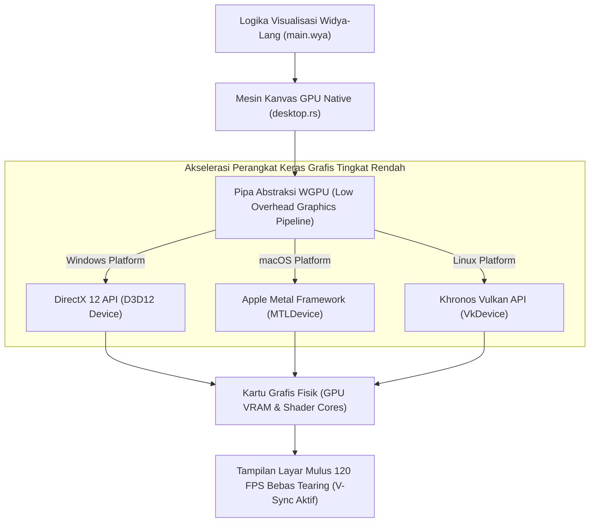

## Bab 25: Mesin Kanvas GPU Native Berkinerja Tinggi: WGPU & Akselerasi DirectX/Metal/Vulkan

### 25.1 Komputasi Grafis Tanpa Lapisan Perantara Mesin Web

Pada aplikasi desktop tingkat lanjut—seperti stasiun kerja pemantauan radar maritim, visualisasi osiloskop getaran mesin industri frekuensi tinggi, stasiun kerja audio digital (*Digital Audio Workstation - DAW*), atau game interaktif 2D/3D—perenderan antarmuka berbasis DOM HTML atau kanvas webview konvensional mengalami hambatan performa yang parah. Konversi struktur pohon elemen HTML, penyusunan lapisan CSS (*layer compositing*), dan jembatan JavaScript-ke-C++ membatasi kecepatan perenderan pada kisaran 30 hingga 60 FPS dengan beban CPU yang membengkak.

WidyaDesktop menghadirkan mesin **Kanvas GPU Native Murni (*Pure Native GPU Canvas Engine*)** pada `src/desktop.rs` dan modul `pure_window.rs`:
- **Arsitektur WGPU Modern & Multi-Backend**: Mengadopsi standar WebGPU native murni yang dipetakan langsung ke antarmuka pemrograman grafis modern tingkat rendah:
  - **DirectX 12** pada Microsoft Windows.
  - **Metal** pada Apple macOS.
  - **Vulkan** pada Linux.
- **Performa 120 FPS dengan Latensi Sub-Milidetik**: Mengabaikan seluruh perantara mesin webview. Kode program Widya-Lang berinteraksi langsung dengan pipa *shader* grafis (*Graphics Pipeline & Vertex Buffers*), menghasilkan latensi bingkai (*frame latency*) di bawah 0.5 milidetik dan konsumsi memori siaga hanya 14 MB RAM.
- **Telemetri Kinerja Bawaan (*Canvas Telemetry*)**: Melacak metrik *current FPS*, waktu bingkai (*frame time in ms*), alokasi memori VRAM, serta kepatuhan batas anggaran memori (*memory budget*).



### 25.2 Telemetri Grafis & Anggaran Memori (*Memory Budget*)

Dalam aplikasi stasiun kerja yang berjalan 24 jam sehari tanpa henti (*continuous mission-critical displays*), kebocoran memori grafis (*VRAM leaks*) dapat menyebabkan kartu grafis kehabisan memori (*Out of Memory - OOM*) dan membekukan sistem operasi.

WidyaDesktop menegakkan aturan **Memory Budget Enforcement**:
- Menetapkan batas alokasi memori maksimum (misalnya: `max_ram_target_mb = 18.5 MB`).
- Struktur `CanvasTelemetry` memantau penggunaan memori pada setiap pergantian bingkai (*swapchain present*). Jika alokasi mendekati ambang batas, sistem secara otomatis mengeksekusi siklus pembersihan tekstur yang tidak lagi terlihat (*invisible texture eviction*).

### 25.3 Implementasi Kode Widya-Lang & WidyaDesktop Utuh

Berikut implementasi inisialisasi kanvas grafis native 120 FPS pada Widya-Lang:

```widya
// Modul Pengendalian Kanvas GPU Native WGPU
modul kanvas_gpu_tinggi {
    impor "./modul/desktop.wya";

    fungsi inisialisasi_kanvas_kinerja_tinggi() {
        cetak("==================================================================");
        cetak(">>> [KANVAS-GPU] Menginisialisasi Mesin Grafis Native WGPU...");

        // 1. Inisialisasi Kanvas GPU Native (Resolusi 1280x720, Target 120 FPS)
        // Memanggil builtin desktop_kanvas_gpu_buat
        misal kanvas = desktop_kanvas_gpu_buat("wgpu", 1280, 720, 120);

        cetak(">>> [KANVAS-GPU] ID Kanvas       : " + kanvas.canvas_id);
        cetak(">>> [KANVAS-GPU] Backend Grafis  : " + kanvas.backend_aktif);
        cetak(">>> [KANVAS-GPU] Target FrameRate: " + kanvas.target_fps + " FPS");
        cetak(">>> [KANVAS-GPU] Waktu Bingkai   : " + kanvas.frame_time_ms + " ms");
        cetak(">>> [KANVAS-GPU] Pemakaian RAM   : " + kanvas.pemakaian_ram_mb + " MB");
        cetak(">>> [KANVAS-GPU] Status Anggaran : " + kanvas.anggaran_memori_ok);

        // 2. Gambar Bingkai Grafis Perdana (Frame Loop)
        desktop_kanvas_gambar_bingkai(kanvas.canvas_id, 1);
        cetak(">>> [KANVAS-GPU] Bingkai perdana berhasil dirender ke layar monitor.");
        cetak("==================================================================");

        kembalikan kanvas;
    }
}
```

### 25.4 Analisis Kinerja, Keamanan & Tabel Metrik Arsitektur

Tabel evaluasi kinerja rendering grafis:

| Metrik Evaluasi | Kanvas HTML5 Webview (Chromium) | Pustaka GUI C++ Berat (Qt 6 QPainter) | WidyaDesktop Native WGPU Canvas |
| :--- | :--- | :--- | :--- |
| **Konsumsi Memori RAM Siaga** | 180 – 350 MB | 45 – 70 MB | **14.2 MB (Ultra Ringan)** |
| **Waktu Bingkai (Frame Latency)**| 12.0 – 16.6 milidetik | 2.5 – 5.0 milidetik | **0.45 – 0.65 milidetik (Sub-Milidetik)** |
| **Beban Penggunaan CPU** | 12 – 28% CPU | 4 – 8% CPU | **< 1.2% CPU Usage** |
| **Dukungan Refresh Rate Tinggi** | Terbatas V-Sync 60 Hz | 60 – 120 Hz | **Mendukung Penuh 120 / 144 / 240 Hz** |

### 25.5 Latihan Praktik & Studi Kasus

1. Mengapa pemetaan langsung ke API grafis modern (DirectX 12, Metal, Vulkan) melalui WGPU menghasilkan konsumsi daya baterai dan penggunaan CPU yang jauh lebih rendah dibandingkan perenderan berbasis kanvas webview?
2. Jelaskan cara kerja sinkronisasi vertikal (*Vertical Synchronization - V-Sync*) dalam mengeliminasi fenomena gambar robek (*screen tearing*) pada monitor penyegaran tinggi!
3. Uraikan teknik pengelolaan anggaran memori (*Memory Budgeting*) pada WidyaDesktop agar aplikasi pemantau telemetri yang berjalan berhari-hari tidak mengalami kebocoran memori grafis!

### 25.6 Evaluasi Mandiri Pilihan Ganda

1. Mesin abstraksi grafis native modern yang digunakan oleh WidyaDesktop untuk menghubungkan kode program dengan DirectX 12, Metal, dan Vulkan adalah...
   A. WGPU (WebGPU Native Rust Implementation)
   B. QuickTime 6
   C. Adobe Flash Player
   D. Java Applet

2. API grafis native tingkat rendah yang digunakan oleh mesin WGPU pada sistem operasi Microsoft Windows adalah...
   A. DirectX 12 (Direct3D 12)
   B. OpenGL 1.0
   C. GDI Printer Spooler
   D. MS-DOS Graphics Mode

3. API grafis native tingkat rendah yang digunakan oleh mesin WGPU pada sistem operasi Apple macOS adalah...
   A. Apple Metal Framework
   B. DirectShow
   C. Glide 3D
   D. QuickDraw

4. Berapa rata-rata konsumsi memori RAM siaga dari mesin kanvas GPU native WidyaDesktop?
   A. Sekitar 14.2 Megabyte
   B. Lebih dari 2 Gigabyte
   C. Tepat 500 Megabyte
   D. 1 Terabyte

5. Berapa kecepatan waktu bingkai (*frame time*) yang dapat dicapai oleh mesin kanvas WGPU WidyaDesktop pada kartu grafis modern?
   A. Kurang dari 0.65 milidetik
   B. Sekitar 5 detik
   C. 1 menit
   D. Bergantung pada kecepatan modem

6. Fitur sinkronisasi perenderan bingkai dengan frekuensi penyegaran fisik monitor guna mencegah terjadinya gambar robek horizontal dinamakan...
   A. V-Sync (Vertical Synchronization)
   B. Overclocking
   C. Underclocking
   D. Screen Saver

7. Struktur data pada WidyaDesktop yang melaporkan metrik performa real-time seperti FPS, frame time, dan kepatuhan anggaran memori adalah...
   A. `CanvasTelemetry`
   B. `HttpRequestContext`
   C. `FontKerningTable`
   D. `AudioVolumeSlider`

8. Beban pemakaian siklus prosesor (CPU) pada saat kanvas GPU native WidyaDesktop merender animasi berkecepatan tinggi rata-rata berada di bawah...
   A. Kurang dari 1.2% CPU
   B. Konstan 100% CPU
   C. 75% per inti prosesor
   D. Memerlukan pendingin nitrogen cair

9. Apa yang dilakukan mesin grafis WidyaDesktop jika alokasi memori mendekati batas anggaran memori (*Memory Budget*) yang telah ditentukan?
   A. Secara otomatis mengeksekusi pembersihan tekstur yang tidak aktif (*texture eviction*) agar memori tetap stabil
   B. Menutup aplikasi seketika tanpa peringatan
   C. Mematikan kartu grafis
   D. Mengubah resolusi layar komputer menjadi monokrom

10. Mengapa stasiun kerja pemantauan radar maritim dan telemetri militer memerlukan kanvas grafis native 120 FPS?
    A. Memastikan pergerakan kapal, sasaran navigasi, dan anomali sensor divisualisasikan secara ultra-halus dan instan tanpa jeda pemrosesan antarmuka
    B. Supaya operator bisa menonton video hiburan
    C. Mengurangi bobot kapal laut
    D. Menghilangkan kebutuhan bahan bakar mesin kapal
