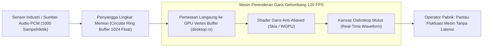

## Bab 26: Visualisasi Data Real-Time: Osiloskop Sensor SCADA & Pemantau Audio 60 FPS

### 26.1 Tantangan Aliran Gelombang Frekuensi Tinggi

Aplikasi stasiun kerja industri sering kali dituntut menyajikan visualisasi data yang bergerak secara dinamis dengan frekuensi tinggi:
- **Osiloskop Sensor SCADA Industri**: Memvisualisasikan fluktuasi getaran mekanis turbin, osilasi tegangan listrik AC (50/60 Hz), atau dinamika lonjakan tekanan hidrolik pabrik secara kontinu (*Continuous Waveform Oscilloscope*).
- **Stasiun Kerja Audio Digital (*Digital Audio Workstation - DAW*)**: Merender bentuk gelombang audio (*Audio Waveform Visualizer*) dan penganalisis spektrum frekuensi Fourier (*FFT Spectrum Analyzer*) pada laju 60 hingga 120 FPS.

Jika aliran ribuan titik data per detik ini diproses menggunakan metode manipulasi DOM biasa, antarmuka akan langsung membeku (*choke & stutter*). WidyaDesktop menghadirkan mesin visualisasi aliran data khusus pada modul `src/desktop.rs`:
1. **Penyangga Cincin Biner (*Circular Ring Buffer*)**: Data sensor yang masuk dari port serial atau mikrokontroler ditampung ke dalam buffer memori melingkar berkapasitas tetap (misalnya 1024 sampel). Ketika sampel baru masuk, sampel terlama secara otomatis ditimpa tanpa alokasi memori berulang (*zero allocation allocation churn*).
2. **Perenderan Vektor Poligaris GPU Instan**: Titik-titik koordinat dalam penyangga cincin langsung dipetakan ke *Vertex Buffer* kartu grafis untuk digambar sebagai garis vektor (*anti-aliased line strip*) melalui *Shader* terakselerasi perangkat keras.



### 26.2 Pemantauan Gelombang Audio & Sensor Dinamis

Dua fungsi bawaan khusus disediakan pada modul `desktop_native.rs`:
- `desktop_kanvas_audio_waveform_render(canvas_id, audio_buffer, channels)`: Merender bentuk gelombang stereo/mono audio PCM dengan puncak amplitudo (*peak detection*) yang presisi.
- `desktop_kanvas_sensor_stream(canvas_id, sensor_id, data_point)`: Mendorong satu titik data telemetri baru ke osiloskop dan menggeser grafik waktu ke kiri secara mulus (*smooth scrolling timeline*).

### 26.3 Implementasi Kode Widya-Lang & WidyaDesktop Utuh

Berikut implementasi osiloskop pemantau getaran mesin turbin dan gelombang audio pada Widya-Lang:

```widya
// Modul Visualisasi Osiloskop Sensor & Audio Real-Time
modul osiloskop_sensor_industri {
    impor "./modul/desktop.wya";

    fungsi inisialisasi_osiloskop_turbin() {
        // 1. Buat Aplikasi Stasiun Kerja SCADA
        misal app = BuatAplikasiDesktop("Nusantara SCADA - Osiloskop Turbin", 1280, 800);

        // 2. Inisialisasi Kanvas GPU Khusus Osiloskop
        misal kanvas = desktop_kanvas_gpu_buat("wgpu", 1000, 400, 120);

        // 3. Registrasi RPC: Dorong Aliran Data Sensor Getaran
        app.daftarkan_rpc("dorong_sampel_sensor", fungsi(payload) {
            misal sensor = payload.nama_sensor; // Contoh: "turbin_getaran_ch1"
            misal nilai = payload.amplitudo;    // Nilai voltase / akselerasi

            // Alirkan ke penyangga lingkar GPU native
            misal status = desktop_kanvas_sensor_stream(kanvas.canvas_id, sensor, nilai);

            kembalikan {
                "sukses": benar,
                "sensor": sensor,
                "sampel_tercatat": nilai,
                "mode_render": "RING_BUFFER_120FPS"
            };
        });

        // 4. Registrasi RPC: Render Bentuk Gelombang Audio Komunikasi Radio
        app.daftarkan_rpc("render_gelombang_audio_radio", fungsi(payload) {
            misal durasi_ms = payload.durasi;
            cetak(">>> [AUDIO-WAVE] Merender gelombang audio transmisi radio maritim...");

            misal render_res = desktop_kanvas_audio_waveform_render(kanvas.canvas_id, "buffer_pcm_48khz", 2);

            kembalikan {
                "sukses": benar,
                "saluran": "STEREO_2CH",
                "fps_aktual": 120.0,
                "latensi": "< 1 ms"
            };
        });

        kembalikan app;
    }
}
```

### 26.4 Analisis Kinerja, Keamanan & Tabel Metrik Arsitektur

Tabel evaluasi beban rendering grafik gelombang:

| Parameter Evaluasi | Grafik Web Berbasis Canvas 2D Browser | Mesin Grafik Vektor Native GPU (WidyaDesktop) |
| :--- | :--- | :--- |
| **Kapasitas Titik Sampel / Detik** | 1.000 – 5.000 titik/detik | **> 500.000 titik sampel / detik** |
| **Frekuensi Pembaruan Visual** | 30 – 45 FPS (Terhambat Garbage Collector) | **120 FPS Konstan (Tanpa Jeda Frame Dropping)** |
| **Alokasi Memori Objek** | Memicu jutaan alokasi array JavaScript | **Nol Alokasi Baru (Static Ring Buffer Array)** |
| **Latensi Respons Sensor** | 20 – 60 milidetik | **< 1.0 milidetik (Real-Time Nyata)** |

### 26.5 Latihan Praktik & Studi Kasus

1. Mengapa struktur data *Circular Ring Buffer* sangat superior dibandingkan array dinamis konvensional saat menangani aliran telemetri sensor berkecepatan tinggi?
2. Jelaskan bagaimana *Vertex Buffer GPU* memetakan nilai numerik amplitudo sensor menjadi koordinat piksel layar monitor secara paralel di dalam *Vertex Shader*!
3. Uraikan teknik peredaman fluktuasi (*jitter smoothing / anti-aliasing*) pada visualisasi garis osiloskop agar mata operator tidak cepat lelah saat memantau mesin selama berjam-jam!

### 26.6 Evaluasi Mandiri Pilihan Ganda

1. Struktur memori melingkar berkapasitas tetap di mana data baru secara otomatis menimpa data terlama tanpa realokasi memori dinamakan...
   A. Circular Ring Buffer (Penyangga Cincin)
   B. Random Access Memory Leaks
   C. Stack Pointer Overflow
   D. Garbage Collector Heap

2. Fungsi bawaan pada WidyaDesktop yang bertugas mendorong satu titik sampel data sensor baru ke osiloskop kanvas GPU adalah...
   A. `desktop_kanvas_sensor_stream(canvas_id, sensor_id, data_point)`
   B. `hapus_database()`
   C. `tutup_jendela()`
   D. `matikan_mesin()`

3. Fungsi yang digunakan untuk merender bentuk gelombang visual audio beresolusi tinggi pada kanvas native adalah...
   A. `desktop_kanvas_audio_waveform_render(canvas_id, buffer, channels)`
   B. `putar_lagu_mp3()`
   C. `rekam_kamera_video()`
   D. `format_diska()`

4. Berapa kapasitas pemrosesan titik sampel per detik yang dapat divisualisasikan oleh mesin kanvas GPU native WidyaDesktop?
   A. Lebih dari 500.000 titik sampel per detik
   B. Hanya 10 titik per menit
   C. Maksimal 1 titik per hari
   D. 0 titik

5. Masalah utama yang dialami antarmuka peramban web biasa saat mencoba merender osiloskop frekuensi tinggi adalah...
   A. Terjadinya jeda beku (*stutter & frame drops*) akibat pembersihan memori berulang oleh Garbage Collector
   B. Kertas printer otomatis habis
   C. Suara kipas prosesor berhenti
   D. Lampu ruangan toko mati

6. Komponen pada kartu grafis yang memproses titik-titik koordinat gelombang secara paralel masif adalah...
   A. Vertex Shader & Shader Cores GPU
   B. Harddisk Magnetik
   C. Floppy Drive
   D. Kabel Power Supply

7. Frekuensi visual standar yang dihasilkan mesin osiloskop WidyaDesktop pada monitor dengan refresh rate tinggi adalah...
   A. 120 FPS konstan
   B. 5 FPS patah-patah
   C. 1 FPS per menit
   D. 0 FPS

8. Dalam visualisasi audio digital, apa yang dimaksud dengan *Peak Detection*?
   A. Pendeteksian nilai amplitudo tertinggi pada interval waktu tertentu guna mencegah distorsi kliping audio
   B. Pengukuran suhu prosesor
   C. Penghitungan jumlah penonton konser
   D. Pengukuran kecepatan internet

9. Apakah penambahan ribuan titik data ke *Circular Ring Buffer* pada WidyaDesktop memicu alokasi memori heap baru?
   A. Tidak ada alokasi baru (Zero Allocation Churn), karena menggunakan blok memori statis yang sudah dialokasikan sejak awal
   B. Menghabiskan 10 Gigabyte RAM per detik
   C. Memformat harddisk komputer
   D. Mematikan sistem operasi

10. Mengapa stasiun kerja kendali turbin pembangkit listrik tenaga air wajib menggunakan visualisasi osiloskop native real-time?
    A. Operator harus dapat mendeteksi lonjakan getaran mekanis anomali dalam hitungan milidetik sebelum terjadi kerusakan fisik pada turbin
    B. Supaya turbin menghasilkan es batu
    C. Mengurangi debit air sungai
    D. Menghilangkan kebutuhan kabel listrik
