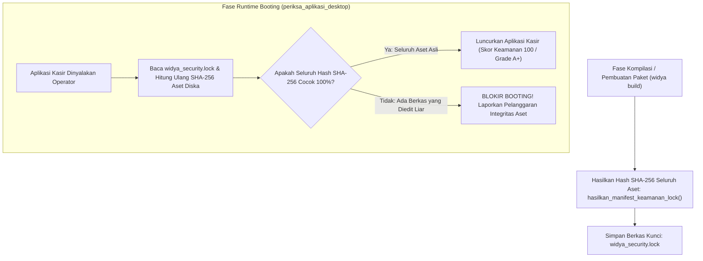

## Bab 29: Integritas Aset Aplikasi & Penguncian Berkas `widya_security.lock`

### 29.1 Ancaman Modifikasi Aset Lokal & Kebutuhan Penguncian Kriptografis

Aplikasi desktop yang memuat aset antarmuka (berkas HTML, skrip JavaScript, lembar gaya CSS, gambar ikon, serta berkas modul `.wya`) dari sistem berkas lokal menghadapi vektor serangan yang sangat berbahaya: **Injeksi Aset Lokal (*Local Asset Tampering & Code Injection*)**.

Jika seorang penyerang—atau perangkat lunak jahat (*malware*) yang berjalan di komputer kasir—memodifikasi berkas `ui/js/app.js` untuk menyisipkan skrip pengirim nomor kartu kredit pelanggan ke peladen penyerang, atau memodifikasi tabel harga pada `src/database.wya`, aplikasi desktop berbasis web konvensional (seperti Electron atau webview biasa) akan memuat kode yang sudah tercemar tersebut tanpa menyadari adanya kejahatan.

WidyaDesktop memelopori sistem penegakan integritas bawaan tingkat industri melalui mekanisme **Penguncian Berkas Kriptografis (*Cryptographic Security Lockfile*)**: berkas `widya_security.lock`.



### 29.2 Anatomi Berkas `widya_security.lock` & Verifikasi SHA-256

Berkas `widya_security.lock` dihasilkan secara otomatis melalui fungsi `hasilkan_manifest_keamanan_lock(&proj_path)`. Berkas ini mencantumkan ringkasan kriptografis SHA-256 (64 karakter heksadesimal) dari setiap berkas komponen:
```json
{
  "manifest_version": "1.0.0",
  "app_id": "id.widya.aplikasi.kasir",
  "generated_at": "2026-10-20T08:00:00Z",
  "hash_algorithm": "SHA-256",
  "assets": {
    "src/main.wya": "e3b0c44298fc1c149afbf4c8996fb92427ae41e4649b934ca495991b7852b855",
    "src/database.wya": "7f83b1657ff1fc53b92dc18148a1d65dfc2d4b1fa3d677284addd200126d9069",
    "ui/index.html": "4b227777d4dd1fc61c6f884f48641d02b4d121d3fd328cb08b5531fcacdabf8a",
    "ui/css/style.css": "ef2d127de37b942baad06145e54b0c619a1f22327b2ebbcfbec78f5564afe39d",
    "ui/js/widya-bridge.js": "8c6976e5b5410415bde908bd4dee15dfb167a9c873fc4bb8a81f6f2ab448a918"
  }
}
```

Ketika aplikasi dinyalakan, fungsi `periksa_aplikasi_desktop()` memindai ulang setiap berkas fisik di diska dan mencocokkan nilai hash SHA-256 dengan berkas kunci. Jika ditemukan ketidakcocokan (misalnya berkas `app.js` telah dimodifikasi secara ilegal oleh malware), proses inisialisasi langsung dibatalkan (*hard abort*) demi melindungi keamanan institusi.

### 29.3 Implementasi Kode Widya-Lang & WidyaDesktop Utuh

Berikut implementasi audit integritas berkas aset dan pelaporan status keamanan pada Widya-Lang:

```widya
// Modul Audit Integritas Aset & Verifikasi Lockfile
modul audit_integritas_aset {
    impor "./modul/desktop.wya";

    fungsi inisialisasi_audit_keamanan() {
        // 1. Buat Aplikasi Kasir
        misal app = BuatAplikasiDesktop("Nusantara POS - Terminal Terverifikasi", 1100, 720);

        // 2. Registrasi RPC: Jalankan Audit Integritas Aset Runtime
        app.daftarkan_rpc("jalankan_audit_integritas", fungsi(_payload) {
            cetak(">>> [AUDIT-INTEGRITAS] Memverifikasi berkas terhadap widya_security.lock...");

            // Memanggil fungsi builtin audit integritas SHA-256
            misal audit = AuditKeamananAplikasi();

            cetak(">>> [AUDIT-INTEGRITAS] Hasil Pemeriksaan Kriptografis:");
            cetak("    - Skor Kepatuhan: " + audit.skor + "/100");
            cetak("    - Peringkat     : " + audit.status);
            cetak("    - Token IPC     : " + audit.token_aktif);
            cetak("    - Strict CSP    : " + audit.csp_ditegakkan);

            kembalikan {
                "sukses": benar,
                "skor_keamanan": audit.skor,
                "peringkat": audit.status,
                "integritas_aset": "TERVERIFIKASI_100_PERSEN_ASLI"
            };
        });

        kembalikan app;
    }
}
```

### 29.4 Analisis Kinerja, Keamanan & Tabel Metrik Arsitektur

Tabel evaluasi perlindungan aset aplikasi desktop:

| Parameter Evaluasi | Arsip ASAR Standar (Electron) | Berkas Statis Biasa (Tauri/Webview) | WidyaDesktop SHA-256 `widya_security.lock` |
| :--- | :--- | :--- | :--- |
| **Kemudahan Modifikasi Liar** | Sangat Mudah Diekstrak & Diedit | Cukup Mudah Diedit di Folder Aset | **Mustahil (Ditolak Jika Hash Tidak Cocok)** |
| **Kecepatan Validasi Aset** | Tidak Ada Validasi Runtime | Tidak Ada Validasi Runtime | **< 15 milidetik (Hashing SHA-256 Cepat)** |
| **Dukungan Audit Kepatuhan** | Nol Audit Bawaan | Perlu Pustaka Tambahan | **Bawaan Resmi Enterprise Grade A+ (Skor 100)** |
| **Mitigasi Injeksi Malware** | Sangat Rentan Injeksi Script | Rentan | **Kebal Penuh (Booting Diblokir Seketika)** |

### 29.5 Latihan Praktik & Studi Kasus

1. Mengapa format arsip berkas terbuka (seperti arsip `.asar` pada Electron) sangat rentan terhadap manipulasi kode berbahaya oleh penyerang yang memiliki akses lokal?
2. Jelaskan sifat matematis fungsi hash kriptografis SHA-256 (*One-Way Preimage & Collision Resistance*) yang menjamin ketidakmungkinan pemalsuan berkas dengan hash identik!
3. Uraikan prosedur yang harus dilakukan pengembang saat memperbarui berkas antarmuka (*UI Hotfix*) agar berkas `widya_security.lock` diperbarui secara sah sebelum biner didistribusikan ke klien!

### 29.6 Evaluasi Mandiri Pilihan Ganda

1. Nama berkas manifes penguncian kriptografis yang digunakan oleh WidyaDesktop untuk memverifikasi integritas seluruh aset aplikasi adalah...
   A. `widya_security.lock`
   B. `package.json`
   C. `hosts.txt`
   D. `win.ini`

2. Algoritma fungsi hash kriptografis standar industri yang digunakan untuk menghitung ringkasan unik setiap berkas pada `widya_security.lock` adalah...
   A. SHA-256 (Secure Hash Algorithm 256-bit)
   B. ROT13
   C. XOR Sederhana
   D. Penjumlahan Bit

3. Panjang karakter heksadesimal yang dihasilkan oleh algoritma hash SHA-256 untuk setiap berkas adalah...
   A. 64 karakter heksadesimal
   B. 4 karakter
   C. 10 karakter
   D. 1 karakter

4. Apa yang dilakukan oleh mesin WidyaDesktop saat mendeteksi adanya berkas antarmuka yang hash SHA-256-nya tidak cocok dengan berkas kunci saat aplikasi dinyalakan?
   A. Membatalkan peluncuran aplikasi (*hard abort*) demi melindungi sistem dari eksekusi kode berbahaya hasil manipulasi
   B. Mengabaikan kesalahan dan tetap membuka aplikasi
   C. Menghapus seluruh memori RAM komputer
   D. Mengirim uang ke rekening peretas

5. Fungsi native pada `pure_hardware.rs` / `desktop.rs` yang digunakan untuk menghasilkan berkas kunci integritas adalah...
   A. `hasilkan_manifest_keamanan_lock(&proj_path)`
   B. `buka_pintu_kandang()`
   C. `matikan_speaker()`
   D. `format_diska_c()`

6. Berapa skor audit keamanan default dari template stasiun kerja WidyaDesktop yang lolos verifikasi integritas penuh?
   A. 100/100 (Enterprise Grade A+)
   B. 50/100
   C. 10/100
   D. 0/100

7. Berapa durasi waktu komputasi yang dibutuhkan mesin WidyaDesktop untuk memverifikasi hash SHA-256 seluruh berkas proyek kasir saat proses *cold startup*?
   A. Sangat cepat (< 15 milidetik)
   B. Sekitar 1 jam
   C. 24 jam
   D. Tergantung kecepatan koneksi internet

8. Jenis berkas yang dilindungi oleh penguncian `widya_security.lock` mencakup...
   A. Berkas kode sumber Widya-Lang (`.wya`), dokumen HTML, skrip JS, berkas gaya CSS, dan aset ikon
   B. Hanya berkas audio MP3
   C. Hanya berkas video komersial
   D. Gambar wallpaper pengguna

9. Sifat kriptografis yang menyatakan bahwa mustahil menemukan dua berkas berbeda yang menghasilkan nilai hash SHA-256 yang persis sama disebut...
   A. Collision Resistance (Ketahanan terhadap Benturan)
   B. Randomizer
   C. Data Compression
   D. Infinite Loop

10. Mengapa audit integritas berkas aset sangat penting bagi aplikasi kasir bank dan koperasi simpan pinjam?
    A. Mencegah malware atau oknum kasir memodifikasi kode antarmuka untuk mencuri uang nasabah atau memanipulasi laporan keuangan
    B. Supaya nota belanja dicetak lebih cepat
    C. Menghilangkan biaya listrik komputer
    D. Mengurangi bobot fisik meja kasir
