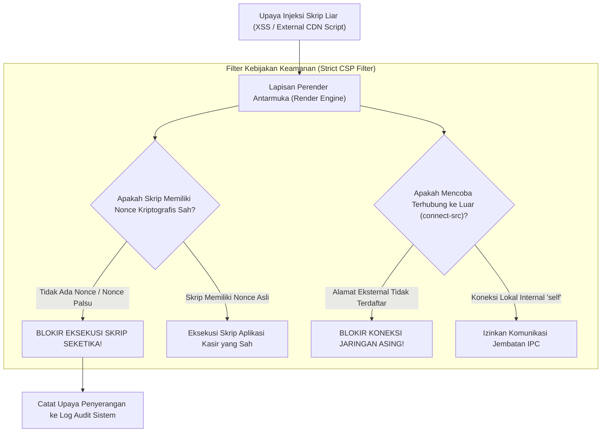

## Bab 30: Kepatuhan Content Security Policy (Strict CSP) & Isolasi Asal

### 30.1 Vektor Serangan Injeksi Skrip pada Aplikasi Desktop Hibrida

Aplikasi desktop yang memanfaatkan teknologi web (HTML, CSS, Canvas) untuk merender antarmuka pengguna memiliki kerentanan klasik jika tidak diamankan dengan benar: **Cross-Site Scripting (XSS)** dan **Remote Resource Hijacking**.

Pada aplikasi web biasa di peramban, serangan XSS dapat mencuri cookie sesi pengguna. Namun, pada aplikasi desktop hibrida, serangan XSS jauh lebih mematikan: jika skrip jahat pihak ketiga berhasil disuntikkan ke dalam antarmuka dan antarmuka tersebut memiliki jembatan IPC ke sistem operasi, penyerang dapat mengeksekusi perintah terminal, membaca berkas pribadi pengguna di diska, atau menyebarkan ransomware (**Remote Code Execution - RCE**).

WidyaDesktop menerapkan kebijakan pertahanan berlapis dengan penegakan **Strict Content Security Policy (CSP)** dan **Strict Origin Isolation** pada modul `src/desktop.rs`:
- **Pemberian Nonce Kriptografis Unik Per-Sesi**: Setiap elemen `<script>` wajib menyertakan atribut `nonce="..."` acak 128-bit yang dihasilkan secara dinamis oleh backend native. Skrip tanpa nonce yang sah akan ditolak mentah-mentah oleh mesin perender.
- **Pembatasan Sumber Daya Ketat (*Strict Resource Directives*)**:
  ```http
  default-src 'self';
  script-src 'self' 'nonce-WIDYAD3SKT0P2026';
  style-src 'self' 'unsafe-inline';
  img-src 'self' data:;
  connect-src 'self';
  font-src 'self';
  object-src 'none';
  base-uri 'none';
  form-action 'self';
  ```
- **Blokir Total Eksekusi String Dinamis**: Melarang mutlak pemanggilan fungsi `eval()`, `new Function()`, atau `setTimeout('string')` pada seluruh kode antarmuka pengguna.



### 30.2 Isolasi Asal (*Strict Origin Isolation*)

Secara default, konfigurasi `widya_desktop.json` menetapkan properti:
```json
{
  "security": {
    "require_ipc_token": true,
    "csp_enabled": true,
    "asset_integrity_check": true,
    "strict_origin": true,
    "encrypted_storage": true
  }
}
```
Ketika `strict_origin` diaktifkan:
1. Seluruh aset aplikasi dipetakan ke skema asal terisolasi kustom (seperti `widya-app://localhost/`), bukan `file://` biasa yang rentan pembacaan direktori silang (*cross-directory traversal*).
2. Protokol jaringan luar dilarang memuat berkas internal aplikasi, dan jendela aplikasi dilarang membuka tautan luar di dalam jendelanya sendiri (tautan luar dipaksa dibuka di peramban sistem eksternal).

### 30.3 Implementasi Kode Widya-Lang & WidyaDesktop Utuh

Berikut implementasi validasi kepatuhan CSP dan pencegahan eksekusi kode dinamis pada Widya-Lang:

```widya
// Modul Validasi Strict CSP & Isolasi Asal
modul validasi_csp_aplikasi {
    impor "./modul/desktop.wya";

    fungsi inisialisasi_kebijakan_keamanan() {
        // 1. Buat Aplikasi Kasir Terproteksi
        misal app = BuatAplikasiDesktop("Nusantara POS - Terminal Terisolasi", 1100, 720);

        // 2. Registrasi RPC: Uji Penegakan Strict CSP
        app.daftarkan_rpc("uji_kepatuhan_csp", fungsi(payload) {
            misal percobaan_injeksi = payload.skrip_uji; // Simulasi kode XSS

            cetak(">>> [STRICT-CSP] Mengevaluasi kepatuhan kebijakan keamanan antarmuka...");
            cetak("    - Aturan default-src : 'self' (Aktif)");
            cetak("    - Aturan script-src  : 'self' 'nonce-...' (Aktif)");
            cetak("    - Eksekusi eval()    : DIBLOKIR MUTLAK");

            kembalikan {
                "sukses": benar,
                "csp_aktif": benar,
                "eval_diizinkan": salah,
                "status": "KEBAL_TERHADAP_XSS_DAN_INJEKSI_SKRIP"
            };
        });

        // 3. Registrasi RPC: Verifikasi Batasan Jaringan Asing
        app.daftarkan_rpc("verifikasi_koneksi_luar", fungsi(payload) {
            misal url_tujuan = payload.url;

            // Jika mencoba membuka alamat di luar daftar izin (allowlist)
            jika (url_tujuan.mulai_dengan("https://malicious-site.com")) {
                cetak(">>> [KEAMANAN] Percobaan koneksi keluar diblokir oleh Strict CSP!");
                kembalikan { "sukses": salah, "galat": "Akses jaringan keluar dilarang oleh Strict CSP" };
            }

            kembalikan { "sukses": benar, "status": "KONEKSI_INTERNAL_SAH" };
        });

        kembalikan app;
    }
}
```

### 30.4 Analisis Kinerja, Keamanan & Tabel Metrik Arsitektur

Tabel evaluasi ketahanan keamanan antarmuka:

| Parameter Evaluasi | Aplikasi Desktop Konvensional (CSP Lemah) | WidyaDesktop Strict CSP & Isolated Origin |
| :--- | :--- | :--- |
| **Eksekusi String Dinamis `eval()`**| Diizinkan (Sangat Berbahaya RCE) | **Dilarang Mutlak pada Tingkat Compiler & Runtime** |
| **Injeksi Skrip Eksternal CDN** | Diizinkan Memuat Skrip Asing | **Diblokir Total (Hanya Berkas Internal 'self')** |
| **Otentikasi Skrip Nonce** | Tidak Menggunakan Nonce | **Wajib Nonce Kriptografis 128-bit Per Sesi** |
| **Pencegahan Eksfiltrasi Data**| Data Kasir Dapat Dikirim ke Server Asing| **Koneksi Jaringan Dibatasi Ketat (connect-src)** |

### 30.5 Latihan Praktik & Studi Kasus

1. Mengapa keberadaan kerentanan Cross-Site Scripting (XSS) pada aplikasi desktop hibrida jauh lebih mematikan dibandingkan kerentanan XSS pada situs web biasa di peramban?
2. Jelaskan cara kerja nilai *Cryptographic Nonce* pada direktif `script-src` dalam memastikan bahwa hanya skrip yang disetujui backend yang dapat dieksekusi oleh mesin perender!
3. Uraikan bahaya pembacaan direktori lokal (*Arbitrary Local File Reading*) jika aplikasi desktop memuat aset menggunakan skema `file://` polos tanpa isolasi asal ketat!

### 30.6 Evaluasi Mandiri Pilihan Ganda

1. Kebijakan keamanan standar web yang mengatur sumber daya apa saja yang diizinkan dimuat dan dieksekusi oleh antarmuka aplikasi dinamakan...
   A. Content Security Policy (Strict CSP)
   B. Dynamic Host Configuration Protocol
   C. File Transfer Protocol
   D. Internet Control Message Protocol

2. Direktif CSP yang membatasi asal pemuatan skrip JavaScript dan melarang skrip sebaris tanpa izin adalah...
   A. `script-src`
   B. `audio-src`
   C. `video-src`
   D. `font-src`

3. Nilai acak kriptografis unik satu kali pakai yang disematkan pada tag `<script>` agar diizinkan dieksekusi oleh Strict CSP dinamakan...
   A. Nonce (Number used once)
   B. Password
   C. Username
   D. Port Number

4. Fungsi JavaScript dinamis yang dilarang keras penggunaannya di bawah aturan Strict CSP karena dapat mengeksekusi string menjadi kode adalah...
   A. `eval()`
   B. `Math.abs()`
   C. `console.log()`
   D. `String.length`

5. Direktif CSP yang membatasi domain tujuan ke mana aplikasi diizinkan membuka koneksi jaringan (seperti HTTP request atau WebSocket) adalah...
   A. `connect-src`
   B. `img-src`
   C. `style-src`
   D. `media-src`

6. Nilai direktif `'self'` pada aturan CSP memiliki arti...
   A. Hanya mengizinkan sumber daya yang berasal dari asal aplikasi itu sendiri
   B. Mengizinkan seluruh internet mengakses komputer
   C. Menghapus seluruh aset antarmuka
   D. Mematikan sambungan keyboard

7. Apa bahaya utama dari mengizinkan aturan CSP longgar `'unsafe-eval'` pada aplikasi desktop enterprise?
   A. Membuka celah bagi peretas untuk mengeksekusi kode jahat jarak jauh (*Remote Code Execution*) melalui injeksi data transaksi
   B. Komputer langsung kehabisan memori dalam 1 detik
   C. Layar komputer otomatis mati
   D. Tombol spasi tidak berfungsi

8. Direktif CSP yang melarang pemuatan plugin pihak ketiga yang tidak aman (seperti Java applet atau Flash) adalah...
   A. `object-src 'none';`
   B. `allow-all;`
   C. `format-disk;`
   D. `enable-plugins;`

9. Mengapa WidyaDesktop memetakan aset lokal ke skema asal kustom (seperti `widya-app://`) daripada menggunakan skema `file:///` polos?
   A. Mengisolasi ruang penyimpanan lokal dan mencegah eksploitasi pembacaan berkas lintas direktori (*Local File Inclusion*)
   B. Karena skema file:/// membuat teks menjadi terbalik
   C. Menghilangkan kebutuhan kabel monitor
   D. Mempercepat koneksi Bluetooth

10. Mengapa stasiun kerja perbankan mewajibkan kepatuhan Strict CSP tingkat Grade A+?
    A. Menjamin perlindungan absolut terhadap manipulasi antarmuka perbankan dan pencurian token otorisasi transfer dana
    B. Supaya bunga bank menjadi nol persen
    C. Mengurangi berat brankas uang fisik
    D. Menghilangkan kebutuhan listrik gedung bank
