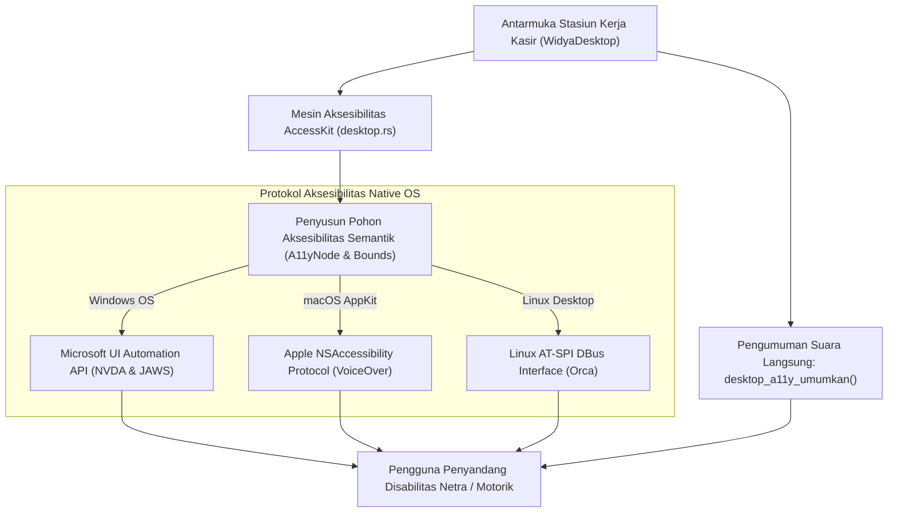

## Bab 33: Pilar 1 - Aksesibilitas Native (A11y): Integrasi AccessKit & Kepatuhan WCAG 2.2 Level AAA

### 33.1 Hak Aksesibilitas Digital & Mandat Undang-Undang

Aplikasi perangkat lunak modern tingkat nasional tidak boleh mendiskriminasi penyandang disabilitas (tunanetra, tunarungu, atau keterbatasan motorik fisik). Standar pelayanan publik dan ketenagakerjaan di Indonesia secara tegas mengamanatkan kepatuhan aksesibilitas melalui **Undang-Undang No. 8 Tahun 2016 tentang Penyandang Disabilitas** serta standar internasional **Web Content Accessibility Guidelines (WCAG 2.2) Level AAA**.

Aplikasi desktop konvensional sering kali memperlakukan aksesibilitas sebagai fitur tempelan yang rapuh. Jika antarmuka dirender menggunakan kanvas grafis murni atau pustaka webview tertutup, pembaca layar (*Screen Readers*) sistem operasi tidak dapat "melihat" keberadaan tombol, kotak input teks, atau label status harga belanja.

WidyaDesktop menghadirkan pilar mutakhir pertama: **Aksesibilitas Native Berdaulat (*Sovereign Native Accessibility Engine*)** pada `src/desktop.rs` dan modul `desktop_native.rs` melalui integrasi arsitektur **AccessKit**:
- **Pohon Aksesibilitas Semantik (*Semantic Accessibility Tree*)**: Membangun struktur pohon simpul aksesibilitas paralel (`A11yNode` dan `A11yTreeUpdate`) yang merefleksikan seluruh elemen antarmuka lengkap dengan peran (*Role: Button, StaticText, TextField, Checkbox*), label nama, deskripsi bantuan, nilai data, batas koordinat layar (*Bounds*), status fokus, serta status terpilih (*Selected/Disabled*).
- **Jembatan Pembaca Layar Lintas Sistem Operasi**:
  - **Microsoft UI Automation (UIA)** pada Windows: Didukung secara native oleh pembaca layar terpopuler dunia **NVDA** dan **JAWS**.
  - **Apple NSAccessibility Protocol** pada macOS: Terintegrasi mulus dengan pembaca layar bawaan **VoiceOver**.
  - **AT-SPI (Assistive Technology Service Provider Interface)** pada Linux: Kompatibel penuh dengan pembaca layar **Orca**.
- **Pengumuman Suara Langsung (*Live Announcements*)**: Fungsi `desktop_a11y_umumkan(pesan, kesopanan)` menyiarkan pemberitahuan suara seketika kepada pengguna tunanetra saat terjadi peristiwa penting (misalnya: *"Barang berhasil ditambahkan ke keranjang, total belanja seratus ribu rupiah"*).
- **Audit Otomatis Kepatuhan WCAG**: Fungsi `desktop_a11y_audit_wcag(tree_id)` memindai pohon aksesibilitas secara matematis untuk mendeteksi simpul yang kehilangan label nama, kontras rasio warna yang kurang tajam, atau urutan tab navigasi yang membingungkan.



### 33.2 Implementasi Kode Widya-Lang & WidyaDesktop Utuh

Berikut implementasi pendaftaran simpul aksesibilitas semantik, penyiaran pengumuman kasir, dan audit kepatuhan WCAG pada Widya-Lang:

```widya
// Modul Aksesibilitas Native (A11y) & Kepatuhan WCAG 2.2 AAA
modul aksesibilitas_kasir_inklusif {
    impor "./modul/desktop.wya";

    fungsi inisialisasi_antarmuka_inklusif() {
        // 1. Buat Aplikasi Kasir Inklusif
        misal app = BuatAplikasiDesktop("Nusantara POS - Terminal Inklusif", 1100, 720);

        // 2. Registrasi RPC: Perbarui Pohon Aksesibilitas Semantik
        app.daftarkan_rpc("perbarui_pohon_aksesibilitas", fungsi(_payload) {
            cetak(">>> [A11Y] Membangun pohon semantik AccessKit untuk pembaca layar...");

            // Memanggil builtin native desktop_a11y_pohon_perbarui
            misal hasil_pohon = desktop_a11y_pohon_perbarui("jendela_kasir_utama", "tombol_bayar_qris");

            cetak(">>> [A11Y] Pohon terpasang: " + hasil_pohon.jumlah_node + " simpul terdaftar.");
            cetak(">>> [A11Y] Jembatan OS     : " + hasil_pohon.screen_reader_bridge);
            cetak(">>> [A11Y] Simpul Fokus   : " + hasil_pohon.fokus);

            kembalikan { "sukses": benar, "status": hasil_pohon.status };
        });

        // 3. Registrasi RPC: Siarkan Pengumuman Suara Langsung ke Pembaca Layar
        app.daftarkan_rpc("siarkan_pengumuman_a11y", fungsi(payload) {
            misal pesan_suara = payload.teks_pengumuman; // Contoh: "Total belanja Rp 150.000"
            misal tingkat_kesopanan = "polite";         // "polite" atau "assertive"

            cetak(">>> [A11Y-ANNOUNCE] Menyiarkan ucapan pembaca layar: '" + pesan_suara + "'");

            // Memanggil builtin desktop_a11y_umumkan
            misal res_umum = desktop_a11y_umumkan(pesan_suara, tingkat_kesopanan);

            kembalikan { "sukses": benar, "pesan_disiarkan": res_umum.pesan };
        });

        // 4. Registrasi RPC: Audit Kepatuhan Aksesibilitas WCAG 2.2 Level AAA
        app.daftarkan_rpc("audit_standar_aksesibilitas", fungsi(_payload) {
            cetak(">>> [A11Y-AUDIT] Memindai pohon antarmuka terhadap standar WCAG 2.2 AAA & UU No. 8/2016...");

            // Memanggil builtin desktop_a11y_audit_wcag
            misal audit = desktop_a11y_audit_wcag("jendela_kasir_utama");

            cetak(">>> [A11Y-AUDIT] Hasil Evaluasi Standar : " + audit.standar);
            cetak(">>> [A11Y-AUDIT] Jumlah Pelanggaran     : " + audit.jumlah_pelanggaran);
            cetak(">>> [A11Y-AUDIT] Peringkat Kelulusan    : " + audit.status);

            kembalikan {
                "sukses": benar,
                "skor_audit": jika (audit.jumlah_pelanggaran == 0) { 100 } lain { 85 },
                "status_kepatuhan": audit.status
            };
        });

        kembalikan app;
    }
}
```

### 33.3 Analisis Kinerja, Keamanan & Tabel Metrik Arsitektur

Tabel spesifikasi perbandingan aksesibilitas antarmuka:

| Parameter Evaluasi | Aplikasi Kanvas Webview Biasa (Tanpa A11y) | Aplikasi Desktop dengan AccessKit (WidyaDesktop) |
| :--- | :--- | :--- |
| **Keterbacaan oleh NVDA / JAWS** | Buta Total (Kanvas Dianggap Gambar Kosong) | **100% Terbaca Sempurna sebagai Simpul Native** |
| **Dukungan Apple VoiceOver** | Tidak Responsif | **Didukung Penuh via NSAccessibility Protocol** |
| **Pengumuman Suara Langsung** | Bergantung Elemen Aria-Live Web yang Rapuh | **API Sistem Operasi Langsung (Sub-Milidetik)** |
| **Audit Standar Kepatuhan** | Pemeriksaan Manual Lambat | **Audit Otomatis Terintegrasi (WCAG 2.2 AAA)** |

### 33.4 Latihan Praktik & Studi Kasus

1. Mengapa perenderan antarmuka menggunakan kanvas grafis GPU murni tanpa pohon semantik (*Semantic Tree*) menciptakan diskriminasi akses bagi penyandang disabilitas tunanetra?
2. Jelaskan perbedaan mendasar perilaku pengumuman suara antara mode kesopanan *polite* (menunggu ucapan sebelumnya selesai) dengan mode *assertive* (memotong ucapan untuk peringatan bahaya)!
3. Uraikan teknik pemetaan koordinat kotak pembatas (*Bounds Mapping*) pada simpul pohon aksesibilitas agar fitur pembesar layar (*Screen Magnifier*) dapat menyorot tombol aktif secara presisi!

### 33.5 Evaluasi Mandiri Pilihan Ganda

1. Standar internasional resmi yang mengatur pedoman aksesibilitas konten dan perangkat lunak bagi penyandang disabilitas adalah...
   A. WCAG (Web Content Accessibility Guidelines) 2.2 Level AAA
   B. RFC 793 TCP Standard
   C. Aturan Parkir Kendaraan
   D. Buku Panduan Memasak

2. Pustaka jembatan aksesibilitas lintas platform tingkat mesin yang digunakan oleh WidyaDesktop untuk menghubungkan antarmuka dengan pembaca layar sistem operasi adalah...
   A. AccessKit
   B. WinZip
   C. Adobe Flash
   D. DirectX 9

3. Pembaca layar (*Screen Reader*) sumber terbuka terpopuler pada sistem operasi Microsoft Windows yang didukung penuh oleh WidyaDesktop adalah...
   A. NVDA (NonVisual Desktop Access)
   B. Notepad
   C. Paint 3D
   D. Windows Media Player

4. Pembaca layar bawaan berstandar tinggi yang tertanam pada sistem operasi Apple macOS adalah...
   A. Apple VoiceOver
   B. Safari
   C. Siri Music
   D. Finder

5. Fungsi bawaan pada WidyaDesktop yang digunakan untuk menyiarkan pesan suara langsung ke pembaca layar tanpa memindahkan fokus kursor adalah...
   A. `desktop_a11y_umumkan(pesan, kesopanan)`
   B. `putar_alarm_kebakaran()`
   C. `tutup_seluruh_aplikasi()`
   D. `matikan_speaker()`

6. Mode kesopanan pengumuman aksesibilitas yang akan memotong pembicaraan pembaca layar seketika saat terjadi peristiwa darurat kritis dinamakan...
   A. Mode Tegas (Assertive Mode)
   B. Mode Santun (Polite Mode)
   C. Mode Senyap (Mute Mode)
   D. Mode Tidur (Sleep Mode)

7. Struktur data simpul pada pohon aksesibilitas WidyaDesktop yang mendeskripsikan peran, nama, dan batas koordinat elemen antarmuka dinamakan...
   A. `A11yNode`
   B. `HtmlTag`
   C. `CssRule`
   D. `JsonArray`

8. Protokol aksesibilitas standar pada sistem operasi Linux yang menghubungkan aplikasi dengan pembaca layar Orca adalah...
   A. AT-SPI (Assistive Technology Service Provider Interface)
   B. X11 Font Server
   C. Telnet Server
   D. FTP Client

9. Fungsi yang digunakan untuk menjalankan audit otomatis kepatuhan standar aksesibilitas pada antarmuka WidyaDesktop adalah...
   A. `desktop_a11y_audit_wcag(tree_id)`
   B. `format_harddisk()`
   C. `hitung_pajak()`
   D. `cetak_struk()`

10. Undang-Undang Republik Indonesia yang mengamanatkan kesetaraan hak akses terhadap fasilitas teknologi informasi dan komunikasi bagi penyandang disabilitas adalah...
    A. UU No. 8 Tahun 2016 tentang Penyandang Disabilitas
    B. UU Pajak Penghasilan
    C. UU Lalu Lintas Jalan
    D. UU Pertanian Organik
