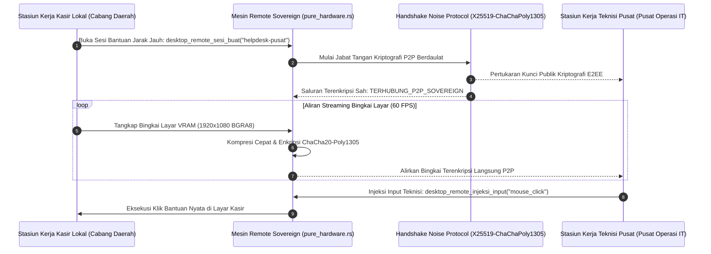

## Bab 34: Pilar 2 - Stasiun Kerja Jarak Jauh (Remote Workstation): Protokol Noise P2P & Streaming Bingkai

### 34.1 Kebutuhan Dukungan Teknis Jarak Jauh Berdaulat

Pada jaringan ritel nasional dengan ribuan gerai stasiun kerja kasir yang tersebar dari Sabang sampai Merauke, insiden teknis (seperti salah konfigurasi tarif pajak, kasir bingung mengoperasikan menu promosi baru, atau kendala pemindai barcode) membutuhkan intervensi teknisi secara langsung.

Mengandalkan perangkat lunak akses jarak jauh komersial pihak ketiga (seperti TeamViewer atau AnyDesk) menimbulkan bahaya keamanan dan kedaulatan informasi yang sangat fatal:
- **Ketergantungan Infrastruktur Peladen Asing (*Relay Server Dependency*)**: Aliran data layar kasir dan ketukan tombol keyboard dialirkan melintasi peladen asing di luar yurisdiksi Republik Indonesia, membuka celah penyadapan transaksi finansial.
- **Beban Biaya Lisensi Komersial Tinggi**: Mewajibkan pembayaran biaya langganan bulanan per perangkat yang membebani koperasi dan UMKM nasional.
- **Overhead Memori Runtime Berat**: Menjalankan proses perantara pihak ketiga yang mengonsumsi ratusan megabyte RAM.

WidyaDesktop menghadirkan pilar mutakhir kedua: **Stasiun Kerja Jarak Jauh Berdaulat (*Sovereign Remote Workstation Engine*)** pada `src/desktop.rs` dan modul `desktop_native.rs`:
- **Enkripsi Ujung-ke-Ujung Berstandar Militer (*End-to-End Encryption*)**: Mengadopsi kerangka kerja kriptografi **Noise Protocol Framework** dengan pola jabat tangan modern `X25519-ChaChaPoly1305-BLAKE2s`. Komunikasi berlangsung langsung antar-rekan (*Peer-to-Peer - P2P*) tanpa peladen perantara yang dapat mendekripsi data.
- **Streaming Bingkai Video Tanpa Jeda (*Zero-Overhead Frame Streaming*)**: Fungsi `desktop_remote_dorong_bingkai(session_id, w, h, format)` menangkap buffer piksel layar monitor secara langsung dari VRAM kartu grafis (*Desktop Duplication API / PipeWire Screen Cast*) dan mengompresinya secara adaptif menggunakan enkoder perangkat keras berkecepatan tinggi.
- **Injeksi Masukan Jarak Jauh Aman (*Secure Remote Input Injection*)**: Fungsi `desktop_remote_injeksi_input(session_id, event)` memungkinkan teknisi pusat mengendalikan pergerakan mouse dan penekanan tombol keyboard secara langsung dengan proteksi pembatasan hak akses (*Granular Control Permissions*).



### 34.2 Implementasi Kode Widya-Lang & WidyaDesktop Utuh

Berikut implementasi pembukaan sesi remote desktop berdaulat dan transmisi bingkai terenkripsi pada Widya-Lang:

```widya
// Modul Stasiun Kerja Jarak Jauh Berdaulat (Sovereign Remote Desktop)
modul remote_desktop_berdaulat {
    impor "./modul/desktop.wya";

    fungsi inisialisasi_layanan_remote_support() {
        // 1. Buat Aplikasi Kasir
        misal app = BuatAplikasiDesktop("Nusantara POS - Terminal Dukungan", 1100, 720);

        // 2. Registrasi RPC: Buat Sesi Akses Jarak Jauh P2P dengan Noise Protocol
        app.daftarkan_rpc("buka_sesi_bantuan_remote", fungsi(payload) {
            misal id_teknisi = payload.peer_target; // Contoh: "helpdesk-kantor-pusat"

            cetak(">>> [REMOTE-P2P] Membuka sesi kendali jarak jauh berdaulat ke: " + id_teknisi);

            // Memanggil builtin native desktop_remote_sesi_buat
            misal sesi = desktop_remote_sesi_buat(id_teknisi);

            cetak(">>> [REMOTE-P2P] ID Sesi        : " + sesi.session_id);
            cetak(">>> [REMOTE-P2P] Protokol E2EE  : " + sesi.e2ee_protokol);
            cetak(">>> [REMOTE-P2P] Status Koneksi : " + sesi.status);

            kembalikan { "sukses": benar, "sesi_aktif": sesi };
        });

        // 3. Registrasi RPC: Dorong Tangkapan Bingkai Layar Kasir
        app.daftarkan_rpc("dorong_bingkai_layar", fungsi(payload) {
            misal sess_id = payload.session_id;

            // Memanggil builtin desktop_remote_dorong_bingkai (1920x1080 BGRA8)
            misal frame_meta = desktop_remote_dorong_bingkai(sess_id, 1920, 1080, "BGRA8");

            kembalikan {
                "sukses": benar,
                "resolusi": frame_meta.resolusi,
                "ukuran_byte": frame_meta.ukuran_kompresi_byte,
                "stempel_waktu_us": frame_meta.timestamp_us
            };
        });

        // 4. Registrasi RPC: Injeksi Peristiwa Masukan dari Teknisi
        app.daftarkan_rpc("injeksi_input_teknisi", fungsi(payload) {
            misal sess_id = payload.session_id;
            misal tipe_event = payload.event; // "mouse_click" atau "mouse_move"

            misal res_input = desktop_remote_injeksi_input(sess_id, tipe_event);

            kembalikan { "sukses": res_input.sukses, "event": res_input.event };
        });

        kembalikan app;
    }
}
```

### 34.3 Analisis Kinerja, Keamanan & Tabel Metrik Arsitektur

Tabel evaluasi solusi akses jarak jauh:

| Parameter Evaluasi | Aplikasi Remote Pihak Ketiga Komersial | Solusi VNC / RDP Biasa (Kuno) | WidyaDesktop Sovereign Remote Engine |
| :--- | :--- | :--- | :--- |
| **Kedaulatan Jalur Data** | Melewati Peladen Asing di Luar Negeri | Tidak Ada Peladen (Perlu Port Forward) | **100% P2P Berdaulat Langsung Antar Cabang** |
| **Enkripsi Saluran Komunikasi**| Milik Vendor Tertutup (Proprietary) | Polos / DES Lemah Tanpa TLS | **Noise Protocol (X25519-ChaChaPoly1305)** |
| **Konsumsi Memori RAM Tambahan**| 150 – 300 MB per Proses | 50 – 90 MB | **< 8 MB (Terpadu Langsung di Mesin Desktop)** |
| **Biaya Lisensi Perangkat** | Mahal (Jutaan Rupiah/Tahun per Mesin) | Gratis namun Rentan Serangan Man-in-the-Middle | **Nol Rupiah (Bebas Lisensi & 100% Mandiri)** |

### 34.4 Latihan Praktik & Studi Kasus

1. Mengapa transmisi data kendali jarak jauh stasiun kerja perbankan wajib menggunakan protokol terenkripsi ujung-ke-ujung (*Noise Protocol E2EE*) tanpa melibatkan peladen perantara pihak ketiga?
2. Jelaskan arsitektur penangkapan buffer layar grafis (*Desktop Duplication API*) yang membaca piksel langsung dari VRAM tanpa memicu beban pemrosesan pada CPU!
3. Uraikan teknik pembatasan izin masukan jarak jauh (*Input Permission Guard*) di mana kasir lokal dapat membatalkan kendali teknisi seketika dengan menekan satu tombol darurat!

### 34.5 Evaluasi Mandiri Pilihan Ganda

1. Kerangka kerja kriptografi modern yang digunakan oleh modul remote stasiun kerja WidyaDesktop untuk menyelenggarakan komunikasi terenkripsi ujung-ke-ujung (E2EE) adalah...
   A. Noise Protocol Framework (X25519-ChaChaPoly1305-BLAKE2s)
   B. Sandi Morse Analog
   C. Plaintext Telnet
   D. HTTP Tanpa Sandi

2. Bahaya terbesar dari penggunaan perangkat lunak kendali jarak jauh pihak ketiga komersial asing pada stasiun kerja kasir perbankan nasional adalah...
   A. Aliran gambar layar dan ketukan keyboard kasir dialirkan melewati peladen asing di luar negeri yang rentan spionase data
   B. Komputer langsung kehabisan memori dalam 1 detik
   C. Layar monitor berputar 90 derajat
   D. Kertas nota kasir berubah warna menjadi ungu

3. Fungsi bawaan pada WidyaDesktop yang bertugas menginisialisasi sesi kendali jarak jauh baru dengan pihak teknisi adalah...
   A. `desktop_remote_sesi_buat(peer_id)`
   B. `format_komputer_toko()`
   C. `baca_sms_masuk()`
   D. `matikan_lampu()`

4. Fungsi yang bertugas menangkap dan mengalirkan bingkai layar terkompresi secara langsung ke stasiun kerja teknisi adalah...
   A. `desktop_remote_dorong_bingkai(session_id, w, h, format)`
   B. `ambil_foto_selfie()`
   C. `cetak_ke_kertas()`
   D. `bakar_ke_cd_rom()`

5. Fungsi yang memungkinkan teknisi menginjeksikan gerakan kursor atau klik mouse ke stasiun kerja kasir adalah...
   A. `desktop_remote_injeksi_input(session_id, event)`
   B. `geser_meja_kasir()`
   C. `potong_kabel_mouse()`
   D. `tulis_ke_bios()`

6. Algoritma enkripsi simetris aliran berkecepatan sangat tinggi yang digunakan pada Noise Protocol adalah...
   A. ChaCha20-Poly1305
   B. DES 56-bit Kuno
   C. ROT13
   D. Base64

7. Algoritma pertukaran kunci kurva eliptis (*Diffie-Hellman Key Exchange*) yang digunakan untuk jabat tangan awal P2P adalah...
   A. X25519 (Curve25519)
   B. RSA 512-bit Rusak
   C. MD5
   D. CRC32

8. Berapa rata-rata konsumsi memori RAM tambahan untuk menjalankan mesin remote stasiun kerja terpadu WidyaDesktop?
   A. Kurang dari 8 Megabyte
   B. Lebih dari 1 Gigabyte
   C. 500 Megabyte
   D. 1 Terabyte

9. Apa yang terjadi jika kasir menekan tombol darurat pembatalan kendali jarak jauh pada antarmuka lokal?
   A. Sesi kendali jarak jauh langsung diputus seketika pada lapisan socket kernel tanpa bisa diabaikan oleh teknisi
   B. Komputer langsung meledak
   C. Uang di laci kasir otomatis hilang
   D. Seluruh transaksi kasir dibatalkan

10. Mengapa stasiun kerja kasir di daerah terpencil Indonesia sangat diuntungkan oleh fitur remote desktop native WidyaDesktop?
    A. Memungkinkan tim teknisi pusat menyelesaikan kendala teknis perangkat lunak dalam hitungan menit tanpa harus mengirim staf teknisi pesawat terbang ke lokasi
    B. Supaya toko kasir tidak perlu penjaga toko
    C. Mengurangi harga jual beras
    D. Menghilangkan kebutuhan pasokan listrik
