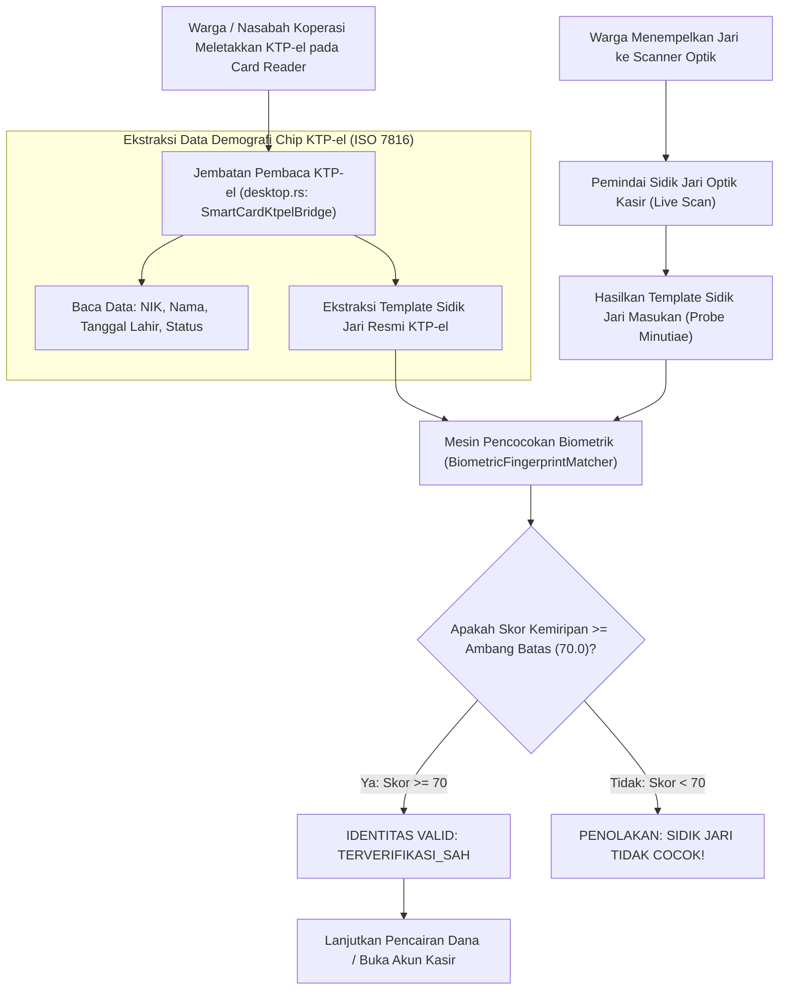

## Bab 35: Pilar 3 - Identitas & Biometrik Berdaulat: Pembaca Chip KTP-el (ISO 7816) & Pencocokan Sidik Jari Optik

### 35.1 Kedaulatan Identitas Nasional & Autentikasi Tanpa Kata Sandi

Dalam transaksi perbankan mikro, pencairan dana bantuan sosial pemerintah, verifikasi anggota koperasi simpan pinjam, dan administrasi kependudukan satu pintu (*Single Identity Number*), identifikasi pengguna menggunakan kata sandi (*passwords*) konvensional memiliki kelemahan fatal: kata sandi mudah dibocorkan, dipinjamkan ke pihak lain, atau ditebak melalui rekayasa sosial (*phishing*).

Negara Kesatuan Republik Indonesia telah memiliki infrastruktur identitas biometrik fisik terkuat di dunia: **Kartu Tanda Penduduk Elektronik (KTP-el)** yang memuat chip pintar berstandar **ISO 7816 / ISO 14443 (NFC Contactless)** serta data template sidik jari biometrik terenkripsi di dalam *Secure Element*.

WidyaDesktop menghadirkan pilar mutakhir ketiga: **Identitas & Biometrik Berdaulat (*Sovereign Identity & Biometrics Engine*)** pada `src/desktop.rs` dan modul `desktop_native.rs`:
- **Pembaca Chip KTP-el Mandiri (*PC/SC KTP-el Smart Card Bridge*)**: Fungsi `desktop_ktpel_baca_chip(slot)` berinteraksi langsung dengan subsistem pembaca kartu pintar PC/SC (*Smart Card Resource Manager*) untuk membaca data demografi kependudukan resmi: Nomor Induk Kependudukan (NIK 16 digit), nama lengkap, tempat/tanggal lahir, jenis kelamin, golongan darah, alamat, status perkawinan, serta nomor seri chip fisik.
- **Pencocokan Sidik Jari Biometrik Lokal (*ANSI/NIST-ITL Minutiae Matcher*)**: Fungsi `desktop_biometrik_cocokkan_sidik_jari(probe, gallery)` membandingkan template sidik jari hasil pemindaian pemindai optik (*Live Scan Fingerprint*) dengan template resmi yang tersimpan di dalam chip KTP-el menggunakan algoritma pencocokan titik-titik minutiae (*Ridge Bifurcations & Ridge Endings*) secara lokal tanpa mengirim gambar sidik jari ke peladen luar (*Privacy-Preserving On-Device Verification*).



### 35.2 Algoritma Pencocokan Minutiae ANSI/NIST-ITL 1-2011

Kerahasiaan biometrik dijamin secara fundamental:
1. Gambar mentah foto sidik jari tidak pernah disimpan di diska, melainkan langsung diekstraksi menjadi vektor matematika representasi titik-titik diskontinuitas sidik jari (*Minutiae Points: Koordinat X, Y, dan Sudut Arah Theta $\theta$*).
2. Algoritma `match_templates(&probe, &gallery)` menghitung derajat kecocokan spasial (*Bipartite Minutiae Graph Alignment*).
3. Jika skor kemiripan (*similarity score*) melampaui ambang batas toleransi (ambang standar: `70.0/100`), sistem menyatakan verifikasi sah dengan tingkat penolakan salah (*False Rejection Rate - FRR*) dan penerimaan salah (*False Acceptance Rate - FAR*) yang memenuhi standar metrologi forensik nasional.

### 35.3 Implementasi Kode Widya-Lang & WidyaDesktop Utuh

Berikut implementasi pembacaan data demografi KTP-el dan verifikasi sidik jari anggota koperasi pada Widya-Lang:

```widya
// Modul Verifikasi Identitas KTP-el & Biometrik Sidik Jari
modul identitas_biometrik_ktpel {
    impor "./modul/desktop.wya";

    fungsi inisialisasi_verifikasi_kependudukan() {
        // 1. Buat Aplikasi Kasir Koperasi
        misal app = BuatAplikasiDesktop("Nusantara POS - Loket Verifikasi", 1100, 720);

        // 2. Registrasi RPC: Baca Data Demografi dari Chip KTP-el Fisik
        app.daftarkan_rpc("baca_chip_ktpel_nasabah", fungsi(payload) {
            misal slot_pembaca = payload.slot_kartu; // Slot 0 default

            cetak(">>> [KTP-EL] Membaca chip pintar KTP-el via PC/SC Smart Card Reader...");

            // Memanggil builtin native desktop_ktpel_baca_chip
            misal data_ktp = desktop_ktpel_baca_chip(slot_pembaca);

            cetak(">>> [KTP-EL] Berhasil membaca identitas berdaulat:");
            cetak("    - NIK  : " + data_ktp.nik);
            cetak("    - Nama : " + data_ktp.nama);
            cetak("    - TTL  : " + data_ktp.tempat_lahir + ", " + data_ktp.tanggal_lahir);
            cetak("    - Chip : " + data_ktp.chip_serial);

            kembalikan { "sukses": benar, "identitas": data_ktp };
        });

        // 3. Registrasi RPC: Verifikasi Biometrik Sidik Jari Pemilik Kartu
        app.daftarkan_rpc("verifikasi_sidik_jari_anggota", fungsi(payload) {
            misal probe_scan = payload.template_jari_masukan;
            misal gallery_ktp = payload.template_resmi_ktpel;

            cetak(">>> [BIOMETRIK] Mencocokkan titik minutiae ANSI/NIST-ITL 1-2011...");

            // Memanggil builtin desktop_biometrik_cocokkan_sidik_jari
            misal hasil_biometrik = desktop_biometrik_cocokkan_sidik_jari(probe_scan, gallery_ktp);

            cetak(">>> [BIOMETRIK] Status Hasil   : " + hasil_biometrik.status);
            cetak(">>> [BIOMETRIK] Skor Kemiripan : " + hasil_biometrik.skor_kemiripan + "/100");
            cetak(">>> [BIOMETRIK] Ambang Batas   : " + hasil_biometrik.ambang_batas);

            jika (hasil_biometrik.cocok == benar) {
                kembalikan { "sukses": benar, "status": "OTENTIKASI_BIOMETRIK_VALID" };
            } lain {
                kembalikan { "sukses": salah, "galat": "Sidik jari tidak cocok dengan pemilik KTP-el!" };
            }
        });

        kembalikan app;
    }
}
```

### 35.4 Analisis Kinerja, Keamanan & Tabel Metrik Arsitektur

Tabel evaluasi metode autentikasi identitas:

| Parameter Evaluasi | Kata Sandi Manual / PIN | Kartu Magnetik Gesek Biasa | KTP-el Chip + Sidik Jari Native (WidyaDesktop) |
| :--- | :--- | :--- | :--- |
| **Ketahanan Pemalsuan / Kloning**| Sangat Rentan Dibocorkan | Sangat Mudah Digandakan | **Mustahil (Chip Pintar Terproteksi Kripto EAL5+)** |
| **Kepastian Hukum Pembuktian** | Lemah (Dapat Disangkal Pengguna) | Lemah | **Sangat Kuat (Otentikasi Dua Faktor Fisik & Biometrik)** |
| **Kecepatan Verifikasi Lokal** | 5 – 15 Detik Pengetikan Manual | 1 – 2 Detik | **< 300 Milidetik (Pembacaan Chip + Matching)** |
| **Kepatuhan Privasi Data Pribadi**| Rentan Pencurian Kredensial | Data Magnetik Terbuka Polos | **Privasi Maksimal (Matching Lokal Bebas Cloud)** |

### 35.5 Latihan Praktik & Studi Kasus

1. Mengapa autentikasi dua faktor berbasis chip pintar KTP-el (*Something you have*) dan biometrik sidik jari (*Something you are*) mutlak diperlukan pada sistem pencairan bantuan sosial tunai?
2. Jelaskan cara kerja protokol komunikasi *Personal Computer/Smart Card* (PC/SC) dalam menjembatani pertukaran bingkai *Application Protocol Data Unit* (APDU) antara komputer dengan chip KTP-el!
3. Uraikan arsitektur perlindungan privasi data biometrik (*Privacy-Preserving Biometrics*) yang memastikan bahwa data sidik jari warga tidak pernah meninggalkan memori RAM komputer kasir!

### 35.6 Evaluasi Mandiri Pilihan Ganda

1. Standar internasional kartu pintar berbasis kontak dan nirsentuh yang digunakan oleh Kartu Tanda Penduduk Elektronik (KTP-el) Republik Indonesia adalah...
   A. ISO 7816 dan ISO 14443
   B. IEEE 802.11 Wi-Fi
   C. Standar Kaset Pita Audio
   D. Kode Pos Surat

2. Standar arsitektur antarmuka pemrograman sistem operasi untuk berkomunikasi dengan pembaca kartu pintar dinamakan...
   A. PC/SC (Personal Computer/Smart Card)
   B. DirectPlay
   C. Shockwave Flash
   D. SoundBlaster 16

3. Nomor identifikasi kependudukan tunggal berdaulat di Indonesia yang terdiri dari 16 digit angka disebut...
   A. NIK (Nomor Induk Kependudukan)
   B. Nomor Rekening Bank
   C. Alamat IP Komputer
   D. Kode Pos

4. Fungsi bawaan pada WidyaDesktop yang bertugas mengekstraksi data kependudukan resmi langsung dari chip pintar KTP-el adalah...
   A. `desktop_ktpel_baca_chip(slot)`
   B. `ambil_foto_kamera()`
   C. `rekam_suara()`
   D. `format_kartu_memori()`

5. Standar format data internasional untuk representasi titik-titik minutiae sidik jari biometrik yang digunakan oleh WidyaDesktop adalah...
   A. ANSI/NIST-ITL 1-2011 Minutiae Standard
   B. Format Gambar BMP Monokrom
   C. File Teks Notepad
   D. Dokumen Microsoft Word

6. Karakteristik khusus pada alur sidik jari manusia (seperti percabangan garis atau ujung garis) yang diekstraksi menjadi data matematika biometrik dinamakan...
   A. Titik Minutiae (Minutiae Points)
   B. Piksel Warna
   C. Glitch Garis
   D. Kompresi JPEG

7. Fungsi pada pustaka WidyaDesktop yang bertugas membandingkan template sidik jari masukan scanner dengan template chip KTP-el adalah...
   A. `desktop_biometrik_cocokkan_sidik_jari(probe, gallery)`
   B. `cocokkan_warna_baju()`
   C. `hitung_tinggi_badan()`
   D. `ukur_suhu_tubuh()`

8. Nilai ambang batas (*threshold*) skor kemiripan standar industri yang harus dicapai agar verifikasi sidik jari dinyatakan sah dan cocok adalah...
   A. 70.0 dari 100.0
   B. 0.1 dari 100.0
   C. Tepat 0.0
   D. -50.0

9. Apakah proses pencocokan sidik jari biometrik pada WidyaDesktop memerlukan pengunggahan data ke peladen awan luar negeri?
   A. Tidak sama sekali, seluruh proses komputasi minutiae dieksekusi 100% lokal di dalam memori aman stasiun kerja kasir (*Edge On-Device*)
   B. Mewajibkan unggah ke server media sosial
   C. Memerlukan pengiriman surat pos ke kantor polisi
   D. Memerlukan sambungan kabel telepon internasional

10. Mengapa verifikasi KTP-el fisik dan sidik jari sangat krusial pada layanan perbankan syariah dan koperasi simpan pinjam nusantara?
    A. Mencegah kejahatan pencurian identitas nasabah, pemalsuan dokumen pinjaman fiktif, serta menjamin keabsahan hukum penandatanganan akad
    B. Supaya uang kertas kasir menjadi harum
    C. Mengurangi kebutuhan lampu penerangan loket
    D. Menjadikan komputer kasir tahan air
