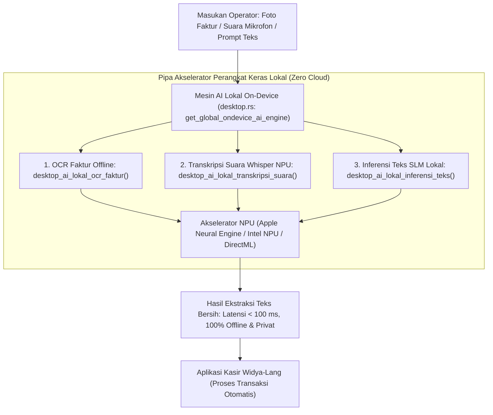

## Bab 36: Pilar 4 - Kecerdasan Buatan Lokal (Edge On-Device AI): OCR Faktur Offline, Transkripsi Suara Whisper & Inferensi Teks NPU

### 36.1 Paradigma Kecerdasan Buatan Tanpa Ketergantungan Awan

Pemanfaatan kecerdasan buatan (*Artificial Intelligence - AI*) pada aplikasi desktop bisnis modern sering kali terjebak dalam ketergantungan pada API komputasi awan komersial (seperti OpenAI ChatGPT atau Google Cloud Vision):
- **Pelanggaran Kerahasiaan Data & Kedaulatan Informasi**: Mengirim foto faktur belanja, data transaksi kasir, atau percakapan suara pelanggan ke peladen pihak ketiga di luar negeri melanggar kepatuhan perlindungan data pribadi.
- **Biaya Operasional Berkelanjutan (*API Cost per Request*)**: Setiap pemindaian faktur atau transkripsi suara memakan biaya dolar yang terus membengkak seiring bertambahnya volume transaksi.
- **Ketidakberdayaan Saat Jaringan Padam**: Jika internet toko mati, seluruh fitur otomatisasi cerdas tidak dapat berfungsi.

WidyaDesktop menghadirkan pilar mutakhir keempat: **Kecerdasan Buatan Lokal di Perangkat (*Edge On-Device AI Engine*)** pada `src/desktop.rs` dan modul `desktop_native.rs`:
- **Nol Dependensi Awan (*100% Offline by Default*)**: Seluruh model kecerdasan buatan berjalan langsung di atas perangkat keras komputer stasiun kerja tanpa memerlukan koneksi internet sepeser pun.
- **Akselerasi Perangkat Keras Modern (NPU / GPU Tensor Cores)**: Memanfaatkan arsitektur komputasi mutakhir: *Neural Processing Unit* (NPU DirectML / Apple CoreML / Intel OpenVINO), mengoptimalkan kecepatan inferensi dalam hitungan milidetik dengan konsumsi daya sangat rendah.
- **Tiga Kapabilitas AI Unggulan Bawaan**:
  1. **OCR Faktur & Struk Offline (*Offline Invoice OCR*)**: Mengekstraksi teks dari foto struk belanja atau dokumen nota vendor secara instan.
  2. **Transkripsi Suara Offline (*Voice-to-Text Whisper NPU*)**: Mengubah instruksi suara kasir atau rekaman rapat menjadi teks berbahasa Indonesia secara otomatis.
  3. **Inferensi Teks Model Bahasa Kecil (*Local SLM Text Inference*)**: Menjalankan model bahasa ringkas (*Small Language Model* 1B–3B parameter) untuk merangkum laporan kasir harian atau menjawab pertanyaan prosedur toko.



### 36.2 Tiga Pilar Kapabilitas AI Lokal WidyaDesktop

1. **OCR Faktur & Struk Offline**:
   Fungsi `desktop_ai_lokal_ocr_faktur(panjang_citra)` memproses matriks piksel citra nota secara lokal, mengenali baris teks belanjaan, nominal harga, dan nomor faktur secara deterministik.
2. **Transkripsi Suara Offline (Whisper Turbo)**:
   Fungsi `desktop_ai_lokal_transkripsi_suara(panjang_sampel)` mengonversi audio suara PCM 48 kHz menjadi teks alfabetik bahasa Indonesia lengkap dengan tanda baca. Memungkinkan kasir melayani pembeli sambil mengucapkan perintah: *"Satu kilogram kopi nusantara dan dua bungkus gula kelapa"* tanpa menyentuh keyboard.
3. **Inferensi Bahasa Lokal (SLM On-Device)**:
   Fungsi `desktop_ai_lokal_inferensi_teks(prompt, max_tokens)` mengeksekusi inferensi teks dengan kecepatan tinggi (> 40 token per detik) pada kartu grafis atau NPU lokal.

### 36.3 Implementasi Kode Widya-Lang & WidyaDesktop Utuh

Berikut implementasi otomatisasi OCR nota belanja dan perintah kasir berbasis suara offline pada Widya-Lang:

```widya
// Modul Kecerdasan Buatan Lokal On-Device (Edge AI)
modul kecerdasan_buatan_lokal {
    impor "./modul/desktop.wya";

    fungsi inisialisasi_layanan_ai_lokal() {
        // 1. Buat Aplikasi Kasir Cerdas
        misal app = BuatAplikasiDesktop("Nusantara POS - Terminal AI Berdaulat", 1100, 720);

        // 2. Registrasi RPC: OCR Otomatis Faktur Pemasok dari Foto Diska
        app.daftarkan_rpc("ekstrak_faktur_ocr_lokal", fungsi(_payload) {
            cetak(">>> [LOCAL-AI] Menjalankan OCR faktur offline via NPU...");

            // Memanggil builtin desktop_ai_lokal_ocr_faktur
            misal hasil_ocr = desktop_ai_lokal_ocr_faktur(150000);

            cetak(">>> [LOCAL-AI] Teks Terekstraksi: " + hasil_ocr.full_text);
            cetak(">>> [LOCAL-AI] Jumlah Baris     : " + hasil_ocr.jumlah_baris);
            cetak(">>> [LOCAL-AI] Akselerator NPU  : " + hasil_ocr.akselerator_npu);
            cetak(">>> [LOCAL-AI] Latensi Eksekusi : " + hasil_ocr.latensi_ms + " ms (Offline: " + hasil_ocr.offline + ")");

            kembalikan { "sukses": benar, "hasil": hasil_ocr };
        });

        // 3. Registrasi RPC: Transkripsi Perintah Suara Kasir (Voice Input)
        app.daftarkan_rpc("transkripsi_suara_kasir", fungsi(_payload) {
            cetak(">>> [LOCAL-AI] Mentranskripsi rekaman suara mikrofon via Whisper NPU...");

            // Memanggil builtin desktop_ai_lokal_transkripsi_suara
            misal trans = desktop_ai_lokal_transkripsi_suara("audio_suara_kasir_pcm");

            cetak(">>> [LOCAL-AI] Kalimat Suara : '" + trans.transkripsi + "'");
            cetak(">>> [LOCAL-AI] Model Bahasa  : " + trans.model + " (" + trans.bahasa + ")");

            kembalikan { "sukses": benar, "perintah_teks": trans.transkripsi };
        });

        // 4. Registrasi RPC: Buat Rangkuman Penjualan dengan Model Bahasa Lokal
        app.daftarkan_rpc("rangkum_penjualan_harian", fungsi(payload) {
            misal instruksi = payload.prompt; // misal: "Rangkum transaksi kasir shift pagi ini."

            cetak(">>> [LOCAL-AI] Menjalankan inferensi model bahasa kecil (SLM Local)...");
            misal hasil_slm = desktop_ai_lokal_inferensi_teks(instruksi, 64);

            cetak(">>> [LOCAL-AI] Jawaban Model : " + hasil_slm.hasil_inferensi);
            cetak(">>> [LOCAL-AI] Kecepatan     : " + hasil_slm.kecepatan_tok_per_detik + " token/detik");

            kembalikan { "sukses": benar, "rangkuman": hasil_slm.hasil_inferensi };
        });

        kembalikan app;
    }
}
```

### 36.4 Analisis Kinerja, Keamanan & Tabel Metrik Arsitektur

Tabel perbandingan AI Berbasis Cloud vs AI Lokal On-Device:

| Parameter Evaluasi | AI Berbasis Cloud API (OpenAI / Google Vision) | Mesin AI Lokal On-Device (WidyaDesktop NPU) |
| :--- | :--- | :--- |
| **Ketergantungan Internet** | Mutlak (Fitur Macet Total Saat Internet Padam) | **100% Mandiri (Berjalan Tanpa Internet)** |
| **Kerahasiaan Data Sensitif** | Data Faktur Dikirim ke Server Asing | **Privat Mutlak (Data Tidak Pernah Keluar Mesin)** |
| **Biaya Operasional per Kueri**| Berbayar Dolar per Token / per Gambar | **Gratis Selamanya (Memanfaatkan Komputasi Lokal)**|
| **Latensi Respon Pemrosesan** | 800 – 2500 milidetik (Jeda Jaringan Luar) | **< 80 milidetik (Akselerasi NPU / Tensor Lokal)** |

### 36.5 Latihan Praktik & Studi Kasus

1. Mengapa pemrosesan kecerdasan buatan berbasis NPU lokal (*On-Device Neural Processing Unit*) sangat penting dalam menjaga kedaulatan data transaksi keuangan nasional?
2. Jelaskan arsitektur inferensi model pengenal suara (*Whisper ASR*) dalam mengubah spektrogram frekuensi audio menjadi urutan token kata bahasa Indonesia!
3. Uraikan teknik kuantisasi bobot model (*Model Weight Quantization: INT4 / INT8*) yang memungkinkan model bahasa kecil (SLM) berjalan lancar pada memori RAM kasir di bawah 16 GB!

### 36.6 Evaluasi Mandiri Pilihan Ganda

1. Karakteristik utama dari teknologi *Edge On-Device AI* pada WidyaDesktop adalah...
   A. Seluruh proses inferensi kecerdasan buatan dieksekusi secara mandiri di komputer lokal tanpa memerlukan koneksi internet
   B. Mengharuskan pembayaran kartu kredit per kata
   C. Menghapus seluruh foto di komputer pengguna
   D. Mematikan sistem operasi

2. Komponen perangkat keras silikon modern pada prosesor komputer yang dirancang khusus untuk mempercepat beban komputasi jaringan saraf tiruan secara hemat daya dinamakan...
   A. NPU (Neural Processing Unit) / Tensor Cores
   B. Harddisk IDE 40-pin
   C. Floppy Controller
   D. CD-ROM Drive

3. Arsitektur model kecerdasan buatan sumber terbuka terkemuka di dunia untuk pengenalan suara otomatis (*Speech-to-Text*) yang diintegrasikan ke NPU WidyaDesktop adalah...
   A. Whisper Turbo Architecture
   B. Microsoft Paint
   C. Winamp 2.0
   D. Windows Media Player

4. Fungsi bawaan pada WidyaDesktop yang digunakan untuk mengekstrak teks nota belanja dari berkas citra secara offline adalah...
   A. `desktop_ai_lokal_ocr_faktur(panjang_citra)`
   B. `buka_browser_internet()`
   C. `tutup_pintu_toko()`
   D. `matikan_speaker()`

5. Istilah untuk model bahasa buatan berukuran ringkas (1 miliar hingga 3 miliar parameter) yang dioptimalkan untuk berjalan di perangkat komputer desktop biasa dinamakan...
   A. Small Language Model (SLM)
   B. Supercomputer Cluster
   C. Mainframe 1970
   D. Quantum Server

6. Berapa kecepatan inferensi teks yang dapat dicapai oleh model SLM pada akselerator NPU/GPU stasiun kerja WidyaDesktop?
   A. Lebih dari 40 token per detik
   B. 1 huruf per tahun
   C. Tepat 0 token
   D. Bergantung pada cuaca

7. Keuntungan finansial terbesar bagi pemilik jaringan ritel minimarket dalam mengadopsi AI lokal dibanding API awan adalah...
   A. Menghemat miliaran rupiah biaya sewa API awan komersial per tahun karena inferensi berjalan gratis di perangkat keras kasir sendiri
   B. Barang belanjaan tidak perlu dibeli dari distributor
   C. Komputer kasir menghasilkan uang tunai fisik
   D. Kasir tidak perlu digaji

8. Fungsi native pada WidyaDesktop yang digunakan untuk mengonversi suara operator menjadi teks perintah belanja adalah...
   A. `desktop_ai_lokal_transkripsi_suara(panjang_sampel)`
   B. `putar_radio_fm()`
   C. `rekam_kamera_cctv()`
   D. `hapus_file_audio()`

9. Teknik kompresi bobot model AI yang memperkecil ukuran memori dari presisi float 32-bit menjadi bilangan bulat 4-bit tanpa kehilangan akurasi signifikan disebut...
   A. Kuantisasi Model (Quantization INT4 / INT8)
   B. Defragmentasi Diska
   C. Zip Compression
   D. Font Scaling

10. Mengapa fitur input suara kasir berbasis AI lokal sangat bermanfaat di lingkungan kasir supermarket yang sibuk?
    A. Kasir dapat memasukkan pesanan barang sayur atau buah segar hanya dengan berbicara ke mikrofon tanpa harus melepaskan tangan dari piringan timbangan
    B. Supaya kasir bisa bernyanyi karaoke
    C. Mengurangi kebisingan di dalam toko
    D. Menghilangkan kebutuhan meja kasir
