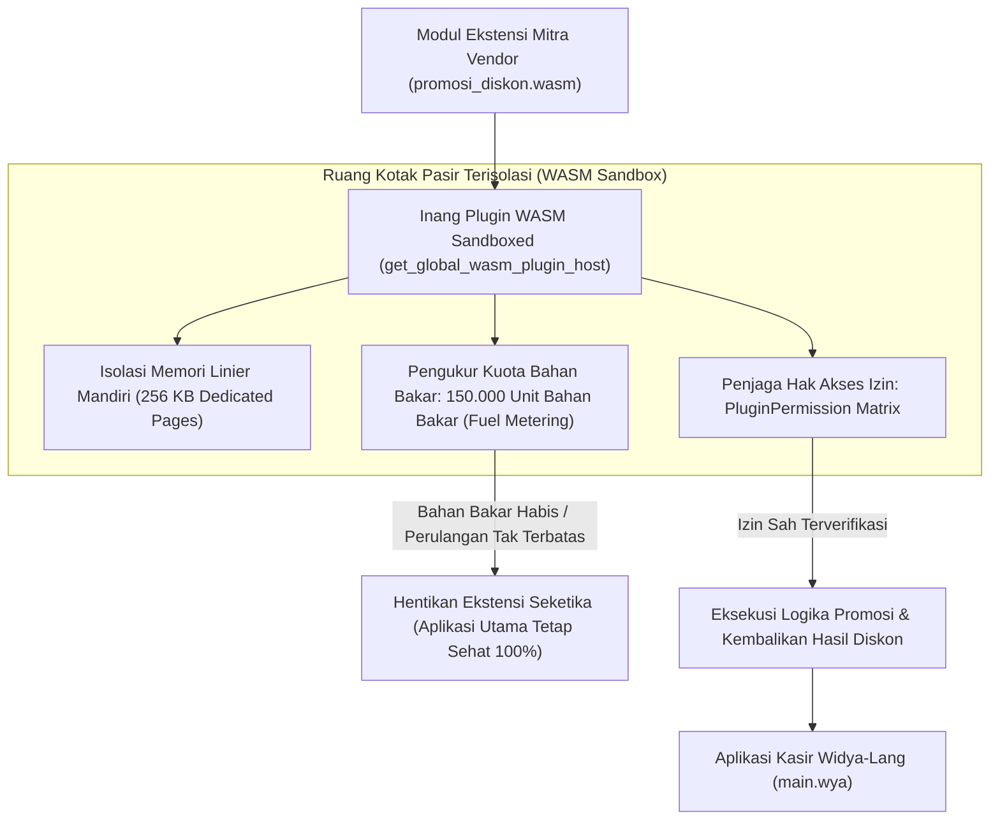

## Bab 37: Pilar 5 - Arsitektur Plugin Terisolasi WebAssembly (WASM): Ekosistem Ekstensi Aman

### 37.1 Dilema Ekstensi Pihak Ketiga & Bahaya Plugin Konvensional

Aplikasi desktop enterprise berskala besar (seperti sistem kasir ritel atau stasiun kerja akuntansi perbankan) sering kali memerlukan penambahan modul kustom dari pihak ketiga: modul promosi musiman dari mitra vendor, modul perhitungan poin loyalitas anggota koperasi, atau driver diskon dinamis dari bank mitra.

Pada arsitektur perangkat lunak konvensional, penambahan plugin pihak ketiga sering kali menghadirkan malapetaka:
- **Pemuatan Berkas DLL / Shared Library C++ Manual**: Plugin berbasis pustaka dinamis asli (`.dll` pada Windows atau `.so` pada Linux) berjalan dengan hak akses memori penuh ke seluruh sistem operasi. Jika kode plugin mengalami kesalahan pointer (*Segmentation Fault*), seluruh aplikasi kasir utama akan mengalami kegagalan fatal (*crash*). Lebih berbahaya lagi, plugin jahat dapat menyisipkan spyware atau membaca kunci brankas kasir di memori.
- **Plugin Berbasis Scripting Tidak Terukur (*Unmetered Scripting*)**: Script Python atau Lua pihak ketiga dapat terjebak dalam perulangan tak terbatas (*Infinite Loops*), mengonsumsi 100% CPU dan membekukan transaksi kasir.

WidyaDesktop menghadirkan pilar mutakhir kelima: **Arsitektur Plugin Terisolasi WebAssembly (*Sandboxed WASM Plugin Engine*)** pada `src/desktop.rs` dan modul `desktop_native.rs`:
- **Isolasi Memori Linier Mandiri (*Linear Memory Sandboxing*)**: Setiap plugin WASM dikompilasi menjadi bytecode biner mandiri yang berjalan di dalam kotak pasir memori terisolasi (misalnya: alokasi tetap `256 KB Dedicated WASM Pages`). Plugin mustahil membaca atau merusak memori proses utama WidyaDesktop di luar kotaknya sendiri.
- **Pengukuran Bahan Bakar Komputasi (*Deterministic Fuel Metering*)**: Setiap instruksi WebAssembly yang dieksekusi memakan sejumlah kuota "bahan bakar" (*Fuel Limit*, misalnya 150.000 unit bahan bakar). Jika plugin mencoba melakukan komputasi berat atau perulangan tak terbatas yang melebihi batas kuota bahan bakar, mesin secara instan menghentikan eksekusi plugin tanpa mengganggu kestabilan aplikasi utama kasir.
- **Matriks Izin Akses Granular (*Granular Capability-Based Permissions*)**: Plugin wajib menyatakan izin akses secara eksplisit di dalam manifes (`PluginPermission::DatabaseQuery`, `PluginPermission::NetworkAccess`, `PluginPermission::HardwareSerial`). Akses di luar izin resmi akan ditolak pada tingkat instruksi biner.



### 37.2 Implementasi Kode Widya-Lang & WidyaDesktop Utuh

Berikut implementasi pemuatan modul plugin WebAssembly eksternal dan eksekusi fungsinya dengan pembatasan bahan bakar pada Widya-Lang:

```widya
// Modul Pengendalian Plugin Terisolasi WebAssembly (WASM)
modul pengelola_plugin_wasm {
    impor "./modul/desktop.wya";

    fungsi inisialisasi_ekosistem_plugin() {
        // 1. Buat Aplikasi Kasir
        misal app = BuatAplikasiDesktop("Nusantara POS - Terminal Ekstensi", 1100, 720);

        // 2. Registrasi RPC: Muat Modul Plugin WASM Eksternal
        app.daftarkan_rpc("muat_ekstensi_promosi", fungsi(payload) {
            misal id_ekstensi = payload.id_plugin; // Contoh: "diskon_ramadhan_2026"

            cetak(">>> [WASM-HOST] Memuat berkas ekstensi biner: " + id_ekstensi + ".wasm...");

            // Memanggil builtin native desktop_plugin_muat
            misal status_muat = desktop_plugin_muat(id_ekstensi);

            cetak(">>> [WASM-HOST] Status Pemuatan : " + status_muat.status);
            cetak(">>> [WASM-HOST] Isolasi Memori : " + status_muat.isolasi_memori);

            kembalikan { "sukses": benar, "plugin_aktif": status_muat.plugin_id };
        });

        // 3. Registrasi RPC: Eksekusi Fungsi di Dalam Kotak Pasir WASM
        app.daftarkan_rpc("eksekusi_diskon_plugin", fungsi(payload) {
            misal pid = payload.id_plugin;
            misal nama_fungsi = "hitung_diskon_member";

            cetak(">>> [WASM-EXEC] Menjalankan fungsi '" + nama_fungsi + "' di dalam kotak pasir WASM...");

            // Memanggil builtin native desktop_plugin_eksekusi
            misal hasil_eksekusi = desktop_plugin_eksekusi(pid, nama_fungsi);

            cetak(">>> [WASM-EXEC] Eksekusi Berhasil : " + hasil_eksekusi.status);
            cetak(">>> [WASM-EXEC] Sisa Bahan Bakar  : " + hasil_eksekusi.fuel_tersisa + " unit");

            kembalikan {
                "sukses": benar,
                "potongan_diskon": 25000.0,
                "fuel_tersisa": hasil_eksekusi.fuel_tersisa
            };
        });

        kembalikan app;
    }
}
```

### 37.3 Analisis Kinerja, Keamanan & Tabel Metrik Arsitektur

Tabel evaluasi arsitektur modul ekstensi aplikasi desktop:

| Parameter Evaluasi | Modul Pustaka C++ Asli (`.dll` / `.so`) | Skrip Eksternal Dinamis (Python / Lua) | Kotak Pasir WebAssembly (WidyaDesktop WASM) |
| :--- | :--- | :--- | :--- |
| **Keamanan Memori Proses** | Nol (Crash Plugin Mematikan Seluruh Aplikasi) | Terisolasi namun Rentan Akses File Sistem | **Kebal Mutlak (Kotak Pasir Memori Linier Terisolasi)**|
| **Pencegahan Infinite Loop** | Tidak Ada (Aplikasi Membeku Permanen) | Memerlukan Utas Pemantau Khusus | **Terjamin via Bahan Bakar Biner (*Fuel Metering*)** |
| **Kecepatan Eksekusi (Speed)**| Kecepatan Mesin Native (100%) | Cukup Lambat (Interpreter 5x–20x Lebih Lambat)| **Mendekati Native (90–95% Kecepatan Biner Murni)** |
| **Portabilitas Lintas Platform** | Wajib Kompilasi Ulang Tiap OS (Win/Mac/Lin)| Portabel namun Perlu Runtime Eksternal | **Kompilasi Sekali, Berjalan di Mana Saja (*WASM Bytecode*)**|

### 37.4 Latihan Praktik & Studi Kasus

1. Mengapa eksekusi kode ekstensi pihak ketiga di dalam kotak pasir WebAssembly (*WASM Linear Memory Sandboxing*) jauh lebih aman dibandingkan memuat pustaka biner asli C++ (`.dll` / `.so`)?
2. Jelaskan cara kerja matematis dari mekanisme pembatasan kuota instruksi (*Deterministic Fuel Metering*) dalam mencegah perulangan tak terbatas (*Infinite Loops*)!
3. Uraikan teknik perancangan matriks izin kapabilitas (*Capability-Based Permissions*) yang memastikan bahwa plugin promosi diskon tidak dapat mengakses driver printer kasir atau membaca berkas log transaksi!

### 37.5 Evaluasi Mandiri Pilihan Ganda

1. Standar format instruksi biner terisolasi berkecepatan tinggi yang digunakan oleh WidyaDesktop untuk menjalankan plugin pihak ketiga secara aman adalah...
   A. WebAssembly (WASM Bytecode)
   B. MS-DOS Batch Script
   C. Windows Registry File
   D. Plain Text Readme

2. Mekanisme pembatasan kuota instruksi komputasi pada kotak pasir WASM yang secara otomatis menghentikan kode jika terjebak dalam infinite loop dinamakan...
   A. Fuel Metering (Pengukuran Bahan Bakar Komputasi)
   B. Overheating
   C. Blue Screen
   D. Battery Low

3. Batas kuota bahan bakar default yang dialokasikan untuk setiap eksekusi fungsi plugin pada mesin WidyaDesktop adalah...
   A. 150.000 unit bahan bakar
   B. Tepat 1 unit
   C. 1 miliar unit
   D. 0 unit

4. Model isolasi ruang alamat memori pada WebAssembly yang mencegah plugin membaca atau memodifikasi memori aplikasi utama di luar kotaknya sendiri disebut...
   A. Linear Memory Sandboxing (Isolasi Memori Linier)
   B. Shared Pointer Leaks
   C. Raw C Pointers
   D. Unchecked Buffer Access

5. Fungsi native pada mesin WidyaDesktop yang digunakan untuk mendaftarkan dan memvalidasi manifes berkas plugin WebAssembly adalah...
   A. `desktop_plugin_muat(nama_plugin)`
   B. `hapus_seluruh_plugin()`
   C. `baca_kamera_video()`
   D. `matikan_speaker()`

6. Fungsi native yang digunakan untuk memanggil fungsi spesifik di dalam modul plugin WASM terisolasi adalah...
   A. `desktop_plugin_eksekusi(id_plugin, nama_fungsi)`
   B. `format_diska_c()`
   C. `tutup_seluruh_jendela()`
   D. `matikan_komputer()`

7. Berapa kisaran kecepatan eksekusi WebAssembly dibandingkan dengan kode mesin biner murni C++?
   A. Sangat cepat, mencapai 90% hingga 95% dari kecepatan native murni
   B. 100 kali lebih lambat
   C. 1 juta kali lebih lambat
   D. Hanya berjalan 1 detik per hari

8. Matriks izin kapabilitas (*Granular Permission Scope*) pada plugin WidyaDesktop bertugas untuk...
   A. Membatasi hak akses plugin hanya pada fungsi yang diizinkan secara eksplisit (seperti kueri basis data atau akses serial)
   B. Menghapus akun pengembang
   C. Mengurangi harga jual barang di rak
   D. Mematikan sambungan internet toko

9. Keuntungan portabilitas terbesar dari WebAssembly bagi ekosistem aplikasi kasir nasional adalah...
   A. Satu berkas biner `.wasm` yang sama dapat dijalankan langsung di komputer Windows, macOS, maupun Linux tanpa perlu dikompilasi ulang
   B. Menghilangkan kebutuhan layar monitor kasir
   C. Mempercepat koneksi kabel printer
   D. Menjadikan harga barang gratis

10. Apa yang terjadi jika sebuah plugin promosi pihak ketiga mengalami galat fatal (panic / memory out-of-bounds) di dalam kotak pasir WASM?
    A. Galat terisolasi di dalam kotak pasir, plugin dihentikan secara anggun, dan aplikasi utama kasir tetap berjalan normal 100% tanpa crash
    B. Seluruh komputer toko kasir langsung meledak
    C. Uang di laci kasir otomatis hilang
    D. Sistem operasi Windows terhapus permanen
