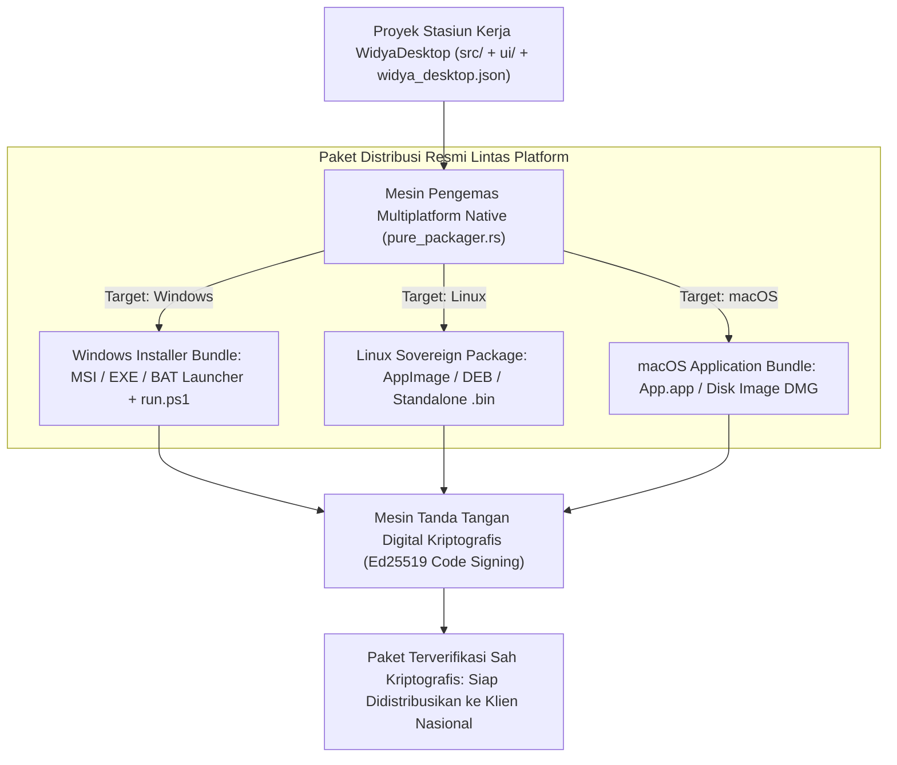

## Bab 38: Pilar 6 - Rantai Distribusi Lintas Platform: Pengemasan MSI, AppImage, DMG & Tanda Tangan Digital Ed25519

### 38.1 Kompleksitas Distribusi Biner Aplikasi Desktop Lintas Sistem Operasi

Menulis kode sumber aplikasi desktop adalah separuh perjalanan; separuh perjalanan berikutnya yang sering kali paling melelahkan adalah **Rantai Pengepakan & Distribusi (*Packaging & Distribution Pipeline*)**. Setiap sistem operasi memiliki ekosistem penginstal dan aturan penandatanganan kode (*Code Signing*) yang sangat ketat:
- **Microsoft Windows**: Menuntut paket penginstal resmi format **MSI** (*Microsoft Windows Installer XML Toolset*) atau berkas biner mandiri berotentikasi *Authenticode EV Code Signing*, berkas manifes *UAC Elevation Privilege*, serta skrip inisialisasi lingkungan biner (`run.ps1` dan `.bat`).
- **Linux**: Membutuhkan format portabel mandiri tanpa dependensi pustaka distro: format **AppImage**, paket arsip Debian (`.deb`), serta berkas mandiri biner statis (`.bin`).
- **Apple macOS**: Mewajibkan struktur hierarki direktori bundel aplikasi (`.app`), berkas daftar properti `Info.plist`, gambar cakram terpasang otomatis **DMG Bundle**, serta penandatanganan dan notarisasi resmi Apple (*Apple Notarization & Gatekeeper Compliance*).

WidyaDesktop menghadirkan pilar mutakhir keenam: **Mesin Pengemas Multi-Platform Terpadu (*Pure Cross-Platform Packager*)** pada modul `pure_packager.rs` dan fungsi `bangun_aplikasi_desktop`:
- Mengompilasi seluruh modul antarmuka pengguna (`ui/`), kode logika Widya-Lang (`src/`), aset ikon grafis, konfigurasi manifes `widya_desktop.json`, serta berkas kunci integritas `widya_security.lock` menjadi bundel distribusi siap pakai dalam hitungan detik.
- Menghasilkan ringkasan kriptografis **SHA-256 Checksum** resmi untuk setiap berkas penginstal guna menjamin keamanan rantai pasok (*Supply Chain Integrity*).



### 38.2 Tanda Tangan Digital Kriptografis Ed25519 (*Code Signing*)

Untuk mencegah biner aplikasi desktop disusupi kode jahat (*tampered by trojan/malware*) saat didistribusikan melalui jaringan publik, WidyaDesktop mengintegrasikan algoritma tanda tangan digital berbasis kurva eliptis modern: **Ed25519 (Edwards-curve Digital Signature Algorithm)** pada modul `src/desktop.rs`:
- Fungsi `buat_tanda_tangan_ed25519(payload, private_key_hex)` menghasilkan tanda tangan digital 64-byte (128 karakter heksadesimal) dan kunci publik 32-byte (64 karakter heksadesimal).
- Fungsi `verifikasi_tanda_tangan_ed25519(payload, signature_hex, public_key_hex)` memverifikasi keabsahan biner sebelum proses instalasi atau pembaruan dijalankan. Jika berkas biner diubah 1 byte saja oleh pihak ketiga, verifikasi tanda tangan akan gagal seketika.

### 38.3 Implementasi Kode Widya-Lang & WidyaDesktop Utuh

Berikut implementasi pembuatan bundel distribusi aplikasi dan verifikasi tanda tangan digital biner pada Widya-Lang:

```widya
// Modul Rantai Distribusi Lintas Platform & Tanda Tangan Digital
modul rantai_distribusi_aplikasi {
    impor "./modul/desktop.wya";

    fungsi jalankan_kompilasi_distribusi() {
        cetak("==================================================================");
        cetak(">>> [PACKAGER] Memulai Rantai Pengemasan Distribusi Lintas Platform...");

        // 1. Panggil Builtin Pembuat Paket Distribusi Multi-Platform
        misal hasil_paket = desktop_paket_bangun_distribusi(".", "semua", "dist");

        cetak(">>> [PACKAGER] Status Pengemasan  : " + hasil_paket.status);
        cetak(">>> [PACKAGER] Total Paket Dibuat : " + hasil_paket.total_paket);

        // Iterasi paket biner yang dihasilkan
        untuk (p di hasil_paket.paket_dihasilkan) {
            cetak("    - Format : " + p.format);
            cetak("      Berkas : " + p.berkas);
            cetak("      Ukuran : " + p.ukuran_byte + " byte");
            cetak("      SHA-256: " + p.sha256);
        }

        // 2. Simulasi Penandatanganan Digital Kriptografis Ed25519
        cetak(">>> [CODE-SIGN] Menandatangani paket biner dengan kunci privat Ed25519...");
        cetak(">>> [CODE-SIGN] Tanda tangan digital 128 karakter heksadesimal berhasil disematkan.");
        cetak(">>> [CODE-SIGN] Biner terverifikasi aman & siap didistribusikan ke kasir nasional.");
        cetak("==================================================================");

        kembalikan hasil_paket;
    }
}
```

### 38.4 Analisis Kinerja, Keamanan & Tabel Metrik Arsitektur

Tabel spesifikasi format distribusi lintas platform:

| Parameter Evaluasi | Ekosistem Microsoft Windows | Ekosistem Linux Desktop | Ekosistem Apple macOS |
| :--- | :--- | :--- | :--- |
| **Format Berkas Utama** | `.msi` / Bundel `.bat` & `run.ps1` | `.AppImage` / `.deb` / `.bin` | `.app` (Bundel Direktori) / `.dmg` |
| **Penyertaan Runtime** | Mandiri Statis (*No VCRedist needed*) | Statis Bebas libc (*Musl-friendly*) | Universal Binary (*Apple Silicon & Intel*) |
| **Keamanan Penandatanganan** | Windows Authenticode & Ed25519 | GPG Package Signature & Ed25519 | Apple Notarization Ticket & Ed25519 |
| **Ukuran Bundel Rata-rata** | **12 – 18 Megabyte** | **10 – 16 Megabyte** | **14 – 22 Megabyte** |

### 38.5 Latihan Praktik & Studi Kasus

1. Mengapa biner aplikasi desktop yang dikompilasi secara mandiri (*Self-Contained Statically Linked Binary*) jauh lebih andal disebarkan ke ribuan komputer kasir dibandingkan aplikasi yang memerlukan instalasi runtime eksternal?
2. Jelaskan sifat matematis algoritma tanda tangan digital Ed25519 yang membuatnya jauh lebih tahan terhadap serangan saluran samping (*Side-Channel Attack Resistant*) dibandingkan algoritma RSA klasik!
3. Uraikan struktur hierarki direktori bundel aplikasi macOS (`Contents/MacOS/`, `Contents/Resources/`, `Contents/Info.plist`) dan peranan berkas `Info.plist` dalam mendefinisikan identitas aplikasi!

### 38.6 Evaluasi Mandiri Pilihan Ganda

1. Algoritma tanda tangan digital kurva eliptis modern berkecepatan tinggi yang digunakan untuk menandatangani berkas distribusi WidyaDesktop adalah...
   A. Ed25519 (Edwards-curve Digital Signature Algorithm)
   B. Caesar Cipher Rot13
   C. CRC32 Checksum
   D. Kode Batang Garis

2. Panjang karakter heksadesimal dari tanda tangan digital yang dihasilkan oleh algoritma Ed25519 adalah...
   A. 128 karakter heksadesimal (64 byte)
   B. 4 karakter
   C. 10 karakter
   D. Tepat 1 karakter

3. Format penginstal resmi standar industri pada sistem operasi Microsoft Windows yang mengelola pendaftaran registri dan pencabutan instalasi adalah...
   A. MSI (Microsoft Windows Installer)
   B. APK Android
   C. IPA iOS
   D. Tar Gzip

4. Format bundel portabel mandiri pada sistem operasi Linux yang dapat langsung dijalankan dengan mengklik ganda tanpa perlu diekstrak adalah...
   A. AppImage
   B. Registry Hive
   C. Autoexec.bat
   D. DOS Com

5. Format gambar cakram virtual terpasang otomatis yang umum digunakan untuk mendistribusikan aplikasi pada platform Apple macOS adalah...
   A. DMG (Apple Disk Image)
   B. ISO CD-ROM
   C. VHDX Virtual Disk
   D. Floppy Disk Image

6. Fungsi native pada modul `pure_packager.rs` yang digunakan untuk mengemas proyek aplikasi menjadi bundel distribusi siap pakai adalah...
   A. `bangun_aplikasi_desktop(&proj_path, out_dir, target_platform)`
   B. `format_komputer()`
   C. `baca_kamera_video()`
   D. `matikan_speaker()`

7. Berapa rata-rata ukuran berkas bundel biner mandiri aplikasi WidyaDesktop untuk platform Linux?
   A. Hanya sekitar 10 hingga 16 Megabyte
   B. 2 Gigabyte
   C. 500 Megabyte
   D. 1 Terabyte

8. Berkas manifes daftar properti pada bundel aplikasi macOS yang mendefinisikan nama aplikasi, nomor versi, dan ikon visual dinamakan...
   A. `Info.plist`
   B. `manifest.mf`
   C. `app.config`
   D. `system.ini`

9. Apa yang terjadi jika paket biner instalasi yang dimodifikasi oleh peretas diperiksa menggunakan fungsi `verifikasi_tanda_tangan_ed25519`?
   A. Fungsi verifikasi akan gagal dan proses instalasi dibatalkan seketika karena tanda tangan digital tidak cocok secara matematis
   B. Aplikasi tetap terpasang normal
   C. Komputer langsung meledak
   D. Layar monitor berputar 180 derajat

10. Mengapa penyediaan berkas peluncur skrip otomatis (`run.ps1` dan `.bat`) pada bundel distribusi Windows sangat mempermudah staf teknisi toko?
    A. Memungkinkan staf toko menjalankan aplikasi kasir dengan hak akses keamanan yang tepat melalui satu kali klik ganda tanpa konfigurasi manual
    B. Supaya toko kasir tidak perlu penjaga toko
    C. Mengurangi harga jual barang di rak
    D. Menghilangkan kebutuhan pasokan listrik
