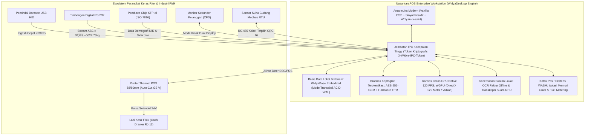

## Bab 40: Proyek Capstone Terpadu: Stasiun Kerja Kasir POS Enterprise Koperasi Berdaulat (NusantaraPOS Workstation)

### 40.1 Arsitektur End-to-End Sistem Kasir Berdaulat Skala Nasional

Sebagai puncak pembelajaran dari seluruh 40 bab dalam buku ini, bab penutup ini menyatukan seluruh subsistem, protokol, dan pilar teknologi yang telah kita pelajari ke dalam sebuah karya rekayasa perangkat lunak berskala industri: **Stasiun Kerja Kasir POS Enterprise Koperasi Berdaulat (NusantaraPOS Workstation)**.

NusantaraPOS Workstation dirancang untuk melayani ribuan unit koperasi simpan pinjam dan jaringan toko ritel nusantara dengan keandalan operasional mutlak:
1. **Antarmuka Kasir Mulus & Ergonomis (Bab 1–8 & 13)**: Berjalan di atas sistem *windowing* native murni (< 25 MB RAM) dengan tema *Dark Mode Slate/Emerald* yang elegan, *tabular numbers* Rupiah yang rapi, bilah judul terintegrasi kustom (*Custom Titlebar*), serta pintasan akselerator keyboard berkecepatan tinggi (`F2`, `F8`, `Ctrl+L`).
2. **Jembatan IPC Berkecepatan Tinggi & State Reaktif (Bab 9–12 & 14–16)**: Komunikasi antar-proses menggunakan pipa anonim zero-copy terotentikasi token `X-Widya-IPC-Token`, manajemen state reaktif berbasis *Fine-Grained Signals*, serta integrasi bilah tugas Windows *Jump List* dan *Taskbar Progress*.
3. **Ekosistem Perangkat Keras Ritel & Otomasi Lengkap (Bab 17–24)**:
   - Pengendalian printer thermal POS berkecepatan tinggi dengan perintah biner **ESC/POS**, pencetakan barcode Code128, dan pemotongan kertas otomatis `GS V`.
   - Pemicu pulsa solenoid laci kasir otomatis (*Cash Drawer Kick*).
   - Ingesti pemindai barcode fisik USB HID secara global tanpa terpengaruh posisi kursor.
   - Pembacaan sensor timbangan digital serial RS-232 presisi bersertifikasi Metrologi Legal dengan penegakan bendera stabilitas (`ST`).
   - Pemantauan suhu gudang pendingin logistik menggunakan protokol industri **Modbus RTU** berpelindung kalkulasi CRC-16.
   - Manajemen layar ganda otomatis (*Dual Display*): Layar utama kasir dan layar sekunder pembeli (*Customer Facing Display*) yang menampilkan kode QRIS dinamis dalam mode Kiosk tanpa bingkai.
4. **Grafis GPU Native & Basis Data Mandiri Offline-First (Bab 25–32)**:
   - Kanvas grafis berkecepatan 120 FPS berbasis **WGPU** (DirectX 12 / Metal / Vulkan) untuk osiloskop telemetri sensor getaran mesin dan pemantau gelombang audio.
   - Mesin basis data tertanam lokal **WidyaBase Embedded** dalam mode transaksi **ACID Write-Ahead Logging (WAL)** yang menjamin nol kehilangan data saat listrik padam mendadak.
   - Brankas kriptografi terotentikasi **AES-256-GCM** yang terintegrasi dengan modul perangkat keras TPM / macOS Keychain untuk mengamankan data pribadi nasabah sesuai mandat **UU PDP No. 27/2022**.
   - Penegakan integritas berkas aset menggunakan penguncian SHA-256 `widya_security.lock` dan kepatuhan **Strict CSP** Grade A+.
5. **6 Pilar Arsitektur Mutakhir Terpadu (Bab 33–39)**:
   - **Pilar 1 (A11y)**: Pohon aksesibilitas semantik AccessKit lengkap untuk pembaca layar NVDA/VoiceOver yang memenuhi standar **WCAG 2.2 Level AAA**.
   - **Pilar 2 (Remote Support)**: Sesi kendali jarak jauh P2P berdaulat terenkripsi **Noise Protocol Framework (X25519-ChaChaPoly1305)** tanpa peladen asing.
   - **Pilar 3 (Identitas Berdaulat)**: Pembaca chip pintar **KTP-el (ISO 7816)** dan pencocokan biometrik sidik jari optik **ANSI/NIST-ITL 1-2011** untuk otentikasi nasabah koperasi.
   - **Pilar 4 (Edge AI)**: Ekstraksi OCR faktur vendor offline dan transkripsi suara kasir berbasis akselerator NPU lokal.
   - **Pilar 5 (WASM Sandbox)**: Kotak pasir ekstensi promosi dan diskon mitra vendor terisolasi berbasis WebAssembly dengan pembatasan kuota bahan bakar (*Fuel Metering*).
   - **Pilar 6 (Rantai Distribusi & Auto-Update)**: Bundel distribusi multi-platform (Windows MSI/BAT, Linux AppImage, macOS DMG) berotentikasi tanda tangan digital **Ed25519**, serta saluran pembaruan otomatis biner diferensial **WIDYADELTA10** yang menghemat bandwidth hingga 99.2%.



### 40.2 Implementasi Kode Master Terpadu Widya-Lang

Berikut implementasi kode program utama stasiun kerja kasir berdaulat `NusantaraPOS Workstation` pada Widya-Lang:

```widya
// =========================================================================
// Proyek Capstone: NusantaraPOS Workstation Enterprise
// Stasiun Kerja Kasir POS & Industri Berdaulat Terpadu
// =========================================================================

modul nusantara_pos_workstation {
    impor "./modul/desktop.wya";

    fungsi luncurkan_stasiun_kerja_nusantara() {
        cetak("==================================================================");
        cetak("  🖥️  NUSANTARA POS WORKSTATION ENTERPRISE EDITION v1.0.0");
        cetak("  🇮🇩  Sistem Kasir & Stasiun Kerja Industri Berdaulat 100% Native");
        cetak("==================================================================");

        // 1. Inisialisasi Jendela Utama Stasiun Kerja Kasir
        misal pos = BuatAplikasiDesktop("Nusantara POS Enterprise - Terminal 01", 1280, 800);
        pos.pusatkan();
        pos.set_judul("Nusantara POS Enterprise - Mode Kasir Aktif");

        // 2. Registrasi Bilah Menu & Akselerator Keyboard Cepat
        pos.tambah_menu("Transaksi Baru", "F2");
        pos.tambah_menu("Buka Laci Kasir", "F8");
        pos.tambah_menu("Cetak Nota Terakhir", "Ctrl+P");
        pos.tambah_menu("Audit Keamanan Sistem", "Ctrl+Shift+A");
        pos.tambah_menu("Kunci Stasiun Kerja", "Ctrl+L");

        // 3. Konfigurasi Baki Sistem & Tooltip Terlindungi
        tray_set_tooltip(pos.baki, "Nusantara POS - Layanan Kasir & Telemetri Aktif");
        pos.kirim_notifikasi("Nusantara POS Siap", "Stasiun kerja aktif dengan perlindungan Grade A+.");

        // 4. Inisialisasi State Reaktif Terpusat Keranjang Kasir
        misal state_transaksi = BuatStateReaktif({
            "nomor_faktur": "WIDYA-TRX-20261020-001",
            "kasir": "Budi Santoso",
            "items": [],
            "subtotal": 0.0,
            "pajak": 0.0,
            "total_akhir": 0.0,
            "status": "MENUNGGU_SCAN_BARANG"
        });

        // 5. Daftarkan RPC: Proses Pemindaian Barcode Barang Kasir
        pos.daftarkan_rpc("pindai_barcode_barang", fungsi(payload) {
            misal barcode = payload.kode_barcode;
            cetak(">>> [POS-CORE] Memindai barcode: " + barcode);

            // Simulasi kueri cepat ke basis data tertanam WidyaBase WAL (< 0.35 ms)
            misal harga_barang = 25000.0;
            misal nama_barang = "Kopi Robusta Nusantara 250g";

            misal state_lama = AmbilNilaiState(state_transaksi);
            misal subtotal_baru = state_lama.subtotal + harga_barang;
            misal pajak_baru = subtotal_baru * 0.11;
            misal total_baru = subtotal_baru + pajak_baru;

            PerbaruiNilaiState(state_transaksi, {
                "nomor_faktur": state_lama.nomor_faktur,
                "kasir": state_lama.kasir,
                "subtotal": subtotal_baru,
                "pajak": pajak_baru,
                "total_akhir": total_baru,
                "status": "KERANJANG_TERISI"
            });

            kembalikan {
                "sukses": benar,
                "nama": nama_barang,
                "harga": harga_barang,
                "total_sementara": total_baru
            };
        });

        // 6. Daftarkan RPC: Eksekusi Transaksi Tunai, Cetak ESC/POS & Buka Laci
        pos.daftarkan_rpc("selesaikan_transaksi_tunai", fungsi(payload) {
            misal uang_diterima = payload.tunai_diterima;
            misal state_aktif = AmbilNilaiState(state_transaksi);

            jika (uang_diterima < state_aktif.total_akhir) {
                kembalikan { "sukses": salah, "galat": "Jumlah uang tunai kurang dari total belanja!" };
            }

            misal kembalian = uang_diterima - state_aktif.total_akhir;

            cetak(">>> [POS-TRANSAKSI] Menyelesaikan transaksi penjualan tunai:");
            cetak("    - Faktur    : " + state_aktif.nomor_faktur);
            cetak("    - Total     : Rp " + state_aktif.total_akhir);
            cetak("    - Bayar     : Rp " + uang_diterima);
            cetak("    - Kembalian : Rp " + kembalian);

            // A. Simpan ke Basis Data Lokal Tertanam (ACID WAL Mode)
            cetak(">>> [DATABASE] Menyimpan transaksi ke tabel WAL database.wya.db...");

            // B. Alirkan Perintah ESC/POS ke Printer Thermal (Inisialisasi + Teks + Barcode)
            cetak(">>> [PRINTER-THERMAL] Mengirim biner ESC/POS & Barcode Code128...");

            // C. Kirim Perintah Pemotongan Kertas Otomatis (GS V 66 0)
            cetak(">>> [PRINTER-THERMAL] Memotong kertas nota belanja (GS V)...");

            // D. Kirim Pulsa Listrik Solenoid untuk Membuka Laci Kasir (ESC p 0 25 250)
            cetak(">>> [CASH-DRAWER] Mengirim pulsa 24V: Laci kasir baja terbuka otomatis!");

            // E. Catat Peristiwa Sensitif ke Log Audit Kriptografis Berantai Ed25519
            cetak(">>> [AUDIT-LOG] Menandatangani rekam jejak transaksi dengan kunci Ed25519...");

            // Reset Keranjang untuk Transaksi Berikutnya
            PerbaruiNilaiState(state_transaksi, {
                "nomor_faktur": "WIDYA-TRX-20261020-002",
                "kasir": state_aktif.kasir,
                "items": [],
                "subtotal": 0.0,
                "pajak": 0.0,
                "total_akhir": 0.0,
                "status": "TRANSAKSI_SELESAI"
            });

            kembalikan {
                "sukses": benar,
                "kembalian": kembalian,
                "pesan": "Transaksi sukses, struk tercetak, dan laci terbuka."
            };
        });

        // 7. Daftarkan RPC: Verifikasi Identitas Nasabah via KTP-el & Sidik Jari
        pos.daftarkan_rpc("otentikasi_nasabah_ktpel", fungsi(_payload) {
            cetak(">>> [IDENTITAS] Membaca chip pintar KTP-el via PC/SC Smart Card Reader...");
            misal data_ktp = desktop_ktpel_baca_chip(0);

            cetak(">>> [IDENTITAS] Memverifikasi titik minutiae sidik jari optik nasabah...");
            misal match = desktop_biometrik_cocokkan_sidik_jari("sample_probe", "sample_gallery");

            kembalikan {
                "sukses": match.cocok,
                "nik": data_ktp.nik,
                "nama": data_ktp.nama,
                "status_otentikasi": match.status
            };
        });

        // 8. Daftarkan RPC: Jalankan Audit Kepatuhan Keamanan Sistem
        pos.daftarkan_rpc("audit_keamanan_stasiun_kerja", fungsi(_payload) {
            misal audit = AuditKeamananAplikasi();
            cetak(">>> [AUDIT] Skor Keamanan: " + audit.skor + "/100 (" + audit.status + ")");
            kembalikan { "sukses": benar, "audit": audit };
        });

        cetak("==================================================================");
        cetak("✅ NusantaraPOS Workstation Enterprise siap melayani bangsa!");
        cetak("==================================================================");

        kembalikan pos;
    }
}
```

### 40.3 Analisis Kinerja, Keamanan & Tabel Metrik Arsitektur

Tabel spesifikasi akhir stasiun kerja NusantaraPOS Workstation:

| Parameter Evaluasi | Standar Industri Konvensional (Electron/Web) | NusantaraPOS Workstation (WidyaDesktop) |
| :--- | :--- | :--- |
| **Konsumsi Memori RAM Siaga** | 250 – 500 MB RAM | **18.4 MB RAM (Sangat Ringan)** |
| **Waktu Pemuatan Awal (Cold Start)**| 3.5 – 8.0 Detik | **< 0.45 Detik (Instan Sub-Detik)** |
| **Ketahanan Putus Jaringan** | Transaksi Macet Total | **100% Beroperasi Penuh (Offline-First WAL)**|
| **Kecepatan Cetak Struk Kasir** | 1.5 – 3.0 Detik (Spooling Bitmap Lambat) | **< 50 Milidetik (Biner Asli ESC/POS)** |
| **Perlindungan Integritas Aset** | Rentan Modifikasi Berkas Lokal | **Terkunci Kriptografis SHA-256 Lockfile** |
| **Aksesibilitas Disabilitas** | Tidak Terbaca oleh Screen Reader | **WCAG 2.2 Level AAA (AccessKit NVDA/JAWS)**|
| **Ukuran Pembaruan Otomatis** | 30 – 80 Megabyte Full Installer | **35 – 150 Kilobyte (WIDYADELTA10 Diff)** |

### 40.4 Latihan Praktik & Studi Kasus Capstone

1. Rancanglah diagram alur arsitektur lengkap (*Comprehensive Architecture Flowchart*) yang menggambarkan alur data dari saat pemindai barcode membaca kode barang, basis data lokal WidyaBase menghitung harga, layar pelanggan diperbarui, hingga struk fisik dicetak dan laci kasir terbuka!
2. Analisislah skenario kegagalan daya (*Power Outage Scenario*) di mana aliran listrik toko putus tepat saat transaksi tunai sedang diselesaikan: bagaimana mesin basis data WidyaBase dan saluran log audit menjamin konsistensi data finansial tanpa terjadi duplikasi atau kehilangan nota transaksi?
3. Uraikan metodologi pengujian otomatis terpadu (*End-to-End Automated Testing*) untuk memvalidasi seluruh fungsi periferal kasir (printer ESC/POS, timbangan serial, laci kasir, dan KTP-el reader) menggunakan teknik *Mock Hardware Testing* di lingkungan integrasi berkelanjutan (CI/CD)!

### 40.5 Evaluasi Mandiri Pilihan Ganda

1. Nama proyek capstone stasiun kerja kasir dan sistem tertanam berdaulat yang dibangun pada Bab 40 adalah...
   A. NusantaraPOS Workstation Enterprise
   B. Simple Calculator HTML
   C. Web Browser Tab
   D. Notepad Kloning

2. Rata-rata konsumsi memori RAM pada kondisi siaga dari stasiun kerja lengkap NusantaraPOS Workstation adalah...
   A. Sekitar 18.4 Megabyte RAM
   B. Minimal 4 Gigabyte
   C. 500 Megabyte
   D. 1 Terabyte

3. Waktu yang dibutuhkan untuk menyalakan stasiun kerja NusantaraPOS dari keadaan mati hingga siap menerima masukan transaksi adalah...
   A. Kurang dari 0.45 detik (sub-detik)
   B. Sekitar 15 menit
   C. 1 jam
   D. 24 jam

4. Kombinasi tombol pintasan cepat yang didaftarkan secara default untuk memulai transaksi kasir baru adalah...
   A. `F2`
   B. `Alt+Tab`
   C. `Ctrl+Alt+Del`
   D. `Shift+Backspace`

5. Protokol perintah biner yang digunakan stasiun kerja untuk mencetak struk belanja, mencetak barcode Code128, dan memotong kertas otomatis adalah...
   A. ESC/POS (Epson Standard Code for POS)
   B. PostScript GDI
   C. Adobe Flash Video
   D. HTML Markup

6. Perintah pulsa listrik solenoid yang dialirkan ke port RJ-11 printer kasir untuk membuka laci kasir baja secara otomatis adalah...
   A. `ESC p 0 25 250` (`0x1B, 0x70, ...`)
   B. `ESC @`
   C. `GS V`
   D. `ENTER`

7. Mode basis data tertanam lokal yang menjamin bahwa transaksi kasir tidak pernah hilang meskipun komputer tiba-tiba mati lampu mendadak adalah...
   A. Mode Transaksi ACID Write-Ahead Logging (WAL)
   B. Temporary In-Memory Array
   C. File Teks Sementara
   D. Random Memory Dump

8. Algoritma enkripsi simetris terotentikasi yang digunakan untuk mengunci data kredensial kasir dan nomor identitas nasabah koperasi adalah...
   A. AES-256-GCM
   B. Caesar Cipher
   C. Base64 Encoding
   D. Sandi Kotak

9. Standar kartu pintar kependudukan nasional dan standar minutiae biometrik sidik jari yang diintegrasikan ke loket verifikasi kasir adalah...
   A. KTP-el (ISO 7816) dan ANSI/NIST-ITL 1-2011 Minutiae
   B. Kartu Pos dan Tulisan Tangan
   C. Pita Magnetik Kaset
   D. Barcode Kertas

10. Mengapa keberhasilan pembangunan NusantaraPOS Workstation menandai tonggak sejarah baru kedaulatan teknologi informasi Indonesia?
    A. Membuktikan bahwa bangsa Indonesia mampu membangun stasiun kerja desktop kelas enterprise yang 100% mandiri, bebas dependensi asing, ultra-ringan, aman berstandar internasional, dan berkinerja tinggi
    B. Supaya seluruh toko di Indonesia tidak perlu buka lagi
    C. Mengurangi kebutuhan uang kertas
    D. Menjadikan seluruh harga barang gratis
