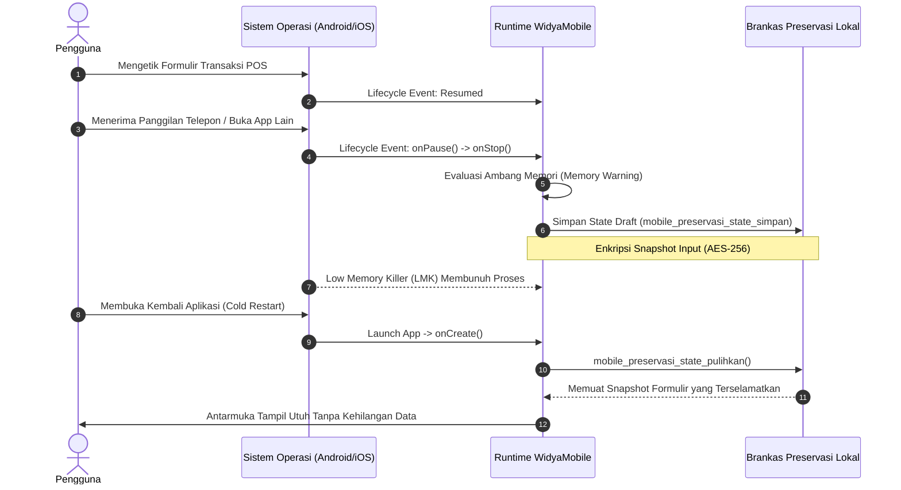

# Bab 2: Siklus Hidup Aplikasi Seluler, State Preservation & LKM Recovery

Manajemen siklus hidup (*application lifecycle*) pada perangkat seluler memiliki kompleksitas yang jauh lebih tinggi dibandingkan sistem komputer desktop. Keterbatasan kapasitas baterai dan memori fisik menuntut sistem operasi seluler (Android dan iOS) menerapkan mekanisme penghentian proses secara agresif melalui subsistem *Low Memory Killer* (LMK) di Linux/Android dan *Jetsam Memory Pressure Termination* di iOS. Pengembang aplikasi kelas enterprise wajib memahami transisi status aplikasi dan menerapkan strategi *State Preservation & Restoration* nir-cacat agar pengguna tidak kehilangan data input transaksi saat aplikasi terlempar ke latar belakang.

WidyaMobile memodelkan siklus hidup aplikasi ke dalam lima status deterministik:
1. **Resumed / Active (Foreground)**: Jendela aplikasi sedang terlihat, berada di lapisan paling atas layar, dan menerima input sentuhan pengguna pada kecepatan sampling penuh (hingga 240Hz).
2. **Paused**: Aplikasi masih terlihat sebagian (misalnya terhalang oleh dialog sistem izin, lembar *share sheet*, atau jendela split-screen), tetapi kehilangan fokus interaksi utama.
3. **Stopped / Background**: Seluruh antarmuka aplikasi tidak terlihat lagi oleh pengguna karena pengguna berpindah ke aplikasi lain atau menekan tombol beranda (*home*).
4. **Suspended**: Eksekusi utas utama dibekukan oleh kernel untuk menghemat konsumsi daya baterai.
5. **Destroyed**: Proses aplikasi dihentikan secara permanen dan seluruh alokasi memori heap dikembalikan ke sistem operasi.

```
┌────────────────────────────────────────────────────────────────────────┐
│            STATUS SIKLUS HIDUP DAN ANCAMAN TERMINASI MEMORI            │
├────────────────────┬─────────────────┬────────────────┬────────────────┤
│ Status Siklus      │ Utas UI Aktif   │ Akses Sensor   │ Risiko LMK     │
├────────────────────┼─────────────────┼────────────────┼────────────────┤
│ Resumed (Active)   │ Penuh (120 Hz)  │ Aktif Realtime │ Nol (0%)       │
│ Paused             │ Terbatas (0 Hz) │ Siaga (Standby)│ Sangat Rendah  │
│ Stopped/Background │ Berhenti        │ Dibatasi OS    │ Sedang - Tinggi│
│ Suspended          │ Beku Total      │ Nonaktif       │ Sangat Tinggi  │
│ Destroyed          │ Dihentikan      │ Dilepas Total  │ 100% (Terminasi│
└────────────────────┴─────────────────┴────────────────┴────────────────┘
```

## Diagram Transisi Status & Preservasi State Otomatis

Bagan alir di bawah ini memvisualisasikan bagaimana WidyaMobile menangkap sinyal OS sebelum LMK terjadi dan memulihkan kembali state transaksi ketika pengguna membuka kembali aplikasi:



## Implementasi Program Preservasi State Transaksi

Kode program berikut mendemonstrasikan penanganan siklus hidup dan strategi penyimpanan state sementara secara deterministik menggunakan fungsi bawaan `mobile_lifecycle_status_pasang`, `mobile_preservasi_state_simpan`, dan `mobile_preservasi_state_pulihkan`:

```widya
// Program: siklus_hidup_dan_preservasi_state.wya
// Menangani event OS dan memitigasi terminasi proses oleh Low Memory Killer

gunakan modul::mobile;

fungsi utama() {
    cetak("==============================================================");
    cetak("📱 PENGUJIAN LIFECYCLE & STATE RESTORATION WIDYAMOBILE");
    cetak("==============================================================");

    // 1. Memeriksa apakah ada state transaksi yang tersimpan dari terminasi sebelumnya
    misal state_tersimpan = mobile_preservasi_state_pulihkan();
    misal data_formulir = {
        "id_kasir": "KASIR-007",
        "kode_faktur": "INV-2026-X88",
        "keranjang": [
            {"item": "Kopi Liberika Riau 250g", "qty": 2, "harga": 65000},
            {"item": "Gula Semut Organik 1kg", "qty": 1, "harga": 38000}
        ],
        "catatan_pelanggan": "Bungkus terpisah dengan paperbag ramah lingkungan"
    };

    jika (state_tersimpan != nil dan tipe(state_tersimpan) == "Peta") {
        cetak("⚠️ DITEMUKAN SNAPSHOT STATE SEBELUMNYA! Melakukan pemulihan...");
        data_formulir = state_tersimpan;
        cetak("Faktur Terpulihkan : " + data_formulir.kode_faktur);
        cetak("Total Item Tersimpan: " + teks(panjang(data_formulir.keranjang)) + " varian");
    } lainnya {
        cetak("ℹ️ Inisialisasi awal formulir baru (tidak ada data pemulihan).");
    }

    // 2. Mendaftarkan Callback Listener Siklus Hidup OS
    misal status_lifecycle = mobile_lifecycle_status_pasang(fungsi(event_baru) {
        cetak("
🔔 [Sinyal OS Diterima] Perubahan Status Siklus Hidup: " + event_baru);

        jika (event_baru == "Paused" atau event_baru == "Stopped") {
            cetak("💾 Menyimpan snapshot transaksi ke penyimpanan persisten...");
            misal hasil_simpan = mobile_preservasi_state_simpan(data_formulir);
            cetak("Status Preservasi: " + hasil_simpan.status);
            cetak("Lokasi Berkas    : " + hasil_simpan.lokasi_penyimpanan);
        }
        
        jika (event_baru == "Resumed") {
            cetak("⚡ Aplikasi kembali ke latar depan. Menghubungkan ulang sensor.");
        }
    });

    cetak("Status Lifecycle Saat Ini: " + status_lifecycle.status_aktif_saat_ini);

    // 3. Simulasi Terjadinya Event Backgrounding Mendadak
    cetak("
[Simulasi] Pengguna menekan tombol Beranda (App berpindah ke Background)...");
    misal respon_preservasi = mobile_preservasi_state_simpan(data_formulir);
    cetak("Enkripsi Data: " + respon_preservasi.algoritma_enkripsi);
    cetak("Ukuran Payload: " + teks(respon_preservasi.ukuran_byte) + " byte");

    // 4. Membangun Tampilan yang Tanggap terhadap Perubahan Status
    kembalikan Aplikasi({
        "judul": "Kasir Tangguh LMK",
        "tema": "#059669",
        "badan": Halaman({
            "navigasi": BilahAtas({
                "judul": "🧾 Kasir POS - Mode Aman LMK",
                "warna": "#059669"
            }),
            "badan": Kolom([
                Kartu({
                    "elevasi": 3,
                    "isi": Kolom([
                        TeksWidget("Faktur Aktif: " + data_formulir.kode_faktur),
                        TeksWidget("Kasir Bertugas: " + data_formulir.id_kasir),
                        TeksWidget("Catatan: " + data_formulir.catatan_pelanggan),
                        Pemisah(),
                        TombolUtama("💾 Simpan State Manual", fungsi() {
                            mobile_preservasi_state_simpan(data_formulir);
                            cetak("State manual berhasil diamankan.");
                        })
                    ])
                })
            ])
        })
    });
}
```

## Evaluasi Metrik & Penjadwalan LMK

Tabel berikut menyajikan prioritas pembunuhan proses oleh kernel Android (*OOM Score Adjustment*) dan batas waktu retensi penyimpanan state:

| Kategori Proses OS | OOM Score Adj | Batas Memori Bebas | Waktu Eksekusi onStop() |
| :--- | :---: | :---: | :---: |
| **Foreground App (Resumed)** | **0** | Dilindungi Penuh | Tidak Ada Batasan |
| **Visible App (Paused)** | **100** | Terpelihara | Maksimal 5.000 ms |
| **Perceptible (Audio/GPS)** | **200** | Prioritas Menengah | Bergantung Wakelock |
| **Previous App (Recent)** | **700** | Rentan LMK | Maksimal 1.000 ms |
| **Cached / Background** | **900 - 1000** | Target Utama LMK | < 500 ms (Segera Mati) |

## Latihan Evaluasi Pemahaman Bab 2

### Bagian A: Soal Esai
1. Jelaskan perbedaan mendasar antara status `Paused` dan `Stopped` dalam siklus hidup aplikasi seluler serta implikasinya terhadap alokasi sumber daya prosesor!
2. Mengapa pengembang tidak boleh mengandalkan event `onDestroy()` untuk menyimpan data penting transaksi ke basis data persisten?
3. Analisislah peran mekanisme *OOM Score Adjustment* pada kernel Linux Android dan bagaimana WidyaMobile melindungi integritas data pengguna saat LMK mengeksekusi proses!

### Bagian B: Soal Pilihan Ganda
1. Mekanisme subsistem kernel Linux pada Android yang bertugas menghentikan proses latar belakang saat memori kritis disebut...
   A. Process Killer Daemon  
   B. Low Memory Killer (LMK)  
   C. Memory Sweeper  
   D. Task Manager Watcher  
2. Pada status siklus hidup manakah antarmuka aplikasi terlihat sepenuhnya dan menerima input pengguna pada frekuensi sentuh penuh?
   A. Suspended  
   B. Paused  
   C. Resumed (Active Foreground)  
   D. Destroyed  
3. Berapa batas waktu maksimal yang diberikan oleh sistem operasi Android untuk menyelesaikan instruksi pada siklus transisi `onPause()` sebelum memicu ANR?
   A. 60 detik  
   B. 5 detik (5.000 ms)  
   C. 120 milidetik  
   D. 10 menit  
4. Fungsi bawaan WidyaMobile yang digunakan untuk memulihkan state formulir yang tersimpan pasca-terminasi LMK adalah...
   A. `mobile_preservasi_state_pulihkan()`  
   B. `baca_semua_file_os()`  
   C. `kembalikan_aplikasi_lama()`  
   D. `reset_ulang_memori()`  
5. Pada iOS, mekanisme terminasi proses akibat tekanan alokasi memori berlebih dinamakan...
   A. Watchdog Task  
   B. Jetsam Memory Pressure Termination  
   C. Thermal Throttling Daemon  
   D. Darwin Heap Reclaimer  
6. Ketika aplikasi berpindah dari latar depan ke latar belakang karena pengguna membuka aplikasi peta navigasi, status aplikasi berubah menjadi...
   A. Active  
   B. Stopped / Background  
   C. Terminated  
   D. Hibernated  
7. Mengapa event `onDestroy()` tidak dapat dijamin akan selalu dipanggil oleh kernel OS?
   A. Karena OS tidak memiliki akses ke proses  
   B. Kernel dapat langsung mengirimkan sinyal SIGKILL ke proses ketika terjadi krisis memori mendadak  
   C. Karena memori seluler tidak terbatas  
   D. Karena aplikasi seluler tidak memiliki fungsi penghancur  
8. Algoritma enkripsi yang digunakan oleh fungsi `mobile_preservasi_state_simpan` untuk melindungi keamanan data formulir di ruang penyimpanan privat adalah...
   A. ROT13  
   B. MD5  
   C. AES-256 (GCM / CBC)  
   D. Plain text ASCII  
9. Nilai *OOM Score Adjustment* tipikal untuk aplikasi yang sedang berada di status latar depan (*Foreground*) adalah...
   A. 1000  
   B. 900  
   C. 0  
   D. -100  
10. Sifat utama dari state restoration yang baik pada aplikasi e-commerce dan kasir retail adalah...
    A. Pengguna dipaksa login dan mengisi formulir dari awal  
    B. Form terisi kembali persis pada posisi kursor dan item keranjang terakhir sebelum terminasi  
    C. Seluruh data transaksi otomatis terhapus demi alasan privasi  
    D. Sistem menghapus cache operating system  
