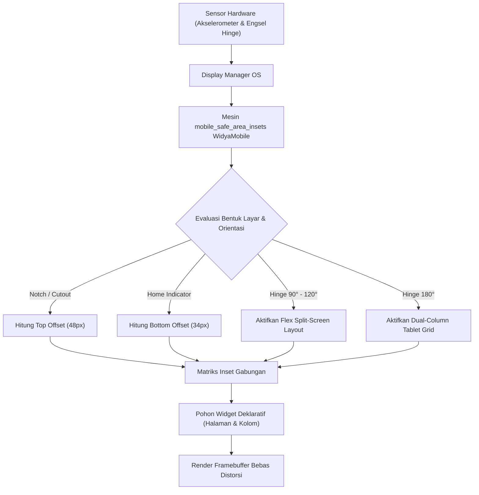

# Bab 3: Tata Letak Adaptif, Safe Area Insets & Layar Lipat (Foldables)

Lanskap perangkat keras seluler modern ditandai oleh keragaman bentuk fisik layar yang sangat dinamis. Layar ponsel pintar tidak lagi berbentuk persegi panjang sempurna dengan sudut siku-siku, melainkan dilengkapi dengan sudut membulat (*rounded display corners*), takik kamera depan (*camera cutout/notch*), pulau interaktif dinamis (*Dynamic Island*), hingga indikator navigasi gestur sistem di bagian bawah (*Home Indicator Bar*). Lebih jauh lagi, hadirnya kategori perangkat layar lipat (*Foldable & Rollable Devices*) memperkenalkan tantangan geometris baru berupa perubahan rasio aspek secara drastis saat engsel dibuka atau ditutup (*hinge angle states*).

WidyaMobile menjawab tantangan ini melalui subsistem **Safe Area Inset Engine** dan **Adaptive Foldable Controller** yang terintegrasi langsung pada modul inti `src/stdlib/mobile_native.rs`. Pengembang tidak perlu melakukan perhitungan offset piksel secara manual atau menulis kode bercabang (*if-else*) yang rapuh untuk setiap tipe perangkat.

```
┌────────────────────────────────────────────────────────────────────────┐
│             ANATOMI GEOMETRI LAYAR MODERN & INSET AREA AMAN            │
├────────────────────────────────────────────────────────────────────────┤
│  [Top Inset (48px)]   ──>  [ Camera Cutout / Dynamic Island Notch ]    │
│  ┌──────────────────────────────────────────────────────────────────┐  │
│  │                                                                  │  │
│  │                  SAFE AREA CANVAS (AREA AMAN)                    │  │
│  │                                                                  │  │
│  │        Seluruh elemen interaktif, tombol sentuh, teks,           │  │
│  │        dan formulir input WAJIB berada di dalam zona ini         │  │
│  │                                                                  │  │
│  └──────────────────────────────────────────────────────────────────┘  │
│  [Bottom Inset (34px)]──>  [ Home Indicator Bar / Gesture Bar Area ]   │
└────────────────────────────────────────────────────────────────────────┘
```

Secara garis besar, terdapat empat wilayah *insets* utama yang dikalkulasi secara otomatis oleh runtime WidyaMobile:
1. `top_notch_inset_px`: Jarak vertikal aman dari tepi fisik atas layar guna menghindari takik kamera depan, speaker earpiece, maupun Dynamic Island (tipikal: 44–59 piksel pada iPhone dan 24–48 piksel pada Android).
2. `bottom_home_indicator_px`: Jarak vertikal aman dari tepi bawah layar untuk memastikan elemen tombol navigasi tidak tertekan secara tidak sengaja bersamaan dengan gestur *swipe-up* sistem operasi (tipikal: 34 piksel pada iOS dan 16–28 piksel pada Android).
3. `left_px` & `right_px`: Jarak horizontal aman saat perangkat berada dalam orientasi lanskap (*landscape mode*), melindungi antarmuka dari kurva lengkung layar tepi (*curved edge displays*).
4. `hinge_angle_degrees`: Sudut lipatan engsel perangkat lipat (0° = Tertutup/Cover Screen, 90°–120° = Mode Tenda/Flex Mode, 180° = Terbuka Datar Penuh/Tablet Mode).

## Diagram Alir Penataan Tata Letak Adaptif

Diagram berikut mengilustrasikan bagaimana subsistem tata letak WidyaMobile merespons perubahan orientasi fisik dan sudut engsel layar:



## Implementasi Program Tata Letak Layar Lipat & Safe Area

Berikut adalah implementasi lengkap aplikasi yang mengadaptasi antarmukanya secara dinamis terhadap keberadaan takik Dynamic Island dan status engsel perangkat lipat:

```widya
// Program: tata_letak_safe_area_dan_foldable.wya
// Menangani Safe Area Insets dan orientasi adaptif perangkat layar lipat

gunakan modul::mobile;

fungsi utama() {
    cetak("==============================================================");
    cetak("📐 KALIBRASI GEOMETRI SAFE AREA & ENGSEL LAYAR LIPAT");
    cetak("==============================================================");

    // 1. Membaca Safe Area Insets dari Subsistem Native
    misal tipe_cutout = "Dynamic Island / Punch Hole";
    misal orientasi_layar = "Portrait";
    misal info_geometri = mobile_safe_area_insets(tipe_cutout, orientasi_layar);

    misal insets = info_geometri.safe_area_insets;
    cetak("Tipe Potongan Layar : " + info_geometri.display_cutout_type);
    cetak("Orientasi Fisik     : " + info_geometri.orientasi);
    cetak("Inset Atas (Top)    : " + teks(insets.top_notch_inset_px) + " px");
    cetak("Inset Bawah (Bottom): " + teks(insets.bottom_home_indicator_px) + " px");
    cetak("Sudut Engsel Hinge  : " + teks(info_geometri.hinge_angle_degrees) + "°");

    // 2. Logika Adaptif Berdasarkan Sudut Engsel (Flex Mode vs Flat Mode)
    misal mode_tampilan = "Ponsel Standar (Single Screen)";
    jika (info_geometri.hinge_angle_degrees >= 80.0 dan info_geometri.hinge_angle_degrees <= 135.0) {
        mode_tampilan = "Flex Mode (Layar Lipat Sudut Laptop / Tenda)";
        cetak("⚡ MODE ENGSEL TERDETEKSI: Mengaktifkan tata letak terbelah atas-bawah.");
    } atau_jika (info_geometri.hinge_angle_degrees > 135.0 dan info_geometri.hinge_angle_degrees <= 180.0) {
        mode_tampilan = "Unfolded Tablet Mode (Layar Luas Penuh)";
        cetak("🖥️ LAYAR TERBUKA PENUH: Mengaktifkan tata letak multi-kolom.");
    }

    // 3. Merakit Antarmuka Adaptif yang Menghormati Insets
    kembalikan Aplikasi({
        "judul": "Antarmuka Adaptif Foldable",
        "tema": "#6366f1",
        "badan": Halaman({
            "navigasi": BilahAtas({
                "judul": "📐 " + mode_tampilan,
                "warna": "#6366f1"
            }),
            "badan": Kolom([
                Kartu({
                    "elevasi": 3,
                    "isi": Kolom([
                        TeksWidget("🔍 Parameter Geometri Perangkat:"),
                        TeksWidget("• Status Engsel: " + teks(info_geometri.hinge_angle_degrees) + " Derajat"),
                        TeksWidget("• Area Bebas Sentuh Atas: " + teks(insets.top_notch_inset_px) + " px"),
                        TeksWidget("• Area Bebas Gestur Bawah: " + teks(insets.bottom_home_indicator_px) + " px"),
                        Pemisah()
                    ])
                }),
                Kartu({
                    "elevasi": 2,
                    "isi": Kolom([
                        TeksWidget("🎯 Kompensasi Konten Otomatis:"),
                        TeksWidget("Elemen UI secara otomatis menambahkan bantalan internal"),
                        TeksWidget("(padding) sebesar insets sehingga tidak terpotong kamera."),
                        Pemisah(),
                        TombolUtama("🔄 Simulasi Rotasi Layar Lanskap", fungsi() {
                            misal info_l = mobile_safe_area_insets("Display Notch", "Landscape");
                            cetak("Rotasi Baru Diterapkan: " + info_l.orientasi);
                            cetak("Inset Samping Kiri: " + teks(info_l.safe_area_insets.left_px) + " px");
                        })
                    ])
                })
            ])
        })
    });
}
```

## Evaluasi Metrik & Spesifikasi Inset Perangkat

Tabel berikut menyajikan nilai inset aman tipikal dari berbagai kelas perangkat keras populer di pasaran:

| Perangkat Acuan | Tipe Cutout | Top Inset | Bottom Inset | Fitur Engsel Hinge |
| :--- | :--- | :---: | :---: | :---: |
| **iPhone 15 / 16 Pro** | Dynamic Island Pill | 59 px | 34 px | Tidak Ada (Bar Phone) |
| **Galaxy S24 Ultra** | Centered Punch Hole | 38 px | 24 px | Tidak Ada (Bar Phone) |
| **Galaxy Z Fold 6** | Under-Display Camera | 32 px | 28 px | Hinge Sensor 0° - 180° |
| **Pixel 9 Pro Fold** | Corner Punch Hole | 42 px | 26 px | Dual-Screen Posture API |
| **Ponsel Entry Level** | Waterdrop Notch | 28 px | 16 px | Tidak Ada (Bar Phone) |

## Latihan Evaluasi Pemahaman Bab 3

### Bagian A: Soal Esai
1. Jelaskan bahaya arsitektural yang terjadi apabila aplikasi menempatkan tombol aksi krusial (misalnya tombol "Konfirmasi Transfer") di luar batas *Safe Area Insets* bagian bawah!
2. Bagaimana mekanisme perhitungan *Safe Area Insets* berubah ketika perangkat diputar dari orientasi tegak (*portrait*) ke orientasi mendatar (*landscape*)?
3. Uraikan bagaimana pengembang aplikasi WidyaMobile dapat memanfaatkan sudut engsel (*hinge angle degrees*) untuk menyajikan pengalaman multi-jendela (*Flex Mode*) pada ponsel layar lipat!

### Bagian B: Soal Pilihan Ganda
1. Wilayah layar yang dijamin bebas dari gangguan takik kamera, Dynamic Island, dan bar navigasi sistem disebut...
   A. Viewport Buffer  
   B. Safe Area Inset  
   C. Display Frame  
   D. Hidden Canvas  
2. Nilai tipikal *bottom inset* pada perangkat iPhone dengan gestur navigasi tanpa tombol fisik adalah...
   A. 0 px  
   B. 34 px  
   C. 120 px  
   D. 4 px  
3. Fungsi resmi WidyaMobile yang digunakan untuk mengkalkulasi inset area aman dan status engsel perangkat adalah...
   A. `mobile_safe_area_insets()`  
   B. `hitung_ukuran_layar_manual()`  
   C. `ambil_resolusi_kamera()`  
   D. `periksa_driver_vga()`  
4. Pada sudut engsel engsel (*hinge angle*) berapakah sebuah perangkat layar lipat biasanya memasuki postur *Flex Mode* (setengah terlipat)?
   A. 0 derajat  
   B. 90 s/d 120 derajat  
   C. 180 derajat  
   D. 360 derajat  
5. Apa dampak visual yang terjadi apabila nilai `top_notch_inset_px` diabaikan oleh tata letak aplikasi?
   A. Aplikasi berhenti mendadak (*crash*)  
   B. Judul bilah atas atau tombol kembali tertutup secara fisik oleh takik kamera atau Dynamic Island  
   C. Warna layar berubah menjadi hitam putih  
   D. Speaker telepon mati  
6. Pada orientasi lanskap (*landscape*), parameter inset manakah yang mengalami penambahan kompensasi piksel untuk menghindari sudut layar melengkung?
   A. left_px dan right_px  
   B. bottom_px saja  
   C. alpha_channel  
   D. z_index  
7. Di bawah ini yang *bukan* merupakan bentuk fisik gangguan layar modern adalah...
   A. Camera punch hole  
   B. Dynamic Island  
   C. CRT Electron Gun Shadow  
   D. Rounded screen corners  
8. Pada perangkat lipat dengan sudut engsel 180°, tata letak antarmuka aplikasi idealnya beradaptasi menjadi...
   A. Tata letak layar tunggal sempit  
   B. Tata letak multi-kolom luas setara tablet (dual-pane / master-detail)  
   C. Mematikan layar sepenuhnya  
   D. Menampilkan bilah navigasi di keempat sisi  
9. Satuan pengukuran yang digunakan dalam kalkulasi inset `top_notch_inset_px` pada WidyaMobile adalah...
   A. Inch fisik  
   B. Density-independent Pixels (dp / pt)  
   C. Centimeter  
   D. Persentase lebar baterai  
10. Keunggulan penanganan Safe Area pada WidyaMobile dibandingkan pendekatan manual berbasis CSS media query adalah...
    A. Tidak membutuhkan parsing string CSS di runtime dan langsung terikat pada metrik subsistem native OS  
    B. Mengharuskan perangkat memiliki keyboard fisik  
    C. Mengurangi kualitas warna layar  
    D. Membatasi resolusi layar ke 720p  
