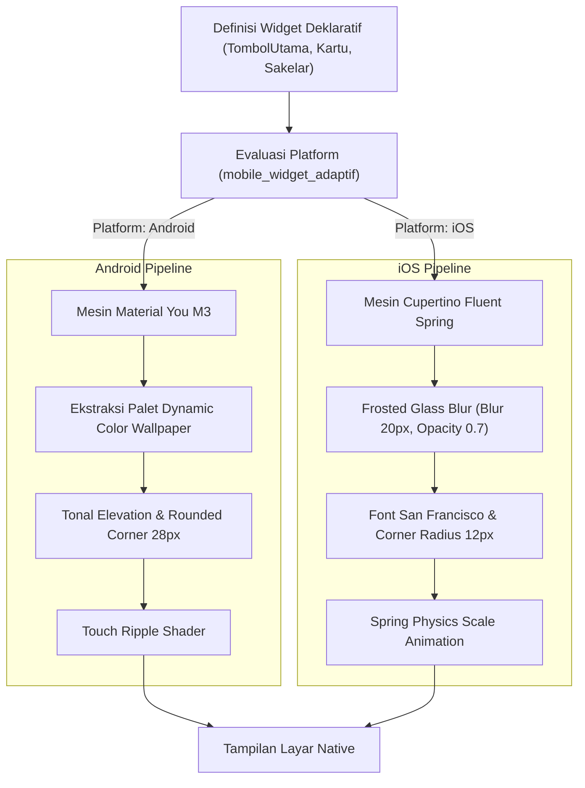

# Bab 4: Desain Sistem UI Adaptif: Material You M3 vs Cupertino Fluent Spring

Salah satu keunggulan terbesar dari ekosistem seluler modern adalah identitas visual yang khas pada masing-masing platform. Pengguna Android terbiasa dengan bahasa desain **Material 3 (Material You)** yang mengusung kurva membulat lembut, elevasi berbasis tonalitas warna, serta pewarnaan dinamis (*Dynamic Theming*) yang mengekstraksi palet warna dari wallpaper pengguna. Di sisi lain, pengguna iOS mengharapkan konsistensi visual **Cupertino (Apple Human Interface Guidelines)** yang menitikberatkan pada efek kaca tembus pandang (*vibrant blur & glassmorphism*), tipografi San Francisco yang presisi, dan navigasi berbasis bilah navigasi tersegmentasi.

Membuat dua basis kode terpisah untuk memenuhi selera desain masing-masing platform merupakan pemborosan sumber daya rekayasa perangkat lunak. WidyaMobile menghadirkan **Adaptive Widget Subsystem** melalui fungsi bawaan `mobile_widget_adaptif`. Komponen antarmuka yang dideklarasikan sekali dalam kode Widya-Lang secara otomatis merender estetika *Material You (Material 3)* ketika dijalankan pada Android, dan beralih secara mulus ke estetika *Cupertino Fluent Spring iOS 18* ketika dijalankan pada iPhone atau iPad.

```
┌────────────────────────────────────────────────────────────────────────┐
│           PERBANDINGAN PARADIGMA DESAIN SELULER MULTIPLATFORM          │
├──────────────────┬─────────────────────────┬───────────────────────────┤
│ Elemen Desain    │ Android Material You M3 │ iOS Cupertino Fluent      │
├──────────────────┼─────────────────────────┼───────────────────────────┤
│ Skema Warna      │ Dynamic Theming (Monet) │ System Tonal Accent       │
│ Lapisan Kedalaman│ Tonal Surface Elevation │ Translucent Frosted Glass │
│ Sudut Komponen   │ Membulat Besar (24-28px)│ Sudut Halus Khas (10-14px)│
│ Kontrol Navigasi │ Floating Bottom Bar     │ Translucent Tab Bar       │
│ Karakter Sakelar │ Pill-shaped Switch      │ Capsule Spring Toggle     │
│ Tipografi Utama  │ Roboto / Google Sans    │ San Francisco / New York  │
└──────────────────┴─────────────────────────┴───────────────────────────┘
```

Prinsip adaptif WidyaMobile tidak sekadar mengganti warna, melainkan merekonstruksi pohon render sesuai hierarki native masing-masing OS:
1. **Material You Engine (Android)**: Mengintegrasikan skema tonalitas warna permukaan (*Surface, Surface Container Low, Surface Container High*), efek riak sentuh (*touch ripple ink*), dan tombol melayang aksi utama (*Floating Action Button - FAB*).
2. **Cupertino Engine (iOS)**: Mengintegrasikan efek blur Gaussian dinamis (*Backdrop Filter Material*), kontrol tersegmentasi (*Segmented Controls*), bilah judul yang mengecil saat digulir (*Large Collapsible Navigation Title*), dan umpan balik haptik pegas halus (*spring haptics*).

## Diagram Alir Pipeline Render UI Adaptif

Bagan alir di bawah ini menjelaskan bagaimana pohon widget deklaratif Widya-Lang dipetakan secara dinamis ke mesin gaya masing-masing platform:



## Implementasi Program Widget Adaptif Lintas Platform

Berikut adalah kode sumber komprehensif yang mendemonstrasikan implementasi antarmuka yang beradaptasi secara otomatis antara gaya Material You M3 dan Cupertino:

```widya
// Program: desain_sistem_adaptif_m3_cupertino.wya
// Mengimplementasikan komponen UI adaptif lintas platform seluler

gunakan modul::mobile;

fungsi utama() {
    cetak("==============================================================");
    cetak("🎨 SISTEM DESAIN UI ADAPTIF: MATERIAL YOU VS CUPERTINO");
    cetak("==============================================================");

    // 1. Memeriksa Platform dan Mengaktifkan Mesin Desain Adaptif
    misal nama_widget = "KartuProfilKasir";
    misal target_os = "android"; // Dapat diuji dengan "android" atau "ios"
    
    misal konfigurasi_adaptif = mobile_widget_adaptif(nama_widget, target_os);
    misal engine_aktif = konfigurasi_adaptif.desain_adaptif.engine_design;
    cetak("Target Platform Terdeteksi : " + target_os);
    cetak("Mesin Desain yang Dipilih  : " + engine_aktif);

    // 2. Definisi Parameter Estetika Berdasarkan Mesin Aktif
    misal radius_sudut = 28;
    misal gaya_elevasi = "Tonal Surface Elevation (Material 3)";
    jika (target_os == "ios") {
        radius_sudut = 12;
        gaya_elevasi = "Ultra-Thin Frosted Glass Blur (Cupertino)";
    }

    cetak("Radius Sudut Komponen      : " + teks(radius_sudut) + " px");
    cetak("Karakter Kedalaman Visual  : " + gaya_elevasi);

    // 3. Membangun Antarmuka dengan Komponen Adaptif
    kembalikan Aplikasi({
        "judul": "Showcase Desain Adaptif",
        "tema": "#0284c7",
        "badan": Halaman({
            "navigasi": BilahAtas({
                "judul": "🎨 Desain: " + engine_aktif,
                "warna": "#0284c7"
            }),
            "badan": Kolom([
                Kartu({
                    "elevasi": 3,
                    "isi": Kolom([
                        TeksWidget("👤 Identitas Pengguna: Siti Aminah"),
                        TeksWidget("💼 Posisi: Supervisor Kasir Utama"),
                        TeksWidget("🎨 Mesin Render: " + engine_aktif),
                        Pemisah()
                    ])
                }),
                Kartu({
                    "elevasi": 2,
                    "isi": Kolom([
                        TeksWidget("⚙️ Preferensi Sistem Kasir:"),
                        SakelarWidget("Aktifkan Haptik Sentuh", benar),
                        SakelarWidget("Cetak Otomatis Struk Thermal", salah),
                        SakelarWidget("Mode Kontras Tinggi (A11y)", salah),
                        Pemisah(),
                        TombolAksiMengambangWidget("+")
                    ])
                }),
                LembarBawahWidget("Detail Pembayaran Cepat", Kolom([
                    TeksWidget("Metode: QRIS Dinamis"),
                    TeksWidget("Waktu Kadaluarsa: 300 Detik"),
                    TombolUtama("💳 Konfirmasi Pembayaran", fungsi() {
                        cetak("Pembayaran terverifikasi di mesin adaptif.");
                    })
                ]))
            ])
        })
    });
}
```

## Evaluasi Metrik & Spesifikasi Desain

Tabel di bawah ini merangkum aturan spesifikasi teknis antara Material You M3 dan Cupertino Fluent Spring pada runtime WidyaMobile:

| Elemen Antarmuka | Spesifikasi Material You M3 | Spesifikasi Cupertino Fluent iOS |
| :--- | :--- | :--- |
| **Corner Radius Kartu** | 24 – 28 dp | 10 – 14 pt |
| **Backdrop Blur** | Tidak digunakan (Solid Tonal) | Gaussian Blur 20pt + Saturation 1.8 |
| **Tombol Aksi Utama (CTA)** | FAB Melayang Sudut Bulat | Tombol Kapsul Penuh di Tengah Bawah |
| **Durasi Animasi Transisi** | 300 ms (Cubic Bezier Easing) | 400 ms (CASpringAnimation Physics) |
| **Umpan Balik Sentuh** | Radial Ripple Effect (Ink) | Opacity Fade-Down (0.6) + Haptic Click |

## Latihan Evaluasi Pemahaman Bab 4

### Bagian A: Soal Esai
1. Jelaskan mengapa pendekatan *one-size-fits-all* (memaksakan gaya antarmuka Android ke iOS atau sebaliknya) dapat menurunkan tingkat kepuasan pengguna (*user satisfaction*) aplikasi seluler!
2. Bagaimana mesin adaptif WidyaMobile (`mobile_widget_adaptif`) memisahkan antara struktur logika deklaratif dengan representasi visual spesifik platform?
3. Uraikan perbedaan mendasar antara teknik kedalaman visual berbasis *Tonal Elevation* pada Material 3 dengan *Frosted Glass Blur* pada Cupertino!

### Bagian B: Soal Pilihan Ganda
1. Bahasa desain antarmuka standar yang digunakan pada sistem operasi Android versi modern adalah...
   A. Metro UI  
   B. Material You (Material 3)  
   C. Aqua Interface  
   D. Skeuomorphic Leather  
2. Karakteristik visual utama yang membedakan komponen kartu pada gaya Cupertino iOS adalah...
   A. Efek kaca buram tembus pandang (*Frosted Glass / Vibrant Blur*)  
   B. Bayangan hitam pekat dengan radius 50px  
   C. Sudut tajam 90 derajat tanpa lengkungan  
   D. Garis tepi merah tebal  
3. Fungsi bawaan WidyaMobile yang digunakan untuk mengaktifkan pemetaan widget adaptif adalah...
   A. `mobile_widget_adaptif()`  
   B. `ganti_tema_layar()`  
   C. `set_warna_hex()`  
   D. `muat_file_css()`  
4. Pada Material You (M3), sumber ekstraksi warna dinamis (*Dynamic Theming / Monet Engine*) berasal dari...
   A. Warna wallpaper yang dipasang oleh pengguna di sistem operasi  
   B. Jam sistem komputer  
   C. Persentase kapasitas baterai  
   D. Lokasi GPS pengguna  
5. Bentuk fisik standar dari tombol aksi mengambang (*Floating Action Button - FAB*) pada Material 3 adalah...
   A. Persegi panjang tipis  
   B. Kotak membulat lembut (*rounded container*) atau lingkaran  
   C. Segitiga siku-siku  
   D. Bintang bersudut lima  
6. Animasi sentuhan khas yang terjadi saat tombol ditekan pada platform iOS Cupertino adalah...
   A. Efek tinta memancar (*ink ripple*)  
   B. Penurunan opasitas sesaat (*opacity fade-down*) yang dipadukan dengan fisika pegas  
   C. Layar berkedip tiga kali  
   D. Tombol berputar 360 derajat  
7. Tipografi standar yang digunakan secara native pada komponen antarmuka platform Apple iOS adalah...
   A. Comic Sans  
   B. San Francisco (SF Pro)  
   C. Times New Roman  
   D. Papyrus  
8. Komponen antarmuka yang menyajikan daftar pilihan tab secara tersegmentasi pada iOS disebut...
   A. Segmented Control  
   B. Android Spinner  
   C. Radio Box Group  
   D. Dropdown Menu  
9. Berapakah rentang nilai radius sudut (*corner radius*) tipikal untuk komponen kartu pada standar Material 3?
   A. 0 – 2 px  
   B. 24 – 28 px  
   C. 80 – 100 px  
   D. 4 – 6 px  
10. Keuntungan utama dari pendekatan widget deklaratif adaptif pada WidyaMobile adalah...
    A. Pengembang cukup menulis satu deklarasi logika UI, dan sistem otomatis merendernya sesuai konvensi OS masing-masing  
    B. Aplikasi hanya bisa berjalan di emulator  
    C. Kode program harus ditulis dua kali dalam bahasa berbeda  
    D. Membutuhkan compiler eksternal tambahan  
