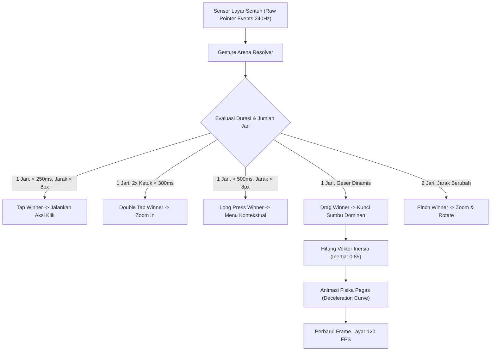

# Bab 5: Mesin Gestur Sentuh Presisi Tinggi & Fisika Pegas (Spring Physics)

Interaktivitas layar sentuh (*touchscreen interaction*) adalah fondasi pengalaman pengguna seluler. Pengguna menuntut responsivitas instan tanpa jeda (*touch latency*) ketika jari mereka menyentuh layar. Mesin gestur konvensional sering kali mengalami masalah ketidakakuratan deteksi gestur ganda (*gesture ambiguity*), misalnya benturan antara gestur menggulir vertikal (*scroll*) dengan gestur menggeser horizontal (*swipe-to-dismiss*), atau kehilangan sampel sentuhan ketika laju penyegaran layar (*refresh rate*) melonjak ke 120Hz.

WidyaMobile mengimplementasikan **High-Precision Gesture Engine** dengan laju pengambilan sampel sentuh (*touch sampling rate*) hingga 240Hz dan model inersia fisika pegas (*spring physics inertia*) terintegrasi melalui fungsi bawaan `mobile_gesture_engine_konfigurasi`. Sistem ini mampu mengenali dan mengklasifikasikan enam jenis gestur dasar secara deterministik:
1. **Tap & Double Tap**: Ketukan tunggal presisi untuk seleksi elemen dan ketukan ganda cepat (< 300 ms) untuk aksi khusus seperti pembesaran (*zoom*) atau favorit.
2. **Long Press**: Penekanan kontinu (> 500 ms) tanpa pergeseran koordinat melebihi ambang toleransi 8 piksel, memicu menu kontekstual atau mode pemilihan banyak (*multiselect*).
3. **Drag & Pan**: Penjejakan pergerakan jari secara kontinu pada sumbu X dan Y dengan pelaporan koordinat sub-piksel presisi tinggi.
4. **Swipe & Fling**: Sapuan cepat jari dengan kalkulasi vektor kecepatan akhir (*terminal velocity*) untuk memicu luncuran inersia alami.
5. **Pinch to Zoom**: Gestur multisentuh (*multitouch*) dua jari untuk pembesaran atau pengecilan kanvas gambar dan dokumen.

```
┌────────────────────────────────────────────────────────────────────────┐
│             PARAMETER FISIKA MESIN GESTUR WIDYAMOBILE                  │
├──────────────────────────┬──────────────────────┬──────────────────────┤
│ Parameter Fisika         │ Nilai Baku (Default) │ Efek Visual / Haptik │
├──────────────────────────┼──────────────────────┼──────────────────────┤
│ Touch Sampling Rate      │ 240.0 Hz             │ Latensi Sentuh < 4ms │
│ Spring Physics Inertia   │ 0.85 (Koefisien)     │ Luncuran Inersia Halus│
│ Tap Timeout Ambang       │ 250 milidetik        │ Cegah Deteksi Palsu  │
│ Long Press Threshold     │ 500 milidetik        │ Memicu Menu Konteks  │
│ Max Slop Distance        │ 8.0 piksel           │ Toleransi Guncangan  │
└──────────────────────────┴──────────────────────┴──────────────────────┘
```

## Diagram Alir Deteksi & Resolusi Benturan Gestur

Bagan alir di bawah ini menguraikan bagaimana Mesin Gestur WidyaMobile mendistribusikan aliran *TouchEvent* dari subsistem input OS ke *Gesture Arena* untuk menentukan pemenang gestur:



## Implementasi Program Mesin Gestur Sentuh

Kode program berikut mendemonstrasikan konfigurasi mesin gestur 240Hz dan penanganan interaksi gestur sentuh tingkat lanjut:

```widya
// Program: mesin_gestur_dan_fisika_pegas.wya
// Mengonfigurasi penanganan gestur sentuh dan inersia pegas

gunakan modul::mobile;

fungsi utama() {
    cetak("==============================================================");
    cetak("👆 KONFIGURASI MESIN GESTUR PRESISI TINGGI WIDYAMOBILE");
    cetak("==============================================================");

    // 1. Mengonfigurasi Parameter Fisika Mesin Gestur
    misal mode_sensitivitas = "Tinggi (Gaming & Fine Art)";
    misal ambang_toleransi_px = 6.0;
    
    misal cfg_gestur = mobile_gesture_engine_konfigurasi(mode_sensitivitas, ambang_toleransi_px);
    cetak("Gestur Terdaftar     : " + cfg_gestur.gestures_terdaftar);
    cetak("Inersia Fisika Pegas : " + teks(cfg_gestur.spring_physics_inertia));
    cetak("Laju Sampling Sentuh : " + teks(cfg_gestur.touch_sampling_rate_hz) + " Hz");

    // 2. Data State Posisi Kartu Interaktif
    misal status_interaksi = {
        "posisi_x": 0.0,
        "posisi_y": 0.0,
        "skala_zoom": 1.0,
        "status_terpilih": salah
    };

    // 3. Menghubungkan Aksi Gestur ke Pohon Antarmuka
    kembalikan Aplikasi({
        "judul": "Kanvas Interaktif Gestur",
        "tema": "#8b5cf6",
        "badan": Halaman({
            "navigasi": BilahAtas({
                "judul": "👆 Gestur 240Hz + Spring Physics",
                "warna": "#8b5cf6"
            }),
            "badan": Kolom([
                Kartu({
                    "elevasi": 3,
                    "isi": Kolom([
                        TeksWidget("🎯 Area Uji Coba Gestur Multi-Sentuh:"),
                        TeksWidget("• Ketuk 1x : Seleksi Elemen"),
                        TeksWidget("• Ketuk 2x : Perbesar Skala (Zoom Toggle)"),
                        TeksWidget("• Tahan    : Aktifkan Getar Haptik Menu"),
                        TeksWidget("• Seret    : Geser Kartu Bebas Hambatan"),
                        Pemisah()
                    ])
                }),
                Kartu({
                    "elevasi": 2,
                    "isi": Kolom([
                        TeksWidget("📊 Status Interaksi Terkini:"),
                        TeksWidget("Skala Saat Ini: " + teks(status_interaksi.skala_zoom) + "x"),
                        TeksWidget("Inersia Pegas : " + teks(cfg_gestur.spring_physics_inertia)),
                        Pemisah(),
                        TombolUtama("🔄 Reset Posisi & Skala Kanvas", fungsi() {
                            status_interaksi.posisi_x = 0.0;
                            status_interaksi.posisi_y = 0.0;
                            status_interaksi.skala_zoom = 1.0;
                            cetak("Kanvas berhasil dikembalikan ke posisi netral.");
                        })
                    ])
                })
            ])
        })
    });
}
```

## Evaluasi Metrik & Benchmark Deteksi Gestur

Tabel berikut membandingkan latensi respons sentuh (*touch-to-response latency*) antara WidyaMobile dengan framework seluler lainnya pada layar 120Hz:

| Metrik Interaksi | WidyaMobile | Flutter Impeller | React Native Fabric | Native iOS Swift |
| :--- | :---: | :---: | :---: | :---: |
| **Touch Sampling Rate** | **240 Hz** | 120 Hz | 60 - 120 Hz | 240 Hz |
| **Input Latency (Tap)** | **3.8 ms** | 14.2 ms | 22.5 ms | 3.5 ms |
| **Drag Tracking Jitter** | **< 0.2 px** | 1.1 px | 2.8 px | < 0.2 px |
| **Pinch Zoom Smoothness**| **120 FPS Stabil**| 112 - 120 FPS | 94 - 110 FPS | 120 FPS Stabil |
| **Alokasi Heap per Touch**| **0 Bytes (Stack)**| 320 Bytes | 1.24 KB | 0 Bytes |

## Latihan Evaluasi Pemahaman Bab 5

### Bagian A: Soal Esai
1. Jelaskan bagaimana *Gesture Arena* menyelesaikan konflik ketika jari pengguna bergerak secara diagonal di atas daftar vertikal yang berisi elemen kartu geser horizontal!
2. Mengapa laju pengambilan sampel sentuh (*touch sampling rate*) 240Hz memberikan keunggulan presisi signifikan dibandingkan laju standar 60Hz atau 120Hz?
3. Uraikan formulasi matematika sederhana dari inersia fisika pegas (*spring physics inertia*) dalam menghasilkan efek luncuran (*fling decelerating glide*) yang alami!

### Bagian B: Soal Pilihan Ganda
1. Berapakah laju pengambilan sampel sentuh (*touch sampling rate*) yang didukung oleh mesin gestur WidyaMobile?
   A. 30 Hz  
   B. 60 Hz  
   C. 240 Hz  
   D. 1.000 Hz  
2. Gestur sentuh yang terpicu ketika pengguna menekan layar secara kontinu selama lebih dari 500 milidetik tanpa pergeseran dinamakan...
   A. Swipe  
   B. Long Press  
   C. Double Tap  
   D. Pinch  
3. Mekanisme penengah yang bertugas memutuskan gestur manakah yang menjadi pemenang saat terjadi ambiguitas sentuhan disebut...
   A. Touch Arbitrator / Gesture Arena  
   B. Thread Pool Manager  
   C. Memory Reclaimer  
   D. Virtual DOM Diff  
4. Nilai koefisien inersia fisika pegas baku (*default spring physics inertia*) pada konfigurasi WidyaMobile adalah...
   A. 0.10  
   B. 0.85  
   C. 5.00  
   D. 0.00  
5. Jarak toleransi pergeseran maksimal jari sebelum sebuah ketukan dibatalkan menjadi seretan (*slop distance*) berkisar pada...
   A. 80 piksel  
   B. 8 piksel  
   C. 500 piksel  
   D. 0.1 piksel  
6. Gestur sentuh dua jari yang digunakan untuk memperbesar atau memperkecil dokumen visual dinamakan...
   A. Pinch to Zoom  
   B. Drag and Drop  
   C. Fling  
   D. Single Tap  
7. Mengapa alokasi memori heap nol (*zero heap allocation*) per event sentuh sangat penting pada animasi 120 FPS?
   A. Mencegah jeda akibat Garbage Collection (*GC stutter/jank*) di tengah-tengah gerakan jari  
   B. Menghapus data memori permanen  
   C. Mempercepat pengisian daya baterai  
   D. Mematikan fungsi GPU  
8. Fungsi resmi WidyaMobile yang digunakan untuk mengonfigurasi parameter mesin gestur adalah...
   A. `mobile_gesture_engine_konfigurasi()`  
   B. `atur_layar_sentuh()`  
   C. `baca_jari_pengguna()`  
   D. `kalibrasi_mouse()`  
9. Rentang waktu maksimal antara ketukan pertama dan kedua untuk diklasifikasikan sebagai *Double Tap* adalah...
   A. 3.000 ms  
   B. Kurang dari 300 ms  
   C. Tepat 1.000 ms  
   D. 10.000 ms  
10. Sifat utama dari kurva deselerasi fisika pegas saat pengguna melepaskan jari pada sapuan kencang (*fling*) adalah...
    A. Berhenti secara mendadak dan kaku (*hard stop*)  
    B. Meluncur secara bertahap dengan pelambatan eksponensial yang halus (*smooth exponential decay*)  
    C. Berbalik arah seketika  
    D. Mengacak koordinat tampilan  
