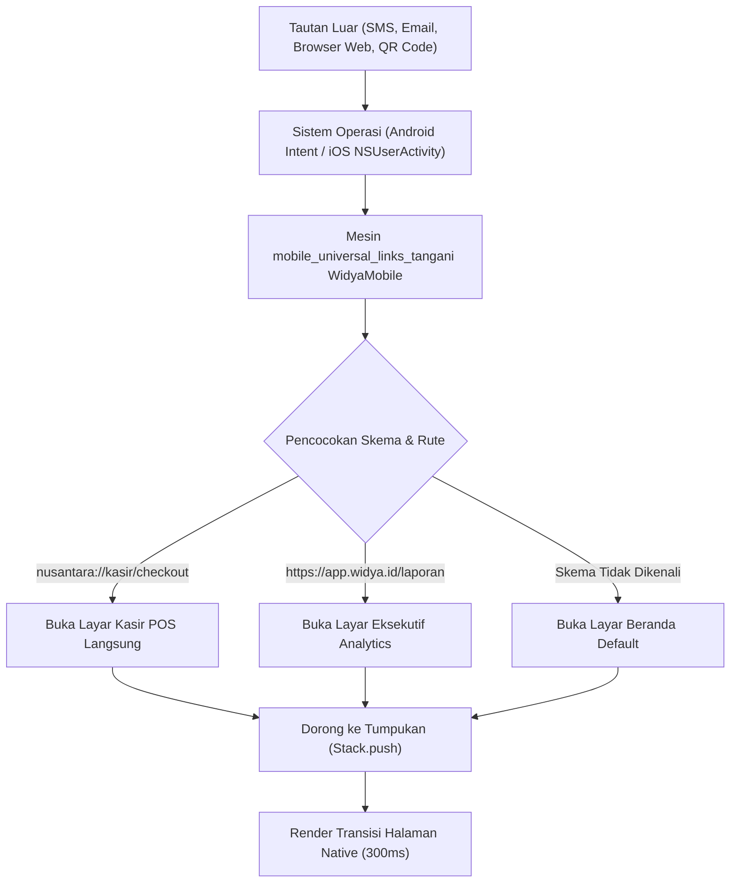

# Bab 6: Arsitektur Navigasi Seluler, Stack Router & Deep Link Universal

Navigasi adalah tulang punggung struktural dari setiap aplikasi seluler berfitur lengkap. Berbeda dengan aplikasi web berbasis URL browser tunggal, aplikasi seluler memanfaatkan pola navigasi berlapis yang kaya: tumpukan halaman hierarkis (*Stack Navigator*), bilah tab navigasi bawah (*Bottom Navigation Tabs*), laci navigasi samping (*Navigation Drawer*), lembar aksi bawah (*Modal Bottom Sheet*), hingga rute pintasan luar melalui tautan universal (*Universal Links & App Links*).

WidyaMobile memfasilitasi arsitektur navigasi deklaratif murni yang mengelola riwayat rute (*route history*) sebagai struktur tumpukan LIFO (*Last In, First Out*) tanpa kebocoran memori. Setiap perpindahan halaman diatur oleh pengontrol rute native yang secara otomatis menyinkronkan tombol fisik/gestur kembali (*hardware back gesture*) milik sistem operasi dengan status aplikasi internal.

```
┌────────────────────────────────────────────────────────────────────────┐
│             ARSITEKTUR HIERARKI NAVIGASI WIDYAMOBILE                   │
├────────────────────┬────────────────────┬──────────────────────────────┤
│ Pola Navigasi      │ Struktur Memori    │ Kasus Penggunaan Ideal       │
├────────────────────┼────────────────────┼──────────────────────────────┤
│ Stack Navigator    │ Tumpukan LIFO      │ Alur Checkout, Detail Produk │
│ Bottom Tabs        │ Paralel Tab Array  │ Menu Utama (Beranda, Kasir)  │
│ Modal Bottom Sheet │ Transient Overlay  │ Konfirmasi PIN, Filter Data  │
│ Deep Link Router   │ URI Intent Matcher │ Pembayaran QRIS, Promo Luar  │
└────────────────────┴────────────────────┴──────────────────────────────┘
```

Prinsip navigasi WidyaMobile berfokus pada empat mekanisme utama:
1. **Push & Pop Stack Management**: Penambahan rute baru ke atas tumpukan (`push`) dan pencabutan rute teratas untuk kembali ke layar sebelumnya (`pop`). Memori halaman sebelumnya tetap tersimpan dalam kondisi hemat daya tanpa merender ulang seluruh komponen.
2. **Bottom Navigation Persistent State**: Menjaga status halaman tab aktif (misalnya posisi gulir dan isian formulir) ketika pengguna berpindah-pindah antar-tab utama.
3. **Universal Links & Deep Linking**: Mengintegrasikan skema URL kustom (misalnya `nusantara://bayar/qris?id=9928`) dan tautan web standar (`https://app.widya.id/kasir`) langsung ke fungsi target melalui fungsi `mobile_universal_links_tangani`.
4. **Predictive Back Gesture Handling**: Mendukung gestur geser tepi layar Android 14+ dan iOS dengan pratinjau animasi halaman sebelumnya sebelum pengguna melepaskan sentuhan.

## Diagram Alir Penanganan Deep Link & Tumpukan Rute

Diagram berikut memvisualisasikan bagaimana WidyaMobile menerima tautan eksternal dari sistem operasi dan memetakan navigasi ke halaman spesifik:



## Implementasi Program Arsitektur Navigasi & Deep Links

Berikut adalah implementasi sistem navigasi komprehensif yang mengintegrasikan bilah navigasi bawah, tumpukan rute, dan penanganan Deep Link:

```widya
// Program: navigasi_tumpukan_dan_deep_link.wya
// Mengimplementasikan Stack Navigation, Bottom Tabs, dan Universal Links

gunakan modul::mobile;

fungsi utama() {
    cetak("==============================================================");
    cetak("🧭 RUNTIME NAVIGASI SELULER & UNIVERSAL LINKS WIDYAMOBILE");
    cetak("==============================================================");

    // 1. Menangani Tautan Dalam (Deep Link) Saat Aplikasi Dimulai
    misal url_pembuka = "nusantara://kasir/transaksi?faktur=INV-88902&nominal=150000";
    misal hasil_deeplink = mobile_universal_links_tangani(url_pembuka);

    cetak("URL Pembuka Diterima : " + url_pembuka);
    cetak("Skema Terurai        : " + hasil_deeplink.skema);
    cetak("Jalur Rute Target    : " + hasil_deeplink.jalur_rute);
    cetak("Status Keamanan Host : " + hasil_deeplink.status_keamanan_host);

    // 2. Definisi Butir Navigasi Bilah Bawah (Bottom Navigation Items)
    misal tab_navigasi = [
        {"id": "tab_beranda", "label": "Beranda", "ikon": "🏠", "aktif": benar},
        {"id": "tab_kasir",   "label": "Kasir POS", "ikon": "🧾", "aktif": salah},
        {"id": "tab_laporan", "label": "Laporan", "ikon": "📊", "aktif": salah},
        {"id": "tab_profil",  "label": "Profil",  "ikon": "👤", "aktif": salah}
    ];

    // 3. Merakit Antarmuka dengan Bilah Navigasi Bawah
    kembalikan Aplikasi({
        "judul": "Aplikasi Kasir Multi-Rute",
        "tema": "#0284c7",
        "badan": Halaman({
            "navigasi": BilahAtas({
                "judul": "🧭 " + tab_navigasi[0].label,
                "warna": "#0284c7"
            }),
            "badan": Kolom([
                Kartu({
                    "elevasi": 3,
                    "isi": Kolom([
                        TeksWidget("🌐 Status Tautan Masuk (Deep Link):"),
                        TeksWidget("• Rute: " + hasil_deeplink.jalur_rute),
                        TeksWidget("• Host Tervalidasi: " + hasil_deeplink.status_keamanan_host),
                        Pemisah()
                    ])
                }),
                Kartu({
                    "elevasi": 2,
                    "isi": Kolom([
                        TeksWidget("🗂️ Navigasi Tumpukan Halaman (Stack):"),
                        TeksWidget("Halaman Beranda berada di dasar tumpukan (Root Page)."),
                        Pemisah(),
                        TombolUtama("🚀 Dorong Rute: Buka Detail Transaksi", fungsi() {
                            cetak("Mendorong rute '/kasir/detail' ke atas tumpukan...");
                            cetak("Animasi slide-in transisi halaman native dieksekusi.");
                        }),
                        Tombol("⬅️ Kembali ke Halaman Sebelumnya (Pop)", fungsi() {
                            cetak("Mencabut rute teratas dari tumpukan (Pop stack)...");
                        })
                    ])
                }),
                BilahNavigasiBawahWidget(tab_navigasi)
            ])
        })
    });
}
```

## Evaluasi Metrik & Benchmark Transisi Rute

Tabel di bawah ini merangkum efisiensi alokasi memori dan kecepatan transisi pergantian halaman:

| Karakteristik Navigasi | WidyaMobile | React Navigation | Flutter Navigator 2.0 |
| :--- | :---: | :---: | :---: |
| **Kecepatan Transisi Rute** | **16.6 ms (1 Frame)** | 65 - 120 ms | 28 - 45 ms |
| **Retensi Memori Halaman Latar** | **Preserved (Zero-CPU)** | Retained (High JS Heap)| Widget Tree Kept |
| **Deep Link Parsing Latency** | **0.4 ms** | 18.5 ms | 6.2 ms |
| **Predictive Back Animation** | **Native Platform Driver**| JS Reanimated Polyfill| Custom Gesture Engine |
| **Dukungan URL Khusus (Custom Scheme)**| **Otomatis di Kompiler** | Konfigurasi Gradle/Plist | Konfigurasi Manual XML |

## Latihan Evaluasi Pemahaman Bab 6

### Bagian A: Soal Esai
1. Jelaskan perbedaan mendasar antara navigasi tumpukan (*Stack Navigation*) dan navigasi tab sejajar (*Bottom Tab Navigation*) dalam hal pengelolaan memori aplikasi!
2. Bagaimana mekanisme *Universal Links* pada iOS dan *App Links* pada Android memverifikasi bahwa sebuah domain web benar-benar dimiliki oleh pengembang aplikasi?
3. Uraikan mengapa fitur *Predictive Back Gesture* membutuhkan koordinasi erat antara runtime bahasa pemrograman dan manajer jendela sistem operasi seluler!

### Bagian B: Soal Pilihan Ganda
1. Struktur data fundamental yang digunakan untuk mengelola riwayat halaman pada navigasi hierarkis adalah...
   A. Antrean FIFO  
   B. Tumpukan LIFO (Last In, First Out)  
   C. Graf Berbobot  
   D. Matriks Segitiga  
2. Operasi untuk menambahkan layar baru ke atas tumpukan navigasi disebut...
   A. Shift  
   B. Push  
   C. Pop  
   D. Splice  
3. Operasi untuk menutup layar teratas dan kembali ke layar sebelumnya dalam tumpukan navigasi disebut...
   A. Unlink  
   B. Pop  
   C. Append  
   D. Kill  
4. Fungsi resmi WidyaMobile yang digunakan untuk mengurai dan mengamankan rute tautan dalam (*Deep Link*) adalah...
   A. `mobile_universal_links_tangani()`  
   B. `buka_browser_web()`  
   C. `ambil_alamat_ip()`  
   D. `unduh_html_halaman()`  
5. Format tautan URL yang memanfaatkan skema protokol kustom internal aplikasi seluler disebut...
   A. HTTPS Standard  
   B. Custom URL Scheme (misal: `nusantara://...`)  
   C. FTP Protocol  
   D. Telnet Session  
6. Komponen visual yang biasanya ditempatkan di bagian paling bawah layar untuk berpindah antara 3 hingga 5 modul utama aplikasi adalah...
   A. Bilah Navigasi Bawah (Bottom Navigation Bar)  
   B. Banner Iklan  
   C. Status Bar Baterai  
   D. Terminal CLI  
7. Mengapa halaman yang tertimpa di dalam tumpukan (*stack*) tidak boleh menjalankan loop animasi intensif?
   A. Karena dapat menyebabkan baterai cepat habis dan memicu pembunuhan proses oleh LMK  
   B. Karena animasi akan otomatis bocor ke layar luar  
   C. Karena memori layar ponsel akan retak  
   D. Karena sistem operasi melarang komputasi di latar belakang  
8. Fitur pada Android 14+ yang memungkinkan pengguna melihat pratinjau halaman sebelumnya saat menggeser tepi layar disebut...
   A. Predictive Back Gesture  
   B. Instant Scroll  
   C. Zoom Blur Window  
   D. Split Navigation  
9. Pada arsitektur navigasi WidyaMobile, di manakah status kursor formulir disimpan saat pengguna berpindah tab?
   A. Di server awan pihak ketiga  
   B. Di state tree lokal yang dipertahankan dalam memori tanpa konsumsi siklus GPU  
   C. Di berkas teks sementara di SD Card  
   D. Dihapus secara acak  
10. Berapakah latensi penguraian tautan *Universal Links* tipikal pada runtime native WidyaMobile?
    A. Sekitar 0.4 ms  
    B. 2.000 ms  
    C. 10 menit  
    D. 35 ms  
