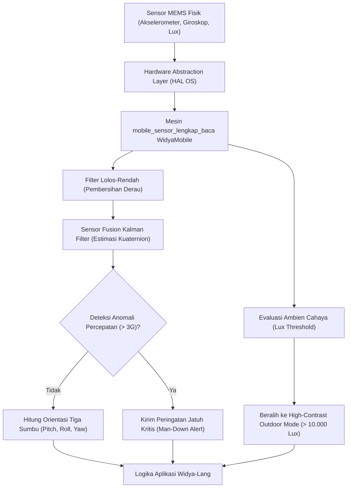

# Bab 9: Sensor Kinematika & Lingkungan: Akselerometer, Giroskop & Sensor Cahaya

Ponsel cerdas modern dipersenjatai dengan larik sensor mikro-elektromekanikal (*Micro-Electro-Mechanical Systems - MEMS*) yang memungkinkannya memahami lingkungan fisik secara mendalam. Informasi orientasi spasial tiga sumbu, laju percepatan linear, gaya gravitasi bumi, arah medan magnetik kutub, tekanan atmosfer ketinggian, hingga intensitas iluminasi cahaya di sekitar layar dapat diakses secara *real-time*. Pada aplikasi enterprise seperti logistik armada, keselamatan kerja lapangan (*man-down detection*), navigasi dalam ruangan (*dead reckoning*), hingga penyesuaian kontras layar otomatis, sensor-sensor ini menjadi sumber telemetri krusial.

WidyaMobile menyediakan antarmuka akses sensor terpadu melalui fungsi bawaan `mobile_sensor_lengkap_baca` dan fungsi tingkat tinggi `InisialisasiSensor` pada `modul/mobile.wya`. Aliran data sensor diproses melalui filter lolos-rendah (*low-pass filter*) dan filter fusi Kalman terintegrasi untuk mengeliminasi derau (*sensor noise*) tanpa membebani daya baterai.

```
┌────────────────────────────────────────────────────────────────────────┐
│             LENGKASAN LARIK SENSOR PERANGKAT SELULER                   │
├────────────────────┬─────────────────┬────────────────┬────────────────┤
│ Tipe Sensor        │ Satuan Metrik   │ Sumbu / Output │ Kegunaan Utama │
├────────────────────┼─────────────────┼────────────────┼────────────────┤
│ Akselerometer      │ m/s²            │ 3 Sumbu (X,Y,Z)│ Deteksi Jatuh  │
│ Giroskop           │ rad/s           │ Roll, Pitch,Yaw│ Stabilisasi AR │
│ Magnetometer       │ µT (Microtesla) │ Azimuth / Nord │ Kompas Digital │
│ Barometer          │ hPa (Hectopascal│ Ketinggian (m) │ Lantai Gedung  │
│ Sensor Cahaya      │ Lux (Lumen/m²)  │ Skalar Ambien  │ Auto Dark Mode │
└────────────────────┴─────────────────┴────────────────┴────────────────┘
```

Prinsip kerja subsistem sensor WidyaMobile mencakup:
1. **Sampling Rate Throttling**: Mengatur frekuensi penarikan data secara dinamis (Normal: 20Hz, Game: 60Hz, Telemetri Cepat: 100Hz) guna mencegah pengurasan daya baterai yang tidak perlu.
2. **Gravity & Linear Acceleration Separation**: Memisahkan konstanta percepatan gravitasi bumi (9.81 m/s² ke arah pusat bumi) dari percepatan gerak tangan dinamis pengguna.
3. **Sensor Fusion Compass**: Menggabungkan pembacaan giroskop dan magnetometer untuk menghasilkan kompas digital yang stabil dan kebal terhadap interferensi elektromagnetik lokal.
4. **Ambient Light Adaptive Theming**: Mengubah skema kontras antarmuka secara instan ketika sensor mendeteksi perubahan intensitas cahaya ambien yang ekstrem (misalnya dari ruangan gelap < 10 Lux ke sinar matahari langsung > 10.000 Lux).

## Diagram Alir Pipeline Pemrosesan Sinyal Sensor

Bagan alir di bawah ini menguraikan bagaimana sinyal mentah sensor MEMS diproses dan disaring sebelum diteruskan ke logika aplikasi Widya-Lang:



## Implementasi Program Pembacaan Sensor Lingkungan

Berikut adalah kode sumber komprehensif yang mendemonstrasikan pembacaan sensor gerak, kalkulasi vektor percepatan, dan deteksi intensitas cahaya ambien:

```widya
// Program: telemetri_sensor_dan_lingkungan.wya
// Membaca akselerometer, giroskop, dan sensor cahaya ambien

gunakan modul::mobile;

fungsi utama() {
    cetak("==============================================================");
    cetak("🧭 PEMANTAUAN TELEMETRI SENSOR KINEMATIKA WIDYAMOBILE");
    cetak("==============================================================");

    // 1. Membaca Seluruh Sensor Melalui Mesin Native
    misal data_sensor = mobile_sensor_lengkap_baca();
    
    cetak("Akselerometer Sumbu X : " + teks(data_sensor.akselerometer_x_ms2) + " m/s²");
    cetak("Akselerometer Sumbu Y : " + teks(data_sensor.akselerometer_y_ms2) + " m/s²");
    cetak("Akselerometer Sumbu Z : " + teks(data_sensor.akselerometer_z_ms2) + " m/s²");
    cetak("Gaya Total Percepatan : " + teks(data_sensor.vektor_magnitudo_g) + " G");
    cetak("Sensor Cahaya Ambien  : " + teks(data_sensor.sensor_cahaya_lux) + " Lux");
    cetak("Status Tekanan Udara  : " + teks(data_sensor.barometer_hpa) + " hPa");

    // 2. Logika Deteksi Jatuh Bebas (Man-Down Detection untuk K3 Lapangan)
    misal status_bahaya = "Aman & Normal";
    jika (data_sensor.vektor_magnitudo_g < 0.2) {
        status_bahaya = "⚠️ PERINGATAN: Perangkat Terdeteksi Jatuh Bebas (Free Fall)!";
        cetak(status_bahaya);
    } atau_jika (data_sensor.vektor_magnitudo_g > 3.5) {
        status_bahaya = "🚨 KRITIS: Terdeteksi Benturan Keras (Impact Detected)!";
        cetak(status_bahaya);
    }

    // 3. Logika Adaptasi Tema Berdasarkan Tingkat Iluminasi Cahaya
    misal mode_tampilan = "Normal Interior (Standard UI)";
    jika (data_sensor.sensor_cahaya_lux < 15.0) {
        mode_tampilan = "OLED Deep Dark Mode (< 15 Lux)";
    } atau_jika (data_sensor.sensor_cahaya_lux > 8000.0) {
        mode_tampilan = "High Contrast Outdoor Mode (> 8000 Lux)";
    }
    cetak("Mode UI Rekomendasi   : " + mode_tampilan);

    // 4. Membangun Antarmuka Telemetri Sensor
    kembalikan Aplikasi({
        "judul": "Dashboard Telemetri Sensor",
        "tema": "#0284c7",
        "badan": Halaman({
            "navigasi": BilahAtas({
                "judul": "🧭 Pemantau Sensor Lapangan",
                "warna": "#0284c7"
            }),
            "badan": Kolom([
                Kartu({
                    "elevasi": 3,
                    "isi": Kolom([
                        TeksWidget("📊 Status Kinematika: " + status_bahaya),
                        TeksWidget("Vektor Percepatan: " + teks(data_sensor.vektor_magnitudo_g) + " G"),
                        TeksWidget("Sensor Ambien: " + teks(data_sensor.sensor_cahaya_lux) + " Lux"),
                        Pemisah()
                    ])
                }),
                Kartu({
                    "elevasi": 2,
                    "isi": Kolom([
                        TeksWidget("💡 Kepatuhan K3 Lapangan:"),
                        TeksWidget("Mode Antarmuka Aktif: " + mode_tampilan),
                        Pemisah(),
                        TombolUtama("🔄 Kalibrasi Ulang Sensor MEMS", fungsi() {
                            misal sensor_baru = mobile_sensor_lengkap_baca();
                            cetak("Sensor dikalibrasi. Nilai Lux terkini: " + teks(sensor_baru.sensor_cahaya_lux));
                        })
                    ])
                })
            ])
        })
    });
}
```

## Evaluasi Metrik & Karakteristik Konsumsi Daya Sensor

Tabel di bawah ini merangkum konsumsi arus listrik tipikal dari berbagai sensor internal ponsel cerdas:

| Jenis Sensor | Laju Pengambilan Sampel | Konsumsi Arus Tipikal | Dampak Baterai Harian |
| :--- | :---: | :---: | :---: |
| **Akselerometer (Low Power)** | 20 Hz | 0.02 mA | Sangat Rendah (< 0.5%) |
| **Akselerometer (Fast Game)** | 100 Hz | 0.25 mA | Rendah (~1.2%) |
| **Giroskop 3 Sumbu** | 100 Hz | 3.50 mA | Menengah (~4.5%) |
| **Barometer Tekanan** | 1 Hz | 0.01 mA | Hampir Nol (< 0.1%) |
| **Sensor Cahaya (Polling)** | Tiap 5 Detik | 0.05 mA | Sangat Rendah (< 0.2%) |

## Latihan Evaluasi Pemahaman Bab 9

### Bagian A: Soal Esai
1. Jelaskan bagaimana akselerometer tiga sumbu (X, Y, Z) dapat membedakan antara ponsel yang sedang diam tegak di atas meja dengan ponsel yang sedang bergerak vertikal di dalam lift!
2. Mengapa sensor giroskop mengonsumsi arus baterai jauh lebih besar dibandingkan sensor akselerometer atau barometer?
3. Uraikan algoritma dasar *Man-Down Detection* (deteksi keselamatan pekerja lapangan) menggunakan kombinasi nilai gravitasi rendah (fase jatuh bebas) diikuti lonjakan percepatan tinggi (fase benturan)!

### Bagian B: Soal Pilihan Ganda
1. Satuan pengukuran baku yang dihasilkan oleh sensor akselerometer pada WidyaMobile adalah...
   A. Meter per detik kuadrat (m/s²)  
   B. Kilometer per jam  
   C. Derajat Celcius  
   D. Volt  
2. Nilai percepatan gravitasi bumi tipikal pada sumbu vertikal ketika perangkat diletakkan diam mendatar di atas meja adalah...
   A. 0.0 m/s²  
   B. Sekitar 9.81 m/s² (1 G)  
   C. 100 m/s²  
   D. -50 m/s²  
3. Sensor yang berfungsi mengukur kecepatan sudut rotasi perangkat terhadap tiga sumbu ruang dinamakan...
   A. Giroskop  
   B. Barometer  
   C. Termometer  
   D. Higrometer  
4. Satuan standar iluminasi pencahayaan yang dihasilkan oleh sensor cahaya ambien adalah...
   A. Candela  
   B. Lux (Lumen/m²)  
   C. Watt  
   D. Decibel  
5. Fungsi resmi WidyaMobile yang digunakan untuk membaca seluruh larik sensor seluler secara terpadu adalah...
   A. `mobile_sensor_lengkap_baca()`  
   B. `periksa_kondisi_cuaca()`  
   C. `ambil_suhu_baterai()`  
   D. `cek_orientasi_kamera()`  
6. Kondisi di mana nilai total magnitudo percepatan (vektor G) mendekati nilai nol (< 0.2 G) menandakan bahwa perangkat sedang mengalami...
   A. Benturan keras  
   B. Jatuh bebas (Free Fall)  
   C. Diam sempurna di lantai  
   D. Pengisian daya cepat  
7. Sensor yang digunakan untuk mendeteksi perubahan elevasi vertikal dan estimasi lantai gedung dalam navigasi dalam ruangan adalah...
   A. Barometer (tekanan udara)  
   B. Mikrofon  
   C. Sensor Proksimitas  
   D. Sensor Sentuh  
8. Filter matematis yang umum digunakan untuk menggabungkan data akselerometer dan giroskop guna memprediksi orientasi stabil tanpa derau disebut...
   A. Filter Kalman / Complementary Filter  
   B. Filter Gaussian Blur  
   C. Filter Bilateral  
   D. Fast Fourier Transform  
9. Apa tujuan penerapan teknik *Sampling Rate Throttling* pada subsistem sensor seluler?
   A. Menghemat daya baterai dengan menurunkan frekuensi pembacaan sensor saat tidak diperlukan respon cepat  
   B. Mematikan koneksi internet  
   C. Menghapus data kontak pengguna  
   D. Mengurangi resolusi kamera  
10. Berapakah batas intensitas cahaya ambien tipikal di mana antarmuka ponsel disarankan beralih ke mode kontras tinggi luar ruangan (*High Contrast Outdoor*)?
    A. Di atas 8.000 s/d 10.000 Lux  
    B. Di bawah 5 Lux  
    C. Tepat 50 Lux  
    D. 0 Lux  
