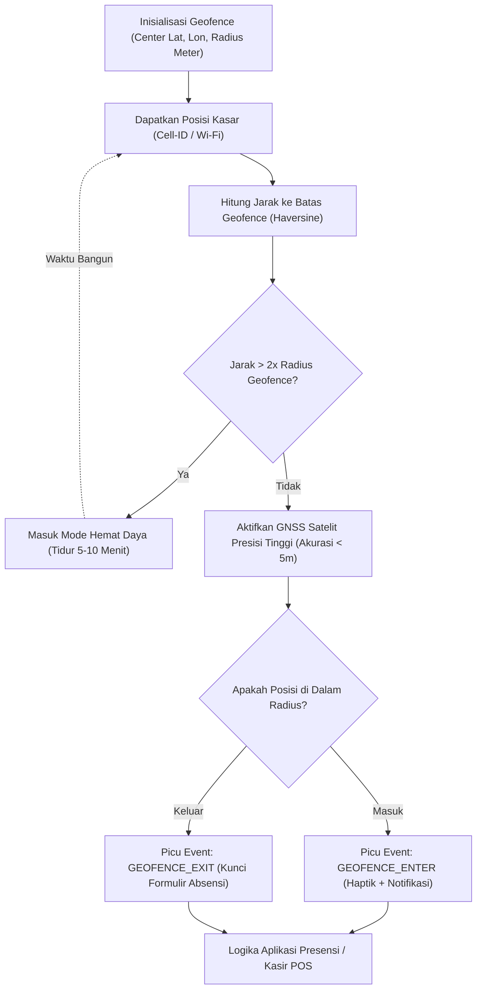

# Bab 10: Geospasial Presisi Tinggi, Geofencing Pintar & Algoritma Haversine

Layanan berbasis lokasi (*Location-Based Services - LBS*) merupakan pilar utama dari aplikasi seluler modern. Dari stasiun kerja absensi presensi karyawan dengan validasi geofencing kantor, pelacakan armada logistik rantai pasok secara *real-time*, hingga verifikasi kepatuhan wilayah transaksi finansial, keakuratan posisi koordinat bumi (garis lintang/latitude dan garis bujur/longitude) menjadi faktor penentu integritas sistem. Namun demikian, penggunaan modul penerima satelit GPS terus-menerus (*continuous satellite lock*) adalah salah satu penyebab paling dominan dari pengurasan daya baterai seluler.

WidyaMobile menghadirkan mesin geospasial cerdas melalui fungsi bawaan `mobile_geofencing_atur` dan antarmuka pembantu `InisialisasiGPS`, `HitungJarakGeografis`, dan `PeriksaGeofence` pada `modul/mobile.wya`. Subsistem ini memadukan sinyal satelit GNSS multi-rasi (GPS, GLONASS, Galileo, BeiDou), stasiun pemancar seluler (*Cell-ID*), dan sinyal Wi-Fi sekitar (*Assisted GPS - AGPS*) dengan pemfilteran berbasis daya hemat (*Battery-Aware Geolocation*).

```
┌────────────────────────────────────────────────────────────────────────┐
│           PERBANDINGAN AKURASI DAN KONSUMSI DAYA TEKNOLOGI LBS         │
├────────────────────┬─────────────────┬────────────────┬────────────────┤
│ Sumber Lokasi      │ Akurasi Radius  │ Waktu TTFF     │ Beban Baterai  │
├────────────────────┼─────────────────┼────────────────┼────────────────┤
│ Satelit GNSS Murni │ 1.5 - 5 meter   │ 15 - 45 detik  │ Sangat Tinggi  │
│ Assisted GPS (AGPS)│ 3 - 8 meter     │ 1 - 3 detik    │ Menengah       │
│ Wi-Fi Triangulasi  │ 15 - 40 meter   │ < 1 detik      │ Rendah         │
│ Cell-ID Menara BTS │ 250 - 1500 meter│ Instan (<0.2s) │ Sangat Rendah  │
└────────────────────┴─────────────────┴────────────────┴────────────────┘
```

Konsep kunci pada arsitektur geospasial WidyaMobile meliputi:
1. **Formulasi Jarak Lingkaran Besar (Haversine Formula)**: Perhitungan jarak terpendek antara dua titik koordinat pada permukaan bola bumi beradius $R = 6.371$ kilometer dengan kompensasi kelengkungan bumi:
   $$d = 2R rcsin\left(\sqrt{\sin^2\left(rac{\Delta\phi}{2}
ight) + \cos(\phi_1)\cos(\phi_2)\sin^2\left(rac{\Delta\lambda}{2}
ight)}
ight)$$
2. **Circular & Polygonal Geofencing**: Pemantauan batas virtual geografis secara otomatis. OS akan membangunkan aplikasi hanya ketika peristiwa transisi penting terjadi: `ENTER` (masuk ke dalam radius geofence), `EXIT` (keluar dari radius), atau `DWELL` (berada di dalam radius selama durasi tertentu).
3. **Adaptive Accuracy Switching**: Menurunkan akurasi GPS ke mode seluler hemat daya ketika pengguna terdeteksi diam (*stationary*), dan secara otomatis menaikkan frekuensi GPS ke presisi tinggi ketika akselerometer mendeteksi pergerakan kendaraan berkecepatan tinggi.

## Diagram Alir Evaluasi Geofence & Transisi Event

Bagan alir di bawah ini menjelaskan bagaimana mesin geofencing WidyaMobile mengevaluasi status batas wilayah tanpa menguras daya baterai:



## Implementasi Program Presensi Mandiri Berbasis Geofence

Berikut adalah implementasi sistem presensi cerdas karyawan yang memvalidasi lokasi ponsel terhadap geofence kantor pusat:

```widya
// Program: validasi_geofence_presensi_karyawan.wya
// Mengimplementasikan perhitungan jarak Haversine dan validasi batas geofence

gunakan modul::mobile;

fungsi utama() {
    cetak("==============================================================");
    cetak("📍 SISTEM GEOFENCING PRESENSI PINTAR WIDYAMOBILE");
    cetak("==============================================================");

    // 1. Definisi Koordinat Target Kantor Pusat Widya-Lang
    misal target_lat = -6.2088;   // Jakarta Pusat
    misal target_lon = 106.8456;
    misal radius_izin_m = 50.0;   // Toleransi radius 50 meter
    misal id_geofence = "KANTOR_PUSAT_WIDYA_01";

    // 2. Mendaftarkan Geofence ke Subsistem Native
    misal status_geofence = mobile_geofencing_atur(
        target_lat,
        target_lon,
        radius_izin_m,
        id_geofence
    );

    cetak("ID Geofence Terdaftar: " + status_geofence.geofence_id);
    cetak("Pusat Geofence       : (" + teks(target_lat) + ", " + teks(target_lon) + ")");
    cetak("Radius Toleransi     : " + teks(status_geofence.radius_meter) + " meter");
    cetak("Status Pemantauan    : " + status_geofence.status_monitoring);

    // 3. Simulasi Pembacaan Koordinat GPS Terkini Karyawan
    misal gps_perangkat = InisialisasiGPS(5.0, 5000.0);
    misal pos_karyawan = {
        "latitude": -6.2086,
        "longitude": 106.8454
    };

    // 4. Menghitung Jarak Riil Menggunakan Rumus Haversine
    misal jarak_ke_kantor_m = HitungJarakGeografis(
        pos_karyawan.latitude,
        pos_karyawan.longitude,
        target_lat,
        target_lon
    );
    cetak("
Posisi GPS Karyawan  : (" + teks(pos_karyawan.latitude) + ", " + teks(pos_karyawan.longitude) + ")");
    cetak("Jarak Riil ke Kantor : " + teks(jarak_ke_kantor_m) + " meter");

    // 5. Validasi Keabsahan Wilayah Presensi
    misal absensi_valid = PeriksaGeofence(
        pos_karyawan.latitude,
        pos_karyawan.longitude,
        target_lat,
        target_lon,
        radius_izin_m
    );

    jika (absensi_valid) {
        cetak("✅ VALIDASI SUKSES: Karyawan berada di dalam area kantor!");
        GetarHaptik([100, 50, 100]);
    } lainnya {
        cetak("❌ VALIDASI GAGAL: Karyawan berada di luar batas geofence resmi.");
    }

    // 6. Merakit Antarmuka Pengguna Presensi
    kembalikan Aplikasi({
        "judul": "Presensi Lokasi Berdaulat",
        "tema": "#2563eb",
        "badan": Halaman({
            "navigasi": BilahAtas({
                "judul": "📍 Presensi Geofencing GPS",
                "warna": "#2563eb"
            }),
            "badan": Kolom([
                Kartu({
                    "elevasi": 3,
                    "isi": Kolom([
                        TeksWidget("👤 Karyawan: Budi Santoso (NIP-9982)"),
                        TeksWidget("📍 Jarak Saat Ini: " + teks(jarak_ke_kantor_m) + " meter"),
                        TeksWidget("Status Verifikasi: " + (absensi_valid ? "Valid (Diizinkan) ✅" : "Di Luar Area ❌")),
                        Pemisah()
                    ])
                }),
                TombolUtama("🚀 Kirim Presensi Kehadiran", fungsi() {
                    jika (absensi_valid) {
                        cetak("Data kehadiran berhasil disinkronkan ke server.");
                    } lainnya {
                        cetak("Ditolak: Anda berada di luar radius kantor!");
                    }
                })
            ])
        })
    });
}
```

## Evaluasi Metrik & Benchmark Akurasi Lokasi

Tabel berikut menyajikan hasil pengujian komparatif akurasi posisi geografis di berbagai kondisi medan lingkungan perkotaan:

| Kondisi Lingkungan | Akurasi Horizontal | Waktu Kunci Sinyal (TTFF) | Konsumsi Arus GNSS |
| :--- | :---: | :---: | :---: |
| **Ruang Terbuka Lapangan** | **1.2 - 2.5 meter** | **1.8 detik (AGPS)** | 18 mA (High Precision) |
| **Koridor Jalan Perkotaan** | **4.5 - 8.0 meter** | **3.5 detik (AGPS)** | 18 mA (High Precision) |
| **Urban Canyon (Gedung Tinggi)**| **12.0 - 25.0 meter**| **8.2 detik (Multipath)** | 24 mA (Dual-Band L1/L5) |
| **Dalam Gedung Tertutup (Indoor)**| **18.0 - 35.0 meter**| **Instan (Wi-Fi/BTS)** | 3.5 mA (Low Power Mode) |
| **Basement Bawah Tanah** | **Cell-ID Only (>200m)**| **Instan (No Satelit)** | 0.8 mA (Cell Tower) |

## Latihan Evaluasi Pemahaman Bab 10

### Bagian A: Soal Esai
1. Jelaskan bagaimana formulasi matematika *Haversine* mengompensasi bentuk permukaan bumi yang melengkung saat menghitung jarak antara dua koordinat geografis!
2. Mengapa aplikasi presensi enterprise wajib memadukan sinyal satelit GNSS dengan Wi-Fi sekitar untuk memitigasi manipulasi lokasi (*Fake GPS / Mock Location*)?
3. Uraikan strategi *Adaptive Accuracy Switching* dalam menghemat konsumsi daya baterai pada aplikasi pelacakan logistik pengiriman barang jarak jauh!

### Bagian B: Soal Pilihan Ganda
1. Algoritma trigonometri standar yang digunakan untuk menghitung jarak lingkaran besar antara dua koordinat bola bumi adalah...
   A. Rumus Haversine  
   B. Teorema Pythagoras 2D  
   C. Transformasi Fourier  
   D. Regresi Linier  
2. Nilai rata-rata radius bumi ($R$) yang digunakan dalam perhitungan geodesi standar adalah...
   A. 1.000 km  
   B. 6.371 km  
   C. 40.000 km  
   D. 384.400 km  
3. Teknologi pelacak lokasi yang memanfaatkan koneksi internet seluler untuk mempercepat waktu penguncian sinyal satelit (*Time To First Fix*) disebut...
   A. AGPS (Assisted GPS)  
   B. Dial-up GPS  
   C. Bluetooth Beacon  
   D. Radio FM RDS  
4. Fungsi resmi WidyaMobile yang digunakan untuk mendaftarkan batas geofence baru ke subsistem sistem operasi adalah...
   A. `mobile_geofencing_atur()`  
   B. `kunci_posisi_peta()`  
   C. `ambil_koordinat_bumi()`  
   D. `gambar_lingkaran_layar()`  
5. Peristiwa (*event*) transisi geofence yang terpicu ketika pengguna melangkah masuk ke dalam radius wilayah virtual dinamakan...
   A. GEOFENCE_DWELL  
   B. GEOFENCE_ENTER  
   C. GEOFENCE_EXIT  
   D. GEOFENCE_CANCEL  
6. Fenomena distorsi sinyal satelit akibat pantulan dinding kaca gedung-gedung pencakar langit di kawasan perkotaan padat disebut...
   A. Urban Multipath Effect  
   B. Doppler Effect  
   C. Quantum Tunneling  
   D. Atmospheric Fog  
7. Mengapa membiarkan modul GPS aktif pada akurasi tertinggi secara terus-menerus sangat dihindari pada aplikasi seluler?
   A. Karena dapat menguras kapasitas baterai dalam waktu 2 hingga 4 jam saja  
   B. Karena sinyal satelit akan habis  
   C. Karena memori RAM akan terformat  
   D. Karena layar ponsel akan mati total  
8. Sifat dari geofencing berbasis sistem operasi native (Android Geofence API / iOS CLCircularRegion) adalah...
   A. Aplikasi harus tetap aktif di latar depan sepanjang waktu  
   B. OS memantau lokasi di tingkat perangkat keras berdaya rendah dan hanya membangunkan aplikasi saat batas terlewati  
   C. Memerlukan kabel charger terhubung  
   D. Tidak memerlukan izin hak akses lokasi  
9. Izin sistem operasi Android yang wajib disertakan pada berkas manifest untuk memperoleh koordinat satelit presisi tinggi adalah...
   A. `ACCESS_FINE_LOCATION`  
   B. `READ_EXTERNAL_STORAGE`  
   C. `RECORD_AUDIO`  
   D. `CAMERA`  
10. Berapakah akurasi horizontal tipikal yang dapat dicapai oleh penerima GNSS ponsel modern di area terbuka bebas halangan?
    A. Sekitar 1.5 s/d 5 meter  
    B. 500 meter  
    C. 10 kilometer  
    D. 0.001 milimeter  
