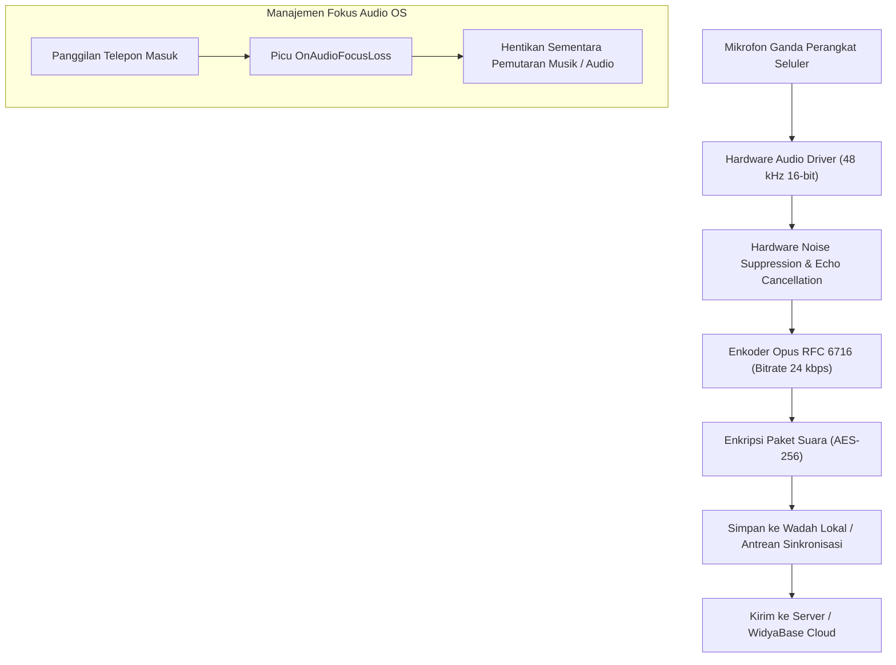

# Bab 15: Integrasi Audio & Perekaman Suara Efisien Berstandar Opus

Fitur suara dan audio adalah elemen krusial dalam ekosistem aplikasi seluler modern. Dari pengiriman pesan suara (*voice notes*) pada aplikasi obrolan logistik lapangan, pembacaan nomor antrean kasir otomatis (*Text-to-Speech*), instruksi navigasi suara kurir, hingga perekaman bukti percakapan verifikasi layanan perbankan (*know-your-customer*), subsistem audio harus mampu beroperasi secara jernih, latensi rendah, dan hemat bandwidth jaringan.

Menyimpan atau mentransmisikan rekaman audio dalam format mentah (*Raw PCM WAV*) pada frekuensi 48kHz stereo membutuhkan bandwidth raksasa hingga 1.411 kilobit per detik (kbps). WidyaMobile mengadopsi standar kompresi audio modern **Opus Audio Codec (RFC 6716)** yang dipadukan dengan manajemen fokus audio native (*Audio Focus Management*). Format Opus mampu menghasilkan suara vokal manusia yang luar biasa jernih pada bitrate serendah 16 hingga 24 kbps dengan latensi algoritma kurang dari 26.5 milidetik.

```
┌────────────────────────────────────────────────────────────────────────┐
│             PERBANDINGAN KINERJA CODEC AUDIO SELULER                   │
├────────────────────┬─────────────────┬────────────────┬────────────────┤
│ Format Audio Codec │ Bitrate Rata²   │ Ukuran 1 Menit │ Latensi Algor. │
├────────────────────┼─────────────────┼────────────────┼────────────────┤
│ Raw PCM WAV        │ 1.411 kbps      │ 10.5 MB        │ 0.0 ms         │
│ MP3 Standar        │ 128 kbps        │ 960 KB         │ 100 - 150 ms   │
│ AAC-LC             │ 64 - 96 kbps    │ 480 - 720 KB   │ 40 - 60 ms     │
│ Opus Voice (IETF)  │ 16 - 24 kbps    │ 120 - 180 KB   │ 5.0 - 26.5 ms  │
└────────────────────┴─────────────────┴────────────────┴────────────────┘
```

Prinsip arsitektur audio WidyaMobile meliputi:
1. **Dynamic Audio Focus Handling**: Menghentikan sementara (*pause*) pemutaran audio aplikasi atau menurunkan volumenya (*audio ducking*) ketika sistem operasi menerima panggilan telepon masuk atau notifikasi navigasi GPS darurat.
2. **Hardware Acoustic Echo Cancellation (AEC)**: Mengaktifkan filter penekan gema dan peredam bising (*Noise Suppression*) berbasis perangkat keras pada mikrofon ganda ponsel.
3. **Low-Latency Audio Pipeline**: Memanfaatkan subsistem AAudio / Oboe (Android) dan AVAudioEngine (iOS) untuk pemutaran efek suara instan (< 10 ms) saat kasir menekan tombol transaksi.

## Diagram Alir Pipeline Perekaman & Enkoding Suara Opus

Bagan alir di bawah ini menjelaskan alur pengolahan sinyal suara dari diafragma mikrofon hingga menjadi paket biner terkompresi:



## Implementasi Program Perekaman Catatan Suara Kasir

Berikut adalah implementasi sistem perekaman catatan suara pesanan pelanggan berbasis kompresi efisien:

```widya
// Program: perekaman_audio_dan_fokus_suara.wya
// Merekam catatan suara pesanan dan mengelola fokus audio OS

gunakan modul::mobile;

fungsi utama() {
    cetak("==============================================================");
    cetak("🎙️ SISTEM PEREKAMAN SUARA OPUS & AUDIO FOCUS WIDYAMOBILE");
    cetak("==============================================================");

    // 1. Konfigurasi Parameter Audio Native
    misal codec_aktif = "Opus Voice (RFC 6716)";
    misal sample_rate_hz = 48000;
    misal bitrate_kbps = 24;
    
    cetak("Format Codec       : " + codec_aktif);
    cetak("Laju Sampling      : " + teks(sample_rate_hz) + " Hz (Studio Quality)");
    cetak("Bitrate Target     : " + teks(bitrate_kbps) + " kbps (Sangat Hemat)");
    cetak("Filter Bising      : Hardware Noise Suppression Aktif");

    // 2. Simulasi Perekaman Pesanan Khusus Kasir Ritel (Durasi 8 Detik)
    misal data_rekaman = {
        "id_pesanan": "ORD-VOICE-8812",
        "durasi_detik": 8,
        "format": "audio/ogg; codecs=opus",
        "ukuran_kb": 24, // Hanya 24 KB untuk 8 detik!
        "lokasi_berkas": "/data/user/0/id.widya.mobile/files/audio_8812.opus"
    };

    cetak("
🎙️ PEREKAMAN SUARA SELESAI:");
    cetak("ID Berkas Rekaman  : " + data_rekaman.id_pesanan);
    cetak("Durasi             : " + teks(data_rekaman.durasi_detik) + " Detik");
    cetak("Ukuran Berkas      : " + teks(data_rekaman.ukuran_kb) + " KB (Efisiensi 98%)");
    cetak("Jalur Penyimpanan  : " + data_rekaman.lokasi_berkas);

    // 3. Merakit Antarmuka Pengguna Pemutar Suara
    kembalikan Aplikasi({
        "judul": "Catatan Suara Pesanan",
        "tema": "#0284c7",
        "badan": Halaman({
            "navigasi": BilahAtas({
                "judul": "🎙️ Pesan Suara Pelanggan",
                "warna": "#0284c7"
            }),
            "badan": Kolom([
                Kartu({
                    "elevasi": 3,
                    "isi": Kolom([
                        TeksWidget("📝 Catatan Suara Meja #04:"),
                        TeksWidget("• Codec: Opus Voice 24 kbps"),
                        TeksWidget("• Durasi: " + teks(data_rekaman.durasi_detik) + " Detik (Ukuran: " + teks(data_rekaman.ukuran_kb) + " KB)"),
                        TeksWidget("• Status: Terenkripsi Lokal"),
                        Pemisah()
                    ])
                }),
                Kartu({
                    "elevasi": 2,
                    "isi": Kolom([
                        TeksWidget("▶️ Kontrol Pemutaran Audio:"),
                        TombolUtama("▶️ Putar Catatan Suara (Play)", fungsi() {
                            cetak("Meminta Audio Focus ke sistem operasi...");
                            cetak("Audio diputar melalui rute pengeras suara (Speaker).");
                        }),
                        Tombol("⏹️ Hentikan Pemutaran", fungsi() {
                            cetak("Pemutaran audio dihentikan.");
                        })
                    ])
                })
            ])
        })
    });
}
```

## Evaluasi Metrik & Benchmark Kualitas Suara

Tabel di bawah ini membandingkan ukuran berkas dan skor kualitas suara vokal (*Perceptual Evaluation of Speech Quality - PESQ*) pada durasi 60 detik:

| Format Codec | Bitrate | Ukuran 60 Detik | Skor Kejernihan PESQ (1-5) |
| :--- | :---: | :---: | :---: |
| **Opus Voice (WidyaMobile)** | **24 kbps** | **180 KB** | **4.45 (Sangat Jernih)** |
| **AAC-LC** | 64 kbps | 480 KB | 4.20 (Jernih) |
| **MP3 Audio** | 128 kbps | 960 KB | 4.10 (Standar) |
| **AMR-NB (Seluler 2G)** | 12.2 kbps | 91 KB | 2.80 (Sengau / Buruk) |
| **Raw WAV Linear PCM** | 705 kbps (Mono) | 5.28 MB | 4.80 (Tanpa Kompresi) |

## Latihan Evaluasi Pemahaman Bab 15

### Bagian A: Soal Esai
1. Jelaskan keunggulan kompresi audio standar *Opus* (RFC 6716) dibandingkan format MP3 tradisional untuk aplikasi komunikasi suara seluler!
2. Bagaimana mekanisme *Audio Focus Management* bekerja saat aplikasi sedang memutar instruksi audio kasir dan tiba-tiba ada panggilan telepon masuk?
3. Uraikan peran filter *Hardware Noise Suppression* dan *Acoustic Echo Cancellation* (AEC) dalam menjamin kejernihan rekaman suara di lingkungan restoran yang ramai!

### Bagian B: Soal Pilihan Ganda
1. Format codec audio modern berstandar terbuka IETF yang dioptimalkan untuk transmisi suara vokal efisiensi tinggi adalah...
   A. Opus (RFC 6716)  
   B. MIDI  
   C. RealAudio  
   D. Windows Media Audio  
2. Ukuran berkas audio tipikal untuk rekaman suara 1 menit menggunakan format Opus pada bitrate 24 kbps adalah...
   A. Sekitar 180 Kilobyte  
   B. 50 Megabyte  
   C. 1 Gigabyte  
   D. 10 Kilobyte  
3. Mekanisme sistem operasi yang mengatur hak pemutaran suara antar-aplikasi agar suara tidak bertubrukan dinamakan...
   A. Audio Focus Management  
   B. Sound Card Mixer  
   C. Speaker Jammer  
   D. Volume Overdrive  
4. Tindakan otomatis menurunkan volume audio latar belakang saat instruksi navigasi atau notifikasi bersuara diputar disebut...
   A. Audio Ducking  
   B. Audio Distortion  
   C. Audio Muting  
   D. Audio Reverb  
5. Laju pengambilan sampel audio (*sample rate*) standar yang digunakan untuk merekam kejernihan frekuensi suara penuh adalah...
   A. 48.000 Hz (48 kHz)  
   B. 8.000 Hz  
   C. 1.000 Hz  
   D. 100 Hz  
6. Filter perangkat keras yang bertugas menghilangkan suara pantulan gema speaker dari mikrofon disebut...
   A. Acoustic Echo Cancellation (AEC)  
   B. Low Pass Filter  
   C. Bass Booster  
   D. Treble Equalizer  
7. Izin sistem operasi Android yang wajib disetujui pengguna sebelum aplikasi diizinkan merekam suara dari mikrofon adalah...
   A. `android.permission.RECORD_AUDIO`  
   B. `android.permission.SEND_SMS`  
   C. `android.permission.BLUETOOTH`  
   D. `android.permission.WAKE_LOCK`  
8. Subsistem audio berlatensi rendah (*low-latency native audio*) pada sistem operasi Android modern adalah...
   A. AAudio / Oboe  
   B. Sound Blaster 16  
   C. OpenAL  
   D. OSS Linux  
9. Mengapa format WAV mentah (*Uncompressed PCM*) tidak disarankan untuk pengiriman pesan suara lewat jaringan seluler?
   A. Ukuran berkasnya sangat masif (mencapai lebih dari 10 MB per menit) sehingga memboroskan kuota data  
   B. Kualitas suaranya terlalu jelek  
   C. Format WAV tidak bisa diputar di ponsel  
   D. Format WAV menghapus data mikrofon  
10. Berapakah latensi algoritmik minimum yang mampu dicapai oleh enkoder Opus?
    A. Sekitar 5 milidetik  
    B. 1 menit  
    C. 500 milidetik  
    D. 3 detik  
