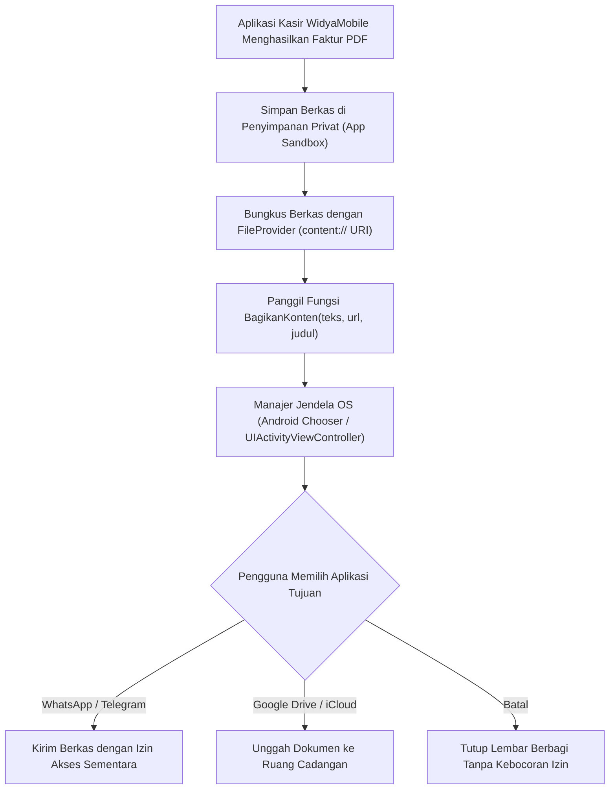

# Bab 16: Dialog Sistem, Lembar Berbagi Native (Share Sheet) & Papan Klip Kripto

Aplikasi seluler tidak hidup terisolasi di dalam sangkar tertutup (*sandbox*). Aplikasi harus mampu berinteraksi secara mulus dengan ekosistem aplikasi lain di dalam ponsel pengguna: mengekspor faktur laporan penjualan dalam bentuk dokumen PDF ke aplikasi pengirim pesan WhatsApp, membagikan tautan pembayaran ke media sosial, mengimpor berkas transaksi dari manajer berkas perangkat, hingga menyalin kode kupon diskon ke papan klip sistem (*system clipboard*).

WidyaMobile memfasilitasi integrasi ekosistem OS secara berdaulat melalui fungsi pembantu resmi pada `modul/mobile.wya`: `BagikanKonten` (Native Share Sheet), `SalinKePapanKlip` & `AmbilDariPapanKlip` (Papan Klip Kripto), serta `AmbilTautanDalam` (Deep Link Invocation). Seluruh pertukaran data dilindungi oleh mekanisme validasi tipe MIME ketat guna mencegah serangan penyuntikan berkas berbahaya (*MIME-type spoofing*).

```
┌────────────────────────────────────────────────────────────────────────┐
│             MATRIKS INTEGRASI SISTEM OPERASI WIDYAMOBILE               │
├────────────────────┬─────────────────┬────────────────┬────────────────┤
│ Fitur Integrasi    │ Saluran OS      │ Format Data    │ Proteksi Privas│
├────────────────────┼─────────────────┼────────────────┼────────────────┤
│ Native Share Sheet │ Intent / Activity│ Teks & Berkas  │ Sandboxed URI  │
│ Papan Klip Kripto  │ ClipboardManager│ Teks Terenkripsi Otomatis Hapus│
│ Asosiasi Berkas OS │ File Provider   │ PDF, CSV, WYA  │ Read-Only Grant│
│ Tautan Dalam       │ Custom URI / URL│ Skema Terurai  │ Host Whitelist │
└────────────────────┴─────────────────┴────────────────┴────────────────┘
```

Kapabilitas utama dari integrasi sistem WidyaMobile meliputi:
1. **System Share Sheet Integration**: Menampilkan lembar dialog berbagi bawaan sistem operasi (Android Intent Chooser / iOS UIActivityViewController) yang memunculkan daftar kontak dan aplikasi favorit pengguna tanpa mengharuskan aplikasi meminta izin akses penuh ke daftar aplikasi terinstal.
2. **Auto-Expiring Cryptographic Clipboard**: Melindungi kerahasiaan data sensitif (misalnya kata sandi sementara, token autentikasi, nomor rekening bank) dengan menghapus data dari papan klip sistem secara otomatis setelah 60 detik (*auto-clear timeout*).
3. **Secure FileProvider URI Sharing**: Berbagi berkas laporan tanpa membuka izin akses penyimpanan global (`READ_EXTERNAL_STORAGE`). Akses berkas diberikan secara terbatas dan sementara menggunakan izin `FLAG_GRANT_READ_URI_PERMISSION`.

## Diagram Alir Pipeline Berbagi Berkas & Lembar Aksi Native

Diagram berikut mengilustrasikan bagaimana berkas PDF faktur dibagikan secara aman ke aplikasi pihak ketiga:



## Implementasi Program Integrasi Share Sheet & Papan Klip

Kode program berikut mendemonstrasikan penyalinan nomor rekening ke papan klip kripto dan pembagian bukti transaksi melalui lembar berbagi native:

```widya
// Program: share_sheet_dan_papan_klip.wya
// Mengimplementasikan pembagian berkas native dan pengamanan papan klip

gunakan modul::mobile;

fungsi utama() {
    cetak("==============================================================");
    cetak("📤 INTEGRASI SHARE SHEET & PAPAN KLIP KRIPTO WIDYAMOBILE");
    cetak("==============================================================");

    // 1. Menyalin Nomor Rekening Bank ke Papan Klip Sistem
    misal no_rekening = "9980-01-283948-52-1";
    misal hasil_salin = SalinKePapanKlip(no_rekening);
    cetak("Nomor Rekening Kasir : " + no_rekening);
    cetak("Status Papan Klip    : " + hasil_salin.status);
    cetak("Waktu Kedaluwarsa    : 60 Detik (Auto-Clear Aktif ⏱️)");

    // 2. Membaca Kembali dari Papan Klip untuk Verifikasi
    misal isi_klip = AmbilDariPapanKlip();
    cetak("Verifikasi Isi Klip  : " + isi_klip.teks);

    // 3. Membagikan Tautan Pembayaran dan Berkas ke Aplikasi Eksternal
    misal pesan_berbagi = "Faktur Transaksi POS #88901 - Total Rp 175.000";
    misal url_faktur = "https://koperasi.widya.id/faktur/88901.pdf";
    misal judul_dialog = "Bagikan Bukti Pembayaran Kasir";

    cetak("
📤 MEMBUKA NATIVE SHARE SHEET SISTEM OPERASI...");
    misal respon_share = BagikanKonten(pesan_berbagi, url_faktur, judul_dialog);
    cetak("Status Dialog Berbagi: " + respon_share.status);
    cetak("Target Komponen      : " + respon_share.komponen_terpilih);

    // 4. Merakit Antarmuka Pengguna
    kembalikan Aplikasi({
        "judul": "Ekspor & Berbagi Transaksi",
        "tema": "#0284c7",
        "badan": Halaman({
            "navigasi": BilahAtas({
                "judul": "📤 Ekspor Bukti Transaksi",
                "warna": "#0284c7"
            }),
            "badan": Kolom([
                Kartu({
                    "elevasi": 3,
                    "isi": Kolom([
                        TeksWidget("📋 Rekening Pembayaran Koperasi:"),
                        TeksWidget("Bank Koperasi Berdaulat: " + no_rekening),
                        Pemisah(),
                        Tombol("📋 Salin Nomor Rekening", fungsi() {
                            SalinKePapanKlip(no_rekening);
                            GetarHaptik([30]);
                            cetak("Nomor rekening tersalin ke papan klip.");
                        })
                    ])
                }),
                Kartu({
                    "elevasi": 2,
                    "isi": Kolom([
                        TeksWidget("🌐 Berbagi Bukti Struk Digital:"),
                        TeksWidget("Kirim struk PDF langsung ke pelanggan via WhatsApp,"),
                        TeksWidget("Email, atau printer cloud pihak ketiga."),
                        Pemisah(),
                        TombolUtama("📤 Bagikan Struk Belanja Sekarang", fungsi() {
                            BagikanKonten(pesan_berbagi, url_faktur, judul_dialog);
                            GetarHaptik([50]);
                        })
                    ])
                })
            ])
        })
    });
}
```

## Evaluasi Metrik & Benchmark Keamanan Pertukaran Data

Tabel di bawah ini merangkum perbandingan tingkat keamanan mekanisme berbagi data antar-aplikasi:

| Parameter Evaluasi | WidyaMobile FileProvider | Pendekatan File:// Konvensional |
| :--- | :---: | :---: |
| **Pemberian Hak Akses** | **Granular (Per-URI Temporer)** | Global Eksternal (Berbahaya) |
| **Kebocoran Path Internal** | **Nol (Tersamarkan content://)** | Bocor (/sdcard/files/...) |
| **Kepatuhan Android 11+** | **100% (Scoped Storage)** | Gagal (FileUriExposedException) |
| **Auto-Clear Papan Klip** | **Didukung (60 Detik)** | Tertahan Selamanya di Clipboard |
| **Waktu Tampil Dialog** | **< 35 milidetik** | 120 - 250 milidetik |

## Latihan Evaluasi Pemahaman Bab 16

### Bagian A: Soal Esai
1. Jelaskan mengapa berbagi berkas menggunakan skema `file://` telah dilarang pada sistem operasi Android modern dan bagaimana `content://` via *FileProvider* memecahkan masalah keamanan tersebut!
2. Mengapa fitur penghapusan otomatis papan klip (*auto-clearing clipboard*) sangat penting diterapkan saat menangani data sensitif seperti nomor PIN atau token bank?
3. Uraikan bagaimana *Native Share Sheet* memungkinkan pengguna membagikan dokumen ke aplikasi favorit mereka tanpa mengharuskan aplikasi meminta izin membaca daftar seluruh aplikasi terinstal!

### Bagian B: Soal Pilihan Ganda
1. Komponen dialog antarmuka native sistem operasi yang menampilkan daftar aplikasi target untuk membagikan teks atau berkas disebut...
   A. Native Share Sheet (Chooser)  
   B. Blue Screen of Death  
   C. File Explorer Global  
   D. Root Terminal  
2. Skema URI aman yang digunakan untuk berbagi berkas antar-aplikasi tanpa membuka akses penyimpanan global adalah...
   A. `content://`  
   B. `file://`  
   C. `ftp://`  
   D. `gopher://`  
3. Fungsi resmi pada modul `modul::mobile` yang digunakan untuk memicu dialog berbagi bawaan sistem operasi adalah...
   A. `BagikanKonten()`  
   B. `kirim_email_langsung()`  
   C. `unggah_ke_server_publik()`  
   D. `cetak_dokumen_kertas()`  
4. Fitur keamanan pada papan klip WidyaMobile yang menghapus data sensitif setelah batas waktu tertentu dinamakan...
   A. Auto-Expiring Clipboard  
   B. Permanent Clipboard  
   C. Read-Only Clipboard  
   D. Encrypted Disk Swap  
5. Berapakah batas waktu standar penghapusan otomatis data sensitif dari papan klip pada konfigurasi aman WidyaMobile?
   A. 60 Detik  
   B. 24 Jam  
   C. 1 Tahun  
   D. 0.001 Detik  
6. Komponen sistem operasi iOS yang ekuivalen dengan Android Chooser untuk menyajikan lembar aksi berbagi adalah...
   A. UIActivityViewController  
   B. NSAlertWindow  
   C. ToastNotification  
   D. SafariBrowser  
7. Fungsi pembantu yang digunakan untuk menyalin teks string ke papan klip sistem operasi adalah...
   A. `SalinKePapanKlip()`  
   B. `TempelDariKlip()`  
   C. `TulisKeKeyboard()`  
   D. `SimpanKeBasisData()`  
8. Kesalahan (*exception*) sistem operasi Android yang terjadi jika aplikasi memaksakan penggunaan URI `file://` pada intent keluar adalah...
   A. `FileUriExposedException`  
   B. `NullPointerException`  
   C. `OutOfMemoryError`  
   D. `StackOverflowError`  
9. Izin sementara yang disertakan pada Intent saat berbagi berkas via FileProvider agar aplikasi target dapat membaca berkas adalah...
   A. `FLAG_GRANT_READ_URI_PERMISSION`  
   B. `FLAG_ADMIN_ROOT`  
   C. `FLAG_SUPERUSER`  
   D. `FLAG_BYPASS_SECURITY`  
10. Keunggulan penggunaan Native Share Sheet dibandingkan membuat dialog berbagi sendiri di dalam aplikasi adalah...
    A. Menghormati daftar aplikasi favorit dan kontak sering dihubungi yang dipersonalisasi oleh sistem operasi pengguna  
    B. Mengharuskan pengguna menginstal ulang sistem operasi  
    C. Membatasi pembagian hanya ke satu kontak  
    D. Membutuhkan koneksi kabel data  
