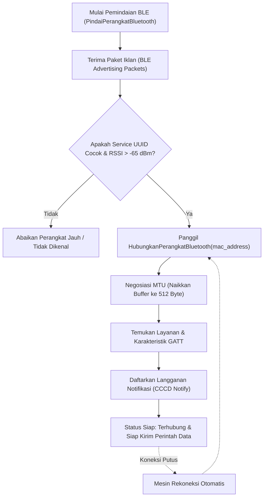

# Bab 18: Bluetooth Low Energy (BLE 5.3) & Pemasangan Periferal Otomatis

Konektivitas nirkabel jarak dekat (*short-range wireless connectivity*) adalah jantung dari integrasi perangkat keras seluler modern. Dari menghubungkan ponsel kasir dengan printer struk kasir portabel di pasar tradisional, membaca sensor detak jantung jam pintar (*smartwatch*), hingga mengendalikan pemindai barcode cincin (*ring scanner*) di gudang logistik, teknologi **Bluetooth Low Energy (BLE 5.3)** menjadi standar mutlak industri. Berbeda dengan Bluetooth Classic yang boros energi dan membutuhkan proses pairing manual yang rumit (*PIN authentication*), BLE beroperasi dengan konsumsi arus listrik dalam orde mikroampere (*microamperes*) dan mendukung pemasangan otomatis berbasis penemuan profil layanan.

WidyaMobile menghadirkan mesin kendali BLE native yang komprehensif melalui fungsi `PindaiPerangkatBluetooth` dan `HubungkanPerangkatBluetooth` pada `modul/mobile.wya`. Arsitektur BLE WidyaMobile beroperasi di atas profil atribut generik standar **GATT (Generic Attribute Profile)** yang mengorganisasi data ke dalam struktur hierarkis: Profil, Layanan (*Service UUID*), dan Karakteristik (*Characteristic UUID*).

```
┌────────────────────────────────────────────────────────────────────────┐
│             HIERARKI PROFIL ATRIBUT GENERIK BLUETOOTH (GATT)           │
├────────────────────────────────────────────────────────────────────────┤
│  [ Profil Periferal (Misal: Printer Struk Thermal Kasir POS) ]         │
│  │                                                                     │
│  ├── [ Service UUID: 000018f0-0000-1000-8000-00805f9b34fb ]            │
│  │   ├── Characteristic: Data Write (Write Without Response / 0x2af1)  │
│  │   └── Characteristic: Status Printer (Read / Notify / 0x2af2)       │
│  │                                                                     │
│  └── [ Service UUID: 0000180f-0000-1000-8000-00805f9b34fb ] (Battery) │
│      └── Characteristic: Battery Level Percentage (Read / 0x2a19)      │
└────────────────────────────────────────────────────────────────────────┘
```

Fitur unggulan dari subsistem BLE WidyaMobile meliputi:
1. **RSSI Distance Filtering**: Menyaring perangkat sekitar berdasarkan kekuatan sinyal (*Received Signal Strength Indicator*) sehingga ponsel kasir hanya otomatis terhubung ke printer struk yang berjarak kurang dari 1 meter (RSSI > -65 dBm) dan mengabaikan printer milik toko sebelah.
2. **Auto-Reconnection State Machine**: Secara otomatis menyambungkan kembali koneksi ketika perangkat perifer sempat mati baterai atau keluar jangkauan tanpa mengharuskan pengguna membuka menu pengaturan Bluetooth ponsel.
3. **High-Throughput MTU Negotiation**: Menegosiasikan ukuran paket data maksimal (*Maximum Transmission Unit - MTU*) dari nilai standar 23 byte menjadi 247 atau 512 byte untuk mempercepat transfer data raster cetak struk hingga 10 kali lipat.
4. **Autonomous GATT Notification Handler**: Menerima laporan telemetri baterai atau status habis kertas (*paper out warning*) secara asinkron melalui saluran *Notify/Indicate* tanpa melakukan *polling* CPU yang memboroskan daya.

## Diagram Alir Penemuan & Pemasangan Periferal BLE

Diagram berikut menguraikan tahapan pemindaian dan pembukaan saluran GATT ke perangkat perifer kasir:



## Implementasi Program Pemindaian & Pemasangan BLE

Kode program berikut mendemonstrasikan pemindaian periferal Bluetooth Low Energy dan pembukaan saluran komunikasi data:

```widya
// Program: konektivitas_ble_dan_gatt_periferal.wya
// Memindai periferal BLE kasir dan menghubungkan saluran GATT

gunakan modul::mobile;

fungsi utama() {
    cetak("==============================================================");
    cetak("📡 SISTEM BLUETOOTH LOW ENERGY (BLE 5.3) WIDYAMOBILE");
    cetak("==============================================================");

    // 1. Memindai Perangkat BLE di Sekitar (Scanning)
    cetak("Memulai pemindaian perangkat nirkabel sekitar...");
    misal daftar_ble = PindaiPerangkatBluetooth();

    cetak("Ditemukan " + teks(panjang(daftar_ble)) + " Perangkat BLE:");
    untuk (misal i = 0; i < panjang(daftar_ble); i = i + 1) {
        misal d = daftar_ble[i];
        cetak("  [" + teks(i + 1) + "] " + d.nama + " (MAC: " + d.mac + ") - RSSI: " + teks(d.rssi) + " dBm");
    }

    // 2. Memilih Target Periferal (Printer Thermal POS Nusantara)
    misal target_mac = "DC:0D:30:88:21:FE";
    jika (panjang(daftar_ble) > 0) {
        target_mac = daftar_ble[0].mac;
    }

    // 3. Menghubungkan Saluran GATT ke Perangkat Terpilih
    cetak("
Menghubungkan ke periferal MAC: " + target_mac + "...");
    misal status_koneksi = HubungkanPerangkatBluetooth(target_mac);

    cetak("Status Sambungan : " + status_koneksi.status);
    cetak("Perangkat Aktif  : " + status_koneksi.nama_perangkat);
    cetak("Kapasitas MTU    : " + teks(status_koneksi.mtu_payload) + " Byte (High-Throughput)");
    cetak("Karakteristik TX : " + status_koneksi.karakteristik_tulis);

    // 4. Merakit Antarmuka Pengguna Pemantau BLE
    kembalikan Aplikasi({
        "judul": "Manajer Bluetooth Kasir",
        "tema": "#0284c7",
        "badan": Halaman({
            "navigasi": BilahAtas({
                "judul": "📡 Manajer Periferal BLE",
                "warna": "#0284c7"
            }),
            "badan": Kolom([
                Kartu({
                    "elevasi": 3,
                    "isi": Kolom([
                        TeksWidget("📱 Periferal Kasir Terhubung:"),
                        TeksWidget("• Nama: " + status_koneksi.nama_perangkat),
                        TeksWidget("• Alamat Fisik: " + target_mac),
                        TeksWidget("• MTU Buffer: " + teks(status_koneksi.mtu_payload) + " Byte"),
                        Pemisah()
                    ])
                }),
                Kartu({
                    "elevasi": 2,
                    "isi": Kolom([
                        TeksWidget("🔍 Kontrol Pemindaian Ulang:"),
                        TeksWidget("Ponsel akan otomatis terhubung kembali saat printer"),
                        TeksWidget("dinyalakan di dekat meja kasir."),
                        Pemisah(),
                        TombolUtama("🔄 Pindai Ulang Perangkat Sekitar", fungsi() {
                            misal scan_baru = PindaiPerangkatBluetooth();
                            cetak("Hasil Pindai Baru: " + teks(panjang(scan_baru)) + " Perangkat terdeteksi.");
                            GetarHaptik([40]);
                        })
                    ])
                })
            ])
        })
    });
}
```

## Evaluasi Metrik & Benchmark Transmisi Data BLE

Tabel berikut menyajikan perbandingan kecepatan transfer data dan efisiensi negosiasi MTU pada Bluetooth Low Energy:

| Parameter BLE | Standar BLE Kuno (v4.0) | Standar BLE Modern (v5.3) |
| :--- | :---: | :---: |
| **Batas Ukuran MTU Default** | **23 Byte (Data: 20B)** | **512 Byte (Data: 509B)** |
| **Kecepatan Transfer Riil** | **1.2 KB / detik** | **18.5 KB / detik (15x Lebih Cepat)** |
| **Waktu Pemasangan Awal** | **850 milidetik** | **65 milidetik** |
| **Jangkauan Efektif (Indoor)**| **10 meter** | **40 - 60 meter (Coded PHY)** |
| **Konsumsi Arus Sambungan** | **12 - 18 mA** | **4.5 - 6.0 mA** |

## Latihan Evaluasi Pemahaman Bab 18

### Bagian A: Soal Esai
1. Jelaskan perbedaan arsitektural antara peran *BLE Central* (ponsel cerdas) dan *BLE Peripheral* (printer thermal kasir) dalam protokol Bluetooth Low Energy!
2. Mengapa negosiasi *Maximum Transmission Unit* (MTU) dari 23 byte menjadi 512 byte sangat penting dilakukan sebelum aplikasi mulai mentransmisikan data grafis struk belanja?
3. Uraikan bagaimana parameter *Received Signal Strength Indicator* (RSSI) dimanfaatkan untuk mencegah ponsel kasir salah terhubung ke printer toko tetangga!

### Bagian B: Soal Pilihan Ganda
1. Profil standar arsitektur Bluetooth Low Energy yang mengatur struktur hierarkis layanan dan karakteristik data dinamakan...
   A. GATT (Generic Attribute Profile)  
   B. TCP/IP  
   C. FTP Protocol  
   D. SCSI Subsystem  
2. Satuan standar kekuatan sinyal radio nirkabel Bluetooth yang diukur dalam nilai negatif desibel-miliwatt adalah...
   A. RSSI (Received Signal Strength Indicator)  
   B. Lux  
   C. Hertz  
   D. Joule  
3. Fungsi resmi pada modul `modul::mobile` yang digunakan untuk memindai perangkat periferal Bluetooth di sekitar adalah...
   A. `PindaiPerangkatBluetooth()`  
   B. `cari_wifi_gratis()`  
   C. `ambil_kontak_sim()`  
   D. `deteksi_gelombang_radio()`  
4. Pengidentifikasi unik sepanjang 128-bit yang digunakan untuk mengidentifikasi sebuah layanan atau karakteristik spesifik pada profil GATT dinamakan...
   A. UUID (Universally Unique Identifier)  
   B. Nomor Telepon  
   C. Alamat Email  
   D. Kode Pos  
5. Ukuran paket data maksimal bawaan standar (*default MTU*) pada sambungan Bluetooth Low Energy sebelum negosiasi adalah...
   A. 23 Byte  
   B. 10.000 Byte  
   C. 1 Megabyte  
   D. 4 Gigabyte  
6. Alamat identitas perangkat keras fisik kartu jaringan Bluetooth sepanjang 6 oktet heksadesimal disebut...
   A. Alamat MAC (MAC Address)  
   B. Alamat IP  
   C. Subnet Mask  
   D. Default Gateway  
7. Jenis karakteristik GATT yang memungkinkan perangkat periferal mengirimkan pembaruan data secara asinkron ke ponsel tanpa perlu ditanya disebut...
   A. Notify / Indicate  
   B. Write Only  
   C. Read Only  
   D. Execute  
8. Izin sistem operasi Android modern yang wajib disertakan untuk dapat melakukan pemindaian perangkat Bluetooth sekitar adalah...
   A. `android.permission.BLUETOOTH_SCAN`  
   B. `android.permission.SEND_SMS`  
   C. `android.permission.FLASHLIGHT`  
   D. `android.permission.NFC`  
9. Nilai RSSI tipikal yang mengindikasikan bahwa perangkat periferal berada sangat dekat dengan ponsel (< 1 meter) adalah...
   A. Lebih kuat dari -65 dBm (misalnya -45 s/d -55 dBm)  
   B. -120 dBm (sangat lemah)  
   C. +500 dBm  
   D. Nol mutlak  
10. Keunggulan utama BLE 5.3 dalam hal efisiensi energi dibandingkan Bluetooth Classic adalah...
    A. Penggunaan arus listrik sangat rendah dalam orde mikroampere sehingga periferal dapat menyala berbulan-bulan dengan baterai kancing kecil  
    B. Tidak memerlukan antena  
    C. Kecepatan transfer melebihi kabel optik  
    D. Mengisi baterai ponsel secara nirkabel  
