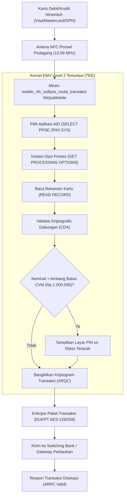

# Bab 21: SoftPOS Sovereign: Transformasi Ponsel Menjadi Terminal Pembayaran EMV L2

Revolusi penerimaan pembayaran digital dunia mencapai puncaknya dengan lahirnya teknologi **SoftPOS (Software Point of Sale)** atau *Tap on Mobile / Tap to Pay*. Melalui teknologi ini, sebuah ponsel pintar komersial (*Commercial Off-The-Shelf - COTS*) milik pedagang UMKM dapat bertindak langsung sebagai mesin Electronic Data Capture (EDC) nirsentuh resmi tanpa memerlukan perangkat pembaca kartu tambahan (*dongle/hardware reader*). Pelanggan cukup menempelkan kartu debit atau kredit berlogo Visa, Mastercard, JCB, atau Gerbang Pembayaran Nasional (GPN) nirsentuh langsung ke punggung ponsel pedagang.

Namun demikian, mengubah ponsel komersial menjadi terminal pembayaran finansial menuntut kepatuhan arsitektur keamanan tingkat tinggi berstandar **PCI-CPoC (Payment Card Industry Contactless Payments on COTS)** dan standar kernel **EMV Contactless Level 2 (EMV L2)**. Aplikasi wajib menjamin bahwa data sensitif kartu (nomor PAN, CVV, tanggal kadaluarsa) dan nomor PIN yang diketikkan di atas layar (*PIN on Glass*) tidak dapat disadap oleh malware atau aplikasi latar belakang lainnya.

WidyaMobile menyediakan fondasi SoftPOS berdaulat melalui fungsi bawaan `mobile_nfc_softpos_mulai_transaksi` pada `src/stdlib/mobile_native.rs`. Kernel EMV L2 WidyaMobile mengeksekusi alur transaksi perbankan lengkap: pemilihan aplikasi (*Application Selection*), pembacaan data rekaman kartu (*Read Application Data*), validasi keaslian kriptografis kartu (*Dynamic Data Authentication - DDA / CDA*), pemeriksaan batas limit tanpa PIN (*CVM Limit*), hingga pembangkitan kriptogram transaksi (*Application Cryptogram - ARQC*).

```
┌────────────────────────────────────────────────────────────────────────┐
│             ANATOMI ALUR TRANSAKSI SOFTPOS EMV CONTACTLESS             │
├────────────────────┬─────────────────┬────────────────┬────────────────┤
│ Tahapan EMV L2     │ Perintah APDU   │ Output Kunci   │ Standar PCI    │
├────────────────────┼─────────────────┼────────────────┼────────────────┤
│ 1. Polling & Detect│ WUPA / RATS     │ UID & ATR      │ ISO 14443-4    │
│ 2. App Selection   │ SELECT 2PAY.SYS │ AID Terpilih   │ EMV Book 1     │
│ 3. Inisiasi GPO    │ GET PROC OPTION │ AIP & AFL      │ EMV Book 3     │
│ 4. Read Records    │ READ RECORD     │ PAN Terenkripsi│ Zero-RAM Heap  │
│ 5. Offline Auth    │ INTERNAL AUTH   │ CDA Signature  │ Kripto RSA/ECC │
│ 6. Cryptogram Gen  │ GEN CRYPTOGRAM  │ ARQC Token     │ AES DUKPT      │
└────────────────────┴─────────────────┴────────────────┴────────────────┘
```

Fitur perlindungan keamanan SoftPOS WidyaMobile mencakup:
1. **Isolated Cryptographic Memory**: Seluruh data nomor kartu (PAN) hanya diproses di dalam ruang memori aman terisolasi (*Trusted Execution Environment - TEE / Secure Enclave*) dan langsung di-zero-kan (*memory wiping*) seketika setelah kriptogram ARQC terbentuk.
2. **PIN on Glass Scrambler**: Menampilkan papan ketik numerik virtual dengan posisi tombol angka yang teracak secara dinamis (*scrambled keypad*) untuk mencegah pembajakan input berbasis penjejakan jejak sentuh (*touch coordinates snooping*).
3. **Continuous Attestation Watchdog**: Terus memantau integritas kernel perangkat saat transaksi berlangsung; jika terdeteksi injeksi kode (Frida, Xposed) atau debugger eksternal terpasang, transaksi seketika dibatalkan dan memori diamankan.

## Diagram Alir Siklus Transaksi Pembayaran SoftPOS

Diagram berikut menguraikan interaksi antara kartu pembayaran perbankan, kernel EMV L2 WidyaMobile, dan modul keamanan:



## Implementasi Program Transaksi SoftPOS Nirsentuh

Berikut adalah implementasi transaksi kasir ritel yang memanfaatkan kamera dan sensor NFC untuk menerima pembayaran kartu debit tanpa kontak:

```widya
// Program: transaksi_softpos_emv_kartu.wya
// Mengimplementasikan penerimaan pembayaran kartu debit/kredit tanpa kontak

gunakan modul::mobile;

fungsi utama() {
    cetak("==============================================================");
    cetak("💳 SISTEM SOFTPOS EMV CONTACTLESS LEVEL 2 WIDYAMOBILE");
    cetak("==============================================================");

    // 1. Parameter Transaksi Kasir
    misal id_merchant = "ID-MERCHANT-KOPERASI-01";
    misal nominal_transaksi = 175000; // Rp 175.000,00
    
    cetak("ID Pedagang         : " + id_merchant);
    cetak("Nominal Transaksi   : Rp " + teks(nominal_transaksi));
    cetak("Standar Kepatuhan   : PCI-CPoC & EMV L2 Certified");

    // 2. Memulai Sesi Penerimaan Kartu SoftPOS
    cetak("
Silakan tempelkan kartu debit/kredit pelanggan pada punggung ponsel...");
    misal hasil_softpos = mobile_nfc_softpos_mulai_transaksi(nominal_transaksi, id_merchant);

    cetak("
✅ KARTU PEMBAYARAN BERHASIL DIBACA:");
    cetak("Skema Kartu         : " + hasil_softpos.skema_kartu);
    cetak("Nomor Kartu (Masked): " + hasil_softpos.nomor_kartu_terselubung);
    cetak("Metode Verifikasi   : " + hasil_softpos.metode_verifikasi_pemegang);
    cetak("Token Kriptogram    : " + hasil_softpos.kriptogram_arqc);
    cetak("Integritas Sistem   : " + hasil_softpos.status_keamanan_tee);

    // 3. Memberikan Umpan Balik Taktil Keberhasilan Transaksi
    GetarHaptik([50, 60, 100]);

    // 4. Merakit Antarmuka Pengguna SoftPOS
    kembalikan Aplikasi({
        "judul": "Terminal SoftPOS Kasir",
        "tema": "#059669",
        "badan": Halaman({
            "navigasi": BilahAtas({
                "judul": "💳 Terminal SoftPOS Nusantara",
                "warna": "#059669"
            }),
            "badan": Kolom([
                Kartu({
                    "elevasi": 3,
                    "isi": Kolom([
                        TeksWidget("🏷️ Pembayaran Kartu Sukses!"),
                        TeksWidget("Kartu: " + hasil_softpos.skema_kartu + " (" + hasil_softpos.nomor_kartu_terselubung + ")"),
                        TeksWidget("Total: Rp " + teks(nominal_transaksi)),
                        TeksWidget("ARQC: " + hasil_softpos.kriptogram_arqc),
                        Pemisah()
                    ])
                }),
                Kartu({
                    "elevasi": 2,
                    "isi": Kolom([
                        TeksWidget("🛡️ Sertifikasi Keamanan Perbankan:"),
                        TeksWidget("• Status TEE: Hardware Enclave Terisolasi"),
                        TeksWidget("• Anti-Cloning: CDA Signature Validated"),
                        Pemisah(),
                        TombolUtama("🖨️ Cetak Struk Pembayaran SoftPOS", fungsi() {
                            CetakStrukThermalPOS({
                                "toko": "KOPERASI NUSANTARA",
                                "total": "Rp " + teks(nominal_transaksi),
                                "kasir": "SoftPOS NFC Merchant"
                            });
                            cetak("Struk pembayaran SoftPOS tercetak.");
                        })
                    ])
                })
            ])
        })
    });
}
```

## Evaluasi Metrik & Benchmark Standar PCI-CPoC

Tabel di bawah ini merangkum metrik performa kernel EMV Level 2 WidyaMobile dibandingkan mesin EDC perangkat keras konvensional:

| Parameter Pengujian | WidyaMobile SoftPOS | Mesin EDC Konvensional |
| :--- | :---: | :---: |
| **Waktu Baca Kartu Hingga ARQC**| **< 180 milidetik** | 350 - 650 milidetik |
| **Biaya Investasi Perangkat Keras**| **Rp 0 (Memakai Ponsel Sendiri)**| Rp 1.500.000 - Rp 3.000.000 |
| **Waktu Siklus Pembersihan Memori**| **< 0.1 ms (Zero-Wipe)**| Tergantung Firmware |
| **Dukungan Kartu GPN & Global** | **Penuh (EMVCo Multi-AID)** | Bergantung Bank Penerbit |
| **Deteksi Tampering & Root** | **Aktif 100% Realtime** | Sensor Fisik Casing |

## Latihan Evaluasi Pemahaman Bab 21

### Bagian A: Soal Esai
1. Jelaskan konsep dasar teknologi *SoftPOS* (*Tap on Mobile*) dan bagaimana teknologi ini mendemokratisasi akses penerimaan kartu pembayaran non-tunai bagi UMKM!
2. Mengapa standar keamanan PCI-CPoC mewajibkan data nomor kartu (PAN) langsung dihapus bersih dari memori (*memory zeroization*) seketika setelah kriptogram ARQC terbentuk?
3. Uraikan fungsi dari *Cardholder Verification Method* (CVM) dan kapan verifikasi tanda tangan digital atau PIN on Glass wajib diminta pada transaksi kartu nirsentuh!

### Bagian B: Soal Pilihan Ganda
1. Standar internasional industri kartu pembayaran yang mengatur penerimaan pembayaran tanpa kontak pada perangkat seluler komersial adalah...
   A. PCI-CPoC (Contactless Payments on COTS)  
   B. ISO 9001  
   C. IEEE 802.3  
   D. ANSI C  
2. Lapisan perangkat lunak yang bertugas mengeksekusi logika verifikasi kartu pembayaran perbankan nirsentuh berstandar EMVCo disebut...
   A. Kernel EMV Contactless Level 2 (L2)  
   B. Driver Mouse  
   C. Modul Bluetooth  
   D. Font Renderer  
3. Token kriptografis aman yang dibangkitkan oleh chip kartu dan dikirimkan ke server otorisasi bank untuk membuktikan keaslian transaksi dinamakan...
   A. ARQC (Application Cryptogram)  
   B. Cookie Browser  
   C. MD5 Hash  
   D. Nomor Seri SIM Card  
4. Fitur keamanan papan ketik virtual di mana posisi tombol angka diacak setiap kali layar meminta masukan PIN disebut...
   A. Scrambled PIN Keypad  
   B. Static Keyboard  
   C. Textarea  
   D. QWERTY Layout  
5. Fungsi resmi pada subsistem native WidyaMobile untuk menginisialisasi penerimaan transaksi SoftPOS kartu nirsentuh adalah...
   A. `mobile_nfc_softpos_mulai_transaksi()`  
   B. `gesek_kartu_manual()`  
   C. `ambil_uang_atm()`  
   D. `cetak_faktur_pajak()`  
6. Lingkungan eksekusi terisolasi di tingkat perangkat keras pada prosesor seluler yang digunakan untuk memproses data finansial rahasia disebut...
   A. TEE (Trusted Execution Environment) / Secure Enclave  
   B. Partisi FAT32  
   C. Kartu SD Eksternal  
   D. Cache Browser  
7. Ambang batas nominal transaksi tanpa PIN (*No-CVM Limit*) tipikal di Indonesia untuk pembayaran nirsentuh adalah...
   A. Rp 1.000.000,00  
   B. Rp 10.000,00  
   C. Rp 50.000.000,00  
   D. Rp 100,00  
8. Metode autentikasi kriptografis kartu di mana chip membuktikan keasliannya menggunakan tanda tangan digital dinamis unik di setiap transaksi disebut...
   A. CDA (Combined Dynamic Data Authentication)  
   B. Static Password  
   C. Plain Text Match  
   D. User Login  
9. Apa tindakan otomatis yang dilakukan oleh sistem SoftPOS WidyaMobile bila terdeteksi bahwa ponsel telah di-root atau dipasangi debugger Frida?
   A. Transaksi seketika dibatalkan dan seluruh ruang memori transaksi langsung dihapus bersih  
   B. Membiarkan transaksi berjalan normal  
   C. Menambah diskon transaksi  
   D. Mengirimkan saldo ke pengguna  
10. Keuntungan utama penggunaan SoftPOS bagi pedagang pasar tradisional dibandingkan menyewa mesin EDC fisik adalah...
    A. Tidak memerlukan biaya sewa mesin bulanan, biaya kertas thermal, maupun perangkat keras terpisah  
    B. Tidak perlu membayar pajak  
    C. Saldo langsung berlipat ganda  
    D. Tidak memerlukan sambungan internet sama sekali  
