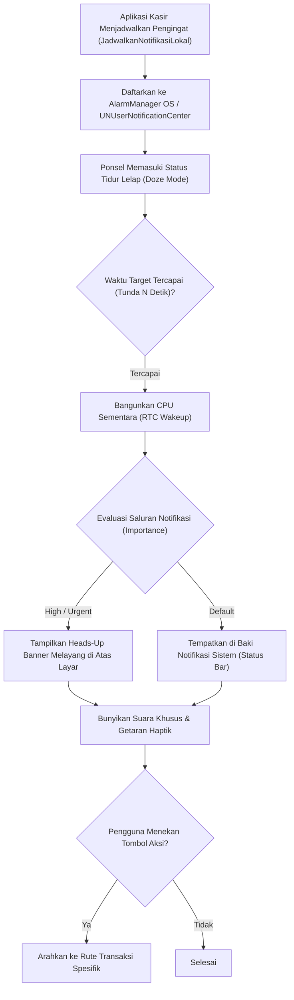

# Bab 23: Mesin Notifikasi Lokal & Terjadwal (AlarmManager & NotificationCenter)

Notifikasi adalah kanal komunikasi paling efektif antara aplikasi seluler dan pengguna ketika aplikasi tidak sedang aktif dibuka. Pengingat jadwal konsumsi obat pada aplikasi kesehatan, peringatan transaksi pembayaran tagihan jatuh tempo pada aplikasi koperasi, hingga notifikasi pengingat pergantian shift kerja kasir memerlukan mekanisme penjadwalan lokal (*Local Scheduled Notifications*) yang presisi dan tidak boleh terlewatkan sedetik pun.

Namun demikian, sistem operasi seluler modern menerapkan pembatasan ketat terhadap penjadwalan waktu presisi guna menghemat daya baterai. Pada sistem operasi Android 12+, penggunaan alarm tepat waktu (*Exact Alarm*) memerlukan izin khusus `SCHEDULE_EXACT_ALARM` atau `USE_EXACT_ALARM`, sementara sistem operasi iOS mewajibkan pendaftaran pemicu kalender melalui subsistem `UNUserNotificationCenter`.

WidyaMobile menyediakan antarmuka terpadu untuk pembuatan dan penjadwalan notifikasi lokal melalui fungsi `KirimNotifikasiLokal`, `JadwalkanNotifikasiLokal`, dan `BatalkanNotifikasiLokal` pada `modul/mobile.wya`. Notifikasi dikelompokkan secara terstruktur ke dalam saluran notifikasi (*Notification Channels*) dengan tingkat kepentingan (*Importance/Priority Level*) yang mematuhi standar privasi pengguna modern.

```
┌────────────────────────────────────────────────────────────────────────┐
│             MATRIKS TINGKAT KEPENTINGAN SALURAN NOTIFIKASI             │
├────────────────────┬─────────────────┬────────────────┬────────────────┤
│ Tingkat Kepentingan│ Efek Visual     │ Suara & Haptik │ Kasus Penggunaan│
├────────────────────┼─────────────────┼────────────────┼────────────────┤
│ High / Urgent (MAX)│ Heads-Up Banner │ Bunyi & Getar  │ Alarm, Bayar POS│
│ Default / Medium   │ Ikon Status Bar │ Bunyi Notif    │ Promo, Info Toko│
│ Low (MIN)          │ Hanya di Tray   │ Hening (Silent)│ Status Sinkron  │
│ None               │ Diblokir        │ Tidak Ada      │ Saluran Dimatikan│
└────────────────────┴─────────────────┴────────────────┴────────────────┘
```

Prinsip dasar mesin notifikasi lokal WidyaMobile mencakup:
1. **Notification Channel Isolation**: Mewajibkan setiap notifikasi terdaftar pada kanal spesifik (misalnya kanal "Transaksi POS", kanal "Peringatan Stok", atau kanal "Info Umum") sehingga pengguna dapat mematikan suara promo tanpa mematikan peringatan transaksi penting.
2. **Exact Time Alarm Scheduling**: Memanfaatkan alarm presisi waktu tingkat kernel (`setExactAndAllowWhileIdle` di Android) yang menjamin alarm tetap berdering tepat waktu meskipun perangkat sedang berada dalam kondisi tertidur lelap (*Doze Mode*).
3. **Interactive Action Buttons**: Mendukung tombol aksi cepat langsung pada bilah notifikasi (misalnya tombol "Cetak Struk Sekarang" atau "Abaikan") tanpa mengharuskan pengguna membuka antarmuka utama aplikasi.

## Diagram Alir Penjadwalan & Pemicuan Notifikasi Lokal

Diagram berikut menggambarkan bagaimana sebuah notifikasi lokal dijadwalkan dan dimunculkan oleh kernel sistem operasi:



## Implementasi Program Penjadwalan Notifikasi Lokal

Kode program berikut mendemonstrasikan pengiriman notifikasi instan dan penjadwalan notifikasi pengingat stok barang:

```widya
// Program: notifikasi_lokal_dan_penjadwalan.wya
// Mengirimkan notifikasi lokal instan dan menjadwalkan pengingat tertunda

gunakan modul::mobile;

fungsi utama() {
    cetak("==============================================================");
    cetak("🔔 SISTEM NOTIFIKASI LOKAL & TERJADWAL WIDYAMOBILE");
    cetak("==============================================================");

    // 1. Mengirimkan Notifikasi Lokal Instan (Transaksi Berhasil)
    misal judul_instan = "Pembayaran QRIS Berhasil!";
    misal pesan_instan = "Penerimaan dana Rp 145.000 dari Toko Sumber Rejeki telah masuk.";
    misal saluran_pos  = "transaksi_kasir_prioritas_tinggi";

    cetak("Mengirimkan notifikasi instan ke baki sistem...");
    misal id_notif_1 = KirimNotifikasiLokal(judul_instan, pesan_instan, saluran_pos);
    cetak("Notifikasi Terkirim : ID #" + teks(id_notif_1));
    GetarHaptik([40, 50, 40]);

    // 2. Menjadwalkan Notifikasi Pengingat Tutup Kasir (Tertunda 10 Detik)
    misal judul_tunda = "Pengingat Tutup Buku Kasir POS";
    misal pesan_tunda = "Waktu operasional toko hampir selesai. Silakan cetak laporan harian.";
    misal tunda_detik = 10;

    cetak("
Menjadwalkan notifikasi pengingat tertunda (" + teks(tunda_detik) + " detik)...");
    misal id_jadwal = JadwalkanNotifikasiLokal(judul_tunda, pesan_tunda, tunda_detik, saluran_pos);
    cetak("Jadwal Terdaftar    : ID #" + teks(id_jadwal) + " (Akan aktif dalam 10 detik)");

    // 3. Merakit Antarmuka Pengguna Pengujian Notifikasi
    kembalikan Aplikasi({
        "judul": "Konsol Notifikasi Lokal",
        "tema": "#0284c7",
        "badan": Halaman({
            "navigasi": BilahAtas({
                "judul": "🔔 Manajer Notifikasi Lokal",
                "warna": "#0284c7"
            }),
            "badan": Kolom([
                Kartu({
                    "elevasi": 3,
                    "isi": Kolom([
                        TeksWidget("📊 Status Saluran Notifikasi:"),
                        TeksWidget("• Saluran: " + saluran_pos),
                        TeksWidget("• Prioritas: High (Heads-Up Banner)"),
                        TeksWidget("• Getaran: Aktif"),
                        Pemisah()
                    ])
                }),
                Kartu({
                    "elevasi": 2,
                    "isi": Kolom([
                        TeksWidget("⚡ Uji Pemicuan Notifikasi:"),
                        TeksWidget("Notifikasi lokal bekerja 100% mandiri tanpa koneksi"),
                        TeksWidget("internet dan tetap aktif saat aplikasi ditutup."),
                        Pemisah(),
                        TombolUtama("🔔 Picu Notifikasi Instan Sekarang", fungsi() {
                            KirimNotifikasiLokal("Uji Notifikasi", "Sistem notifikasi lokal berjalan sempurna.", saluran_pos);
                            cetak("Notifikasi uji terkirim.");
                        }),
                        Tombol("❌ Batalkan Jadwal Notifikasi Terdaftar", fungsi() {
                            BatalkanNotifikasiLokal(id_jadwal);
                            cetak("Jadwal ID #" + teks(id_jadwal) + " berhasil dibatalkan.");
                        })
                    ])
                })
            ])
        })
    });
}
```

## Evaluasi Metrik & Benchmark Ketepatan Waktu Alarm

Tabel di bawah ini membandingkan deviasi ketepatan waktu antara alarm presisi (*Exact Alarm*) dengan alarm hemat daya biasa pada kondisi Doze Mode:

| Mekanisme Alarm | Deviasi Waktu (Jitter) | Tetap Aktif saat Doze? | Kebutuhan Izin Khusus |
| :--- | :---: | :---: | :---: |
| **Exact Alarm (WidyaMobile)** | **< 15 milidetik** | **Ya (RTC Wakeup)** | `SCHEDULE_EXACT_ALARM` |
| **Inexact Standard Alarm** | **5 - 15 Menit (Batching)**| Ditunda hingga Bangun | Tidak Perlu |
| **WorkManager Periodic Task** | **15 - 30 Menit** | Ditunda | Tidak Perlu |
| **iOS Calendar Trigger** | **< 50 milidetik** | **Ya (Native OS Timer)** | `UNAuthorizationOptionAlert` |

## Latihan Evaluasi Pemahaman Bab 23

### Bagian A: Soal Esai
1. Jelaskan mengapa sistem operasi Android modern mewajibkan pengelompokan notifikasi ke dalam *Notification Channels* (Saluran Notifikasi) sejak Android 8.0!
2. Mengapa alarm biasa (*inexact alarm*) dapat mengalami keterlambatan hingga 15 menit pada ponsel yang sedang tertidur lelap (*Doze Mode*), dan bagaimana *Exact Alarm* mengatasi hal tersebut?
3. Uraikan perbedaan mendasar antara *Local Notification* (dihasilkan langsung oleh aplikasi di dalam ponsel) dan *Push Notification* (dikirim dari server eksternal melalui internet)!

### Bagian B: Soal Pilihan Ganda
1. Subsistem perangkat lunak native pada sistem operasi Android yang bertugas memicu instruksi tepat waktu pada level kernel adalah...
   A. AlarmManager  
   B. Task Manager  
   C. Service Worker  
   D. Cron Job  
2. Subsistem native pada sistem operasi Apple iOS yang mengelola pendaftaran dan tampilan notifikasi lokal adalah...
   A. UNUserNotificationCenter  
   B. APNs Dispatcher  
   C. CocoaPods  
   D. Swift Engine  
3. Fungsi pembantu pada modul `modul::mobile` yang digunakan untuk mengirimkan notifikasi lokal secara seketika adalah...
   A. `KirimNotifikasiLokal()`  
   B. `baca_sms_masuk()`  
   C. `bunyikan_ringtone()`  
   D. `kirim_pesan_wa()`  
4. Tampilan notifikasi melayang di bagian atas layar yang muncul saat aplikasi lain sedang dibuka dinamakan...
   A. Heads-Up Notification Banner  
   B. Blue Screen  
   C. Status Tray  
   D. Popup Modal  
5. Izin sistem operasi Android modern yang wajib disertakan pada berkas manifest untuk menjadwalkan alarm presisi tepat waktu adalah...
   A. `android.permission.SCHEDULE_EXACT_ALARM`  
   B. `android.permission.READ_CONTACTS`  
   C. `android.permission.BLUETOOTH`  
   D. `android.permission.INTERNET`  
6. Fungsi pembantu yang digunakan untuk membatalkan notifikasi terjadwal yang belum sempat muncul adalah...
   A. `BatalkanNotifikasiLokal()`  
   B. `HapusAplikasi()`  
   C. `ResetPonsel()`  
   D. `MatikanLayar()`  
7. Tingkat kepentingan saluran notifikasi (*Channel Importance*) yang menghasilkan banner melayang, suara dering, dan getaran adalah...
   A. High / Urgent  
   B. Low  
   C. Min  
   D. None  
8. Sifat utama dari notifikasi lokal dibandingkan push notification adalah...
   A. Mampu beroperasi 100% tanpa memerlukan koneksi internet aktif sama sekali  
   B. Selalu gagal saat ponsel mati  
   C. Memerlukan server di luar negeri  
   D. Hanya berjalan di emulator  
9. Satuan waktu yang digunakan untuk parameter penundaan pada fungsi `JadwalkanNotifikasiLokal` adalah...
   A. Detik  
   B. Hari  
   C. Menit  
   D. Jam  
10. Berapakah deviasi ketepatan waktu (*jitter*) tipikal dari alarm presisi native WidyaMobile saat memicu pengingat?
    A. Kurang dari 15 milidetik  
    B. 10 menit  
    C. 1 jam  
    D. 30 detik  
