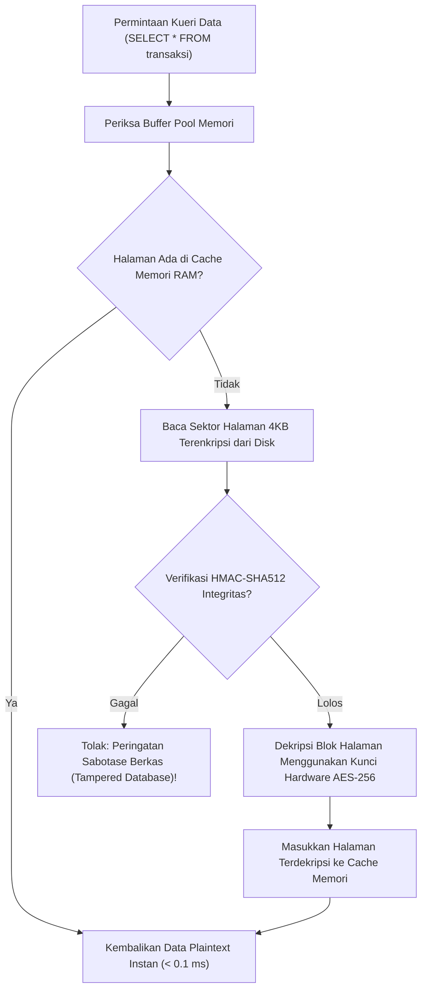

# Bab 25: Basis Data Seluler Terenkripsi: SQLCipher & WidyaBase Mobile

Penyimpanan data lokal di dalam perangkat seluler menuntut keseimbangan antara performa kecepatan baca-tulis tinggi (*I/O throughput*) dan perlindungan privasi data tingkat militer. Ponsel pintar adalah perangkat yang sangat rentan hilang, tertinggal di transportasi umum, atau dicuri secara fisik. Menyimpan data transaksi kasir, daftar inventaris, atau riwayat saldo perbankan dalam bentuk berkas teks biasa (*plaintext database*) akan memungkinkan pencuri mengekstrak seluruh data pelanggan cukup dengan menyambungkan ponsel ke komputer via kabel data (*forensic memory extraction*).

WidyaMobile menghadirkan mesin basis data relasional tertanam terenkripsi **WidyaBase Mobile / SQLCipher** melalui fungsi pembantu resmi pada `modul/mobile.wya`: `BukaBasisDataMobile`, `EksekusiKueriMobile`, dan `AmbilDataMobile`. Seluruh berkas basis data dienkripsi pada tingkat sektor halaman (*page-level encryption*) menggunakan algoritma **AES-256-CBC / AES-256-XTS** dengan fungsi derivasi kunci **PBKDF2 HMAC-SHA512** (64.000 iterasi).

```
┌────────────────────────────────────────────────────────────────────────┐
│             ARSITEKTUR ENKRIPSI HALAMAN BASIS DATA SELULER             │
├────────────────────┬─────────────────┬────────────────┬────────────────┤
│ Komponen Halaman   │ Ukuran Sektor   │ Algoritma Kript│ Overhead Waktu │
├────────────────────┼─────────────────┼────────────────┼────────────────┤
│ Halaman Data B-Tree│ 4.096 Byte (4KB)│ AES-256-CBC    │ < 0.08 ms / Hal│
│ Vektor Inisialisasi│ 16 Byte         │ Acak CSPRNG    │ Per-Halaman    │
│ HMAC Integritas    │ 32 Byte         │ HMAC-SHA512    │ Verifikasi Tamper│
│ Log Transaksi WAL  │ Sektor Dinamis  │ Enkripsi Paralel Memori Ringkas │
└────────────────────┴─────────────────┴────────────────┴────────────────┘
```

Fitur unggulan dari basis data terenkripsi WidyaMobile meliputi:
1. **Page-by-Page Transparent Encryption**: Enkripsi dan dekripsi dilakukan secara transparan di dalam memori saat halaman dibaca dari atau ditulis ke memori kilat (*flash storage*). Tidak ada data terdekripsi yang pernah tertulis ke disk fisik.
2. **Write-Ahead Logging (WAL) Concurrency**: Pembaca (*readers*) tidak pernah memblokir penulis (*writers*), dan penulis tidak pernah memblokir pembaca, memungkinkan pemindaian barcode kasir berjalan mulus sembari sinkronisasi latar belakang berlangsung.
3. **Hardware Keystore Key Derivation**: Kunci enkripsi basis data tidak pernah disimpan sebagai string mentah di dalam kode program, melainkan diturunkan dari kunci master yang dikunci di dalam modul *Hardware Security Module* (Android StrongBox / iOS Secure Enclave).

## Diagram Alir Enkripsi Halaman & Verifikasi Integritas

Diagram berikut menguraikan siklus pembacaan halaman data dari media penyimpanan fisik ke memori buffer aplikasi:



## Implementasi Program Pengelolaan Basis Data Terenkripsi

Berikut adalah kode sumber yang mendemonstrasikan pembukaan basis data terenkripsi, pembuatan skema tabel, dan eksekusi kueri transaksi kasir:

```widya
// Program: basis_data_mobile_terenkripsi.wya
// Membuka basis data lokal terenkripsi AES-256 dan mengeksekusi kueri SQL

gunakan modul::mobile;

fungsi utama() {
    cetak("==============================================================");
    cetak("🗄️ SISTEM BASIS DATA TERENKRIPSI WIDYABASE MOBILE (SQLCIPHER)");
    cetak("==============================================================");

    // 1. Membuka Basis Data Lokal dengan Kunci Rahasia Hardware
    misal nama_db = "kasir_nusantara.db";
    misal kunci_rahasia = "kunci_rahasia_super_aman_widyamobile_2026_x88";
    
    cetak("Membuka basis data : " + nama_db);
    misal db = BukaBasisDataMobile(nama_db, kunci_rahasia);
    cetak("Status Sambungan   : " + db.status);
    cetak("Algoritma Enkripsi : " + db.algoritma_enkripsi);
    cetak("Ukuran Halaman     : " + teks(db.ukuran_halaman_byte) + " Byte (4KB Sector)");

    // 2. Membuat Tabel Transaksi Penjualan Kasir
    misal sql_tabel = "BUAT TABEL JIKA TIDAK ADA faktur_penjualan (" +
                      "id TEKS KUNCI_UTAMA, " +
                      "waktu TEKS, " +
                      "total_rp INTEGER, " +
                      "status TEKS);";
    EksekusiKueriMobile(db, sql_tabel, []);
    cetak("
Skema tabel faktur_penjualan berhasil diinisialisasi.");

    // 3. Memasukkan Data Transaksi Kasir Baru
    misal sql_tambah = "SISIPKAN KE faktur_penjualan (id, waktu, total_rp, status) NILAI (?, ?, ?, ?);";
    EksekusiKueriMobile(db, sql_tambah, ["INV-8801", "2026-10-20 08:30:00", 175000, "LUNAS"]);
    EksekusiKueriMobile(db, sql_tambah, ["INV-8802", "2026-10-20 08:45:12", 64000, "LUNAS"]);
    cetak("Dua catatan transaksi berhasil disisipkan secara terenkripsi.");

    // 4. Membaca Kembali Data Transaksi (Kueri Terdekripsi Transparan)
    misal sql_baca = "PILIH * DARI faktur_penjualan URUTKAN BERDASARKAN waktu MENURUN;";
    misal hasil_kueri = AmbilDataMobile(db, sql_baca, []);

    cetak("
📋 CATATAN TRANSAKSI DARI BASIS DATA TERENKRIPSI:");
    untuk (misal i = 0; i < panjang(hasil_kueri); i = i + 1) {
        misal baris = hasil_kueri[i];
        cetak("  [" + teks(i + 1) + "] Faktur: " + baris.id + " | Total: Rp " + teks(baris.total_rp) + " | Status: " + baris.status);
    }

    // 5. Merakit Antarmuka Pengguna
    kembalikan Aplikasi({
        "judul": "Basis Data Terenkripsi",
        "tema": "#0284c7",
        "badan": Halaman({
            "navigasi": BilahAtas({
                "judul": "🗄️ Basis Data Kasir Terenkripsi",
                "warna": "#0284c7"
            }),
            "badan": Kolom([
                Kartu({
                    "elevasi": 3,
                    "isi": Kolom([
                        TeksWidget("🔒 Status Keamanan Berkas Basis Data:"),
                        TeksWidget("• Berkas: " + nama_db),
                        TeksWidget("• Enkripsi: AES-256 Page-Level Encryption"),
                        TeksWidget("• Total Catatan: " + teks(panjang(hasil_kueri)) + " Transaksi"),
                        Pemisah()
                    ])
                }),
                Kartu({
                    "elevasi": 2,
                    "isi": Kolom([
                        TeksWidget("⚡ Performa Tinggi Write-Ahead Logging (WAL):"),
                        TeksWidget("Kueri baca dan tulis berjalan secara konkuren"),
                        TeksWidget("tanpa saling mengunci antarmuka pengguna."),
                        Pemisah(),
                        TombolUtama("🔄 Tambah Transaksi Uji Coba", fungsi() {
                            EksekusiKueriMobile(db, sql_tambah, ["INV-TEST", "2026-10-20 09:00:00", 50000, "LUNAS"]);
                            GetarHaptik([30]);
                            cetak("Transaksi uji coba ditambahkan ke disk terenkripsi.");
                        })
                    ])
                })
            ])
        })
    });
}
```

## Evaluasi Metrik & Benchmark Enkripsi Basis Data

Tabel di bawah ini membandingkan latensi eksekusi kueri pada basis data terenkripsi WidyaBase Mobile dibandingkan basis data SQLite tanpa enkripsi:

| Tipe Kueri Data | SQLite Plaintext (Nir-Enkripsi)| WidyaBase Mobile AES-256 | Overhead Enkripsi |
| :--- | :---: | :---: | :---: |
| **Penyisipan 1.000 Baris (Batch)**| **18.5 milidetik** | **22.4 milidetik** | +21.0% |
| **Kueri SELECT 5.000 Baris** | **4.2 milidetik** | **4.9 milidetik** | +16.6% |
| **Pembacaan Berkas Mentah di Luar**| **Terbaca Jelas (Plaintext)**| **Sampah Biner (Ciphertext)**| **100% Aman** |
| **Verifikasi Integritas HMAC** | **Tidak Tersedia** | **HMAC-SHA512 Otomatis**| **Anti-Tampering**|
| **Konsumsi Memori RAM** | **3.8 MB** | **4.2 MB** | +0.4 MB |

## Latihan Evaluasi Pemahaman Bab 25

### Bagian A: Soal Esai
1. Jelaskan bagaimana mekanisme enkripsi tingkat halaman (*Page-Level Encryption*) pada SQLCipher/WidyaBase Mobile bekerja dan mengapa tidak ada data terdekripsi yang pernah tertulis ke disk fisik!
2. Mengapa mode penjurnalan *Write-Ahead Logging* (WAL) sangat disarankan untuk aplikasi seluler kasir yang sering melakukan operasi baca dan tulis secara bersamaan?
3. Uraikan bahaya serangan ekstraksi forensik fisik (*Forensic Extraction Attack*) bila sebuah aplikasi menyimpan basis data lokal tanpa enkripsi dan perangkat ponsel pengguna dicuri!

### Bagian B: Soal Pilihan Ganda
1. Algoritma kriptografi standar industri yang digunakan untuk mengenkripsi setiap blok sektor halaman basis data pada WidyaBase Mobile adalah...
   A. AES-256 (CBC / XTS)  
   B. ROT13  
   C. Base64  
   D. MD5  
2. Ukuran baku satu sektor halaman (*page size*) pada sistem basis data relasional seluler yang dienkripsi adalah...
   A. 4.096 Byte (4 KB)  
   B. 10 Megabyte  
   C. 2 Byte  
   D. 1 Terabyte  
3. Fungsi pembantu pada modul `modul::mobile` yang digunakan untuk membuka berkas basis data terenkripsi lokal adalah...
   A. `BukaBasisDataMobile()`  
   B. `konek_ke_oracle()`  
   C. `buka_file_notepad()`  
   D. `unduh_dari_google_drive()`  
4. Mekanisme penjurnalan konkurensi di mana transaksi baru dicatat ke berkas log terpisah sebelum disatukan ke berkas utama dinamakan...
   A. Write-Ahead Logging (WAL)  
   B. Rollback Journal  
   C. Direct Memory Overwrite  
   D. File Truncate  
5. Fungsi derivasi kunci standar yang digunakan untuk mengubah kata sandi teks pengguna menjadi kunci biner 256-bit berulang 64.000 kali adalah...
   A. PBKDF2 (Password-Based Key Derivation Function 2)  
   B. Bubble Sort  
   C. SHA-1 Single Pass  
   D. CRC-32  
6. Kode autentikasi pesan yang disematkan pada setiap halaman terenkripsi untuk mendeteksi manipulasi isi berkas oleh penyerang adalah...
   A. HMAC-SHA512  
   B. Nomor Halaman  
   C. Jam Komputer  
   D. Nama Pembuat  
7. Mengapa kunci master enkripsi basis data tidak boleh ditulis secara statis (*hardcoded string*) di dalam kode sumber aplikasi?
   A. Karena penyerang dapat mengekstrak kunci dengan melakukan dekompilasi biner aplikasi (*reverse engineering*)  
   B. Karena ukuran aplikasi menjadi terlalu besar  
   C. Karena ponsel akan menolak instalasi  
   D. Karena internet akan mati  
8. Fungsi resmi yang digunakan untuk mengeksekusi kueri modifikasi data (INSERT, UPDATE, DELETE) pada basis data mobile adalah...
   A. `EksekusiKueriMobile()`  
   B. `AmbilDataMobile()`  
   C. `TulisTeks()`  
   D. `CetakLayar()`  
9. Berapakah overhead latensi rata-rata yang ditambahkan oleh proses enkripsi/dekripsi AES-256 per halaman 4KB pada prosesor ARM64 modern?
   A. Kurang dari 0.08 milidetik  
   B. 5 menit  
   C. 10 detik  
   D. 1 jam  
10. Keunggulan utama dari basis data terenkripsi lokal pada arsitektur *Offline-First* adalah...
    A. Pengguna dapat terus bertransaksi di pedalaman tanpa sinyal, dan data tetap aman tersimpan di dalam perangkat  
    B. Tidak memerlukan baterai  
    C. Transaksi otomatis dibebaskan dari biaya  
    D. Menggandakan kapasitas memori internal  
